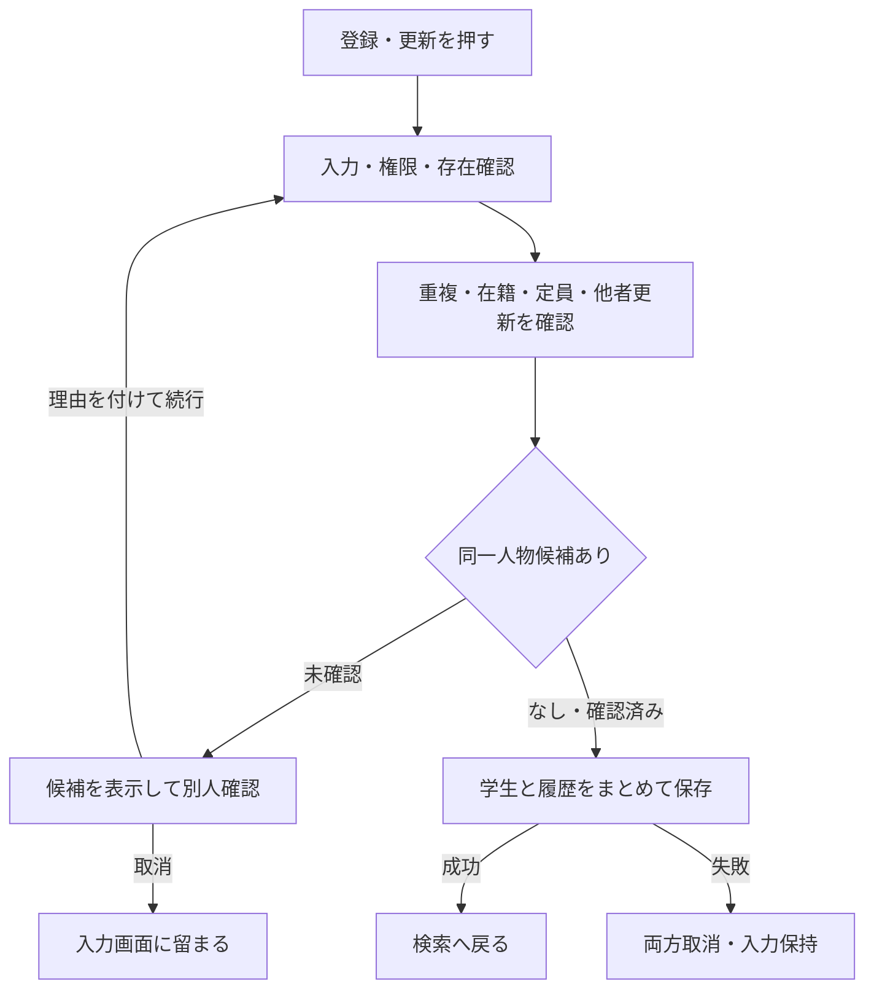

# 学生登録画面 基本設計書

## 表紙

| 項目 | 内容 |
| --- | --- |
| システム名 | 学生管理システム |
| 画面番号 | SCR-STU-002 |
| 版数・作成日 | 2.0／2026-10-10 |
| 対象読者 | 顧客・業務担当者 |
| 状態 | 新規設計案 |
| 対応する詳細仕様 | [学生登録画面](../詳細仕様書/03_学生登録画面.md) |

## 概要

学生の氏名、住所、連絡先、生年月日、在籍状態、現在／最終所属クラスを管理する。新規登録・編集・参照は同じ画面を使用する。元版の追加提案である管理者向け論理削除を引き継ぐ。成績は管理しない。

| 情報 | 内容 |
| --- | --- |
| 呼出元・復帰先 | 学生検索画面 |
| 保存単位 | 学生1人とその操作履歴をまとめて保存 |
| 参照情報 | クラスマスタ、コード種別マスタ、コード管理マスタ |
| 通常の削除 | 学生情報を物理的に消さず通常検索・参照から除外する |
| 対象外 | 学籍番号訂正、削除復元、物理消去、所属履歴一覧、将来の異動予約 |

## 画面設計

### 標準画面（静的HTML）

以下は編集時の架空例。新規時は学籍番号を入力でき、学生管理番号は「登録時に採番」とする。必須印は「※」。

<table>
<caption>学生管理システム ／ 学生登録・編集</caption>
<tr><th colspan="4">学生登録</th><td colspan="2">モード：編集</td></tr>
<tr><td colspan="6"><strong>メッセージ領域</strong>　※は必須です。変更内容を確認して「更新」を押してください。</td></tr>
<tr><th colspan="6">基本情報</th></tr>
<tr><th>学生管理番号</th><td colspan="2">1001（表示のみ）</td><th>学籍番号 ※</th><td colspan="2">S2026-0001（変更不可）</td></tr>
<tr><th>氏名 ※</th><td colspan="5">［見本 太郎　　　　　　　　　　　　　　　　　］</td></tr>
<tr><th>氏名カナ ※</th><td colspan="5">［ミホン タロウ　　　　　　　　　　　　　　　］</td></tr>
<tr><th>生年月日 ※</th><td colspan="2">［2008-05-15］</td><th>性別</th><td colspan="2">［未回答 ▼］</td></tr>
<tr><th colspan="6">住所・連絡先</th></tr>
<tr><th>郵便番号 ※</th><td colspan="2">［100-0000］</td><th>都道府県 ※</th><td colspan="2">［東京都 ▼］</td></tr>
<tr><th>住所1 ※</th><td colspan="5">［見本市見本町1-1　　　　　　　　　　　　　　］</td></tr>
<tr><th>住所2</th><td colspan="5">［見本ビル101　　　　　　　　　　　　　　　　 ］</td></tr>
<tr><th>本人電話</th><td colspan="2">［　　　　　　　　　］</td><th>本人メール</th><td colspan="2">［student@example.invalid］</td></tr>
<tr><td colspan="6">本人電話・本人メール・緊急連絡先電話のいずれかは必要です。</td></tr>
<tr><th colspan="6">在籍・所属</th></tr>
<tr><th>入学日 ※</th><td colspan="2">［2026-04-01］</td><th>在籍区分 ※</th><td colspan="2">［在学 ▼］</td></tr>
<tr><th>卒業・退学日</th><td colspan="5">［未入力・在学中は入力不可］　卒業・退学の場合は必須</td></tr>
<tr><th>年度</th><td colspan="2">［2026 ▼］</td><th>学年</th><td colspan="2">［学年なし ▼］</td></tr>
<tr><th>クラス ※</th><td colspan="5">［C-A Aクラス ▼］　所属人数 32人／定員40人（参考）</td></tr>
<tr><th colspan="6">緊急連絡先</th></tr>
<tr><th>氏名</th><td colspan="2">［　　　　　　　　　］</td><th>続柄</th><td colspan="2">［未選択 ▼］</td></tr>
<tr><th>電話番号</th><td colspan="5">［　　　　　　　　　］　一つでも入力したら3項目すべて必要</td></tr>
<tr><th>備考</th><td colspan="5">［　　　　　　　　　　　　　　　　　　　　　　　　　　　］ ［　　　　　　　　　　　　　　　　　　　　　　　　　　　］</td></tr>
<tr><th>確認・変更理由</th><td colspan="5">［　　　　　　　　　　　　　　　　　　　　　　　　　　　］ 重複候補を別人として登録する場合、卒業・退学から区分を訂正する場合に必要</td></tr>
<tr><th>更新情報</th><td colspan="5">2026/10/10 09:00:00 ／ 更新者：担当者番号</td></tr>
<tr><td colspan="6"><strong>［更新］</strong>　［編集取消］　［最新情報を再読込］　［検索へ戻る］　［論理削除：管理者のみ］</td></tr>
</table>

### 重複候補の確認（静的HTML）

<table>
<caption>同一人物候補の確認</caption>
<tr><td colspan="4"><strong>同じ生年月日で氏名または氏名カナが一致する学生が1件あります。</strong> 既存学生を誤って再登録していないか確認してください。</td></tr>
<tr><th>学籍番号</th><th>氏名</th><th>生年月日</th><th>クラス</th></tr>
<tr><td>S2025-0010</td><td>見本 太郎</td><td>2008/05/15</td><td>2025年度 Aクラス</td></tr>
<tr><th>確認理由 ※</th><td colspan="3">［　　　　　　　　　　　　　　　　　　　　　］</td></tr>
<tr><td colspan="4">［取消：初期選択］　<strong>［別人と確認して続行］</strong></td></tr>
</table>

候補は最大20件を表示し、全候補件数も表示する。候補の住所・電話・メールは表示しない。警告は同一人物と断定するものではなく、正当に異なる学生を排除しない。

### 削除確認（静的HTML）

<table>
<caption>学生の論理削除</caption>
<tr><td colspan="2">学籍番号 S2026-0001 ／ 見本 太郎 削除後は通常検索・参照ができません。入力途中の変更は保存されません。</td></tr>
<tr><th>削除理由 ※</th><td>［　　　　　　　　　　　　　　　　　　　］</td></tr>
<tr><td colspan="2">［取消：初期選択］　<strong>［論理削除を実行］</strong></td></tr>
</table>

## 項目一覧

| 番号 | グループ | 項目名 | 必須・初期値 | 形式・桁 | 保存先・説明 |
| --- | --- | --- | --- | --- | --- |
| 1 | 基本 | 学生管理番号 | 自動 | 正の整数 | 学生基本情報。内部識別用、変更不可 |
| 2 | 基本 | 学籍番号 | 必須・空 | 20文字 | 英数字・ハイフン、先頭英数字。登録後変更不可 |
| 3 | 基本 | 氏名 | 必須・空 | 100文字 | 表記を保持。前後空白を除く |
| 4 | 基本 | 氏名カナ | 必須・空 | 入力200、変換後100文字 | 全角カナに整える。中点・長音・空白可 |
| 5 | 基本 | 生年月日 | 必須・空 | 年月日 | 実在日、入学日以前 |
| 6 | 基本 | 性別 | 未回答 | 選択 | 未回答を選べる。回答の強制なし |
| 7 | 住所 | 郵便番号 | 必須・空 | 入力10文字、保存7桁 | 表示は3桁－4桁 |
| 8 | 住所 | 都道府県 | 必須・未選択 | 選択 | 国内47都道府県 |
| 9 | 住所 | 住所1 | 必須・空 | 200文字 | 市区町村・町域・番地 |
| 10 | 住所 | 住所2 | 任意・空 | 200文字 | 建物名・部屋番号 |
| 11 | 連絡先 | 本人電話 | 条件付き・空 | 入力32、保存16文字 | 国内10・11桁、または国番号付き |
| 12 | 連絡先 | 本人メール | 条件付き・空 | 254文字 | 共通形式に従う。共有アドレス可 |
| 13 | 在籍 | 入学日 | 必須・空 | 年月日 | 生年月日以上、本日以前 |
| 14 | 在籍 | 在籍区分 | 必須・在学 | 選択 | 在学・休学・卒業・退学 |
| 15 | 在籍 | 卒業・退学日 | 卒業・退学時必須 | 年月日 | 入学日以上、本日以前。在学・休学は空 |
| 16 | 所属補助 | 年度 | 新規は当年度 | 4桁 | クラス絞込み用。学生へ重複保存しない |
| 17 | 所属補助 | 学年 | 新規はすべて | 選択 | クラス絞込み用。成績ではない |
| 18 | 所属 | クラス | 在学・休学は必須 | 選択 | 現在／最終所属は最大1件 |
| 19 | 所属 | 所属人数・定員 | 参考表示 | 整数 | 保存時に再確認。空き枠の予約ではない |
| 20 | 緊急 | 氏名 | 一式入力時必須 | 100文字 | 学生基本情報 |
| 21 | 緊急 | 続柄 | 一式入力時必須 | 選択 | 続柄コードの名称を表示 |
| 22 | 緊急 | 電話番号 | 一式入力時必須 | 入力32、保存16文字 | 本人電話と同じ形式 |
| 23 | その他 | 備考 | 任意・空 | 1000文字 | 改行可。成績管理には使わない |
| 24 | 確認 | 確認・変更理由 | 警告続行・終了区分訂正時必須 | 200文字 | 操作履歴。学生備考とは別 |
| 25 | 更新情報 | 更新日時・更新者 | 自動表示 | 日本時間・利用者番号 | 手入力・書換え不可 |
| 26 | 削除確認 | 削除理由 | 削除時必須 | 200文字 | 学生基本情報と操作履歴 |

## イベント仕様

### 画面表示

新規は担当者・管理者だけが使用できる。性別を未回答、在籍区分を在学、年度を当年度、他の入力項目を空にする。入学日を当日に自動設定しない。編集・参照は対象学生の最新情報を取得する。対象が存在しない場合または削除済みの場合は終了し、空の新規画面へ勝手に切り替えない。

閲覧者はすべて表示のみ。編集でも学籍番号・学生管理番号・更新情報は変更不可。既存のコードやクラスが停止・期間外でも元の値を表示し、無断で別値に変更しない。マスタ設定が不足する場合は保存を止める。

### 入力補助

在籍区分を卒業・退学にすると卒業・退学日を必須とし、クラスは任意の最終所属になる。在学・休学へ変更すると終了日を空にし、クラスを必須にする。確認・変更理由は終了区分からの訂正時に必須となる。年度・学年の変更で選択クラスが不適合になる場合は解除して案内する。画面で人数を表示しても保存時点で満員になる可能性がある。

### 新規登録・更新

1. 利用権限と画面からの要求の妥当性を確認する。
2. 入力値を整え、必須、文字数、形式、日付、連絡先一式を確認する。
3. 学籍番号の使用済み確認、コード・クラスの存在と選択可否を確認する。更新時は他者の更新がないことと学籍番号の不変を確認する。
4. クラス定員・在籍期間・状態変更権限を保存直前に再確認する。
5. 同じ生年月日で氏名または氏名カナが一致する別の学生がいれば警告する。別人であると確認し理由を入力した場合だけ続行する。確認中は保存処理を保留状態で占有しない。
6. 学生1件と操作履歴1件をまとめて保存する。どちらか失敗した場合はどちらも保存しない。
7. 保存を確認できた場合だけ成功を表示し、学生検索画面へ戻る。変更がない更新は、更新日時・履歴を増やさず「変更内容がありません」とする。

### 主要な業務チェック

| チェック | 判定 | 結果 |
| --- | --- | --- |
| 学籍番号重複 | 削除済みを含む全学生で使用済み | 保存不可。番号の再利用も不可 |
| 同一人物候補 | 非削除の他学生と生年月日が同じ、氏名またはカナの照合値が同じ | 別人確認・理由付きなら保存可 |
| コード存在 | 正しい分類内に値がある | 不存在は保存不可 |
| コード利用可否 | 新規・変更する値が有効・期間内 | 不可値は保存不可。既存の同値保持は可 |
| クラス存在 | 選択クラスが実在し年度・学年が一致 | 不存在・不一致は保存不可 |
| 日付 | 生年月日≦入学日≦本日、終了日も本日以前 | 不整合は保存不可 |
| 連絡手段 | 本人電話・メール・緊急電話の1つ以上 | 不足は保存不可 |
| 緊急連絡先 | 氏名・続柄・電話を全部空または全部入力 | 一部だけは保存不可 |
| 他者の更新 | 画面読込後に別操作が更新済み | 上書きせずエラー。入力を保持 |
| 理由 | 必要な操作で空白でない200文字以内 | 不足は保存不可 |

### クラス選択・定員の決定表

| 保存後の状態・変更 | クラス要否・利用規則 | 定員 |
| --- | --- | --- |
| 新規の在学・休学、別クラスへの異動、卒業等から在学へ訂正 | 必須。利用可かつ本日が利用期間内 | 自分を除いた在学・休学人数＋1が定員以下 |
| 在学・休学のまま同じクラスを保持 | 存在必須。期間外等でも住所などの変更は可、見直し警告 | 席が増えないため既存の超過だけでは拒否しない |
| 新規の卒業・退学 | 任意。指定するならクラス利用期間と入学～終了日の期間が重なる | 席を消費しない |
| 卒業・退学の最終所属・在籍日付・区分を変更 | 停止・過去クラスも可。指定した期間の重なりを確認 | 席を消費しない |
| 卒業・退学の最終所属・在籍日付・区分を変えず住所等だけ変更 | 既存値を保持できる | 席を消費しない |
| 論理削除 | 元のクラス情報を保持 | 削除後は人数に含めない |

休学も1席を使用する。定員未設定は制限なし。定員40人に対し39人在籍で同時に2人を登録した場合は片方だけ保存でき、超過させない。期間の重なりは1日以上あればよく、卒業日がクラス利用期間内に入ることまでは必須にしない。

### 在籍区分の状態遷移

| 変更前 | 変更後 | 実行者・条件 |
| --- | --- | --- |
| 在学・休学 | 在学・休学・卒業・退学 | 担当者または管理者。変更後の日付・クラス規則を満たす |
| 卒業・退学 | 同一区分 | 担当者または管理者。通常項目の訂正可 |
| 卒業・退学 | 別区分 | 管理者のみ。確認・変更理由が必須 |
| 新規 | 任意の4区分 | 担当者または管理者。過去データ登録を認める |

在籍区分は日付到来だけで自動変更しない。再入学や年度別履歴は本版に含まない。

### 論理削除

管理者が保存済み学生に対して理由を入力し確認した場合だけ実行する。学生の存在と他者更新の有無を確認し、通常参照から除外する印・削除日時・削除者・理由を記録する。入力途中の氏名・住所等は保存しない。削除履歴とまとめて保存し、成功後に検索画面へ戻る。論理削除は卒業・退学への変更とは異なる。

### 取消・再読込・検索へ戻る

新規の入力クリアは初期値、編集取消は最後に正常読込した値へ戻す。編集取消は最新情報の取得ではない。再読込は明示確認後に最新情報を取得する。戻る際に未保存変更があれば破棄確認を行い、既定は取消。通信が切れて保存結果が不明な場合は、直ちに再登録せず検索で状態を確認する。

## 補足説明

同じ電話・メールを家族で共有しても登録可能とし、連絡先の重複だけでは拒否しない。学籍番号や氏名の検索・比較に使う文字変換は共通仕様に従う。個人情報の保存期間、削除復元、物理消去は運用要件の確認事項であり、論理削除を永久保存の承認とは扱わない。

関連：[論理テーブル](03_テーブル仕様書.md)／[コード](04_コード設計書.md)／[共通チェック](../共通/05_チェック・メッセージ設計.md)
