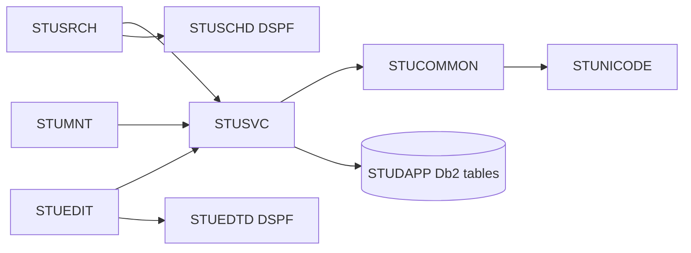

# AS400 / RPG 言語依存仕様書

版5.0／2026-10-10。IBM i 7.5／ILE RPG全自由形式／SQLRPGLE／Db2 for i。[検索詳細](01_学生検索画面.md)／[登録詳細](02_学生登録画面.md)。資料は[共通06](../../共通/06_要件対応・設計判断.md) S-10・11。

## 1. オブジェクト・プログラム構造

| 区分 | 物理オブジェクト・ソース | 責務 |
| --- | --- | --- |
| プログラム | STUDPGM/STUSRCH、STUEDIT | 検索・登録の画面イベント |
| 表示ファイル | STUDPGM/STUSCHD、STUEDTD | DDS条件・一覧・入力・確認・補助編集 |
| サービスプログラム | STUDPGM/STUSVC | StSearchStudents、StLoadStudent、StSaveStudent、StDeleteStudent、StMaintainClass、StMaintainCode |
| 共通サービス | STUDPGM/STUCOMMON | StAuthorize、StClock、StNormalize、StValidate、StMessage、StConfirm |
| Unicode補助 | STUDPGM/STUNICODE | CCSID変換、Unicode正規化、scalar数、エスケープ編集。別途実装するILE C補助とのバインド契約 |
| 管理者処理 | STUDPGM/STUMNT | IFS承認データの保守投入 |
| SQL表 | STUDAPP | 業務5表＋制御表 |
| COPY | STUTYPES、STUPROTO | Qualified DS、プロトタイプ、結果定数 |
| バインド | STUBND | サービスプログラムの公開手続きとシグネチャー |

共通01～03はStAuthorize/StClock、04～05はStNormalize/StValidate、06～10はStLookupCodes/StLookupClasses/StCheckRules/StCheckCapacity/StFindDuplicates、11はStConfirm、12はSearchContext DS、13はStBeginWork/StEndWork、14はStAppendAudit、15はStMessage。



クラス図ではなく呼出構造図とする。画面側からUPDATE命令を直接発行せず、保存単位をStSaveStudent等へ集約する。

## 2. RPG型・データ構造

| 意味 | RPG型・表現 |
| --- | --- |
| ID・版 | int(20)の符号付き64bit。DDS非表示転送は19桁文字から検査して変換 |
| 人数・ページ | int(10)、定員NULL標識を別保持 |
| NULL標識 | int(5)、-1=NULL／0=値あり。SQLホスト変数へ併記 |
| 日付 | date、内部ISO日付char(10)と変換。生年月日の画面入力は和暦の分割項目 |
| 時点 | timestamp、UTCとして運用し表示時に日本時間へ変換 |
| 業務Unicode文字N | vargraphic(2*N) CCSID1200相当のUTF-16領域。scalar数Nを別検査 |
| ASCIIコード | varchar(N)、数字・大文字英字等を検証 |
| SQL真偽 | smallint 0/1、RPG側はindへ明示変換 |

`StudentWork`はqualified DS。物理列snake_caseをcamelCaseへ対応付けたサブフィールドを持つ。SQL NULL可の各項目について同名＋Indのint(5)を持ち、空文字・0・最小日付をNULLの代替にしない。API署名はStSaveStudent(work const、hints const、expectedVersion、confirmation const、result)とし、resultはResultKind、MessageId、FieldErrors、StudentId、RowVersionを持つ。

## 3. Db2 for i：物理全89列

DBスキーマSTUDAPP、SQL名は下記、システム名は順にM_STUDENT、M_CLASS、MCAT、M_CODE、T_OPLOGとする。長いSQL表名は作成時にFOR SYSTEM NAMEを明示。RPGのDB入出力は明示SQLホスト変数で行い、自動生成の短いフィールド名に依存しない。

記号ID＝BIGINT GENERATED ALWAYS AS IDENTITY、L＝BIGINT、I＝INTEGER、S＝SMALLINT、D＝DATE、T＝TIMESTAMP(6)、Vn＝ASCII用途VARCHAR(n)、Un＝業務Unicode N scalarを収めるVARGRAPHIC(2*N) CCSID1200。?はNULL可、他はNOT NULL。A＝created_at T、created_by V64、updated_at T、updated_by V64、row_version L DEFAULT 1。

| 表・列数 | 全列 |
| --- | --- |
| m_student・35 | student_id ID; student_no V20; student_name U100; student_name_kana U100; name_key U2000; kana_key U100; birth_date D; gender_category V30; gender_code V1; postal_code V7; prefecture_category V30; prefecture_code V2; address_line1 U200; address_line2 U200?; phone_number V16?; email_address V254?; admission_date D; enrollment_category V30; enrollment_status_code V2; enrollment_end_date D?; class_id L?; emergency_contact_name U100?; relationship_category V30; relationship_code V2?; emergency_phone_number V16?; remarks U1000?; is_deleted S DEFAULT 0; deleted_at T?; deleted_by V64?; delete_reason U200?; A |
| m_class・17 | class_id ID; school_year S; grade_category V30; grade_code V2; class_code V10; class_name U50; valid_from D; valid_to D; capacity I?; display_order I DEFAULT 0; is_active S DEFAULT 1; remarks U500?; A |
| m_code_category・11 | category_id V30; category_name U50; code_length S; allow_add S; is_active S DEFAULT 1; remarks U500?; A |
| m_code・14 | category_id V30; code_value V10; code_name U100; display_order I DEFAULT 0; is_active S DEFAULT 1; valid_from D; valid_to D?; is_protected S; remarks U500?; A |
| t_operation_log・12 | log_id ID; target_table V30; target_key V200; operation_type V10; before_version L?; after_version L; changed_columns CLOB(16K) CCSID1208; executed_by V64; executed_at T; correlation_id CHAR(36); operation_reason U200?; duplicate_confirmed S DEFAULT 0 |

Unは物理2N UTF-16コード単位の領域であり、業務上限を2N文字へ増やす意味ではない。STUNICODEでscalar上限Nを検証する。changed_columnsは物理列名だけのJSON配列、生成器で妥当性を検査する。UTC時点はTZなしTIMESTAMPへUTC変換済みで保存する。

PK＝各ID、category_id、(category_id,code_value)。UQ＝student_no全行、クラス(school_year,class_code)。FK＝学生クラス、学生4分類組→コード、クラス学年組→コード、コード→種別、RESTRICT。コード固定分類CHECKとすべての真偽0/1 CHECKを設ける。版正数、日付順、状態01/02の終了日NULLとクラス必須、03/04の終了日必須、連絡先1つ・緊急一式、削除属性一式、年度1900～9998と年度内期間、定員NULLまたは1～9999、コード期間順を保護する。現在日・有効性・分類桁・集計は保存処理で再検証。

索引はbirth_date、(is_deleted,class_id,enrollment_status_code)、admission_date、updated_at、本人／緊急電話、履歴(target_table,target_key,executed_at)。name_key U2000を無条件の通常索引にしない。ソート照合は配備時に*HEXで固定し環境変更を試験する。異なるDB製品との全Unicode文字の完全同順を暗黙に保証しない。

## 4. SQL・コミットメント制御

評価版は補助表`STUDAPP.T_WRITE_GUARD`（システム名STGUARD）を追加：guard_id SMALLINT PRIMARY KEY CHECK(guard_id=1)、lock_bit SMALLINT NOT NULL CHECK IN(0,1)。初期1行(1,0)。業務表ではない。検索の件数・一覧と全書込みが同じ行を更新して短時間保護し、整合する結果を得る。MVCCのスナップショットを仮定しない。

```sql
UPDATE STUDAPP.T_WRITE_GUARD
   SET LOCK_BIT=1-LOCK_BIT WHERE GUARD_ID=1;
SELECT STUDENT_ID,ROW_VERSION FROM STUDAPP.M_STUDENT
 WHERE STUDENT_ID=:studentId AND IS_DELETED=0;
SELECT COUNT(*) INTO :occupancy FROM STUDAPP.M_STUDENT
 WHERE CLASS_ID=:classId AND IS_DELETED=0
   AND ENROLLMENT_STATUS_CODE IN ('01','02')
   AND STUDENT_ID<>:excludeStudentId;
```

新規のexcludeStudentIdは0（自動IDは正数）を用いる。対象読込・マスタ存在・版・定員・全候補検査はゲート取得後。更新は固定列割当と`WHERE STUDENT_ID=:id AND ROW_VERSION=:expectedVersion AND IS_DELETED=0`、ROW_VERSION=ROW_VERSION+1。GET DIAGNOSTICSのROW_COUNTで1件を確認。新規IDはINSERT直後、同じ接続でIDENTITY_VAL_LOCALを取得し、監査INSERTを先行させない。

INSERTは19業務入力＋2照合値＋固定分類＋作成更新＋版1、UPDATEは学籍番号以外18入力＋照合値2＋更新情報、削除は削除4属性と更新情報・版だけ。履歴は同じコミットメント定義内で追記。成功COMMIT、入力・版・確認待ち・例外はROLLBACK。検索は結果をメモリーへコピー後ROLLBACKしてゲート変更を取り消す。全DML対象とゲートがジャーナル対象でなければ起動検査で停止する。[S-11]

SQLRPGLEはCOMMIT(*CS)、同じ名前付きactivation groupを採用、コミットメント定義を共用。Tx中にEXFMT、入力待ち、外部対話をしない。ジョブ終了・MONITOR例外でもRollback経路を通す。DBロック待ち上限は配備設定で有限にし、待ち時間超過時はE-COM-004と再確認。検索も書込みもゲートで直列化するため性能は実機測定が必要。

検索SQLは最大10001件のキーを取得して上限判定。同じ条件とゲート保護下で20/50/100件をOFFSET/FETCHまたはROW_NUMBERで取得。動的値はPREPARE/OPEN USINGでバインド。LIKE ESCAPE '!'のリテラル処理、状態OR、電話OR、日付両端、未所属NULLを維持。名称は分類＋値のLEFT JOINで有効性を条件にしない。ソートは許可4項目＋学生IDだけ。

## 5. DDS・状態・認証

DSPFはDSPSIZ(27 132)、COND/SFLCTL/SFLROW/EDBASE/EDENROLL/EDNOTE/CNFRM/LONGTXTのレコード構成。サブファイルはSFLPAG(10)、SFLSIZ(101)、SFLDSP/SFLDSPCTL/SFLCLRを状態で制御。RRNとstudentIdの対応をresultRowsに持つ。実際のDDS源にはDBCS表示桁とソースCCSIDを反映し、モックの日本語文字幅をそのままDDS列数にしない。[S-10]

検索DSと確認DSはジョブ・利用者・画面識別別。確認DSには対象・版・正規化全入力・全候補ID/版のダイジェスト・10分期限。複数候補はストリーミングで全集合ハッシュを計算し、20件表示で判定を打ち切らない。確認中にゲートを解放し、再確定で候補を再集計。共有のグローバル確認済フラグを設けない。

認証はIBM iの実行ユーザープロファイルと承認済み認可設定から取得。画面のUSERLABELを権限の根拠にしない。業務データファイルの直接変更権限を制限し、許可プログラム経由にする。権限採用を使用する場合は所有者プロファイルを最小権限とし、任意のSQL・IFSパス・コマンドを渡せない設計を必須とする。

## 6. ビルド・配備・エラー

DDSをCRTDSPF、SQLRPGLEをCRTSQLRPGI／モジュール→サービスプログラムとしてビルドし、COPYとバインダーシグネチャーを固定する。STUDAPP/STUDPGMのライブラリーリスト、実行activation group、SQL命名・日付形式・照合順・CCSIDを配置資料で固定。ジャーナルレシーバー・ジャーナル作成、全5表＋制御表へのジャーナル開始を検証してからコミットメント制御を開始する。

SQLSTATE23505は番号／マスタ重複、23503は参照、02000は呼出目的に応じ行なし、ROW_COUNT=0は版または不在、40xxx・ロック待ちは再確認、その他は受付番号付き共通エラー。SQLCOD<0で後続更新を続けない。

STUNICODEは製品標準で存在するという仮定ではなく、実装が必要な補助サービス。変換不能文字の保持・Unicodeエスケープ補助・全長編集・C ABIを稼働条件として試験する。実機未検証のためコンパイル済み・文字往復確認済みとは記載しない。


## 共通規約・日付実装

対象読者は実務経験５年程度のプログラマー。[検索詳細](01_学生検索画面.md)／[登録詳細](02_学生登録画面.md)／[開発規約](../../../docs/開発規約.md)／[日付正本](../../共通/07_日付・和暦仕様.md)。

共通16の入力は元号識別値・年・月・日という原文字列4値と業務日。出力は正規化日付と和暦表示文字列、または項目エラー。共通17は項目種別と日付／年度にDATE-R01～06を適用する。変換で不正日を補正しない。OS全体の暦設定を変更しない。元号表の版を画面・保存側で一致させる。

| 役割 | 実装仕様 |
| --- | --- |
| 共通16物理名 | StParseBirthDate / StFormatBirthDate、DDS EBERA・EBYEAR・EBMONTH・EBDAY |
| 内部日付型 | date、SQL NULLは別標識 |
| 入力と保存 | 和暦原入力4値から日付を生成。StudentDraft等のbirth_date相当は正規化日付。元号をDBへ重複保存しない |
| 呼出境界 | 本方式はネイティブ画面。和暦原入力4値を業務処理へ渡し厳密変換する。取得時は内部日付を和暦表示に変換。Web JSON契約は本方式に適用しない |
| 表示 | 一覧・参照・重複確認のBirthDateWareki相当文字列は共通16で生成。その他の日付・日時は西暦 |
| 例外 | CHK-032～034、E-DATE-001～003。構文検査後、実在日、元号境界、逆変換、業務範囲、前後関係を順に検査 |
| 参考試験 | DATE-T01～20。ライブラリーの解析成功だけで元号境界を合格にしない |

### 保守入口・方式固有の適合条件

#### Unicode補助・保守・試験

5250表示で変換できない文字は`[U+20BB7]`等で注意を表示し、元Unicode値をDSに保持する。変更していない項目を画面バッファから全上書きしない。変換不能値の編集はF8の明示的Unicode入力モードで`\u{20BB7}`等のエスケープを受け、逆変換・文字数検査して保存。通常入力モードではエスケープを勝手に解釈しない。バックスラッシュ自体は補助モードで二重化する。長文は文字境界単位で分割し全範囲を編集できることを試験する。

`STUMNT`管理者プログラムは承認済みIFS入力を読み、StMaintainClass/Codeを呼ぶ。初期5分類70値、保護値・キー不変、クラス参照・定員・期間と履歴を同じゲートで処理する。

共通T-01～28に加え、5250画面サイズ、SFL10行と取得20/50/100の境界、READC選択、Fキーの権限、DDS桁とUnicode文字数、CCSID往復、ジョブ異常終了のRollback、全表ジャーナル開始、2ジョブ競合を実機検証する。
