# 学生登録画面 詳細仕様書（COBOL）

| 項目 | 内容 |
| --- | --- |
| システム名 | 学生管理システム |
| 機能ID | SCR-STU-002 |
| 版数・改訂日 | 5.0／2026-10-10 |
| 対象読者 | 実務経験５年程度のプログラマー |
| 状態 | 実装前の設計仕様。実装・コンパイル・実機試験は未実施 |
| 開発方式 | COBOL |
| 対応基本設計 | [基本設計](../../基本設計書/02_学生登録画面.md) |

## 概要

### 概要説明

学生1件の新規・編集・参照・論理削除。同じ画面のモードとして扱う。

| 責務 | 物理構成 |
| --- | --- |
| 画面・提示制御 | STEDIT / STSAVE / STDELT |
| 業務処理・共通呼出 | STRULES / STDBOP / STAUDIT |
| 共通物理規約 | [言語依存仕様書](03_言語依存仕様書.md) |
| 原則 | DB列・変数・型は本書と共通実装規約。業務要件を言語都合で弱めない |

### 画面設計

#### 画面レイアウト（埋め込みHTML）

<table><caption>STEDIT／STRENDER：学生登録</caption>
<tr><th colspan="4">学生登録 ／ E-MODE ／ WS-MESSAGE</th></tr>
<tr><th>管理番号</th><td>E-STUDENT-ID（表示）</td><th>学籍番号 ※</th><td>［E-STUDENT-NO］既存は変更不可</td></tr>
<tr><th>氏名 ※</th><td colspan="3">［E-STUDENT-NAME　　　　　　　　　　　］</td></tr>
<tr><th>カナ ※</th><td colspan="3">［E-STUDENT-KANA　　　　　　　　　　　］</td></tr>
<tr><th>生年月日 ※</th><td>［E-BIRTH-ERA ▼］［E-BIRTH-YEAR］年［E-BIRTH-MONTH］月［E-BIRTH-DAY］日</td><th>性別</th><td>［E-GENDER 未回答▼］</td></tr>
<tr><th>郵便番号 ※</th><td>［E-POSTAL］</td><th>都道府県 ※</th><td>［E-PREFECTURE▼］</td></tr>
<tr><th>住所1 ※</th><td colspan="3">［E-ADDRESS-1　　　　　　　　　　　　］</td></tr>
<tr><th>住所2</th><td colspan="3">［E-ADDRESS-2　　　　　　　　　　　　］</td></tr>
<tr><th>本人電話</th><td>［E-PHONE］</td><th>メール</th><td>［E-EMAIL］</td></tr>
<tr><th>入学日 ※</th><td>［E-ADMISSION-DATE］</td><th>在籍 ※</th><td>［E-STATUS▼］</td></tr>
<tr><th>終了日</th><td>［E-END-DATE］</td><th>年度・学年</th><td>［E-YEAR▼］［E-GRADE▼］</td></tr>
<tr><th>クラス</th><td colspan="3">［E-CLASS-ID▼］ 人数／定員</td></tr>
<tr><th>緊急氏名</th><td>［E-EMERGENCY-NAME］</td><th>続柄</th><td>［E-RELATIONSHIP▼］</td></tr>
<tr><th>緊急電話</th><td colspan="3">［E-EMERGENCY-PHONE］</td></tr>
<tr><th>備考</th><td colspan="3">［E-REMARKS：複数行］</td></tr>
<tr><th>確認理由</th><td colspan="3">［E-REASON］</td></tr>
<tr><td colspan="4">更新情報 ［SAVE］［RESET］［RELOAD］［BACK］［DELETE：管理者］</td></tr></table>
<table><caption>重複・削除確認部分</caption><tr><th>対象</th><td>全候補件数・最大20件の学籍番号／氏名／生年月日／クラス、または削除対象</td></tr><tr><th>理由 ※</th><td>［E-REASON］</td></tr><tr><td colspan="2">［CANCEL：既定］［CONFIRM］</td></tr></table>

生年月日は和暦、その他は西暦。HTMLは静的な仕様表現であり、ネイティブ画面方式をWebへ変更しない。

#### 表示状態・モード別制御

[共通UI状態](../../共通/04_共通UI部品設計.md)に従う。参照権限では全業務項目読取専用・保存不可。編集でも学籍番号・管理項目は変更不可。新規の生年月日・入学日は空。元号・年・月・日の原入力と正規化後日付を分け、エラー時に原入力を失わない。

### ファイル・DB入出力関係

#### 入出力一覧

方向は当該機能から見たもの。画面入力、DB読取り、DB書込みを区別する。

| IO-ID | 分類 | 対象 | 入出力 | 主な項目 | 保存単位・備考 |
| --- | --- | --- | --- | --- | --- |
| 01 | 画面 | 入力値・操作・確認理由 | 入力 | 当該機能の項目一覧 | 要求開始時の値を複製 |
| 02 | 永続DB | m_student | 入出力（参照・登録・更新・論理削除） | 学生基本情報・版 | 学生1件。履歴と一括確定 |
| 03 | 永続DB | m_class | 入力（参照） | 年度・学年・名称・期間・定員 | 学生機能からマスタを更新しない |
| 04 | 永続DB | m_code_category / m_code | 入力（参照） | 分類・値・名称・有効性 | 学生機能からマスタを更新しない |
| 08 | 永続DB | t_operation_log | 出力（追記） | 対象・前後版・変更項目名・実行者・理由 | 学生変更と同一保存単位、実変更時のみ1件 |
| 05 | 一時情報 | 期限付きT-RUNTIME-STATE | 入出力 | 確定検索条件・ページ・原入力・確認対象 | 業務表と別。所有者・期限を検査 |
| 06 | 外部ファイル | なし | なし | CSV・帳票・取込は本機能の対象外 | 仕様書MDを業務IOに数えない |
| 07 | 画面 | 表示値・確認・保存結果 | 出力 | 個人情報は必要項目のみ | DB保存とは別の出力 |

#### データ操作関連図

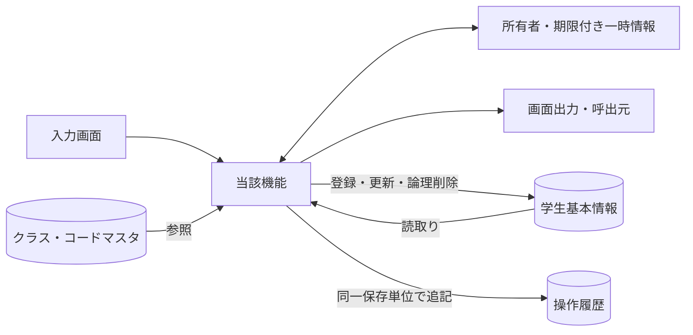

認証情報・業務日時は共通01～03から取得。マスタ保守の承認入力ファイルは画面機能のIOに含めず、方式別言語依存仕様に定義する。

## 項目一覧

### 項目別DB連携説明

| 項目ID | 論理項目名 | 連携方向 | 関連論理DB項目 | 物理列・処理値 | 候補参照キー | DB連携・変換説明 |
| --- | --- | --- | --- | --- | --- | --- |
| REG-001 | 学生管理番号 | O（表示） | 学生基本情報・学生管理番号 | m_student.student_id | － | 表示のみ、登録時自動採番 |
| REG-002 | 学籍番号 | I/O（表示・保存） | 学生基本情報・学籍番号 | m_student.student_no | － | 新規のみ設定。登録後不変、削除済み含め一意 |
| REG-003 | 氏名 | I/O（表示・保存） | 学生基本情報・学生氏名 | m_student.student_name | － | N-02、原表記を保存 |
| REG-004 | 氏名カナ | I/O（表示・保存） | 学生基本情報・学生氏名カナ | m_student.student_name_kana | － | N-04、全角カナ100文字 |
| REG-005 | 生年月日 | I/O（表示・保存） | 学生基本情報・生年月日 | m_student.birth_date | 元号 | 和暦入力→厳密変換→日付保存、DATE-R01 |
| REG-006 | 性別 | I/O（表示・保存） | 学生基本情報・性別 | m_student.gender_code | 性別 | コード値保存／性別分類のコード名称表示 |
| REG-007 | 郵便番号 | I/O（表示・保存） | 学生基本情報・郵便番号 | m_student.postal_code | － | N-08、数字7桁保存、3桁－4桁表示 |
| REG-008 | 都道府県 | I/O（表示・保存） | 学生基本情報・都道府県 | m_student.prefecture_code | 都道府県 | コード値保存／都道府県分類の名称表示 |
| REG-009 | 住所1 | I/O（表示・保存） | 学生基本情報・住所1 | m_student.address_line1 | － | N-02、市区町村・番地、200文字 |
| REG-010 | 住所2 | I/O（表示・保存） | 学生基本情報・住所2 | m_student.address_line2 | － | N-02、任意200文字、空は未設定 |
| REG-011 | 本人電話 | I/O（表示・保存） | 学生基本情報・本人電話 | m_student.phone_number | － | N-09、連絡手段条件あり |
| REG-012 | 本人メール | I/O（表示・保存） | 学生基本情報・本人メール | m_student.email_address | － | N-10、連絡手段条件あり |
| REG-013 | 入学日 | I/O（表示・保存） | 学生基本情報・入学日 | m_student.admission_date | － | 西暦入力・表示、DATE-R02 |
| REG-014 | 在籍区分 | I/O（表示・保存） | 学生基本情報・在籍区分 | m_student.enrollment_status_code | 在籍区分 | 値保存／在籍区分分類の名称表示 |
| REG-015 | 卒業・退学日 | I/O（表示・保存） | 学生基本情報・卒業・退学日 | m_student.enrollment_end_date | － | 西暦。03/04で必須、01/02は未設定 |
| REG-016 | 年度 | I/O（選択補助・保存なし） | 選択補助：クラスマスタ・学校年度 | m_class.school_year | 年度 | 選択補助・整合検査のみ。学生へ保存しない |
| REG-017 | 学年 | I/O（選択補助・保存なし） | 選択補助：クラスマスタ・学年 | m_class.grade_code | 学年 | 選択補助。学年名称は学年分類のコード名称 |
| REG-018 | クラス | I/O（表示・保存） | 学生基本情報・現在・最終所属クラス | m_student.class_id | クラス | 識別番号保存／年度・学年・コード・名称表示 |
| REG-019 | 所属人数・定員 | O（表示） | 集計：学生基本情報・在籍区分／クラス、クラスマスタ・定員 | count of m_student / m_class.capacity | － | 非削除01/02の参考人数。確保予約ではない |
| REG-020 | 緊急連絡先氏名 | I/O（表示・保存） | 学生基本情報・緊急連絡先氏名 | m_student.emergency_contact_name | － | 緊急3項目は全部入力または全部未設定 |
| REG-021 | 緊急連絡先続柄 | I/O（表示・保存） | 学生基本情報・緊急連絡先続柄 | m_student.relationship_code | 続柄 | 値保存／続柄分類のコード名称表示 |
| REG-022 | 緊急連絡先電話 | I/O（表示・保存） | 学生基本情報・緊急連絡先電話 | m_student.emergency_phone_number | － | N-09、緊急3項目一式 |
| REG-023 | 備考 | I/O（表示・保存） | 学生基本情報・備考 | m_student.remarks | － | プレーンテキスト、1000文字、改行可 |
| REG-024 | 確認・変更理由 | I（関連保存） | 関連保存：操作履歴・操作・確認理由 | t_operation_log.operation_reason | － | 警告続行・終了区分訂正時必須、200文字 |
| REG-025 | 更新日時・更新者 | O（表示） | 表示：学生基本情報・更新日時／更新者 | updated_at / updated_by | － | システム設定。西暦日時、日本時間 |
| REG-026 | 削除理由 | I（関連保存） | 保存：学生基本情報・削除理由／操作履歴・操作・確認理由 | delete_reason / t_operation_log.operation_reason | － | 削除時のみ、200文字、編集中の業務値は保存しない |
| REG-027 | 登録／更新 | 操作／表示 | DB保存なし（呼出処理はイベント仕様） | 画面制御。次節のネイティブイベントへ対応 | － | 保存処理を呼ぶ |
| REG-028 | 入力クリア／編集取消 | 操作／表示 | DB保存なし（呼出処理はイベント仕様） | 画面制御。次節のネイティブイベントへ対応 | － | 新規は初期値、既存は読込時値 |
| REG-029 | 最新情報を再読込 | 操作／表示 | DB保存なし（呼出処理はイベント仕様） | 画面制御。次節のネイティブイベントへ対応 | － | 確認後にDB最新値を取得 |
| REG-030 | 検索へ戻る | 操作／表示 | DB保存なし（呼出処理はイベント仕様） | 画面制御。次節のネイティブイベントへ対応 | － | 未保存破棄確認後に復帰 |
| REG-031 | 論理削除 | 操作／表示 | DB保存なし（呼出処理はイベント仕様） | 画面制御。次節のネイティブイベントへ対応 | － | 管理者のみ、理由・明示確認 |
| REG-032 | 重複候補一覧 | 操作／表示 | 学生基本情報・学籍番号／学生氏名／生年月日／所属クラス | OP-DUP result | － | 全候補件数＋最大20件、個人情報を最小化 |
| REG-033 | 別人と確認して続行 | 操作／表示 | DB保存なし（呼出処理はイベント仕様） | 画面制御。次節のネイティブイベントへ対応 | － | 理由・確認情報付きで保存を再検証 |
| REG-034 | 確認取消 | 操作／表示 | DB保存なし（呼出処理はイベント仕様） | 画面制御。次節のネイティブイベントへ対応 | － | 入力へ戻る。DB更新なし |

項目IDの数値部は基本設計の従来番号を維持する。表示・検索・保存は同じ項目でも異なる経路となる。候補参照キーは次節で定義する。

### 物理バインド・変数定義

#### 全保存入力の対応

E-STUDENT-NO→student_no、E-STUDENT-NAME→student_name、E-STUDENT-KANA→student_name_kana、和暦4項目→E-BIRTH-DATE→birth_date、E-GENDER→gender_code、E-POSTAL→postal_code、E-PREFECTURE→prefecture_code、E-ADDRESS-1/2→address_line1/2、E-PHONE→phone_number、E-EMAIL→email_address、E-ADMISSION-DATE→admission_date、E-STATUS→enrollment_status_code、E-END-DATE→enrollment_end_date、E-CLASS-ID→class_id、E-EMERGENCY-NAME→emergency_contact_name、E-RELATIONSHIP→relationship_code、E-EMERGENCY-PHONE→emergency_phone_number、E-REMARKS→remarks。以上19入力にサーバー生成NAME-KEY/KANA-KEYを加える。

E-YEAR/E-GRADEは補助検査、E-REASONは監査、E-EXPECTED-VERSIONと確認状態は非表示制御。必須と保存文字長は基本02を保持し、PICの長さに合わせて短縮しない。生年月日は和暦4項目からE-BIRTH-DATEへ変換。入学日はISO日付10文字から厳密解析する。

#### REG-005 生年月日の物理移送契約

| 項目 | 定義 |
| --- | --- |
| 入力コントロール | E-BIRTH-ERA / E-BIRTH-YEAR / E-BIRTH-MONTH / E-BIRTH-DAY |
| 入力→内部値 | PIC Xの原入力4値→E-BIRTH-DATE PIC X(10)のISO日付 |
| 共通呼出 | STDATE。業務日・元号定義版を渡す |
| 保存先 | m_student.birth_date。元号・元号年を別列へ保存しない |
| 既存値→画面 | 内部日付から4入力値と和暦表示を生成。日付に時差変換を適用しない |
| エラー | 元号・年・月・日の原入力を保持しREG-005へE-DATE-001または002等を関連付ける。変換失敗をNULL扱いしない |

既存のBirthDate／BirthDateIso／E-BIRTH-DATE等は変換後の内部日付を指す。生年月日の入力欄を西暦の単一DatePickerや単一テキストへ戻さない。日付型の必須性は保存命令を確定するときに検査し、新規画面の未入力状態と区別する。

#### 型と制御情報

| 対象 | 規約 |
| --- | --- |
| 日付型 | PIC X(10)、SQL NULLは別標識 |
| ID・版 | 方式別ID型を使用し近似数へ変換しない。新規は対象・期待版なし、更新削除は正のID・期待版必須 |
| 隠し状態 | 原スナップショット、編集値、期待版、戻りContext、確認Token、要求連番、Busyを分離。利用者権限は入力にしない |
| 生年月日 | REG-005は元号・年・月・日のRaw文字列→共通16→birth_date。HTML上の名称と内部日付値を区別する |
| 一覧出力 | 一覧取得DTOはOP-PAGEの11表示項目＋学生ID。birth_dateは和暦表示へ、updated_atは西暦日本時間へ変換 |
| 未設定 | 任意文字の空は共通04でNULL相当。変換失敗をNULLや0にしない |

### 選択候補の参照元

| 候補参照キー | 参照元・分類 | 選択値 | 表示値 | 抽出条件 | 表示順 | 初期値・連動 |
| --- | --- | --- | --- | --- | --- | --- |
| 年度 | クラスマスタ・学校年度 | school_year | 年度 | 停止・過去年度を含め範囲1900～9998。新規登録は当年度を選択補助へ | 年度降順 | 検索すべて／登録当年度、クラス0件を区別 |
| 学年 | コード管理マスタ（学年） | GRADE / grade_code | コード名称 | 検索は停止を含む。新規選択は有効値、既存値は別枠保持 | 表示順→コード値 | すべて。学年なし00は未所属と別 |
| クラス | クラスマスタ・コード管理マスタ（学年） | class_id | 年度・学年・クラスコード・クラス名 | 検索は停止を含む。登録は共通モジュール07の新規所属／最終所属／既存保持の区別 | 年度降順→学年表示順→クラス表示順→コード→ID | 検索すべて／新規未選択。上位変更で不適合なら解除 |
| 在籍区分 | コード管理マスタ（在籍区分） | ENROLLMENT_STATUS / code_value | コード名称 | 検索は分類内の値。登録の新規選択は有効値。01～04は保護 | 表示順→コード値 | 検索01・02／新規登録01、全解除検索は全区分 |
| 都道府県 | コード管理マスタ（都道府県） | PREFECTURE / code_value | コード名称 | 検索は停止を含む。登録新規選択は有効、既存同値は保持 | 表示順→コード値 | 検索すべて／登録未選択 |
| 性別 | コード管理マスタ（性別） | GENDER / code_value | コード名称 | 新規選択は有効値。既存同値は保持。未回答0は保護 | 表示順→コード値 | 新規0、未回答を許容 |
| 続柄 | コード管理マスタ（緊急連絡先続柄） | RELATIONSHIP / code_value | コード名称 | 新規選択は有効、既存同値は保持 | 表示順→コード値 | 未選択。緊急3項目一式 |
| 元号 | 共通日付仕様（文書07）・元号の変換定義（共通暦定義） | MEIJI / TAISHO / SHOWA / HEISEI / REIWA | 元号名 | 生年月日の許容範囲に重なる元号、業務日まで | 新しい元号順 | 未選択。変更時に年・月・日の範囲を再検証 |

取得入口はOP-CODE→共通モジュール06、OP-CLASS→共通モジュール07、元号→共通モジュール16。候補取得メソッドには用途・既存値・業務日を渡し、画面で送信された候補配列や名称を保存根拠にしない。戻り値はValue／Label／Selectable／Warning、クラスには年度・学年・期間・参考人数を含める。

## イベント仕様

### EV-REG-001 新規画面表示

#### 処理概要

作成権限のある利用者が新規モードを開く。

#### 処理手順

1. 共通01・02・03で権限と業務日時を確定。OP-CODE・OP-CLASSで候補と初期値の存在を確認する。
2. 性別0、在籍01、年度は当年度。他の値、特に生年月日・入学日を未入力にする。学生管理番号・版は未採番。
3. 必須コード不足は保存不可。クラス0件はW-STU-108。在学・休学はクラス設定まで保存不可だが卒業等の過去入力は妨げない。

##### 実装詳細

入口：`STEDIT 新規`。機能内の入力・結果型は項目一覧、共通実装は[言語依存仕様](03_言語依存仕様書.md)を使用する。 編集用値と原スナップショットを別に保持。変換失敗を未入力へ置換せず、エラー項目と原入力を返す。

#### 処理フロー

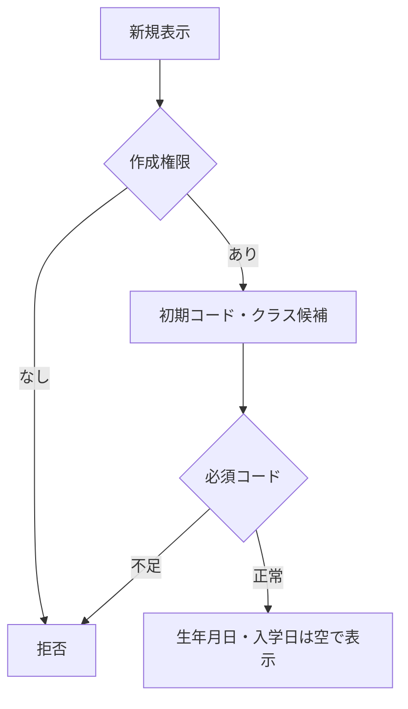

#### SQL・テーブル関連（ER図）

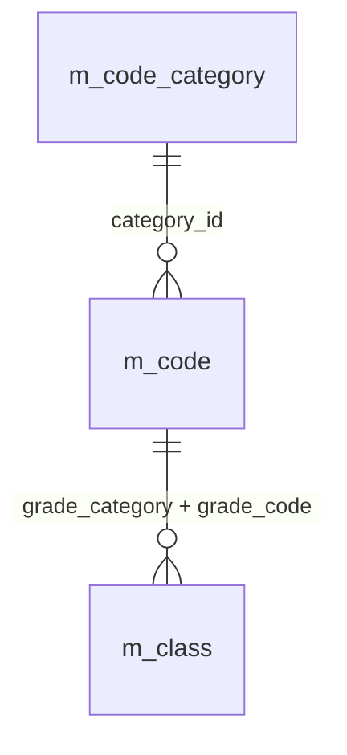

名称参照は未所属・停止値を残す外部結合相当。コードは用途ごとの別名で**分類と値**を結合する。図は読取りの関連であり、履歴への書込みや削除連動を意味しない。単独の存在確認・採番・書込みの表関連は下記操作IDで特定する。

#### DB操作の詳細

`OP-CODE` → `OP-CLASS`。下記「DB操作定義」の同名操作を実行する。保存系ではINSERTとUPDATEをモードで選択し、両方を実行しない。

#### 結果・例外時の扱い

入力不備は原入力保持、対象不在はE-STU-103、版競合はE-STU-105。確認待ちは保存を確定せず、変更なしはI-STU-004。成功通知は学生と履歴の確定確認後だけ。確定結果不明はE-COM-004と検索確認の案内。 各イベントで実行していない処理の結果状態は発生対象外。

### EV-REG-002 編集・参照画面表示

#### 処理概要

既存学生の識別番号で最新値を表示する。

#### 処理手順

1. OP-STUDENTへ学生管理番号を渡し非削除1件を取得。不在はE-STU-103、新規へ切替えない。
2. 学生・クラス・コード名称を取得し、元の値と更新管理番号を読込時スナップショットへ複製。編集値とは分離する。
3. 生年月日を和暦へ変換。学籍番号・管理項目は表示のみ、閲覧者は全項目表示のみ。停止・期間外の既存値を消さない。

##### 実装詳細

入口：`STEDIT 対象あり`。機能内の入力・結果型は項目一覧、共通実装は[言語依存仕様](03_言語依存仕様書.md)を使用する。 編集用値と原スナップショットを別に保持。変換失敗を未入力へ置換せず、エラー項目と原入力を返す。

#### 処理フロー

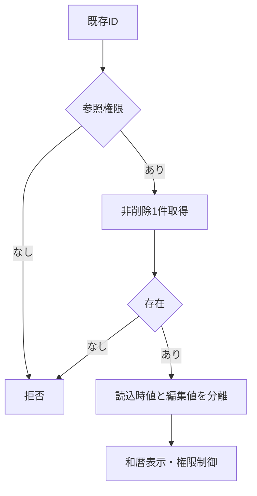

#### SQL・テーブル関連（ER図）

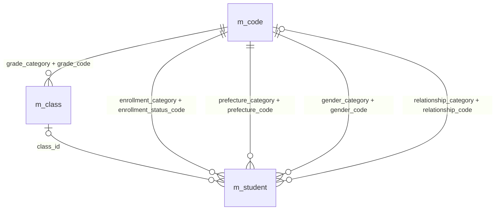

名称参照は未所属・停止値を残す外部結合相当。コードは用途ごとの別名で**分類と値**を結合する。図は読取りの関連であり、履歴への書込みや削除連動を意味しない。単独の存在確認・採番・書込みの表関連は下記操作IDで特定する。

#### DB操作の詳細

`OP-STUDENT` → `OP-CODE` → `OP-CLASS`。下記「DB操作定義」の同名操作を実行する。保存系ではINSERTとUPDATEをモードで選択し、両方を実行しない。

#### 結果・例外時の扱い

入力不備は原入力保持、対象不在はE-STU-103、版競合はE-STU-105。確認待ちは保存を確定せず、変更なしはI-STU-004。成功通知は学生と履歴の確定確認後だけ。確定結果不明はE-COM-004と検索確認の案内。 各イベントで実行していない処理の結果状態は発生対象外。

### EV-REG-003 入力補助

#### 処理概要

所属・在籍・生年月日の入力部品を連動させる。

#### 処理手順

1. 共通16・17で生年月日の元号・年・月・日を厳密検査。不正値を次元号・翌月へ補正せず原入力を保持する。
2. 在籍01/02はクラス必須・終了日なし、03/04は終了日必須・最終所属任意。終了区分からの訂正は権限・理由条件を表示する。
3. 年度・学年・区分変更に応じOP-CLASSで候補を再取得。不適合値解除を通知し、人数は参考表示とする。

##### 実装詳細

入口：`OPTIONS／STDATE`。機能内の入力・結果型は項目一覧、共通実装は[言語依存仕様](03_言語依存仕様書.md)を使用する。 編集用値と原スナップショットを別に保持。変換失敗を未入力へ置換せず、エラー項目と原入力を返す。

#### 処理フロー

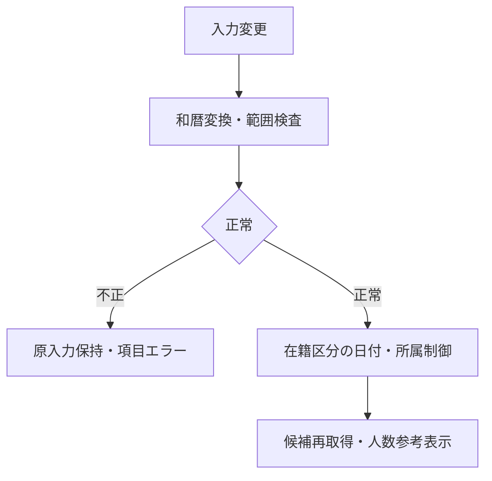

#### SQL・テーブル関連（ER図）

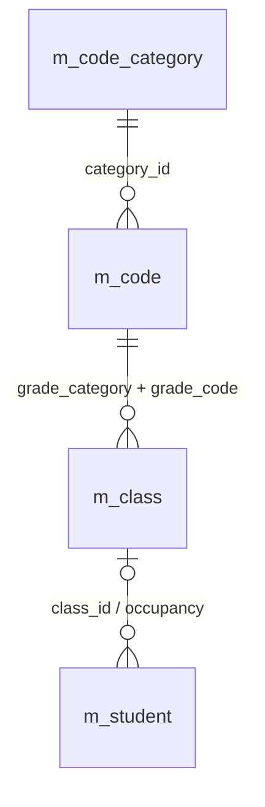

名称参照は未所属・停止値を残す外部結合相当。コードは用途ごとの別名で**分類と値**を結合する。図は読取りの関連であり、履歴への書込みや削除連動を意味しない。単独の存在確認・採番・書込みの表関連は下記操作IDで特定する。

#### DB操作の詳細

`OP-CLASS`。下記「DB操作定義」の同名操作を実行する。保存系ではINSERTとUPDATEをモードで選択し、両方を実行しない。

#### 結果・例外時の扱い

入力不備は原入力保持、対象不在はE-STU-103、版競合はE-STU-105。確認待ちは保存を確定せず、変更なしはI-STU-004。成功通知は学生と履歴の確定確認後だけ。確定結果不明はE-COM-004と検索確認の案内。 各イベントで実行していない処理の結果状態は発生対象外。

### EV-REG-004 新規登録・更新

#### 処理概要

検証済み学生1件と操作履歴1件を一括確定する。

#### 処理手順

1. 入力19業務項目を複製。和暦原入力は共通16で日付へ変換、共通04・05・17で正規化・必須・範囲・連絡手段を検査する。
2. 共通13の短い保存単位内で同時保存制御を取得。既存モードのみOP-STUDENTを実行し、OP-EXISTSとともに最新存在・版・分類・クラス・日付・区分権限を再検証し、学籍番号不変・全行一意を確認する。
3. OP-CAPACITYで旧席から新席が増加する場合だけ定員を検査する。変更なしなら版・更新日時・履歴を増やさずI-STU-004。
4. OP-DUPで全候補と版を確認。未確認なら保存単位を終了して確認画面へ。確認待ちにDBロックを持たない。
5. OP-INSERTまたはOP-UPDATEで学生1件、OP-AUDITで履歴1件を確定。失敗は双方取消、成否不明は自動再送せず検索確認。

##### 実装詳細

入口：`STSAVE CREATE / UPDATE`。機能内の入力・結果型は項目一覧、共通実装は[言語依存仕様](03_言語依存仕様書.md)を使用する。 対象ID・ExpectedVersionは検証するが、利用者・権限・業務日は信頼する実行側で決定する。保存値は固定許可列に限定し、結果種別により画面遷移を分岐する。

#### 処理フロー

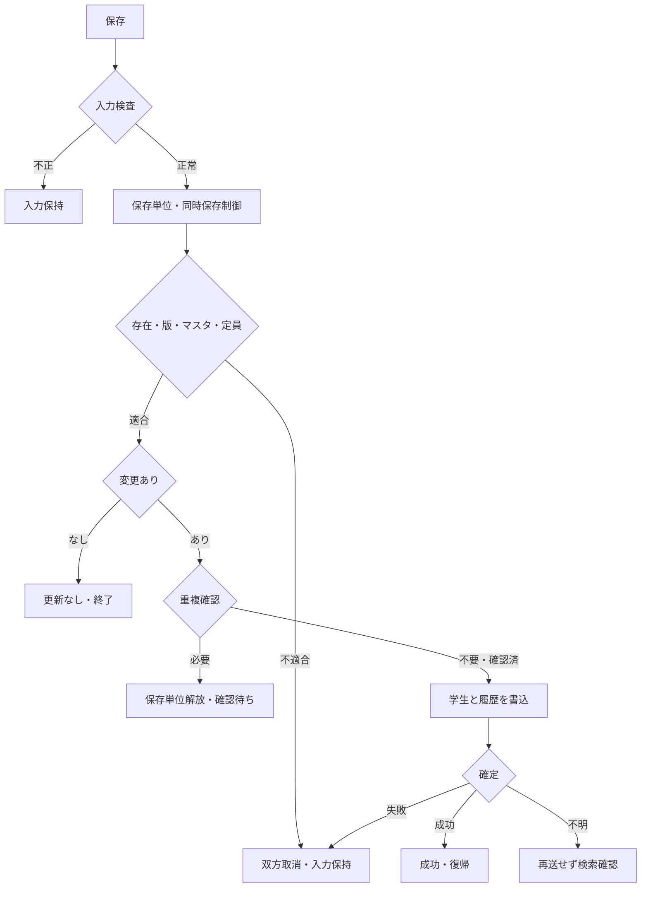

#### SQL・テーブル関連（ER図）

名称参照は未所属・停止値を残す外部結合相当。コードは用途ごとの別名で**分類と値**を結合する。図は読取りの関連であり、履歴への書込みや削除連動を意味しない。単独の存在確認・採番・書込みの表関連は下記操作IDで特定する。

#### DB操作の詳細

`OP-STUDENT` → `OP-EXISTS` → `OP-CAPACITY` → `OP-DUP` → `OP-INSERT` → `OP-UPDATE` → `OP-AUDIT`。下記「DB操作定義」の同名操作を実行する。保存系ではINSERTとUPDATEをモードで選択し、両方を実行しない。

#### 結果・例外時の扱い

入力不備は原入力保持、対象不在はE-STU-103、版競合はE-STU-105。確認待ちは保存を確定せず、変更なしはI-STU-004。成功通知は学生と履歴の確定確認後だけ。確定結果不明はE-COM-004と検索確認の案内。 各イベントで実行していない処理の結果状態は発生対象外。

### EV-REG-005 重複候補の確認続行・取消

#### 処理概要

別人確認と理由を保存処理へ引き渡す。

#### 処理手順

1. 候補は全件数と最大20件の学籍番号・氏名・和暦生年月日・クラスのみ。既定操作は取消。
2. 続行では共通11により本人・認証状態・対象・旧版・正規化内容・全候補IDと版・10分期限を照合。相違はW-STU-102で再確認する。
3. 理由を付けEV-REG-004を再実行し全検査を行う。取消は入力画面に留まりDB更新なし。

##### 実装詳細

入口：`CONFIRM→STSAVE`。機能内の入力・結果型は項目一覧、共通実装は[言語依存仕様](03_言語依存仕様書.md)を使用する。 対象ID・ExpectedVersionは検証するが、利用者・権限・業務日は信頼する実行側で決定する。保存値は固定許可列に限定し、結果種別により画面遷移を分岐する。

#### 処理フロー

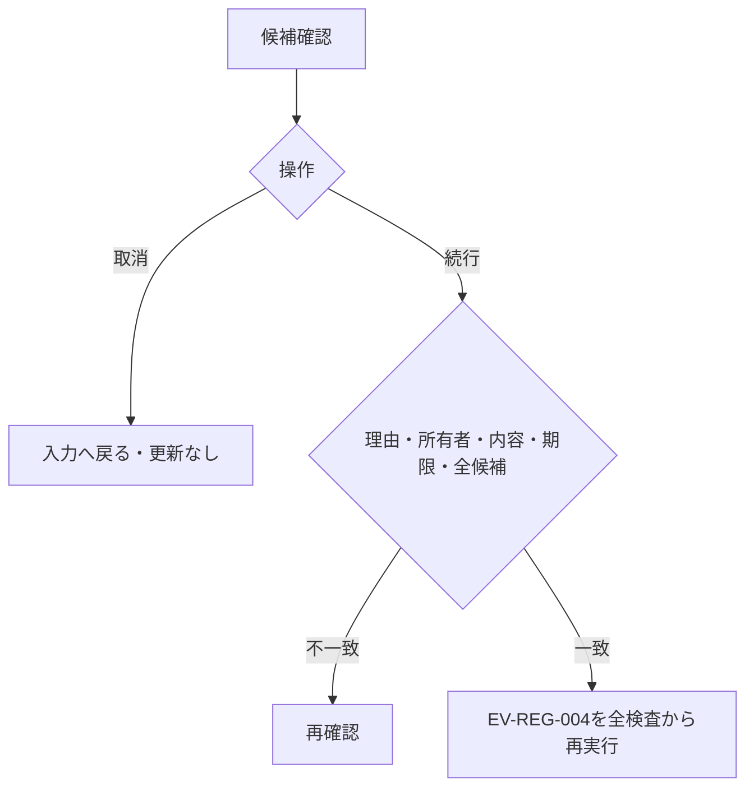

#### SQL・テーブル関連（ER図）

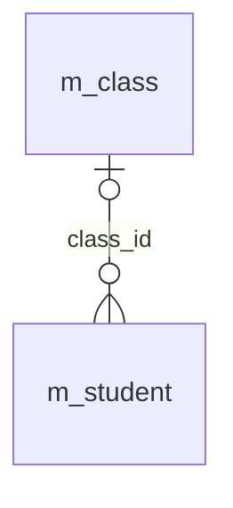

名称参照は未所属・停止値を残す外部結合相当。コードは用途ごとの別名で**分類と値**を結合する。図は読取りの関連であり、履歴への書込みや削除連動を意味しない。単独の存在確認・採番・書込みの表関連は下記操作IDで特定する。

#### DB操作の詳細

`OP-DUP`。下記「DB操作定義」の同名操作を実行する。保存系ではINSERTとUPDATEをモードで選択し、両方を実行しない。

#### 結果・例外時の扱い

入力不備は原入力保持、対象不在はE-STU-103、版競合はE-STU-105。確認待ちは保存を確定せず、変更なしはI-STU-004。成功通知は学生と履歴の確定確認後だけ。確定結果不明はE-COM-004と検索確認の案内。 各イベントで実行していない処理の結果状態は発生対象外。

### EV-REG-006 論理削除

#### 処理概要

管理者が対象と理由を確認して通常検索から除外する。

#### 処理手順

1. 対象ID・読込時版・削除理由・明示確認のみを受ける。編集中の氏名・住所・生年月日等は保存しない。
2. 同時保存制御下でOP-STUDENTを再読込し権限・非削除・版を検証する。対象不在と版競合を区別する。
3. OP-DELETEで削除属性と更新管理情報だけを変更しOP-AUDITと一括確定。確定後に検索へ戻る。

##### 実装詳細

入口：`STDELT DELETE`。機能内の入力・結果型は項目一覧、共通実装は[言語依存仕様](03_言語依存仕様書.md)を使用する。 対象ID・ExpectedVersionは検証するが、利用者・権限・業務日は信頼する実行側で決定する。保存値は固定許可列に限定し、結果種別により画面遷移を分岐する。

#### 処理フロー

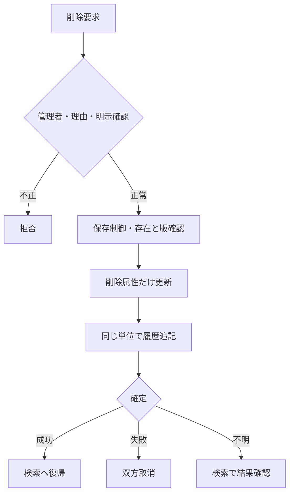

#### SQL・テーブル関連（ER図）

名称参照は未所属・停止値を残す外部結合相当。コードは用途ごとの別名で**分類と値**を結合する。図は読取りの関連であり、履歴への書込みや削除連動を意味しない。単独の存在確認・採番・書込みの表関連は下記操作IDで特定する。

#### DB操作の詳細

`OP-STUDENT` → `OP-DELETE` → `OP-AUDIT`。下記「DB操作定義」の同名操作を実行する。保存系ではINSERTとUPDATEをモードで選択し、両方を実行しない。

#### 結果・例外時の扱い

入力不備は原入力保持、対象不在はE-STU-103、版競合はE-STU-105。確認待ちは保存を確定せず、変更なしはI-STU-004。成功通知は学生と履歴の確定確認後だけ。確定結果不明はE-COM-004と検索確認の案内。 各イベントで実行していない処理の結果状態は発生対象外。

### EV-REG-007 取消・再読込・検索へ戻る

#### 処理概要

原入力の取消、最新取得、検索への復帰を区別する。

#### 処理手順

1. 新規クリアは初期値、編集取消は最後の読込時スナップショットへ戻す。DBから最新取得する処理ではない。
2. 再読込は明示確認後OP-STUDENTを実行し値と版をともに置換。競合時に版だけを最新にしない。
3. 戻る・ウィンドウ終了は未保存変更の破棄確認を行い、取消を既定とする。保存結果不明は再保存前の検索確認を案内する。

##### 実装詳細

入口：`RESET / RELOAD / BACK`。機能内の入力・結果型は項目一覧、共通実装は[言語依存仕様](03_言語依存仕様書.md)を使用する。 編集用値と原スナップショットを別に保持。変換失敗を未入力へ置換せず、エラー項目と原入力を返す。

#### 処理フロー

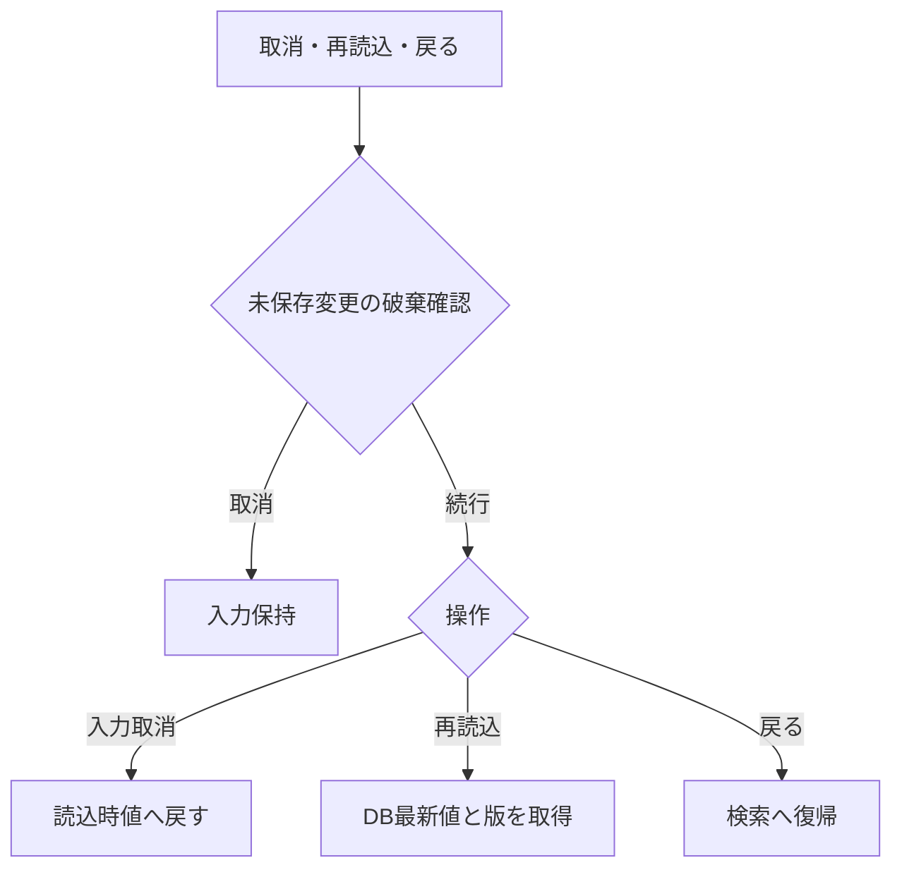

#### SQL・テーブル関連（ER図）

名称参照は未所属・停止値を残す外部結合相当。コードは用途ごとの別名で**分類と値**を結合する。図は読取りの関連であり、履歴への書込みや削除連動を意味しない。単独の存在確認・採番・書込みの表関連は下記操作IDで特定する。

#### DB操作の詳細

`OP-STUDENT`。下記「DB操作定義」の同名操作を実行する。保存系ではINSERTとUPDATEをモードで選択し、両方を実行しない。

#### 結果・例外時の扱い

入力不備は原入力保持、対象不在はE-STU-103、版競合はE-STU-105。確認待ちは保存を確定せず、変更なしはI-STU-004。成功通知は学生と履歴の確定確認後だけ。確定結果不明はE-COM-004と検索確認の案内。 各イベントで実行していない処理の結果状態は発生対象外。

### DB操作定義

操作の業務契約は[共通データアクセス](../../共通/08_データアクセス仕様.md)が正本。本機能における具体的な対象・引数・確定単位は以下。

#### OP-CODE

| 項目 | 内容 |
| --- | --- |
| 対象テーブル | m_code_category / m_code |
| 操作 | 参照 |
| 実行条件・引数 | 分類、用途（検索／新規選択／既存表示）、既存値、業務日 |
| 取得・設定項目／対象条件 | 分類・値・名称・表示順・利用可否・期間。分類＋値で取得 |
| 件数・順序 | 候補0件を検出。既定値を先頭値へ代替しない |
| 確定・取消 | 参照のみ |

#### OP-CLASS

| 項目 | 内容 |
| --- | --- |
| 対象テーブル | m_class / m_code / m_student |
| 操作 | 参照 |
| 実行条件・引数 | 用途、年度、学年、在籍区分、在籍期間、既存所属、業務日、人数参照要否 |
| 取得・設定項目／対象条件 | 年度・学年・クラスID・コード・名称・期間・定員。人数集計は登録側で要求した場合のみ。検索の候補取得では学生を集計しない |
| 件数・順序 | 年度降順、学年表示順、クラス表示順、クラスコード、ID |
| 確定・取消 | 参照のみ、人数は予約ではない |

#### OP-STUDENT

| 項目 | 内容 |
| --- | --- |
| 対象テーブル | m_student / m_class / m_code |
| 操作 | 参照 |
| 実行条件・引数 | 対象学生ID |
| 取得・設定項目／対象条件 | 非削除の1件、全保存値・版・参照名称。名称はLEFT JOIN相当 |
| 件数・順序 | 0件E-STU-103、1件正常、複数件は整合性障害 |
| 確定・取消 | 画面読込は参照のみ。保存時の再検証は保存単位内 |

#### OP-EXISTS

| 項目 | 内容 |
| --- | --- |
| 対象テーブル | m_student / m_class / m_code_category / m_code |
| 操作 | 参照 |
| 実行条件・引数 | 用途（検索／保存）、分類付きコード・クラスID・選択補助。保存だけ対象ID・完全な学籍番号・期待版 |
| 取得・設定項目／対象条件 | 検索は指定コード・クラスの存在と年度学年の整合のみ。学籍番号前方一致に重複・完全一致存在検査をしない。保存は全行学籍番号一意、分類付き存在、変更有無、有効性を再検査 |
| 件数・順序 | 未存在／重複／組合せ／停止を区別。未指定の検索条件は検査対象外 |
| 確定・取消 | 検索は参照のみ、保存は保護した最新値で確認 |

#### OP-CAPACITY

| 項目 | 内容 |
| --- | --- |
| 対象テーブル | m_student / m_class |
| 操作 | 参照 |
| 実行条件・引数 | 旧席、新席、対象学生ID |
| 取得・設定項目／対象条件 | 非削除01/02、自分以外の対象クラス人数と定員 |
| 件数・順序 | 新席が未設定でなく、旧席から追加・異動するときだけ人数＋1≦定員。卒業・退学・削除による席解放はこの加算検査をしない。定員未設定は制限なし |
| 確定・取消 | 保存制御取得後に判定、休学も1席 |

#### OP-DUP

| 項目 | 内容 |
| --- | --- |
| 対象テーブル | m_student / m_class |
| 操作 | 参照 |
| 実行条件・引数 | 日付型生年月日、氏名照合値、カナ照合値、自分ID |
| 取得・設定項目／対象条件 | 非削除かつ自分除外、同生年月日かつ氏名キーORカナキー一致 |
| 件数・順序 | 全ID・版をID順、表示は最大20件。クラス名は表示のみ |
| 確定・取消 | 確認照合は同時保存制御内、応答待ちは解放 |

#### OP-INSERT

| 項目 | 内容 |
| --- | --- |
| 対象テーブル | m_student |
| 操作 | 登録 |
| 実行条件・引数 | 検証済み19入力、生成照合値2、固定分類、認証情報 |
| 取得・設定項目／対象条件 | 学生ID自動採番、版1、作成更新情報設定、未削除 |
| 件数・順序 | 必ず1件。学籍番号一意制約でも競合防止 |
| 確定・取消 | OP-AUDITと同一確定単位 |

#### OP-UPDATE

| 項目 | 内容 |
| --- | --- |
| 対象テーブル | m_student |
| 操作 | 更新 |
| 実行条件・引数 | 対象ID、期待版、学籍番号以外18入力、生成照合値2 |
| 取得・設定項目／対象条件 | 対象ID＋期待版＋非削除。作成情報・学籍番号・分類・削除情報は変更なし |
| 件数・順序 | 更新1件。0件は存在再確認後不在／版競合に分離 |
| 確定・取消 | OP-AUDITと一括、版＋1。変更なしは実行しない |

#### OP-AUDIT

| 項目 | 内容 |
| --- | --- |
| 対象テーブル | t_operation_log |
| 操作 | 登録 |
| 実行条件・引数 | 対象、操作、前後版、変更項目名、実行者・時点・理由・受付番号 |
| 取得・設定項目／対象条件 | 変更した物理項目名だけ。個人情報の値はコピーしない |
| 件数・順序 | 実際の変更1件につき履歴1件。追記専用 |
| 確定・取消 | 業務変更と同じ接続・保存単位。失敗は双方取消 |

#### OP-DELETE

| 項目 | 内容 |
| --- | --- |
| 対象テーブル | m_student |
| 操作 | 更新（論理削除） |
| 実行条件・引数 | 対象ID、期待版、理由、認証情報 |
| 取得・設定項目／対象条件 | 削除状態・日時・者・理由、更新日時・者・版だけ変更 |
| 件数・順序 | 更新1件。編集中の一般項目を含めない |
| 確定・取消 | 物理DELETEではない。OP-AUDITと一括 |

### ネイティブイベント・通信の対応

#### 保存・削除フロー

STSAVEはSTAUTH→STNORM→STVALID→STDBOPでTx開始・ゲート取得→最新学生版／コード／クラスを取得→STRULESで有効性・在籍・定員→変更なし→STDUPで全候補を照合→学生書込み→STAUDIT→COMMIT。重複未確認ならROLLBACK後に確認HTMLを返す。CONFIRM再POSTは状態所有者・期限・入力・全候補を再照合して全検査を再実行する。

STDELTは対象ID・旧版・理由・明示確認だけを受け、一般学生入力を無視するのではなく削除要求の許可項目以外を拒否する。元学生の業務値は保持し、削除属性・版・更新情報と履歴だけを書く。

STRENDERは入力不備422、版・確認409、不存在404、障害503で入力値を再描画する。成功確定後だけ303で元検索状態へ戻す。生成HTMLの値はすべてエスケープ。保存が不明なときは検索確認を案内し、STSAVEを自動再実行しない。

## 項目更新仕様

EV-REG-004・006から呼び出す。新規19入力、通常更新18入力（学籍番号以外）、生成照合値2の対応を固定する。更新・削除は対象ID＋期待版＋非削除で1件を要求し、0件の場合は不在／競合を区別する。

| 更新ID | 項目ID | 対象 | 登録 | 更新 | 論理削除 | 規則・設定元 |
| --- | --- | --- | --- | --- | --- | --- |
| UPD-002 | REG-002 | m_student.student_no | 検証済み入力値 | 変更なし | 変更なし | 新規のみ設定。登録後不変、削除済み含め一意 |
| UPD-003 | REG-003 | m_student.student_name | 検証済み入力値 | 同左。空の任意値は未設定で上書き | 変更なし | N-02、原表記を保存 |
| UPD-004 | REG-004 | m_student.student_name_kana | 検証済み入力値 | 同左。空の任意値は未設定で上書き | 変更なし | N-04、全角カナ100文字 |
| UPD-005 | REG-005 | m_student.birth_date | 検証済み入力値（生年月日は日付へ変換） | 同左。空の任意値は未設定で上書き | 変更なし | 和暦入力→厳密変換→日付保存、DATE-R01 |
| UPD-006 | REG-006 | m_student.gender_code | 検証済み入力値 | 同左。空の任意値は未設定で上書き | 変更なし | コード値保存／性別分類のコード名称表示 |
| UPD-007 | REG-007 | m_student.postal_code | 検証済み入力値 | 同左。空の任意値は未設定で上書き | 変更なし | N-08、数字7桁保存、3桁－4桁表示 |
| UPD-008 | REG-008 | m_student.prefecture_code | 検証済み入力値 | 同左。空の任意値は未設定で上書き | 変更なし | コード値保存／都道府県分類の名称表示 |
| UPD-009 | REG-009 | m_student.address_line1 | 検証済み入力値 | 同左。空の任意値は未設定で上書き | 変更なし | N-02、市区町村・番地、200文字 |
| UPD-010 | REG-010 | m_student.address_line2 | 検証済み入力値 | 同左。空の任意値は未設定で上書き | 変更なし | N-02、任意200文字、空は未設定 |
| UPD-011 | REG-011 | m_student.phone_number | 検証済み入力値 | 同左。空の任意値は未設定で上書き | 変更なし | N-09、連絡手段条件あり |
| UPD-012 | REG-012 | m_student.email_address | 検証済み入力値 | 同左。空の任意値は未設定で上書き | 変更なし | N-10、連絡手段条件あり |
| UPD-013 | REG-013 | m_student.admission_date | 検証済み入力値 | 同左。空の任意値は未設定で上書き | 変更なし | 西暦入力・表示、DATE-R02 |
| UPD-014 | REG-014 | m_student.enrollment_status_code | 検証済み入力値 | 同左。空の任意値は未設定で上書き | 変更なし | 値保存／在籍区分分類の名称表示 |
| UPD-015 | REG-015 | m_student.enrollment_end_date | 検証済み入力値 | 同左。空の任意値は未設定で上書き | 変更なし | 西暦。03/04で必須、01/02は未設定 |
| UPD-018 | REG-018 | m_student.class_id | 検証済み入力値 | 同左。空の任意値は未設定で上書き | 変更なし | 識別番号保存／年度・学年・コード・名称表示 |
| UPD-020 | REG-020 | m_student.emergency_contact_name | 検証済み入力値 | 同左。空の任意値は未設定で上書き | 変更なし | 緊急3項目は全部入力または全部未設定 |
| UPD-021 | REG-021 | m_student.relationship_code | 検証済み入力値 | 同左。空の任意値は未設定で上書き | 変更なし | 値保存／続柄分類のコード名称表示 |
| UPD-022 | REG-022 | m_student.emergency_phone_number | 検証済み入力値 | 同左。空の任意値は未設定で上書き | 変更なし | N-09、緊急3項目一式 |
| UPD-023 | REG-023 | m_student.remarks | 検証済み入力値 | 同左。空の任意値は未設定で上書き | 変更なし | プレーンテキスト、1000文字、改行可 |
| UPD-101 | REG-003／004 | name_key / kana_key | 共通04で生成 | 元の氏名等から再生成 | 変更なし | 入力された照合値を信用しない |
| UPD-102 | REG-001 | student_id | 自動採番 | 変更なし | 変更なし | 最大値＋1は禁止 |
| UPD-103 | ― | gender_category / prefecture_category / enrollment_category / relationship_category | 定義済み分類を設定 | 変更なし | 変更なし | 利用者の入力から設定しない |
| UPD-104 | ― | created_at / created_by | 共通03・01 | 変更なし | 変更なし | システム設定 |
| UPD-105 | REG-025 | updated_at / updated_by / row_version | 実行時点・実行者・1 | 実変更時だけ実行時点・実行者・版＋1 | 同左 | 期待版一致が条件、変更なしでは更新しない |
| UPD-106 | REG-026／031 | is_deleted / deleted_at / deleted_by / delete_reason | 未削除、削除属性未設定 | 変更なし | 削除済・実行時点・実行者・検査済理由 | 削除時に一般入力を保存しない |
| UPD-107 | REG-024／026 | t_operation_log | 前版未設定・後版1・操作新規 | 前後版・変更項目名・操作更新 | 前後版・変更項目名・操作論理削除 | 対象識別、実行者時点、理由、受付番号、重複確認有無。値は複写しない |

## 補足説明

### 制約・正本

本書は1機能を対象とし、複数クラス・API・パネルはその内部実装である。マスタ保守、共通UI、物理テーブル、ビルド・配備は[言語依存仕様](03_言語依存仕様書.md)を参照する。

### 試験観点

[共通T-01～28](../../共通/06_要件対応・設計判断.md)と[DATE-T01～20](../../共通/07_日付・和暦仕様.md)の該当項目を実装工程で実施する。入力→処理値→DB→再表示を往復確認し、Unicode最大長、日付境界、停止候補、最終席競合、旧版、履歴失敗、保存結果不明を含める。

[レビュー結果](../../../docs/仕様書レビュー結果.md)。文書検査と実装試験合格を区別する。
