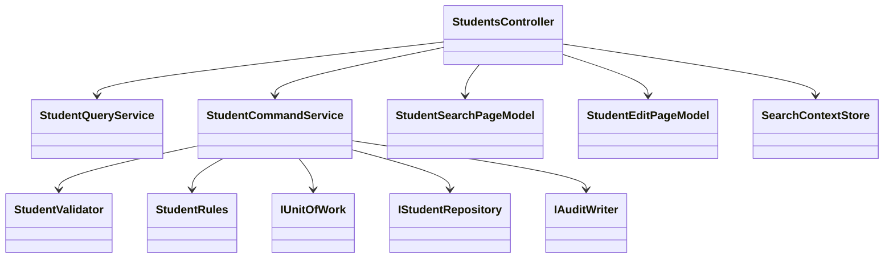

# C# / ASP.NET 言語依存仕様書

版5.0／2026-10-10。ASP.NET Core MVC／Razor方式。[検索詳細](01_学生検索画面.md)／[登録詳細](02_学生登録画面.md)。技術資料：[共通06](../../共通/06_要件対応・設計判断.md) S-04・07・12・14。

## 1. クラス・配置

```text
Web/Controllers/StudentsController.cs
Web/Models/StudentSearchPageModel.cs, StudentEditPageModel.cs
Web/Inputs/StudentSearchInput.cs, StudentSaveInput.cs, StudentDeleteInput.cs
Web/Views/Students/Search.cshtml, Edit.cshtml
Web/Views/Shared/_Layout.cshtml, _MessagePanel.cshtml, _CodeSelect.cshtml
Web/Views/Shared/_ClassSelector.cshtml, _Pager.cshtml, _DuplicateConfirmation.cshtml
Application/StudentQueryService.cs, StudentCommandService.cs, MasterMaintenanceService.cs
Domain/Student.cs, SchoolClass.cs, CodeCategory.cs, CodeEntry.cs, StudentDraft.cs
Infrastructure/NpgsqlStudentRepository.cs, NpgsqlUnitOfWork.cs, AuditWriter.cs
Infrastructure/SearchContextStore.cs, DuplicateConfirmationStore.cs, FlashMessageStore.cs
```



Controllerは認証・HTTP入出力だけ、Serviceは確定単位、RepositoryはSQL、Viewは表示。共通01～03はCurrentUserAccessor/AuthorizationService/BusinessClock、04～05はStudentNormalizer/StudentValidator、06～10はMasterLookupService/StudentRules/CapacityService/DuplicateService、11～12は各StateStore、13はNpgsqlUnitOfWork、14はAuditWriter、15はMessageCatalog/ExceptionFilter。

```csharp
[Authorize]
public sealed class StudentsController : Controller {
    // Input DTOだけを受理。Entityの管理列はバインドしない。
    [HttpPost("/students/{id:long}/update")]
    [ValidateAntiForgeryToken]
    public async Task<IActionResult> Update(long id, StudentSaveInput input,
                                            CancellationToken ct) {
        // 正規化・権限・検査・Txはサービスで行い、結果別にView/303を返す。
        var result = await service.UpdateAsync(id, input, ct);
        return Present(result, input);
    }
}
```

構造例であり、service/Presentの完全実装を省略している。非同期I/OにAwaitを用い、HTTP要求のScoped接続をSingletonへ保持しない。

## 2. C#・DB型と物理全89列

long＝ID・版、int＝ページ・人数、DateOnly＝日付、DateTimeOffset＝UTC時点、bool＝真偽、string/string?＝文字。HTTPでは日付・IDをraw文字で受け厳密解析し、未設定をnull。JavaScript補助に渡すID・版は10進文字列で桁落ち防止。

PostgreSQL記号：ID=bigint identity、L=bigint、I=integer、B=boolean、D=date、T=timestamptz、Vn=varchar(n)。?はNULL可、他はNOT NULL。A＝created_at T、created_by V64、updated_at T、updated_by V64、row_version L DEFAULT 1。列名のsnake_caseをPascalCaseへ変換した名前がEntityプロパティ。

| 表（列数） | 全列 |
| --- | --- |

Aを最初の4表に展開。業務の5表・89項目と一致。changed_columnsは物理列名のJSON配列。typeはCREATE/UPDATE/DELETE/DISABLE/ENABLE。固定分類はGENDER、PREFECTURE、ENROLLMENT_STATUS、RELATIONSHIP、GRADE。IDと作成情報は不変。

PK：student_id、class_id、category_id、(category_id,code_value)、log_id。UQ：student_no（削除済み含む）、クラス(school_year,class_code)。FK：学生クラス、学生4分類＋コード、クラス学年分類＋コード、コード分類→種別。すべてRESTRICT。カテゴリー定数、版>0、氏名等必須空白不可、連絡先1つ以上、緊急3項目一式、birth_date≦admission_date、在籍区分と終了日・クラス、削除状態と削除3属性、クラス年度範囲1900～9998・期間・定員1～9999またはNULL・表示順非負、コード期間順をCHECKと保存検証で保証する。現在日・分類の固定桁・有効状態・集計はサービスで毎回検査。

索引は非削除のbirth_date、(class_id,enrollment_status_code)、admission_date、updated_at、phone_number、emergency_phone_number。履歴は(target_table,target_key,executed_at)。name_key2000の無条件B-treeは作らない。クラス・コード候補は表示順＋キー順。

## 3. SQLと同時実行

SELECT件数・一覧は同じReadOnly RepeatableRead Txで実行。件数は条件一致IDを最大10001件に制限して数える。10000超なら一覧なし。それ以外はOFFSET/LIMITで20/50/100件。件数・一覧に同じ述語を使う。

```sql
SELECT s.student_id,s.student_no,s.student_name,s.student_name_kana,
 s.birth_date,c.school_year,g.code_name AS grade_name,
 c.class_code,c.class_name,es.code_name AS status_name,
 p.code_name AS prefecture_name,s.address_line1,s.phone_number,s.updated_at
FROM m_student s
LEFT JOIN m_class c ON c.class_id=s.class_id
LEFT JOIN m_code g ON g.category_id=c.grade_category AND g.code_value=c.grade_code
LEFT JOIN m_code es ON es.category_id=s.enrollment_category AND es.code_value=s.enrollment_status_code
LEFT JOIN m_code p ON p.category_id=s.prefecture_category AND p.code_value=s.prefecture_code
WHERE NOT s.is_deleted
-- 指定条件だけパラメーター化して追加。名称JOINに有効性条件を付けない。
ORDER BY s.student_no COLLATE "C",s.student_id
LIMIT $1 OFFSET $2;
```

検索の学籍前方・氏名カナ部分はLIKE ... ESCAPE '!'、在籍はtext配列、本人／緊急電話はOR、日付両端、未所属はIS NULL。氏名順はname_key COLLATE "C"、ソート許可はstudentNo/name/admissionDate/updatedAt、方向asc/desc、同順位student_id。パラメーターを文字列SQLとして連結しない。

書込みはRead CommittedでBEGIN、`SELECT pg_advisory_xact_lock(75310,1)`、その後の別命令で対象・マスタを再取得。対象版比較、コードとクラスの存在・有効性、状態訂正、期間・連絡先、席増加時の人数、全候補を検査。すべての学生・コード・クラス保守が同ゲートを守る。確認待ちならROLLBACKしてHTMLを返す。

新規は入力19列＋name_key/kana_key＋分類＋作成更新情報＋版1、IDはRETURNING。更新は学籍番号以外18入力＋照合値2＋更新情報・版加算、WHERE student_id=$id AND row_version=$old AND NOT is_deleted、0件なら不在／競合。削除はis_deleted・deleted_at/by/reason・updated_at/by・row_versionだけを変更。定員集計は非削除01/02かつ自分を除外。同一人物候補は同birthdayかつ(name_key一致ORkana_key一致)、自分除外、全IDと版を取得。

学生／マスタ変更とt_operation_logの1件を同じ接続・Txに書き、両方成功後COMMIT。Repositoryは独立Commitしない。参照SQL・DML例は正規化済みパラメーターを前提とする。

## 4. サーバー状態・認証・UI

基準はWebサーバー1台。SearchContextStoreは認証UserId＋LoginSessionId＋TabIdで所有者を照合し、256bit乱数のContextId、AppliedCriteria、Page、PageSize、Sort、Revision、ExpiresAtを持つ。30分スライド期限、要求はContextId単位で直列化し古いRevisionを拒否。個人情報をCookieへ保存しない。

DuplicateConfirmationStoreは10分固定、利用者・対象・旧版・固定順正規化業務値のSHA256・全候補ID/版のSHA256を保存。理由・復帰先・選択補助はハッシュ対象外だが別途毎回検査。同一トークン同時処理は拒否、成功で消費、書込み開始後の例外・結果不明で失効。複数ノード化する場合は共有ストアと保護鍵を使用する別配置設計が必要。

Razorの標準エスケープを利用し、学生値をHtml.Rawへ渡さない。input名とModelStateキーを対応付ける。日付空欄、停止既存値、エラー時候補再構成、未保存破棄確認を共通部分ビュー化。個人情報ページはCache-Control:no-store。HTTPS、Secure/HttpOnly Cookie、ログイン失効時再認証、全POSTの明示的なCSRF検証を行う。[S-14]

サーバーは共通認証から得た利用者を信頼し、フォームのUserId/Roleは受け取らない。DB資格情報はサーバーだけが保持し最小権限。通常ログへ要求本文・氏名・住所・メール・トークンを出さない。

## 5. 例外・ビルド・配備

認証401、権限403、要求・CSRF400、型付き業務エラー422、不存在404、版／重複確認409、DB一時障害503をHTML文言とともに返す。検索0件・上限・変更なしは200。成功保存は303。SQLSTATE23505はuq_student_noならE-STU-101、クラス／コード重複はE-MST-002。23503は参照不整合、版0件はE-STU-105、40001/40P01/55P03は再確認。その他はE-COM-004＋受付番号。

.NET SDKのWebプロジェクト、TargetFramework=net10.0、Nullable=enable、Npgsql版固定。開発秘密と本番秘密を分離し、IISまたはリバースプロキシ下のKestrelを選定。プロキシから渡す認証・転送ヘッダーは信頼元を制限。コード種別→70コード→学校承認クラスの順で投入。Web統合試験、実DB競合、エスケープ、CSRF、PRG、障害時の入力保持と結果不明を実装後に確認する。


## 共用物理定義

[PostgreSQL物理仕様書](../共通技術/PostgreSQL物理仕様書.md)を5表・89列、型、キー、制約、索引の正本とする。ローカル記載は型付け・呼出・排他方式の追加条件であり、同じ物理列を再定義しない。


## 共通規約・日付実装

対象読者は実務経験５年程度のプログラマー。[検索詳細](01_学生検索画面.md)／[登録詳細](02_学生登録画面.md)／[開発規約](../../../docs/開発規約.md)／[日付正本](../../共通/07_日付・和暦仕様.md)。

共通16の入力は元号識別値・年・月・日という原文字列4値と業務日。出力は正規化日付と和暦表示文字列、または項目エラー。共通17は項目種別と日付／年度にDATE-R01～06を適用する。変換で不正日を補正しない。OS全体の暦設定を変更しない。元号表の版を画面・保存側で一致させる。

| 役割 | 実装仕様 |
| --- | --- |
| 共通16物理名 | _JapaneseBirthDate.cshtml / JapaneseDateService |
| 内部日付型 | DateOnly / DateOnly? |
| 入力と保存 | 和暦原入力4値から日付を生成。StudentDraft等のbirth_date相当は正規化日付。元号をDBへ重複保存しない |
| 通信境界 | Webの保存要求はbirthDateInputの4文字列を受け、保存側で厳密変換。既存取得応答のbirthDateはISO日付。入力と応答の型を混同しない |
| 表示 | 一覧・参照・重複確認のBirthDateWareki相当文字列は共通16で生成。その他の日付・日時は西暦 |
| 例外 | CHK-032～034、E-DATE-001～003。構文検査後、実在日、元号境界、逆変換、業務範囲、前後関係を順に検査 |
| 参考試験 | DATE-T01～20。ライブラリーの解析成功だけで元号境界を合格にしない |

### 保守入口・方式固有の適合条件

#### 戻る・権限・保守・試験

検索状態は認証者・セッション・タブ別30分、重複確認10分。改変・他人のIDは拒否。取消は最後の読込スナップショット、再読込は明示確認後GET、戻るは未保存破棄確認。保存確定後の応答喪失は結果不明で検索を案内。

管理者用`StudentMaintenance`コンソールはWebと同じサービスとゲートを利用。初期5分類70値、キー不変、保護コード、クラス参照・定員・期間の確認と監査を実行。マスタ専用Web画面は追加しない。

共通T-01～28に加え、CSRF欠落、余分なEntity管理列の送信、フォーム二重POST、ブラウザー戻る、認証失効、XSS文字列、条件がURLへ出ないこと、ModelState入力保持、候補0件、cookieに個人情報を保存しないことを試験する。
