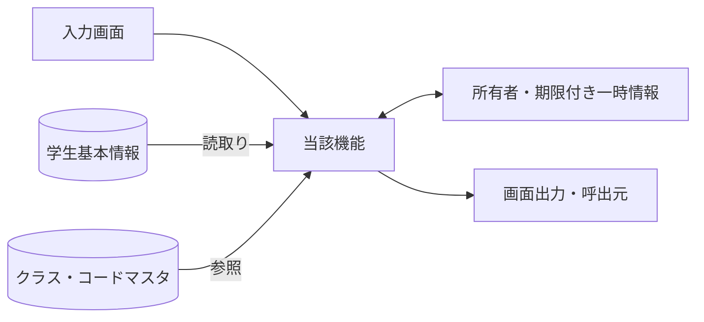
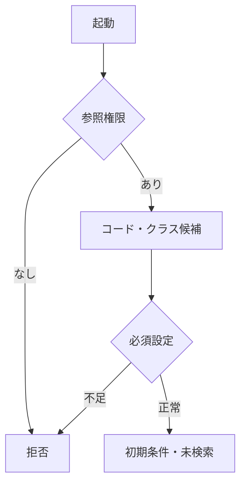
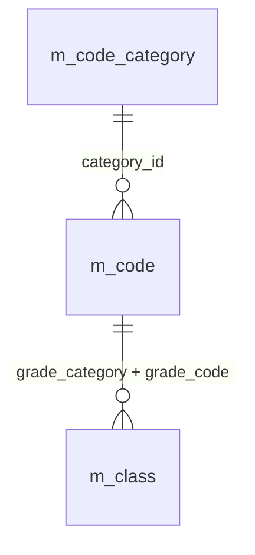
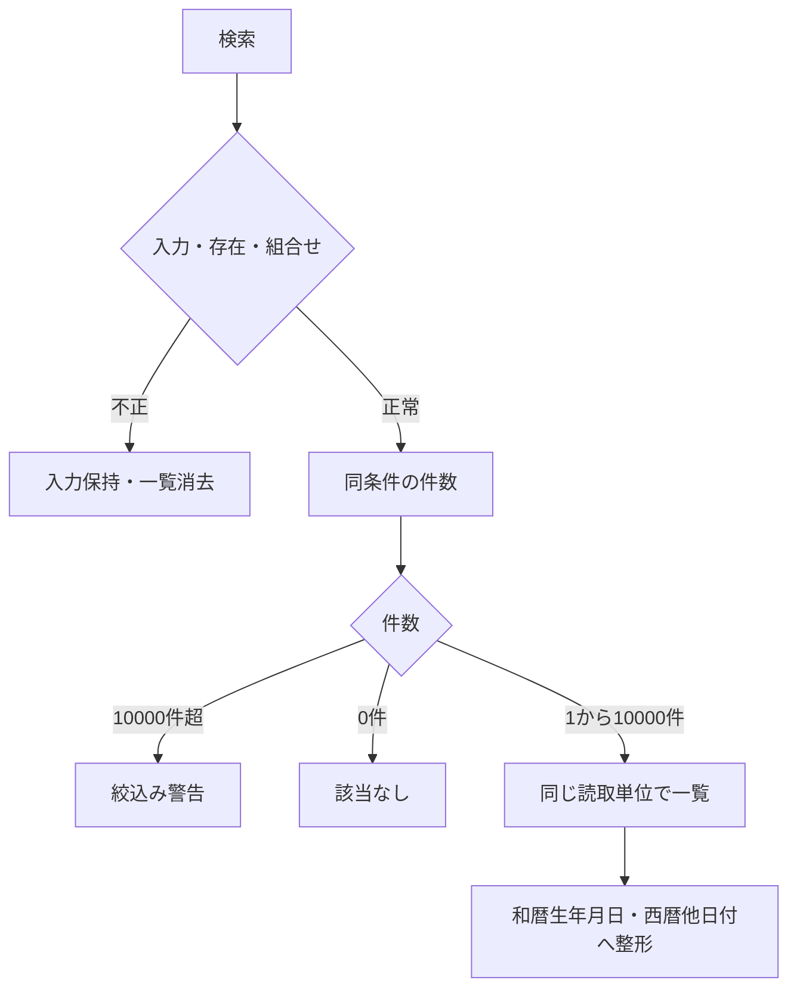
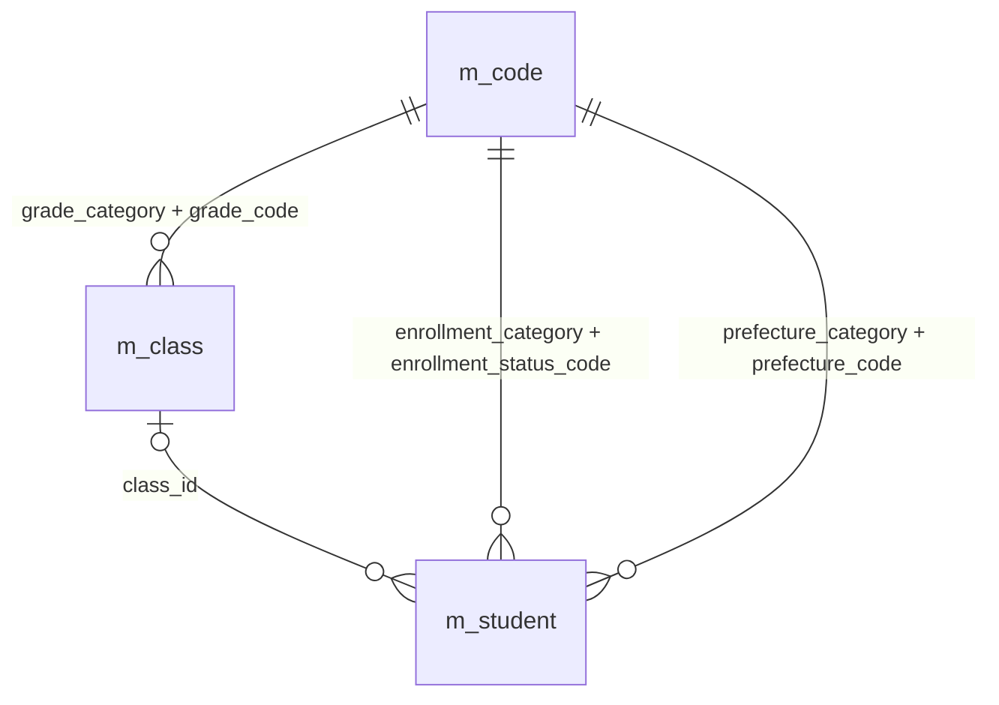
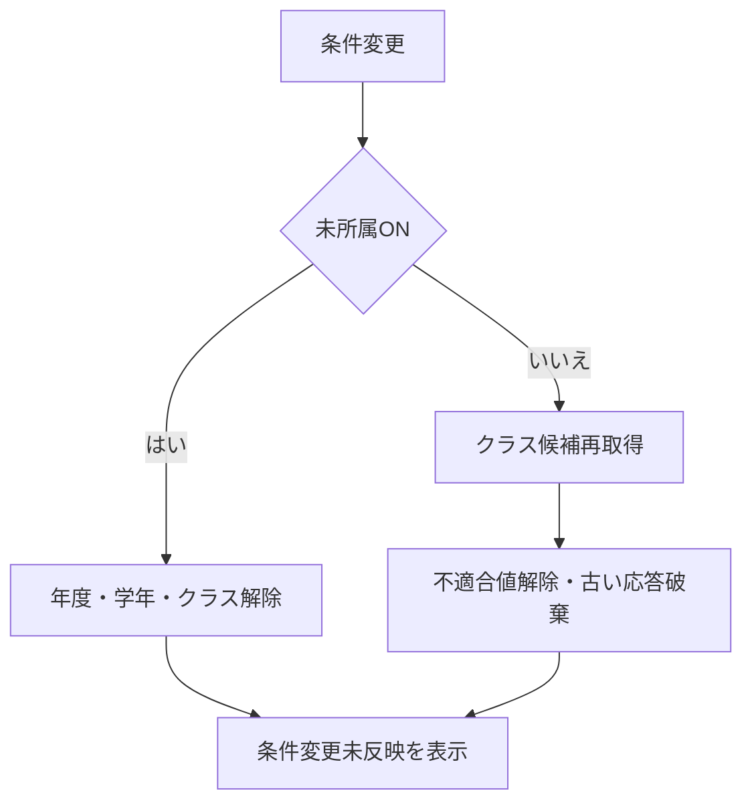
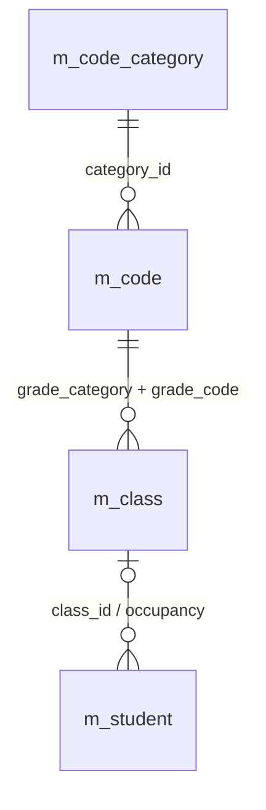
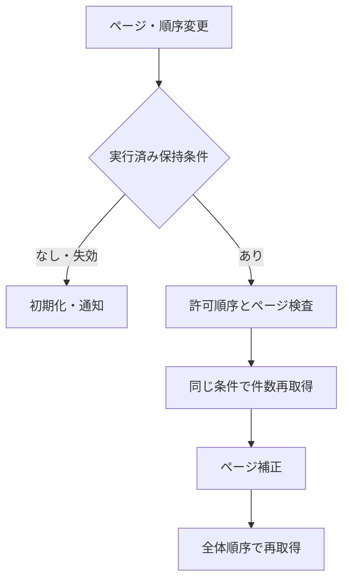
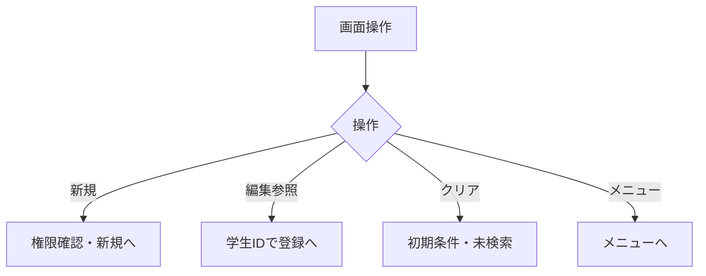
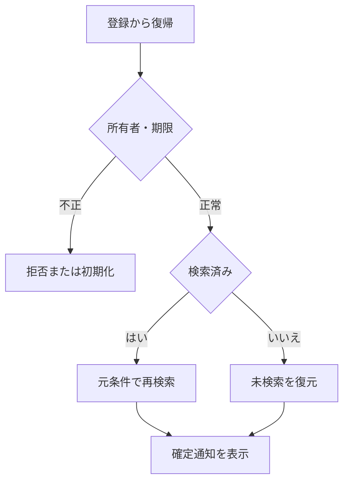

# 学生検索画面 詳細仕様書（VB.NET／WinForms）

| 項目 | 内容 |
| --- | --- |
| システム名 | 学生管理システム |
| 機能ID | SCR-STU-001 |
| 版数・改訂日 | 5.0／2026-10-10 |
| 対象読者 | 実務経験５年程度のプログラマー |
| 状態 | 実装前の設計仕様。実装・コンパイル・実機試験は未実施 |
| 開発方式 | VB.NET／WinForms |
| 対応基本設計 | [基本設計](../../基本設計書/01_学生検索画面.md) |

## 概要

### 概要説明

検索条件と一覧を管理する。業務DBは参照のみ。

| 責務 | 物理構成 |
| --- | --- |
| 画面・提示制御 | FrmStudentSearch / StudentSearchPresenter |
| 業務処理・共通呼出 | StudentApplicationService |
| 共通物理規約 | [言語依存仕様書](03_言語依存仕様書.md) |
| 原則 | DB列・変数・型は本書と共通実装規約。業務要件を言語都合で弱めない |

### 画面設計

#### 画面レイアウト（埋め込みHTML）

画面クラス`FrmStudentSearch`、提示制御`StudentSearchPresenter`、条件`StudentSearchCriteria`、一覧`BindingList(Of StudentListItem)`。検索フォームのインスタンスごとに`SearchContext`を持つ。

<table>
<caption>FrmStudentSearch：学生検索</caption>
<tr><th colspan="4">学生検索 ／ lblCurrentUser</th></tr>
<tr><td colspan="4">pnlMessages：未検索・エラー・検索結果の案内</td></tr>
<tr><th>学籍番号</th><td>［txtStudentNo］</td><th>氏名</th><td>［txtName］</td></tr>
<tr><th>氏名カナ</th><td>［txtKana］</td><th>年度</th><td>［cboSchoolYear ▼］</td></tr>
<tr><th>学年</th><td>［cboGrade ▼］</td><th>クラス</th><td>［cboClass ▼］</td></tr>
<tr><th>所属</th><td>□ chkUnassignedOnly</td><th>在籍区分</th><td>☑在学 ☑休学 □卒業 □退学：clbStatuses</td></tr>
<tr><th>都道府県</th><td>［cboPrefecture ▼］</td><th>電話</th><td>［txtPhone］</td></tr>
<tr><th>入学日</th><td colspan="3">［dtpAdmissionFrom］～［dtpAdmissionTo］</td></tr>
<tr><td colspan="4">［btnSearch 検索］ ［btnClear クリア］ ［btnNew 新規］ ［btnMenu メニュー］</td></tr>
<tr><td colspan="4">lblCount ／ cboPageSize［20 ▼］ ／ cboSortKey［学籍番号 ▼］ ／ cboSortDirection［昇順 ▼］ ／ lblSearchedAt</td></tr>
</table>
<table>
<caption>dgvStudents：参照専用DataGridView</caption>
<tr><th>学籍番号</th><th>氏名</th><th>カナ</th><th>生年月日</th><th>年度</th><th>学年</th><th>クラス</th><th>在籍</th><th>住所</th><th>本人電話</th><th>更新日時</th><th>操作</th></tr>
<tr><td>S2026-0001</td><td>見本 太郎</td><td>ミホン タロウ</td><td>平成20年05月15日</td><td>2026</td><td>学年なし</td><td>C-A Aクラス</td><td>在学</td><td>東京都 見本市1-1</td><td>－</td><td>2026/10/10 09:00</td><td>編集</td></tr>
</table>

［btnFirst］［btnPrev］ lblPage ［btnNext］［btnLast］

生年月日は和暦、その他は西暦。HTMLは静的な仕様表現であり、ネイティブ画面方式をWebへ変更しない。

#### 表示状態・モード別制御

[共通UI状態](../../共通/04_共通UI部品設計.md)に従う。初回は未検索。処理中は二重検索を抑止し、0件・上限超過・検索失敗を区別する。参照権限では新規登録を表示せず行操作を参照とする。検索画面では生年月日を編集しない。

### ファイル・DB入出力関係

#### 入出力一覧

方向は当該機能から見たもの。画面入力、DB読取り、DB書込みを区別する。

| IO-ID | 分類 | 対象 | 入出力 | 主な項目 | 保存単位・備考 |
| --- | --- | --- | --- | --- | --- |
| 01 | 画面 | 入力条件・操作 | 入力 | 当該機能の項目一覧 | 要求開始時の値を複製 |
| 02 | 永続DB | m_student | 入力（参照） | 学生基本情報・版 | 更新なし |
| 03 | 永続DB | m_class | 入力（参照） | 年度・学年・名称・期間・定員 | 学生機能からマスタを更新しない |
| 04 | 永続DB | m_code_category / m_code | 入力（参照） | 分類・値・名称・有効性 | 学生機能からマスタを更新しない |
| 05 | 一時情報 | フォーム別SearchContext | 入出力 | 確定検索条件・ページ・原入力・確認対象 | 業務表と別。所有者・期限を検査 |
| 06 | 外部ファイル | なし | なし | CSV・帳票・取込は本機能の対象外 | 仕様書MDを業務IOに数えない |
| 07 | 画面 | 一覧・メッセージ | 出力 | 個人情報は必要項目のみ | DB保存とは別の出力 |

#### データ操作関連図

認証情報・業務日時は共通01～03から取得。マスタ保守の承認入力ファイルは画面機能のIOに含めず、方式別言語依存仕様に定義する。

## 項目一覧

### 項目別DB連携説明

| 項目ID | 論理項目名 | 連携方向 | 関連論理DB項目 | 物理列・処理値 | 候補参照キー | DB連携・変換説明 |
| --- | --- | --- | --- | --- | --- | --- |
| SRC-001 | 学籍番号 | I（検索条件） | 学生基本情報・学籍番号 | m_student.student_no | － | 前方一致、N-06。保存なし |
| SRC-002 | 氏名 | I（検索条件） | 学生基本情報・氏名照合用情報 | m_student.name_key | － | N-03後の部分一致。氏名の原表記と区別 |
| SRC-003 | 氏名カナ | I（検索条件） | 学生基本情報・氏名カナ照合用情報 | m_student.kana_key | － | N-05後の部分一致 |
| SRC-004 | 年度 | I（検索条件） | クラスマスタ・学校年度 | m_class.school_year | 年度 | 完全一致。西暦1900～9998、DATE-R04 |
| SRC-005 | 学年 | I（検索条件） | クラスマスタ・学年 | m_class.grade_code | 学年 | 完全一致。学年なしと未所属は別 |
| SRC-006 | クラス | I（検索条件） | 学生基本情報・現在・最終所属クラス | m_student.class_id | クラス | 完全一致。年度・学年は選択クラス実値と照合 |
| SRC-007 | 未所属のみ | I（検索条件） | 学生基本情報・現在・最終所属クラス | m_student.class_id | － | 未設定だけ。年度・学年・クラスと排他 |
| SRC-008 | 在籍区分 | I（検索条件） | 学生基本情報・在籍区分 | m_student.enrollment_status_code | 在籍区分 | 複数値はいずれか一致、全解除は全区分 |
| SRC-009 | 都道府県 | I（検索条件） | 学生基本情報・都道府県 | m_student.prefecture_code | 都道府県 | コード値で完全一致 |
| SRC-010 | 電話番号 | I（検索条件） | 学生基本情報・本人電話／緊急連絡先電話 | m_student.phone_number / emergency_phone_number | － | N-09後の完全一致、本人または緊急電話 |
| SRC-011 | 入学日・開始 | I（検索条件） | 学生基本情報・入学日 | m_student.admission_date | － | 開始日を含む。DATE-R03、片側指定可 |
| SRC-012 | 入学日・終了 | I（検索条件） | 学生基本情報・入学日 | m_student.admission_date | － | 終了日を含む。DATE-R03、開始≦終了 |
| SRC-013 | 検索 | 操作 | DB保存なし | － | － | 入力検査後、最初のページを取得 |
| SRC-014 | クリア | 操作 | DB保存なし | － | － | 初期条件・未検索へ、保持条件を消去 |
| SRC-015 | 新規登録 | 操作 | DB保存なし | － | － | 権限を確認し学生登録へ遷移 |
| SRC-016 | メニューへ | 操作 | DB保存なし | － | － | 共通メニューへ |
| SRC-017 | 検索件数・表示範囲 | O（表示） | 計算：全条件一致の学生件数 | count of matching student_id | － | 未検索／0件／上限超過を区別 |
| SRC-018 | 検索日時 | O（表示） | 計算：今回の検索実行日時 | RequestContext.ExecutedAt | － | 西暦日時、日本時間。DB保存なし |
| SRC-019 | 表示件数 | I（表示指定） | DB保存なし：取得範囲 | pageSize | 表示件数 | 20／50／100、既定20 |
| SRC-020 | 学籍番号 | O（表示） | 学生基本情報・学籍番号 | m_student.student_no | － | 保存済み文字列、文字順 |
| SRC-021 | 氏名 | O（表示） | 学生基本情報・学生氏名 | m_student.student_name | － | 登録表記のまま文字列表示 |
| SRC-022 | 氏名カナ | O（表示） | 学生基本情報・学生氏名カナ | m_student.student_name_kana | － | 保存済みカナ表記 |
| SRC-023 | 生年月日 | O（表示） | 学生基本情報・生年月日 | m_student.birth_date | － | 和暦表示。共通16で日付から変換 |
| SRC-024 | 年度・学年 | O（表示） | クラスマスタ・学校年度／学年→コード管理マスタ（学年）・コード名称 | m_class.school_year / grade_code → m_code.code_name | － | 年度は西暦、学年は名称。未所属は－ |
| SRC-025 | クラス | O（表示） | 学生基本情報・現在・最終所属クラス→クラスマスタ・クラスコード／クラス名 | m_student.class_id → m_class.class_code / class_name | － | 未所属／停止／期間外を区別 |
| SRC-026 | 在籍区分 | O（表示） | 学生基本情報・在籍区分→コード管理マスタ（在籍区分）・コード名称 | m_student.enrollment_status_code → m_code.code_name | － | 種別と値で結合、名称未取得でも学生行を落とさない |
| SRC-027 | 住所 | O（表示） | 学生基本情報・都道府県→コード管理マスタ（都道府県）・コード名称＋学生基本情報・住所1 | m_code.code_name + m_student.address_line1 | － | 都道府県名と住所1を連結。住所2は表示しない |
| SRC-028 | 本人電話 | O（表示） | 学生基本情報・本人電話 | m_student.phone_number | － | 未設定は－。緊急電話を一覧へ出さない |
| SRC-029 | 更新日時 | O（表示） | 学生基本情報・更新日時 | m_student.updated_at | － | 西暦日時、日本時間 |
| SRC-030 | 編集／参照 | 操作 | 学生基本情報・学生管理番号 | m_student.student_id | － | 行番号ではなく対象IDで遷移、遷移先で再取得 |
| SRC-031 | ページ操作 | 操作 | DB保存なし：取得範囲 | page / pageSize | － | 先頭・前・次・最後。有効範囲へ再補正 |
| SRC-032 | 並び順項目 | I（表示指定） | 検索：学籍番号／氏名照合用情報／入学日／更新日時 | sortKey | 並び順 | 許可4項目。最後に学生ID昇順を加える |
| SRC-033 | 並び順方向 | I（表示指定） | DB保存なし：取得順 | sortDirection | 昇降順 | 昇順／降順。初期は昇順 |

項目IDの数値部は基本設計の従来番号を維持する。表示・検索・保存は同じ項目でも異なる経路となる。候補参照キーは次節で定義する。

### 物理バインド・変数定義

#### 検索項目・変数

| コントロール | プロパティ | 検索対象・方式 |
| --- | --- | --- |
| txtStudentNo | StudentNoPrefix As String | student_no、前方一致、20文字 |
| txtName | NameKey As String | name_key、正規化部分一致、入力100文字 |
| txtKana | KanaKey As String | kana_key、正規化部分一致、保存相当100文字 |
| cboSchoolYear | SchoolYear As Integer? | m_class.school_year |
| cboGrade | GradeCode As String | m_class.grade_code、分類GRADE |
| cboClass | ClassId As Long? | m_student.class_id |
| chkUnassignedOnly | UnassignedOnly As Boolean | class_id IS NULL、他所属条件と排他 |
| clbStatuses | StatusCodes As IReadOnlyList(Of String) | enrollment_status_code、複数OR、空はすべて |
| cboPrefecture | PrefectureCode As String | prefecture_code |
| txtPhone | PhoneNumber As String | 本人・緊急電話の完全一致 |
| dtpAdmissionFrom/To | AdmissionFrom/To As DateOnly? | admission_date両端含む |
| cboPageSize | PageSize As Integer | 20/50/100 |
| cboSortKey/Direction | SortKey/Direction As String | studentNo/name/admissionDate/updatedAt、asc/desc |

任意日付のDateTimePickerはShowCheckBox=True、Checked=Falseを未設定とする。Checked=True時だけValueをDateOnlyへ変換。表示された当日日付を無条件に条件へ使わない。ComboBoxはDropDownList、ValueMemberをID／コード、DisplayMemberを名称とする。

#### 型と制御情報

| 対象 | 規約 |
| --- | --- |
| 日付型 | DateOnly / DateOnly? |
| ID・版 | 方式別ID型を使用し近似数へ変換しない。新規は対象・期待版なし、更新削除は正のID・期待版必須 |
| 隠し状態 | 原スナップショット、編集値、期待版、戻りContext、確認Token、要求連番、Busyを分離。利用者権限は入力にしない |
| 生年月日 | 一覧の日付値→共通16→和暦表示（入力なし） |
| 一覧出力 | 一覧取得DTOはOP-PAGEの11表示項目＋学生ID。birth_dateは和暦表示へ、updated_atは西暦日本時間へ変換 |
| 未設定 | 任意文字の空は共通04でNULL相当。変換失敗をNULLや0にしない |

### 選択候補の参照元

| 候補参照キー | 参照元・分類 | 選択値 | 表示値 | 抽出条件 | 表示順 | 初期値・連動 |
| --- | --- | --- | --- | --- | --- | --- |
| 年度 | クラスマスタ・学校年度 | school_year | 年度 | 停止・過去年度を含め範囲1900～9998。新規登録は当年度を選択補助へ | 年度降順 | 検索すべて／登録当年度、クラス0件を区別 |
| 学年 | コード管理マスタ（学年） | GRADE / grade_code | コード名称 | 検索は停止を含む。新規選択は有効値、既存値は別枠保持 | 表示順→コード値 | すべて。学年なし00は未所属と別 |
| クラス | クラスマスタ・コード管理マスタ（学年） | class_id | 年度・学年・クラスコード・クラス名 | 検索は停止を含む。登録は共通モジュール07の新規所属／最終所属／既存保持の区別 | 年度降順→学年表示順→クラス表示順→コード→ID | 検索すべて／新規未選択。上位変更で不適合なら解除 |
| 在籍区分 | コード管理マスタ（在籍区分） | ENROLLMENT_STATUS / code_value | コード名称 | 検索は分類内の値。登録の新規選択は有効値。01～04は保護 | 表示順→コード値 | 検索01・02／新規登録01、全解除検索は全区分 |
| 都道府県 | コード管理マスタ（都道府県） | PREFECTURE / code_value | コード名称 | 検索は停止を含む。登録新規選択は有効、既存同値は保持 | 表示順→コード値 | 検索すべて／登録未選択 |
| 表示件数 | 共通UI固定定義 | 20 / 50 / 100 | 20件／50件／100件 | 固定3候補。業務コードではない | 20→50→100 | 20、変更で1ページへ |
| 並び順 | 共通UI固定定義 | studentNo / name / admissionDate / updatedAt | 学籍番号／氏名／入学日／更新日時 | 固定4候補。自由文字でDB列を指定しない | 左記順 | 学籍番号 |
| 昇降順 | 共通UI固定定義 | asc / desc | 昇順／降順 | 固定2候補 | 昇順→降順 | 昇順 |

取得入口はOP-CODE→共通モジュール06、OP-CLASS→共通モジュール07、元号→共通モジュール16。候補取得メソッドには用途・既存値・業務日を渡し、画面で送信された候補配列や名称を保存根拠にしない。戻り値はValue／Label／Selectable／Warning、クラスには年度・学年・期間・参考人数を含める。

## イベント仕様

### EV-SRC-001 初期表示

#### 処理概要

認証済み利用者がメニューから起動。学生一覧は取得しない。

#### 処理手順

1. 共通01・02で参照権限を確認し、共通03で業務日時を確定する。
2. OP-CODE・OP-CLASSで候補取得。在学・休学、20件、学籍番号昇順、未検索を設定する。必須マスタ不足なら検索を不可とする。
3. 共通12の画面別状態を作成する。復帰識別がある場合はEV-SRC-006へ進む。

##### 実装詳細

入口：`Shown`。機能内の入力・結果型は項目一覧、共通実装は[言語依存仕様](03_言語依存仕様書.md)を使用する。 `Draft`相当の未実行値と`AppliedCriteria`相当の確定条件を分離。呼出引数を複製し、結果を返した要求が最新であることを確認して画面へ移送する。

#### 処理フロー

#### SQL・テーブル関連（ER図）

名称参照は未所属・停止値を残す外部結合相当。コードは用途ごとの別名で**分類と値**を結合する。図は読取りの関連であり、履歴への書込みや削除連動を意味しない。単独の存在確認・採番・書込みの表関連は下記操作IDで特定する。

#### DB操作の詳細

`OP-CODE` → `OP-CLASS`。下記「DB操作定義」の同名操作を実行する。

#### 結果・例外時の扱い

入力不備は項目エラーと原入力を保持。検索要求の失敗は一覧消去、0件はI-SRC-001、上限超過はW-SRC-001。権限不備・他者の保持情報は拒否する。候補連動だけでは既存一覧を再検索しない。 各イベントで実行していない処理の結果状態は発生対象外。

### EV-SRC-002 検索実行

#### 処理概要

入力した検索条件で、非削除学生を検索する。

#### 処理手順

1. 入力を複製し共通04・05・17で正規化、桁、日付範囲、選択値、未所属条件を検査する。項目エラーは入力保持・一覧消去、DB検索なし。
2. OP-EXISTSでコード分類・クラス・年度・学年の存在と整合を検査する。検索では停止・期間外の既存値を許容する。
3. OP-COUNT・OP-PAGEへ同じ確定条件を渡す。10001件で上限、0件は該当なし、それ以外は最初のページを表示する。件数と一覧の読取りを揃える。
4. 正常時に実行済み条件を共通12へ保持。生年月日は共通16で和暦表示。他の日付・日時は西暦。

##### 実装詳細

入口：`btnSearch.Click`。機能内の入力・結果型は項目一覧、共通実装は[言語依存仕様](03_言語依存仕様書.md)を使用する。 `Draft`相当の未実行値と`AppliedCriteria`相当の確定条件を分離。呼出引数を複製し、結果を返した要求が最新であることを確認して画面へ移送する。

#### 処理フロー

#### SQL・テーブル関連（ER図）

名称参照は未所属・停止値を残す外部結合相当。コードは用途ごとの別名で**分類と値**を結合する。図は読取りの関連であり、履歴への書込みや削除連動を意味しない。単独の存在確認・採番・書込みの表関連は下記操作IDで特定する。

#### DB操作の詳細

`OP-EXISTS` → `OP-COUNT` → `OP-PAGE`。下記「DB操作定義」の同名操作を実行する。

#### 結果・例外時の扱い

入力不備は項目エラーと原入力を保持。検索要求の失敗は一覧消去、0件はI-SRC-001、上限超過はW-SRC-001。権限不備・他者の保持情報は拒否する。候補連動だけでは既存一覧を再検索しない。 各イベントで実行していない処理の結果状態は発生対象外。

### EV-SRC-003 条件連動

#### 処理概要

年度・学年・クラス・未所属の変更。学生検索はまだ実行しない。

#### 処理手順

1. 未所属ONなら年度・学年・クラスを解除し非活性、OFFでも元の条件を勝手に戻さない。
2. OP-CLASSへ選択済み年度・学年を渡し候補を再取得。不適合クラスは解除しW-STU-107。クラス先行選択なら実際の年度・学年を反映する。
3. 候補要求の応答順を照合して古い応答は破棄。変更未反映を表示し実行済み条件は維持する。

##### 実装詳細

入口：`SelectedIndexChanged / CheckedChanged`。機能内の入力・結果型は項目一覧、共通実装は[言語依存仕様](03_言語依存仕様書.md)を使用する。 `Draft`相当の未実行値と`AppliedCriteria`相当の確定条件を分離。呼出引数を複製し、結果を返した要求が最新であることを確認して画面へ移送する。

#### 処理フロー

#### SQL・テーブル関連（ER図）

名称参照は未所属・停止値を残す外部結合相当。コードは用途ごとの別名で**分類と値**を結合する。図は読取りの関連であり、履歴への書込みや削除連動を意味しない。単独の存在確認・採番・書込みの表関連は下記操作IDで特定する。

#### DB操作の詳細

`OP-CLASS`。下記「DB操作定義」の同名操作を実行する。

#### 結果・例外時の扱い

入力不備は項目エラーと原入力を保持。検索要求の失敗は一覧消去、0件はI-SRC-001、上限超過はW-SRC-001。権限不備・他者の保持情報は拒否する。候補連動だけでは既存一覧を再検索しない。 各イベントで実行していない処理の結果状態は発生対象外。

### EV-SRC-004 並び替え・ページ移動

#### 処理概要

実行済み条件の結果を別の順序・ページで取得する。

#### 処理手順

1. 共通12から保持条件を取得。未検索は不可、期限切れはW-SRC-002。入力途中の条件を混ぜない。
2. 並び順4項目・方向2種・件数20/50/100・正のページ番号を検査する。並び順・件数変更時は1ページへ戻す。
3. OP-COUNT・OP-PAGEを再実行。件数減少時は最終有効ページへ補正。0件は一覧なし・ページ操作不可。

##### 実装詳細

入口：`ページ・ソートボタン`。機能内の入力・結果型は項目一覧、共通実装は[言語依存仕様](03_言語依存仕様書.md)を使用する。 `Draft`相当の未実行値と`AppliedCriteria`相当の確定条件を分離。呼出引数を複製し、結果を返した要求が最新であることを確認して画面へ移送する。

#### 処理フロー

#### SQL・テーブル関連（ER図）

名称参照は未所属・停止値を残す外部結合相当。コードは用途ごとの別名で**分類と値**を結合する。図は読取りの関連であり、履歴への書込みや削除連動を意味しない。単独の存在確認・採番・書込みの表関連は下記操作IDで特定する。

#### DB操作の詳細

`OP-COUNT` → `OP-PAGE`。下記「DB操作定義」の同名操作を実行する。

#### 結果・例外時の扱い

入力不備は項目エラーと原入力を保持。検索要求の失敗は一覧消去、0件はI-SRC-001、上限超過はW-SRC-001。権限不備・他者の保持情報は拒否する。候補連動だけでは既存一覧を再検索しない。 各イベントで実行していない処理の結果状態は発生対象外。

### EV-SRC-005 新規・編集・参照・クリア

#### 処理概要

行操作または機能ボタンを受け付ける。

#### 処理手順

1. 新規は作成権限を確認し学生登録へ。検索条件を登録値へ流用しない。
2. 編集・参照は選択行の学生管理番号で登録機能を起動する。行番号・表示名を識別子にしない。読込みは登録側の責務。
3. クリアは初期条件・未検索へ戻し共通12も初期化。メニューへ戻る処理はDB更新なし。

##### 実装詳細

入口：`btnNew / dgvStudents.CellContentClick / btnClear`。機能内の入力・結果型は項目一覧、共通実装は[言語依存仕様](03_言語依存仕様書.md)を使用する。 `Draft`相当の未実行値と`AppliedCriteria`相当の確定条件を分離。呼出引数を複製し、結果を返した要求が最新であることを確認して画面へ移送する。

#### 処理フロー

#### SQL・テーブル関連（ER図）

DB参照なし。ER図は対象外。

#### DB操作の詳細

このイベントで業務DBを読み書きしない。遷移先の読込みと混同しない。

#### 結果・例外時の扱い

入力不備は項目エラーと原入力を保持。検索要求の失敗は一覧消去、0件はI-SRC-001、上限超過はW-SRC-001。権限不備・他者の保持情報は拒否する。候補連動だけでは既存一覧を再検索しない。 各イベントで実行していない処理の結果状態は発生対象外。

### EV-SRC-006 学生登録からの復帰

#### 処理概要

保存・削除・取消・戻るから検索状態を復元する。

#### 処理手順

1. 共通12で所有者・認証・画面・期限を確認。他者状態は拒否、期限切れは初期化する。
2. 未検索から起動していた場合は未検索へ。検索済みなら元条件でOP-COUNT・OP-PAGEを再実行し最新DBを表示する。
3. 確定済み成功通知だけを表示。保存した学生が条件外でも検索条件を変更しない。

##### 実装詳細

入口：`登録Form終了`。機能内の入力・結果型は項目一覧、共通実装は[言語依存仕様](03_言語依存仕様書.md)を使用する。 `Draft`相当の未実行値と`AppliedCriteria`相当の確定条件を分離。呼出引数を複製し、結果を返した要求が最新であることを確認して画面へ移送する。

#### 処理フロー

#### SQL・テーブル関連（ER図）

名称参照は未所属・停止値を残す外部結合相当。コードは用途ごとの別名で**分類と値**を結合する。図は読取りの関連であり、履歴への書込みや削除連動を意味しない。単独の存在確認・採番・書込みの表関連は下記操作IDで特定する。

#### DB操作の詳細

`OP-COUNT` → `OP-PAGE`。下記「DB操作定義」の同名操作を実行する。

#### 結果・例外時の扱い

入力不備は項目エラーと原入力を保持。検索要求の失敗は一覧消去、0件はI-SRC-001、上限超過はW-SRC-001。権限不備・他者の保持情報は拒否する。候補連動だけでは既存一覧を再検索しない。 各イベントで実行していない処理の結果状態は発生対象外。

### DB操作定義

操作の業務契約は[共通データアクセス](../../共通/08_データアクセス仕様.md)が正本。本機能における具体的な対象・引数・確定単位は以下。

#### OP-CODE

| 項目 | 内容 |
| --- | --- |
| 対象テーブル | m_code_category / m_code |
| 操作 | 参照 |
| 実行条件・引数 | 分類、用途（検索／新規選択／既存表示）、既存値、業務日 |
| 取得・設定項目／対象条件 | 分類・値・名称・表示順・利用可否・期間。分類＋値で取得 |
| 件数・順序 | 候補0件を検出。既定値を先頭値へ代替しない |
| 確定・取消 | 参照のみ |

#### OP-CLASS

| 項目 | 内容 |
| --- | --- |
| 対象テーブル | m_class / m_code / m_student |
| 操作 | 参照 |
| 実行条件・引数 | 用途、年度、学年、在籍区分、在籍期間、既存所属、業務日、人数参照要否 |
| 取得・設定項目／対象条件 | 年度・学年・クラスID・コード・名称・期間・定員。人数集計は登録側で要求した場合のみ。検索の候補取得では学生を集計しない |
| 件数・順序 | 年度降順、学年表示順、クラス表示順、クラスコード、ID |
| 確定・取消 | 参照のみ、人数は予約ではない |

#### OP-EXISTS

| 項目 | 内容 |
| --- | --- |
| 対象テーブル | m_student / m_class / m_code_category / m_code |
| 操作 | 参照 |
| 実行条件・引数 | 用途（検索／保存）、分類付きコード・クラスID・選択補助。保存だけ対象ID・完全な学籍番号・期待版 |
| 取得・設定項目／対象条件 | 検索は指定コード・クラスの存在と年度学年の整合のみ。学籍番号前方一致に重複・完全一致存在検査をしない。保存は全行学籍番号一意、分類付き存在、変更有無、有効性を再検査 |
| 件数・順序 | 未存在／重複／組合せ／停止を区別。未指定の検索条件は検査対象外 |
| 確定・取消 | 検索は参照のみ、保存は保護した最新値で確認 |

#### OP-COUNT

| 項目 | 内容 |
| --- | --- |
| 対象テーブル | m_student s LEFT JOIN m_class c |
| 操作 | 参照 |
| 実行条件・引数 | 正規化後の実行済み検索条件 |
| 取得・設定項目／対象条件 | 非削除必須、指定項目AND、状態OR・電話OR。全条件一致IDだけ最大10001件 |
| 件数・順序 | 10001件は上限、10000件以下は実件数。0件は該当なし |
| 確定・取消 | OP-PAGEと同じ読取り整合性 |

#### OP-PAGE

| 項目 | 内容 |
| --- | --- |
| 対象テーブル | m_student s / m_class c / m_code g, es, p |
| 操作 | 参照 |
| 実行条件・引数 | OP-COUNTと同じ条件、ページ、件数、許可並び順 |
| 取得・設定項目／対象条件 | 一覧11項目＋学生ID。住所2・メール・緊急連絡先・備考を返さない |
| 件数・順序 | 全一致集合をソート後ページ化。同順位学生ID昇順 |
| 確定・取消 | 参照のみ、旧結果を最新として残さない |

### ネイティブイベント・通信の対応

#### 検索イベント

| イベント | 実装と処理 |
| --- | --- |
| Shown | `_initializing=True`で候補設定。在学・休学、20件、未検索。初期設定によるSelectedIndexChangedで検索しない |
| btnSearch.Click | UI値を一度読み取る→正規化・CHK検査→SearchAsync→件数上限→一覧へ反映。成功時だけAppliedCriteriaを更新 |
| 所属候補変更 | 未所属ONで年度・学年・クラス解除。非同期候補の要求番号を比較し古い応答を破棄 |
| ページ・ソート | 保持済AppliedCriteriaだけを使用。ソート／件数変更はpage=1。件数減少なら最終有効ページ補正 |
| dgvStudents.CellContentClick | 操作列以外は無視。DataBoundItem.StudentIdから対象を開く。RowIndexを学生IDにしない |
| btnNew.Click | Create権限→新規登録フォーム。検索条件を初期学生値に流用しない |
| 登録フォーム終了 | DialogResultと確定結果を確認し、検索済みなら元条件で再取得。未検索なら未検索 |
| btnClear.Click | 初期値・一覧空・保持状態初期化。学生DB変更なし |

`ReadOnly=True, AutoGenerateColumns=False, AllowUserToAddRows=False`。学生IDは非表示列またはモデルだけに保持。検索失敗・上限超過では古い一覧を消し、入力を残す。

## 補足説明

### 制約・正本

本書は1機能を対象とし、複数クラス・API・パネルはその内部実装である。マスタ保守、共通UI、物理テーブル、ビルド・配備は[言語依存仕様](03_言語依存仕様書.md)を参照する。

### 試験観点

[共通T-01～28](../../共通/06_要件対応・設計判断.md)と[DATE-T01～20](../../共通/07_日付・和暦仕様.md)の該当項目を実装工程で実施する。入力→処理値→DB→再表示を往復確認し、Unicode最大長、日付境界、停止候補、最終席競合、旧版、履歴失敗、保存結果不明を含める。

[レビュー結果](../../../docs/仕様書レビュー結果.md)。文書検査と実装試験合格を区別する。
