<!-- spec-meta: {"schema":"spec-md/1.0","documentId":"DET-VB.NET_WinForms-SCR-STU-002","version":"6.0","path":"spec/詳細仕様書/VB.NET_WinForms/02_学生登録画面.md","sheets":[{"heading":"概要","kind":"GRID","sheet":"01_概要"},{"heading":"項目一覧","kind":"LIST","sheet":"02_項目一覧","key":["項目ID"]},{"heading":"選択候補一覧","kind":"LIST","sheet":"03_選択候補一覧","key":["候補ID"]},{"heading":"内部項目一覧","kind":"LIST","sheet":"04_内部項目一覧","key":["内部項目ID"]},{"heading":"イベント仕様","kind":"GRID","sheet":"05_イベント仕様"},{"heading":"項目移送仕様","kind":"LIST","sheet":"06_項目移送仕様","key":["移送ID"]},{"heading":"項目更新仕様","kind":"LIST","sheet":"07_項目更新仕様","key":["更新ID"]},{"heading":"補足説明","kind":"GRID","sheet":"08_補足説明"}]} -->
# 学生登録画面 詳細仕様書（VB.NET／WinForms）

| 項目 | 内容 |
| --- | --- |
| システム名 | 学生管理システム |
| 機能ID | SCR-STU-002 |
| 版数・改訂日 | 6.0／2026-10-11 |
| 対象読者 | 実務経験５年程度のプログラマー |
| 状態 | 実装前の設計仕様。実装・コンパイル・実機試験は未実施 |
| 開発方式 | VB.NET／WinForms |
| 対応基本設計 | [基本設計](../../基本設計書/02_学生登録画面.md) |

## 概要

### 概要説明

学生1件の新規・編集・参照・論理削除。同じ画面のモードとして扱う。

| 責務 | 物理構成 |
| --- | --- |
| 画面・提示制御 | FrmStudentEdit / StudentEditPresenter |
| 業務処理・共通呼出 | StudentApplicationService |
| 共通実装仕様 | [方式別共通仕様・DB定義・開発規約](../../共通/方式別/VB.NET_WinForms/01_共通実装仕様.md) |
| 原則 | DB列・変数・型は本書・共通仕様・DB定義・開発規約。業務要件を言語都合で弱めない |

### 画面設計

#### 画面レイアウト（描画可能な埋め込みHTML）

画面の配置・色・入力欄・一覧・操作を表現した**静的HTMLモック**。サンプル値は架空。実装環境の実機画面ではなく、ブラウザーで描画した設計見本である。

[単独HTMLプレビュー](assets/学生登録.html)／[レンダリング画像](assets/学生登録.png)。GitHubのMarkdown表示でCSSや入力要素が除去される場合にも配置を確認できるよう画像を併記する。下記HTMLが画面設計の構造であり、画像だけで代替しない。

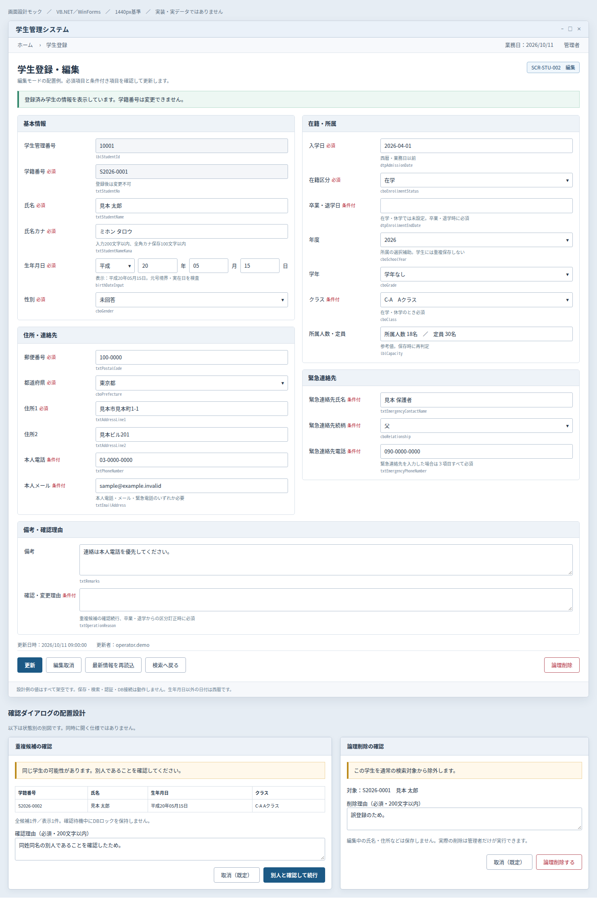

<!-- screen-html-start: REG -->

画面設計モック　／　VB.NET／WinForms　／　1440px基準　／　実装・実データではありません

<strong>学生管理システム</strong>−　□　×

ホーム　 ›　学生登録業務日：2026/10/11　　管理者

<h2>学生登録・編集</h2>
編集モードの配置例。必須項目と条件付き項目を確認して更新します。

SCR-STU-002　編集

登録済み学生の情報を表示しています。学籍番号は変更できません。

<section class="section">
基本情報

学生管理番号

<input class="input" aria-label="学生管理番号" value="10001" readonly>lblStudentId

学籍番号必須

<input class="input" aria-label="学籍番号" value="S2026-0001" maxlength="40" data-business-maxlength="20" readonly>
登録後は変更不可
txtStudentNo

氏名必須

<input class="input" aria-label="氏名" value="見本 太郎" maxlength="200" data-business-maxlength="100">txtStudentName

氏名カナ必須

<input class="input" aria-label="氏名カナ" value="ミホン タロウ" maxlength="400" data-business-maxlength="200">
入力200文字以内、全角カナ保存100文字以内
txtStudentNameKana

生年月日必須

平成▾
<input class="input" aria-label="元号年" data-part="year" value="20" maxlength="4">年<input class="input" aria-label="生年月日の月" data-part="month" value="05" maxlength="2">月<input class="input" aria-label="生年月日の日" data-part="day" value="15" maxlength="2">日

表示：平成20年05月15日。元号境界・実在日を検査
birthDateInput

性別必須

未回答▾
cboGender

</section><section class="section">
住所・連絡先

郵便番号必須

<input class="input" aria-label="郵便番号" value="100-0000" maxlength="20" data-business-maxlength="10">txtPostalCode

都道府県必須

東京都▾
cboPrefecture

住所1必須

<input class="input" aria-label="住所1" value="見本市見本町1-1" maxlength="400" data-business-maxlength="200">txtAddressLine1

住所2

<input class="input" aria-label="住所2" value="見本ビル201" maxlength="400" data-business-maxlength="200">txtAddressLine2

本人電話条件付

<input class="input" aria-label="本人電話" value="03-0000-0000" maxlength="64" data-business-maxlength="32">txtPhoneNumber

本人メール条件付

<input class="input" aria-label="本人メール" value="sample@example.invalid" maxlength="508" data-business-maxlength="254">
本人電話・メール・緊急電話のいずれか必要
txtEmailAddress

</section>

<section class="section">
在籍・所属

入学日必須

<input class="input" aria-label="入学日" value="2026-04-01" maxlength="10" data-business-maxlength="10">
西暦・業務日以前
dtpAdmissionDate

在籍区分必須

在学▾
cboEnrollmentStatus

卒業・退学日条件付

<input class="input" aria-label="卒業・退学日" value="" maxlength="10" data-business-maxlength="10">
在学・休学では未設定。卒業・退学時に必須
dtpEnrollmentEndDate

年度

2026▾

所属の選択補助。学生には重複保存しない
cboSchoolYear

学年

学年なし▾
cboGrade

クラス条件付

C-A　Aクラス▾

在学・休学のとき必須
cboClass

所属人数・定員

所属人数 18名　／　定員 30名

参考値。保存時に再判定
lblCapacity

</section><section class="section">
緊急連絡先

緊急連絡先氏名条件付

<input class="input" aria-label="緊急連絡先氏名" value="見本 保護者" maxlength="200" data-business-maxlength="100">txtEmergencyContactName

緊急連絡先続柄条件付

父▾
cboRelationship

緊急連絡先電話条件付

<input class="input" aria-label="緊急連絡先電話" value="090-0000-0000" maxlength="64" data-business-maxlength="32">
緊急連絡先を入力した場合は３項目すべて必須
txtEmergencyPhoneNumber

</section>

<section class="section">
備考・確認理由

備考

<textarea rows="3" maxlength="2000" data-business-maxlength="1000" aria-label="備考">連絡は本人電話を優先してください。</textarea>txtRemarks

確認・変更理由条件付

<textarea rows="2" maxlength="400" data-business-maxlength="200" aria-label="確認・変更理由"></textarea>
重複候補の確認続行、卒業・退学からの区分訂正時に必須
txtOperationReason

</section>
更新日時：2026/10/11 09:00:00　　更新者：operator.demo

<button type="button" data-field-id="REG-027" data-control="btnSave" data-binding="Save" class="primary">更新</button><button type="button" data-field-id="REG-028" data-control="btnReset" data-binding="Reset" class="">編集取消</button><button type="button" data-field-id="REG-029" data-control="btnReload" data-binding="Reload" class="">最新情報を再読込</button><button type="button" data-field-id="REG-030" data-control="btnBack" data-binding="Back" class="">検索へ戻る</button><button type="button" data-field-id="REG-031" data-control="btnDelete" data-binding="Delete" class="danger">論理削除</button>

設計例の値はすべて架空です。保存・検索・認証・DB接続は動作しません。生年月日以外の日付は西暦です。

<h3>確認ダイアログの配置設計</h3>
以下は状態別の別図です。同時に開く仕様ではありません。

<h4>重複候補の確認</h4>

同じ学生の可能性があります。別人であることを確認してください。
<table><tr><th>学籍番号</th><th>氏名</th><th>生年月日</th><th>クラス</th></tr><tr><td>S2026-0002</td><td>見本 太郎</td><td>平成20年05月15日</td><td>C-A Aクラス</td></tr></table>
全候補1件／表示1件。確認待機中にDBロックを保持しません。
<label>確認理由（必須・200文字以内）<textarea maxlength="400" data-business-maxlength="200" rows="2" aria-label="確認理由">同姓同名の別人であることを確認したため。</textarea></label>
<button type="button" data-field-id="REG-034" data-control="DlgDuplicateConfirm.btnCancel" data-binding="Cancel" class="">取消（既定）</button><button type="button" data-field-id="REG-033" data-control="DlgDuplicateConfirm.btnConfirm" data-binding="Confirm" class="primary">別人と確認して続行</button>

<h4>論理削除の確認</h4>

この学生を通常の検索対象から除外します。

対象：S2026-0001　見本 太郎
<label>削除理由（必須・200文字以内）<textarea maxlength="400" data-business-maxlength="200" rows="2" aria-label="削除理由">誤登録のため。</textarea></label>
編集中の氏名・住所などは保存しません。実際の削除は管理者だけが実行できます。

<button type="button">取消（既定）</button><button type="button" class="danger">論理削除する</button>

<!-- screen-html-end: REG -->

#### 表示状態・モード別制御

[共通UI状態](../../共通/04_共通UI部品設計.md)に従う。参照権限では全業務項目読取専用・保存不可。編集でも学籍番号・管理項目は変更不可。新規の生年月日・入学日は空。元号・年・月・日の原入力と正規化後日付を分け、エラー時に原入力を失わない。

### ファイル・DB入出力関係

#### 入出力一覧

方向は当該機能から見たもの。画面入力、DB読取り、DB書込みを区別する。

| IO-ID | 分類 | 対象 | 入出力 | 主な項目 | 保存単位・備考 |
| --- | --- | --- | --- | --- | --- |
| 01 | 画面 | 入力値・操作・確認理由 | 入力 | 当該機能の項目一覧 | 要求開始時の値を複製 |
| 02 | 永続DB | m_student | 入出力（参照・登録・更新・論理削除） | 学生基本情報・版 | 学生1件。履歴と一括確定 |
| 03 | 永続DB | m_class | 入力（参照） | 年度・学年・名称・期間・定員 | 学生機能からマスタを更新しない |
| 04 | 永続DB | m_code_category / m_code | 入力（参照） | 分類・値・名称・有効性 | 学生機能からマスタを更新しない |
| 08 | 永続DB | t_operation_log | 出力（追記） | 対象・前後版・変更項目名・実行者・理由 | 学生変更と同一保存単位、実変更時のみ1件 |
| 05 | 一時情報 | フォーム別SearchContext | 入出力 | 確定検索条件・ページ・原入力・確認対象 | 業務表と別。所有者・期限を検査 |
| 06 | 外部ファイル | なし | なし | CSV・帳票・取込は本機能の対象外 | 仕様書MDを業務IOに数えない |
| 07 | 画面 | 表示値・確認・保存結果 | 出力 | 個人情報は必要項目のみ | DB保存とは別の出力 |

#### データ操作関連図

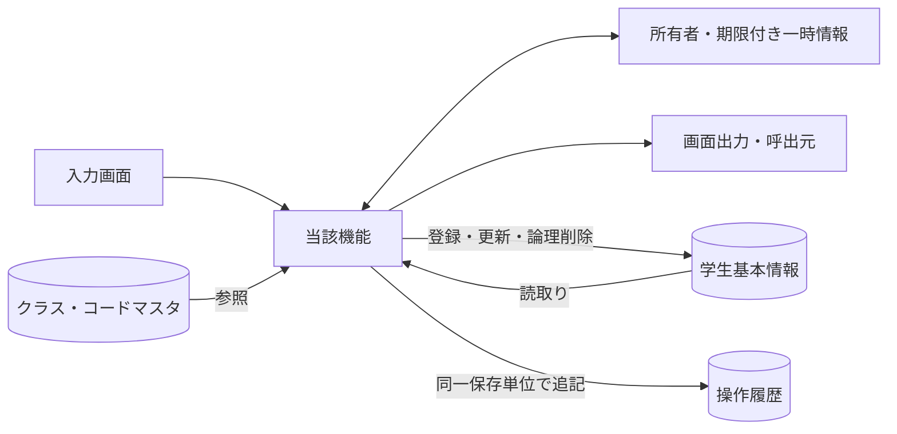

認証情報・業務日時は共通01～03から取得。マスタ保守の承認入力ファイルは画面機能のIOに含めず、方式別共通仕様に定義する。

### 実装契約の配置

共用クラス／プログラム構造は[方式別共通仕様](../../共通/方式別/VB.NET_WinForms/01_共通実装仕様.md)、SQLの永続項目・制約は[DB定義](../../DB定義/PostgreSQL/01_DB定義書.md)、命名・配備は[開発規約](../../../docs/開発規約/VB.NET_WinForms.md)へ分離する。本機能の具体的な画面・変数・DB割当・イベント順序は本書を正とし、共通契約を引数と結果で具体化する。

## 項目一覧

| 項目ID | グループ | 論理項目名 | 種類 | 入出力 | 入力最大長 | 保存・正規化最大長 | 長さ単位 | 必須区分 | 必須条件 | 初期値 | 未設定値 | 表示形式・許容範囲 | 関連論理DB項目 | 物理コントロール | 変数・プロパティ | 言語型 | 物理DB項目 | 候補ID | 正規化ID | チェックID | 関連イベント | DB連携説明 | Raw入力表現 | 対応DB型 | 対応DB_NULL可否 |
| --- | --- | --- | --- | --- | --- | --- | --- | --- | --- | --- | --- | --- | --- | --- | --- | --- | --- | --- | --- | --- | --- | --- | --- | --- | --- |
| REG-001 | 基本 | 学生管理番号 | 表示 | O（表示） | 非適用 | 非適用 | 非適用 | 自動表示 | 入力対象外。取得結果または計算値を表示 | システム設定 | 表示欠損は－、マスタ欠落は不整合表示 | ID正の整数 | 学生基本情報・学生管理番号 | lblStudentId | StudentId | 表示DTO／複合項目は内部項目一覧 | m_student.student_id | － | 非適用 | 非適用 | EV-REG-001,EV-REG-002 | 表示のみ、登録時自動採番 | 入力対象外 | m_student.student_id:bigint GENERATED ALWAYS AS IDENTITY | m_student.student_id:不可 |
| REG-002 | 基本 | 学籍番号 | 文字入力 | I/O（表示・保存） | 20 | 20 | Unicodeスカラー値 | 必須 | 新規登録時。既存は表示のみ・変更不可 | 新規は空／未設定 | 不可 | 20文字 | 学生基本情報・学籍番号 | txtStudentNo | StudentEditModel.StudentNo | String | m_student.student_no | － | N-06 | CHK-001,CHK-002,CHK-003,CHK-004 | EV-REG-004 | 新規のみ設定。登録後不変、削除済み含め一意 | 画面文字列（空・不正を保持） | m_student.student_no:varchar(20) | m_student.student_no:不可 |
| REG-003 | 基本 | 氏名 | 文字入力 | I/O（表示・保存） | 100 | 100 | Unicodeスカラー値 | 必須 | 通常保存時 | 新規は空／未設定 | 不可 | 100文字 | 学生基本情報・学生氏名 | txtStudentName | StudentEditModel.StudentName | String | m_student.student_name | － | N-02 | CHK-001,CHK-002,CHK-005 | EV-REG-004 | N-02、原表記を保存 | 画面文字列（空・不正を保持） | m_student.student_name:varchar(100) | m_student.student_name:不可 |
| REG-004 | 基本 | 氏名カナ | 文字入力 | I/O（表示・保存） | 200 | 100 | Unicodeスカラー値 | 必須 | 通常保存時 | 新規は空／未設定 | 不可 | 入力200、変換後100文字 | 学生基本情報・学生氏名カナ | txtStudentNameKana | StudentEditModel.StudentNameKana | String | m_student.student_name_kana | － | N-04,N-05 | CHK-001,CHK-002,CHK-006,CHK-005 | EV-REG-004 | N-04、全角カナ100文字 | 画面文字列（空・不正を保持） | m_student.student_name_kana:varchar(100) | m_student.student_name_kana:不可 |
| REG-005 | 基本 | 生年月日 | 和暦日付 | I/O（表示・保存） | 元号10・年4・月2・日2 | 日付 | 年4桁・ISO10文字 | 必須 | 元号・年・月・日すべて。新規は全部空 | 新規は空／未設定 | 不可 | 和暦（DATE-R01） | 学生基本情報・生年月日 | birthDateInput | StudentEditModel.BirthDate | DateOnly? | m_student.birth_date | 元号 | N-11 | CHK-001,CHK-007,CHK-008,CHK-032,CHK-033 | EV-REG-004 | 和暦入力→厳密変換→日付保存、DATE-R01 | 元号・年・月・日のraw文字列4値 | m_student.birth_date:date | m_student.birth_date:不可 |
| REG-006 | 基本 | 性別 | 選択 | I/O（表示・保存） | 1 | 1 | 数字またはASCII文字 | 必須 | 未回答を0として許容。NULL不可 | 0（未回答） | 不可 | 数字1桁。候補一覧の分類・値 | 学生基本情報・性別 | cboGender | StudentEditModel.GenderCode | String | m_student.gender_code | 性別 | N-07 | CHK-010,CHK-011 | EV-REG-004 | コード値保存／性別分類のコード名称表示 | 画面文字列（空・不正を保持） | m_student.gender_code:varchar(1) | m_student.gender_code:不可 |
| REG-007 | 住所 | 郵便番号 | 文字入力 | I/O（表示・保存） | 10 | 7 | Unicodeスカラー値 | 必須 | 通常保存時 | 新規は空／未設定 | 不可 | 入力10文字、保存7桁 | 学生基本情報・郵便番号 | txtPostalCode | StudentEditModel.PostalCode | String | m_student.postal_code | － | N-08 | CHK-001,CHK-002,CHK-016 | EV-REG-004 | N-08、数字7桁保存、3桁－4桁表示 | 画面文字列（空・不正を保持） | m_student.postal_code:varchar(7) | m_student.postal_code:不可 |
| REG-008 | 住所 | 都道府県 | 選択 | I/O（表示・保存） | 2 | 2 | 数字またはASCII文字 | 必須 | 通常保存時 | 新規は空／未設定 | 不可 | 数字2桁。候補一覧の分類・値 | 学生基本情報・都道府県 | cboPrefecture | StudentEditModel.PrefectureCode | String | m_student.prefecture_code | 都道府県 | N-07 | CHK-001,CHK-010,CHK-011 | EV-REG-004 | コード値保存／都道府県分類の名称表示 | 画面文字列（空・不正を保持） | m_student.prefecture_code:varchar(2) | m_student.prefecture_code:不可 |
| REG-009 | 住所 | 住所1 | 文字入力 | I/O（表示・保存） | 200 | 200 | Unicodeスカラー値 | 必須 | 通常保存時 | 新規は空／未設定 | 不可 | 200文字 | 学生基本情報・住所1 | txtAddressLine1 | StudentEditModel.AddressLine1 | String | m_student.address_line1 | － | N-02 | CHK-001,CHK-002 | EV-REG-004 | N-02、市区町村・番地、200文字 | 画面文字列（空・不正を保持） | m_student.address_line1:varchar(200) | m_student.address_line1:不可 |
| REG-010 | 住所 | 住所2 | 文字入力 | I/O（表示・保存） | 200 | 200 | Unicodeスカラー値 | 任意 | 空白除去後空はNULL | 新規は空／未設定 | NULL相当 | 200文字 | 学生基本情報・住所2 | txtAddressLine2 | StudentEditModel.AddressLine2 | String | m_student.address_line2 | － | N-02 | CHK-002 | EV-REG-004 | N-02、任意200文字、空は未設定 | 画面文字列（空・不正を保持） | m_student.address_line2:varchar(200) | m_student.address_line2:可 |
| REG-011 | 連絡先 | 本人電話 | 文字入力 | I/O（表示・保存） | 32 | 16 | Unicodeスカラー値 | 条件付き | 本人電話・本人メール・緊急電話のいずれか1つ以上 | 新規は空／未設定 | NULL相当 | 入力32、保存16文字 | 学生基本情報・本人電話 | txtPhoneNumber | StudentEditModel.PhoneNumber | String | m_student.phone_number | － | N-09 | CHK-002,CHK-017,CHK-019 | EV-REG-004 | N-09、連絡手段条件あり | 画面文字列（空・不正を保持） | m_student.phone_number:varchar(16) | m_student.phone_number:可 |
| REG-012 | 連絡先 | 本人メール | 文字入力 | I/O（表示・保存） | 254 | 254 | Unicodeスカラー値 | 条件付き | 本人電話・本人メール・緊急電話のいずれか1つ以上 | 新規は空／未設定 | NULL相当 | 254文字 | 学生基本情報・本人メール | txtEmailAddress | StudentEditModel.EmailAddress | String | m_student.email_address | － | N-10 | CHK-002,CHK-018,CHK-019 | EV-REG-004 | N-10、連絡手段条件あり | 画面文字列（空・不正を保持） | m_student.email_address:varchar(254) | m_student.email_address:可 |
| REG-013 | 在籍 | 入学日 | 西暦日付 | I/O（表示・保存） | 10 | 日付 | 年4桁・ISO10文字 | 必須 | 通常保存時。生年月日以上・業務日以下 | 新規は空／未設定 | 不可 | 西暦yyyy/MM/dd、入力yyyy-MM-dd、DATE-R02/03 | 学生基本情報・入学日 | dtpAdmissionDate | StudentEditModel.AdmissionDate | DateOnly? | m_student.admission_date | － | N-11 | CHK-001,CHK-007,CHK-008,CHK-033 | EV-REG-004 | 西暦入力・表示、DATE-R02 | 画面文字列（空・不正を保持） | m_student.admission_date:date | m_student.admission_date:不可 |
| REG-014 | 在籍 | 在籍区分 | 選択 | I/O（表示・保存） | 2 | 2 | 数字またはASCII文字 | 必須 | 01在学・02休学・03卒業・04退学 | 01（在学） | 不可 | 数字2桁。候補一覧の分類・値 | 学生基本情報・在籍区分 | cboEnrollmentStatus | StudentEditModel.EnrollmentStatusCode | String | m_student.enrollment_status_code | 在籍区分 | N-07 | CHK-001,CHK-010,CHK-011,CHK-009,CHK-026 | EV-REG-004 | 値保存／在籍区分分類の名称表示 | 画面文字列（空・不正を保持） | m_student.enrollment_status_code:varchar(2) | m_student.enrollment_status_code:不可 |
| REG-015 | 在籍 | 卒業・退学日 | 西暦日付 | I/O（表示・保存） | 10 | 日付 | 年4桁・ISO10文字 | 条件付き | 03・04で必須、01・02ではNULL | 新規は空／未設定 | NULL相当 | 西暦yyyy/MM/dd、入力yyyy-MM-dd、DATE-R02/03 | 学生基本情報・卒業・退学日 | dtpEnrollmentEndDate | StudentEditModel.EnrollmentEndDate | DateOnly? | m_student.enrollment_end_date | － | N-11 | CHK-007,CHK-009,CHK-033 | EV-REG-004 | 西暦。03/04で必須、01/02は未設定 | 画面文字列（空・不正を保持） | m_student.enrollment_end_date:date | m_student.enrollment_end_date:可 |
| REG-016 | 所属補助 | 年度 | 選択 | I/O（選択補助・保存なし） | 4 | 保存なし | 数字またはASCII文字 | 任意 | 選択補助。値があれば年度範囲・クラス実値を検査 | 当年度 | NULL相当 | 西暦1900～9998 | 選択補助：クラスマスタ・学校年度 | cboSchoolYear | SchoolYear | Integer? | m_class.school_year | 年度 | N-11 | CHK-010,CHK-014,CHK-034 | EV-REG-004 | 選択補助・整合検査のみ。学生へ保存しない | 画面文字列（空・不正を保持） | m_class.school_year:smallint | m_class.school_year:不可 |
| REG-017 | 所属補助 | 学年 | 選択 | I/O（選択補助・保存なし） | 2 | 保存なし | 数字またはASCII文字 | 任意 | 選択補助。値があればコード存在とクラス実値を検査 | すべて | NULL相当 | 数字2桁。候補一覧の分類・値 | 選択補助：クラスマスタ・学年 | cboGrade | GradeCode | String | m_class.grade_code | 学年 | N-07 | CHK-010,CHK-014 | EV-REG-004 | 選択補助。学年名称は学年分類のコード名称 | 画面文字列（空・不正を保持） | m_class.grade_code:varchar(2) | m_class.grade_code:不可 |
| REG-018 | 所属 | クラス | 選択 | I/O（表示・保存） | 19 | 64bit正整数 | 数字またはASCII文字 | 条件付き | 01・02で必須、03・04は任意 | 新規は空／未設定 | NULL相当 | 正の整数。型範囲は方式別DB定義 | 学生基本情報・現在・最終所属クラス | cboClass | StudentEditModel.ClassId | Long? | m_student.class_id | クラス | 非適用 | CHK-010,CHK-012,CHK-013,CHK-014,CHK-015,CHK-031 | EV-REG-004 | 識別番号保存／年度・学年・コード・名称表示 | 画面文字列（空・不正を保持） | m_student.class_id:bigint | m_student.class_id:可 |
| REG-019 | 所属 | 所属人数・定員 | 表示 | O（表示） | 非適用 | 非適用 | 非適用 | 自動表示 | 入力対象外。取得結果または計算値を表示 | システム設定 | 表示欠損は－、マスタ欠落は不整合表示 | 人数は非負整数・定員1～9999またはNULL | 集計：学生基本情報・在籍区分／クラス、クラスマスタ・定員 | lblCapacity | Occupancy / Capacity | 表示DTO／複合項目は内部項目一覧 | count of m_student / m_class.capacity | － | 非適用 | 非適用 | EV-REG-004 | 非削除01/02の参考人数。確保予約ではない | 入力対象外 | m_class.capacity:integer | m_class.capacity:可 |
| REG-020 | 緊急 | 緊急連絡先氏名 | 文字入力 | I/O（表示・保存） | 100 | 100 | Unicodeスカラー値 | 条件付き | 緊急氏名・続柄・電話のいずれか入力時は全3項目必須 | 新規は空／未設定 | NULL相当 | 100文字 | 学生基本情報・緊急連絡先氏名 | txtEmergencyContactName | StudentEditModel.EmergencyContactName | String | m_student.emergency_contact_name | － | N-02 | CHK-002,CHK-020 | EV-REG-004 | 緊急3項目は全部入力または全部未設定 | 画面文字列（空・不正を保持） | m_student.emergency_contact_name:varchar(100) | m_student.emergency_contact_name:可 |
| REG-021 | 緊急 | 緊急連絡先続柄 | 選択 | I/O（表示・保存） | 2 | 2 | 数字またはASCII文字 | 条件付き | 緊急氏名・続柄・電話のいずれか入力時は全3項目必須 | 新規は空／未設定 | NULL相当 | 数字2桁。候補一覧の分類・値 | 学生基本情報・緊急連絡先続柄 | cboRelationship | StudentEditModel.RelationshipCode | String | m_student.relationship_code | 続柄 | N-07 | CHK-010,CHK-011,CHK-020 | EV-REG-004 | 値保存／続柄分類のコード名称表示 | 画面文字列（空・不正を保持） | m_student.relationship_code:varchar(2) | m_student.relationship_code:可 |
| REG-022 | 緊急 | 緊急連絡先電話 | 文字入力 | I/O（表示・保存） | 32 | 16 | Unicodeスカラー値 | 条件付き | 緊急氏名・続柄・電話のいずれか入力時は全3項目必須 | 新規は空／未設定 | NULL相当 | 入力32、保存16文字 | 学生基本情報・緊急連絡先電話 | txtEmergencyPhoneNumber | StudentEditModel.EmergencyPhoneNumber | String | m_student.emergency_phone_number | － | N-09 | CHK-002,CHK-017,CHK-019,CHK-020 | EV-REG-004 | N-09、緊急3項目一式 | 画面文字列（空・不正を保持） | m_student.emergency_phone_number:varchar(16) | m_student.emergency_phone_number:可 |
| REG-023 | その他 | 備考 | 文字入力 | I/O（表示・保存） | 1000 | 1000 | Unicodeスカラー値 | 任意 | 空白除去後空はNULL。LF改行可 | 新規は空／未設定 | NULL相当 | 1000文字 | 学生基本情報・備考 | txtRemarks | StudentEditModel.Remarks | String | m_student.remarks | － | N-01 | CHK-002 | EV-REG-004 | プレーンテキスト、1000文字、改行可 | 画面文字列（空・不正を保持） | m_student.remarks:varchar(1000) | m_student.remarks:可 |
| REG-024 | 確認 | 確認・変更理由 | 文字入力 | I（関連保存） | 200 | 200 | Unicodeスカラー値 | 条件付き | 重複確認続行、卒業・退学からの区分訂正時に必須 | 新規は空／未設定 | NULL相当 | 200文字 | 関連保存：操作履歴・操作・確認理由 | txtOperationReason | OperationReason | String | t_operation_log.operation_reason | － | N-01 | CHK-002,CHK-025,CHK-026 | EV-REG-005 | 警告続行・終了区分訂正時必須、200文字 | 画面文字列（空・不正を保持） | t_operation_log.operation_reason:varchar(200) | t_operation_log.operation_reason:可 |
| REG-025 | 更新情報 | 更新日時・更新者 | 表示 | O（表示） | 非適用 | 非適用 | 非適用 | 自動表示 | 入力対象外。取得結果または計算値を表示 | システム設定 | 表示欠損は－、マスタ欠落は不整合表示 | 日時19文字・更新者64文字 | 表示：学生基本情報・更新日時／更新者 | lblUpdatedAt / lblUpdatedBy | UpdatedAt / UpdatedBy | 表示DTO／複合項目は内部項目一覧 | updated_at / updated_by | － | 非適用 | 非適用 | EV-REG-002 | システム設定。西暦日時、日本時間 | 入力対象外 | m_student.updated_at:timestamptz；m_student.updated_by:varchar(64) | m_student.updated_at:不可；m_student.updated_by:不可 |
| REG-026 | 削除確認 | 削除理由 | 文字入力 | I（関連保存） | 200 | 200 | Unicodeスカラー値 | 条件付き | 論理削除イベントで必須。通常保存では使用しない | 新規は空／未設定 | NULL相当 | 200文字 | 保存：学生基本情報・削除理由／操作履歴・操作・確認理由 | DlgDeleteConfirm.txtReason | DeleteReason | String | delete_reason / t_operation_log.operation_reason | － | N-01 | CHK-001,CHK-002,CHK-027 | EV-REG-006 | 削除時のみ、200文字、編集中の業務値は保存しない | 画面文字列（空・不正を保持） | m_student.delete_reason:varchar(200)；t_operation_log.operation_reason:varchar(200) | m_student.delete_reason:可；t_operation_log.operation_reason:可 |
| REG-027 | 操作・確認 | 登録／更新 | 操作 | 操作／表示 | 非適用 | 非適用 | 非適用 | 非適用 | 表示または操作項目 | 権限・モードに従う | 非適用 | ― | DB保存なし（呼出処理はイベント仕様） | btnSave | Save | イベント／引数はイベント仕様 | 画面制御。次節のネイティブイベントへ対応 | － | 非適用 | 非適用 | EV-REG-004 | 保存処理を呼ぶ | 入力対象外 | 非適用（操作・計算または一覧DTO） | 非適用 |
| REG-028 | 操作・確認 | 入力クリア／編集取消 | 操作 | 操作／表示 | 非適用 | 非適用 | 非適用 | 非適用 | 表示または操作項目 | 権限・モードに従う | 非適用 | ― | DB保存なし（呼出処理はイベント仕様） | btnReset | Reset | イベント／引数はイベント仕様 | 画面制御。次節のネイティブイベントへ対応 | － | 非適用 | 非適用 | EV-REG-007 | 新規は初期値、既存は読込時値 | 入力対象外 | 非適用（操作・計算または一覧DTO） | 非適用 |
| REG-029 | 操作・確認 | 最新情報を再読込 | 操作 | 操作／表示 | 非適用 | 非適用 | 非適用 | 非適用 | 表示または操作項目 | 権限・モードに従う | 非適用 | ― | DB保存なし（呼出処理はイベント仕様） | btnReload | Reload | イベント／引数はイベント仕様 | 画面制御。次節のネイティブイベントへ対応 | － | 非適用 | 非適用 | EV-REG-007 | 確認後にDB最新値を取得 | 入力対象外 | 非適用（操作・計算または一覧DTO） | 非適用 |
| REG-030 | 操作・確認 | 検索へ戻る | 操作 | 操作／表示 | 非適用 | 非適用 | 非適用 | 非適用 | 表示または操作項目 | 権限・モードに従う | 非適用 | ― | DB保存なし（呼出処理はイベント仕様） | btnBack | Back | イベント／引数はイベント仕様 | 画面制御。次節のネイティブイベントへ対応 | － | 非適用 | 非適用 | EV-REG-007 | 未保存破棄確認後に復帰 | 入力対象外 | 非適用（操作・計算または一覧DTO） | 非適用 |
| REG-031 | 操作・確認 | 論理削除 | 操作 | 操作／表示 | 非適用 | 非適用 | 非適用 | 非適用 | 表示または操作項目 | 権限・モードに従う | 非適用 | ― | DB保存なし（呼出処理はイベント仕様） | btnDelete | Delete | イベント／引数はイベント仕様 | 画面制御。次節のネイティブイベントへ対応 | － | 非適用 | 非適用 | EV-REG-006 | 管理者のみ、理由・明示確認 | 入力対象外 | 非適用（操作・計算または一覧DTO） | 非適用 |
| REG-032 | 操作・確認 | 重複候補一覧 | 表示 | 操作／表示 | 非適用 | 非適用 | 非適用 | 自動表示 | 入力対象外。取得結果または計算値を表示 | 権限・モードに従う | 表示欠損は－、マスタ欠落は不整合表示 | 最大20行、全候補件数は別表示 | 学生基本情報・学籍番号／学生氏名／生年月日／所属クラス | DlgDuplicateConfirm.dgvCandidates | DuplicateCandidates | 表示DTO／複合項目は内部項目一覧 | OP-DUP result | － | 非適用 | 非適用 | EV-REG-005 | 全候補件数＋最大20件、個人情報を最小化 | 入力対象外 | 非適用（操作・計算または一覧DTO） | 非適用 |
| REG-033 | 操作・確認 | 別人と確認して続行 | 操作 | 操作／表示 | 非適用 | 非適用 | 非適用 | 非適用 | 表示または操作項目 | 権限・モードに従う | 非適用 | ― | DB保存なし（呼出処理はイベント仕様） | DlgDuplicateConfirm.btnConfirm | Confirm | イベント／引数はイベント仕様 | 画面制御。次節のネイティブイベントへ対応 | － | 非適用 | 非適用 | EV-REG-005 | 理由・確認情報付きで保存を再検証 | 入力対象外 | 非適用（操作・計算または一覧DTO） | 非適用 |
| REG-034 | 操作・確認 | 確認取消 | 操作 | 操作／表示 | 非適用 | 非適用 | 非適用 | 非適用 | 表示または操作項目 | 権限・モードに従う | 非適用 | ― | DB保存なし（呼出処理はイベント仕様） | DlgDuplicateConfirm.btnCancel | Cancel | イベント／引数はイベント仕様 | 画面制御。次節のネイティブイベントへ対応 | － | 非適用 | 非適用 | EV-REG-005 | 入力へ戻る。DB更新なし | 入力対象外 | 非適用（操作・計算または一覧DTO） | 非適用 |

## 選択候補一覧

| 候補ID | 参照元・分類 | 選択値 | 表示値 | 抽出条件 | 表示順 | 初期値・連動 |
| --- | --- | --- | --- | --- | --- | --- |
| 年度 | クラスマスタ・学校年度 | school_year | 年度 | 停止・過去年度を含め範囲1900～9998。新規登録は当年度を選択補助へ | 年度降順 | 検索すべて／登録当年度、クラス0件を区別 |
| 学年 | コード管理マスタ（学年） | GRADE / grade_code | コード名称 | 検索は停止を含む。新規選択は有効値、既存値は別枠保持 | 表示順→コード値 | すべて。学年なし00は未所属と別 |
| クラス | クラスマスタ・コード管理マスタ（学年） | class_id | 年度・学年・クラスコード・クラス名 | 検索は停止を含む。登録は共通モジュール07の新規所属／最終所属／既存保持の区別 | 年度降順→学年表示順→クラス表示順→コード→ID | 検索すべて／新規未選択。上位変更で不適合なら解除 |
| 在籍区分 | コード管理マスタ（在籍区分） | ENROLLMENT_STATUS / code_value | コード名称 | 検索は分類内の値。登録の新規選択は有効値。01～04は保護 | 表示順→コード値 | 検索01・02／新規登録01、全解除検索は全区分 |
| 都道府県 | コード管理マスタ（都道府県） | PREFECTURE / code_value | コード名称 | 検索は停止を含む。登録新規選択は有効、既存同値は保持 | 表示順→コード値 | 検索すべて／登録未選択 |
| 性別 | コード管理マスタ（性別） | GENDER / code_value | コード名称 | 新規選択は有効値。既存同値は保持。未回答0は保護 | 表示順→コード値 | 新規0、未回答を許容 |
| 続柄 | コード管理マスタ（緊急連絡先続柄） | RELATIONSHIP / code_value | コード名称 | 新規選択は有効、既存同値は保持 | 表示順→コード値 | 未選択。緊急3項目一式 |
| 元号 | 共通日付仕様（文書07）・元号の変換定義（共通暦定義） | MEIJI / TAISHO / SHOWA / HEISEI / REIWA | 元号名 | 生年月日の許容範囲に重なる元号、業務日まで | 新しい元号順 | 未選択。変更時に年・月・日の範囲を再検証 |

## 内部項目一覧

| 内部項目ID | 親項目ID | 論理名 | 変数・コントロール | 型 | 最大長・範囲 | 必須条件 | 未設定 | 設定元 | 用途・制約 |
| --- | --- | --- | --- | --- | --- | --- | --- | --- | --- |
| REG-INT-001 | REG-005 | 元号 | birthDateInput.Era | String | 10 | 全4値必須 | 新規画面は空、保存時空はエラー | 共通07元号定義 | 共通16で厳密変換、範囲CHK-032/033。元年は「元」または1。月日を補正しない |
| REG-INT-002 | REG-005 | 元号年 | birthDateInput.Year | String | 4 | 全4値必須 | 新規画面は空、保存時空はエラー | 和暦原入力 | 共通16で厳密変換、範囲CHK-032/033。元年は「元」または1。月日を補正しない |
| REG-INT-003 | REG-005 | 月 | birthDateInput.Month | String | 2 | 全4値必須 | 新規画面は空、保存時空はエラー | 和暦原入力 | 共通16で厳密変換、範囲CHK-032/033。元年は「元」または1。月日を補正しない |
| REG-INT-004 | REG-005 | 日 | birthDateInput.Day | String | 2 | 全4値必須 | 新規画面は空、保存時空はエラー | 和暦原入力 | 共通16で厳密変換、範囲CHK-032/033。元年は「元」または1。月日を補正しない |
| REG-INT-005 | REG-005 | 変換後生年月日 | BirthDate | DateOnly? | 日付／ISO10 | 保存時必須 | 解析前は未確定 | 和暦4原入力 | m_student.birth_dateへ保存。原入力と同時に正本化しない |
| REG-INT-006 | REG-025 | 更新日時 | UpdatedAt | 時点型／UTC | 画面19文字 | 自動表示 | 新規は未設定 | m_student.updated_at | 西暦日本時間。入力DTOから受けない |
| REG-INT-007 | REG-025 | 更新者 | UpdatedBy | String | 64 | 自動表示 | 新規は未設定 | m_student.updated_by | 認証主体。入力DTOから受けない |
| REG-INT-008 | REG-019 | 所属人数 | Occupancy | 非負整数 | 数値 | 参考表示 | クラス未選択は未設定 | 非削除01/02人数 | 保存時再計算。表示値を定員判断の根拠にしない |
| REG-INT-009 | REG-019 | 定員 | Capacity | 任意整数 | 4 | 任意 | NULLは制限なし | m_class.capacity | 1～9999、0を制限なしの代替にしない |
| REG-INT-010 | REG-032 | 候補表示の生年月日 | DuplicateItem.BirthDateWareki | String | 共通和暦形式 | 自動表示 | 通常候補は日付必須 | OP-DUP birth_date | 元号を含む表示。比較は内部日付 |
| REG-INT-011 | REG-032 | 重複全件数 | DuplicateTotalCount | 非負整数 | 数値 | 自動 | 0は候補なし | OP-DUP全候補 | 表示最大20件と比較対象全件を混同しない |
| REG-INT-012 | REG-001 | 対象学生ID | StudentId | Long（正64bit） | 19 | 更新削除・既存読込時 | 新規はNULL | DB採番値／行モデル／ルート | 行番号ではない。権限・存在を再確認 |
| REG-INT-013 | REG-027 | 期待版 | ExpectedVersion | Long（正64bit） | 19 | 更新削除時 | 新規はNULL | 読込時row_version | 正数。最新の版へ勝手に差替えない |
| REG-INT-014 | REG-030 | 検索状態キー | ReturnContextId | String | 36 | 復帰または一覧操作時 | 初回だけ未指定 | 共通12のUUID文字表記または同一形式のインスタンスキー | 利用者・セッション・画面ごと、30分 |
| REG-INT-015 | REG-033 | 確認トークン | DuplicateToken | String | 36 | 警告続行時 | 未確認はNULL | 共通11で発行するUUID表記 | 10分、全業務値・候補・対象・版・主体に紐付く |
| REG-INT-016 | REG-027 | 読込スナップショット | OriginalSnapshot | 検証済み学生データ | 各DB列上限 | 既存編集時 | 新規なし | 最新DB読込み | 取消・変更なし判定。管理値を入力へ転用しない |
| REG-INT-017 | REG-003 | 氏名照合値 | NameKey | String | 2000 | 保存時自動生成 | 不可 | 共通04 | 入力を信用せず保存側生成 |
| REG-INT-018 | REG-004 | カナ照合値 | KanaKey | String | 100 | 保存時自動生成 | 不可 | 共通04 | 入力を信用せず保存側生成 |
| REG-INT-019 | REG-027 | 処理中 | IsBusy | 真偽 | 1 | 自動 | false | 処理開始終了 | UI再入防止のみ。DB排他は共通13 |
| REG-INT-020 | REG-027 | 応答世代 | RequestSequence | 非負整数 | 数値 | 非同期要求時 | 0初期 | 画面内要求連番 | 旧応答を無視。桁あふれ時は採番継続しない |

## イベント仕様

### EV-REG-001 新規画面表示

#### 処理概要

作成権限のある利用者が新規モードを開く。

#### 処理手順

1. 共通01・02・03で権限と業務日時を確定。OP-CODE・OP-CLASSで候補と初期値の存在を確認する。
2. 性別0、在籍01、年度は当年度。他の値、特に生年月日・入学日を未入力にする。学生管理番号・版は未採番。
3. 必須コード不足は保存不可。クラス0件はW-STU-108。在学・休学はクラス設定まで保存不可だが卒業等の過去入力は妨げない。

##### 実装詳細

入口：`新規LoadAsync`。機能内の入力・結果型は項目一覧、共通実装は[方式別共通仕様](../../共通/方式別/VB.NET_WinForms/01_共通実装仕様.md)を使用する。 編集用値と原スナップショットを別に保持。変換失敗を未入力へ置換せず、エラー項目と原入力を返す。

#### 処理フロー

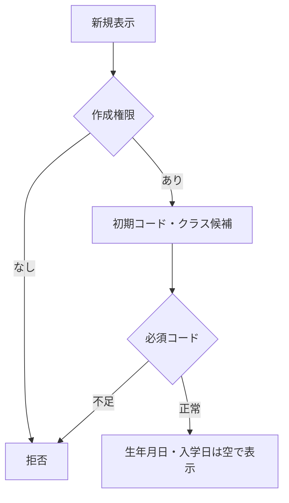

#### SQL・テーブル関連（ER図）

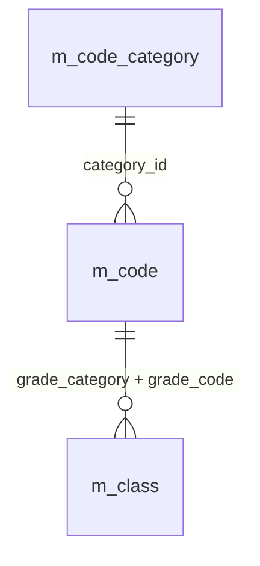

名称参照は未所属・停止値を残す外部結合相当。コードは用途ごとの別名で**分類と値**を結合する。図は読取りの関連であり、履歴への書込みや削除連動を意味しない。単独の存在確認・採番・書込みの表関連は下記操作IDで特定する。

#### DB操作の詳細

`OP-CODE` → `OP-CLASS`。下記「DB操作定義」の同名操作を実行する。保存系ではINSERTとUPDATEをモードで選択し、両方を実行しない。

#### 結果・例外時の扱い

入力不備は原入力保持、対象不在はE-STU-103、版競合はE-STU-105。確認待ちは保存を確定せず、変更なしはI-STU-004。成功通知は学生と履歴の確定確認後だけ。確定結果不明はE-COM-004と検索確認の案内。 各イベントで実行していない処理の結果状態は発生対象外。

### EV-REG-002 編集・参照画面表示

#### 処理概要

既存学生の識別番号で最新値を表示する。

#### 処理手順

1. OP-STUDENTへ学生管理番号を渡し非削除1件を取得。不在はE-STU-103、新規へ切替えない。
2. 学生・クラス・コード名称を取得し、元の値と更新管理番号を読込時スナップショットへ複製。編集値とは分離する。
3. 生年月日を和暦へ変換。学籍番号・管理項目は表示のみ、閲覧者は全項目表示のみ。停止・期間外の既存値を消さない。

##### 実装詳細

入口：`既存LoadAsync`。機能内の入力・結果型は項目一覧、共通実装は[方式別共通仕様](../../共通/方式別/VB.NET_WinForms/01_共通実装仕様.md)を使用する。 編集用値と原スナップショットを別に保持。変換失敗を未入力へ置換せず、エラー項目と原入力を返す。

#### 処理フロー

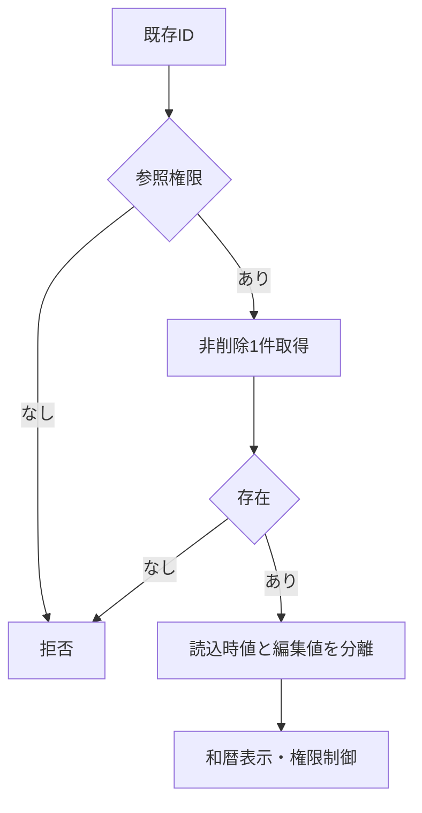

#### SQL・テーブル関連（ER図）

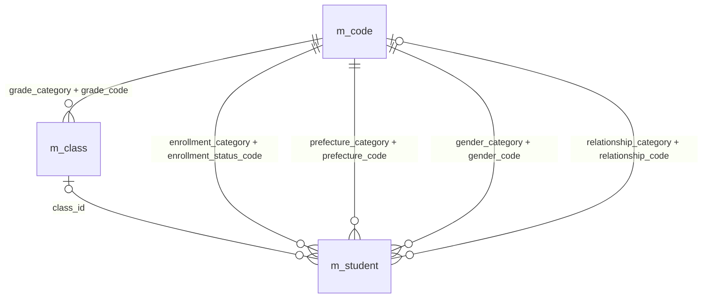

名称参照は未所属・停止値を残す外部結合相当。コードは用途ごとの別名で**分類と値**を結合する。図は読取りの関連であり、履歴への書込みや削除連動を意味しない。単独の存在確認・採番・書込みの表関連は下記操作IDで特定する。

#### DB操作の詳細

`OP-STUDENT` → `OP-CODE` → `OP-CLASS`。下記「DB操作定義」の同名操作を実行する。保存系ではINSERTとUPDATEをモードで選択し、両方を実行しない。

#### 結果・例外時の扱い

入力不備は原入力保持、対象不在はE-STU-103、版競合はE-STU-105。確認待ちは保存を確定せず、変更なしはI-STU-004。成功通知は学生と履歴の確定確認後だけ。確定結果不明はE-COM-004と検索確認の案内。 各イベントで実行していない処理の結果状態は発生対象外。

### EV-REG-003 入力補助

#### 処理概要

所属・在籍・生年月日の入力部品を連動させる。

#### 処理手順

1. 共通16・17で生年月日の元号・年・月・日を厳密検査。不正値を次元号・翌月へ補正せず原入力を保持する。
2. 在籍01/02はクラス必須・終了日なし、03/04は終了日必須・最終所属任意。終了区分からの訂正は権限・理由条件を表示する。
3. 年度・学年・区分変更に応じOP-CLASSで候補を再取得。不適合値解除を通知し、人数は参考表示とする。

##### 実装詳細

入口：`選択Changed／birthDateInput.Validating`。機能内の入力・結果型は項目一覧、共通実装は[方式別共通仕様](../../共通/方式別/VB.NET_WinForms/01_共通実装仕様.md)を使用する。 編集用値と原スナップショットを別に保持。変換失敗を未入力へ置換せず、エラー項目と原入力を返す。

#### 処理フロー

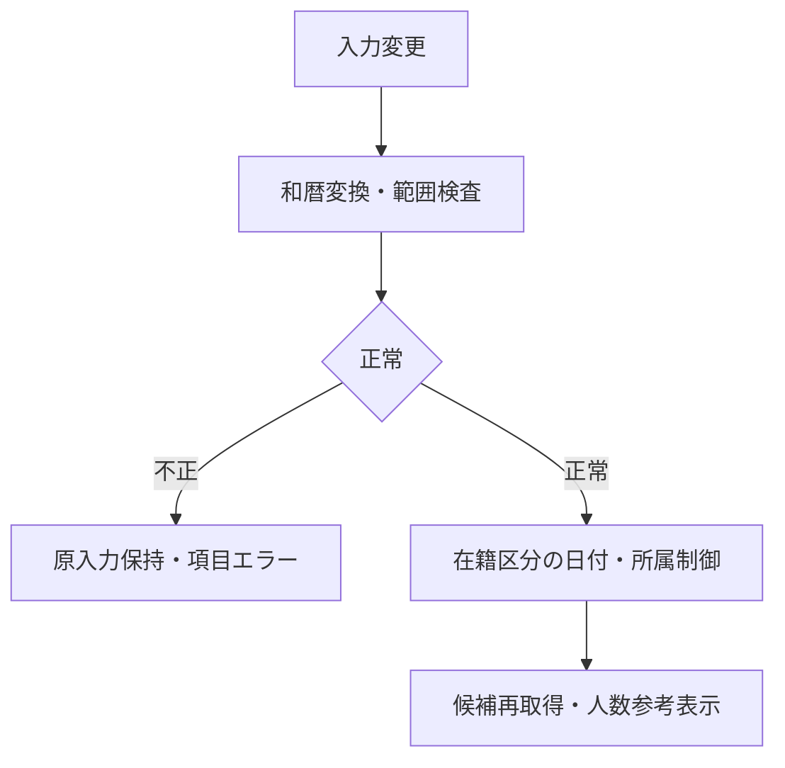

#### SQL・テーブル関連（ER図）

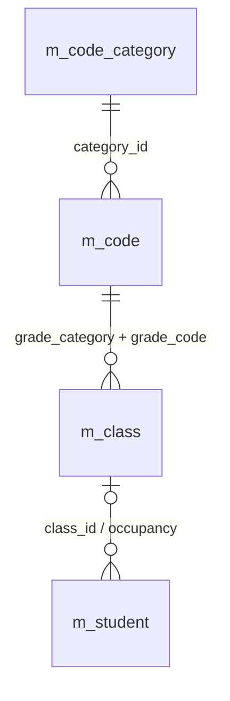

名称参照は未所属・停止値を残す外部結合相当。コードは用途ごとの別名で**分類と値**を結合する。図は読取りの関連であり、履歴への書込みや削除連動を意味しない。単独の存在確認・採番・書込みの表関連は下記操作IDで特定する。

#### DB操作の詳細

`OP-CLASS`。下記「DB操作定義」の同名操作を実行する。保存系ではINSERTとUPDATEをモードで選択し、両方を実行しない。

#### 結果・例外時の扱い

入力不備は原入力保持、対象不在はE-STU-103、版競合はE-STU-105。確認待ちは保存を確定せず、変更なしはI-STU-004。成功通知は学生と履歴の確定確認後だけ。確定結果不明はE-COM-004と検索確認の案内。 各イベントで実行していない処理の結果状態は発生対象外。

### EV-REG-004 新規登録・更新

#### 処理概要

検証済み学生1件と操作履歴1件を一括確定する。

#### 処理手順

1. 入力19業務項目を複製。和暦原入力は共通16で日付へ変換、共通04・05・17で正規化・必須・範囲・連絡手段を検査する。
2. 共通13の短い保存単位内で同時保存制御を取得。既存モードのみOP-STUDENTを実行し、OP-EXISTSとともに最新存在・版・分類・クラス・日付・区分権限を再検証し、学籍番号不変・全行一意を確認する。
3. OP-CAPACITYで旧席から新席が増加する場合だけ定員を検査する。変更なしなら版・更新日時・履歴を増やさずI-STU-004。
4. OP-DUPで全候補と版を確認。未確認なら保存単位を終了して確認画面へ。確認待ちにDBロックを持たない。
5. OP-INSERTまたはOP-UPDATEで学生1件、OP-AUDITで履歴1件を確定。失敗は双方取消、成否不明は自動再送せず検索確認。

##### 実装詳細

入口：`btnSave.Click`。機能内の入力・結果型は項目一覧、共通実装は[方式別共通仕様](../../共通/方式別/VB.NET_WinForms/01_共通実装仕様.md)を使用する。 対象ID・ExpectedVersionは検証するが、利用者・権限・業務日は信頼する実行側で決定する。保存値は固定許可列に限定し、結果種別により画面遷移を分岐する。

#### 処理フロー

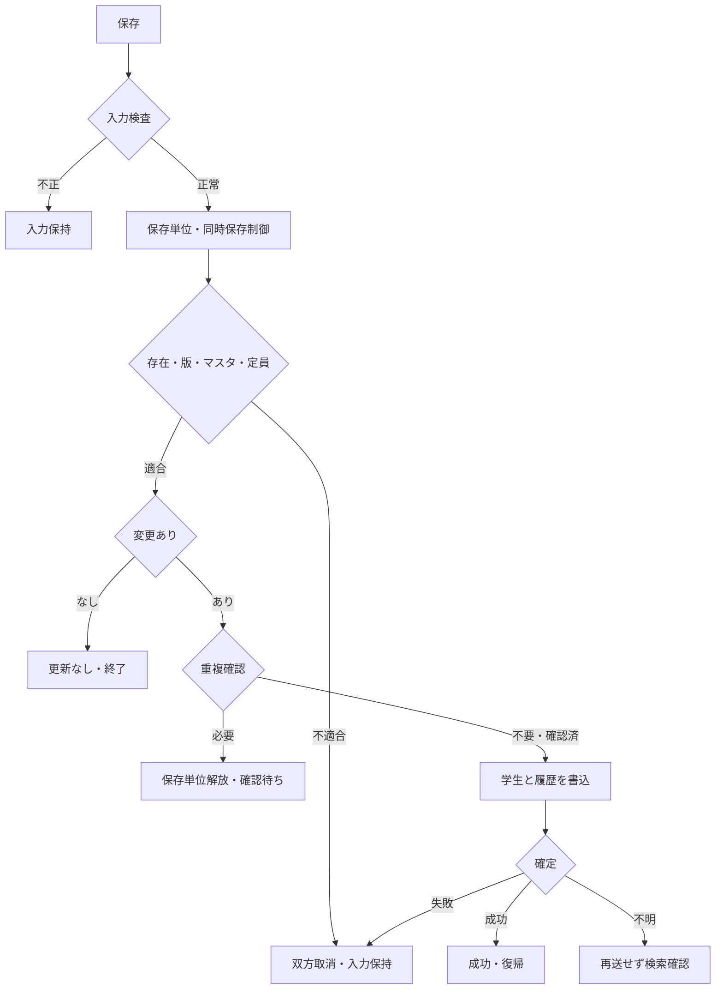

#### SQL・テーブル関連（ER図）

名称参照は未所属・停止値を残す外部結合相当。コードは用途ごとの別名で**分類と値**を結合する。図は読取りの関連であり、履歴への書込みや削除連動を意味しない。単独の存在確認・採番・書込みの表関連は下記操作IDで特定する。

#### DB操作の詳細

`OP-STUDENT` → `OP-EXISTS` → `OP-CAPACITY` → `OP-DUP` → `OP-INSERT` → `OP-UPDATE` → `OP-AUDIT`。下記「DB操作定義」の同名操作を実行する。保存系ではINSERTとUPDATEをモードで選択し、両方を実行しない。

#### 結果・例外時の扱い

入力不備は原入力保持、対象不在はE-STU-103、版競合はE-STU-105。確認待ちは保存を確定せず、変更なしはI-STU-004。成功通知は学生と履歴の確定確認後だけ。確定結果不明はE-COM-004と検索確認の案内。 各イベントで実行していない処理の結果状態は発生対象外。

### EV-REG-005 重複候補の確認続行・取消

#### 処理概要

別人確認と理由を保存処理へ引き渡す。

#### 処理手順

1. 候補は全件数と最大20件の学籍番号・氏名・和暦生年月日・クラスのみ。既定操作は取消。
2. 続行では共通11により本人・認証状態・対象・旧版・正規化内容・全候補IDと版・10分期限を照合。相違はW-STU-102で再確認する。
3. 理由を付けEV-REG-004を再実行し全検査を行う。取消は入力画面に留まりDB更新なし。

##### 実装詳細

入口：`DlgDuplicateConfirm`。機能内の入力・結果型は項目一覧、共通実装は[方式別共通仕様](../../共通/方式別/VB.NET_WinForms/01_共通実装仕様.md)を使用する。 対象ID・ExpectedVersionは検証するが、利用者・権限・業務日は信頼する実行側で決定する。保存値は固定許可列に限定し、結果種別により画面遷移を分岐する。

#### 処理フロー

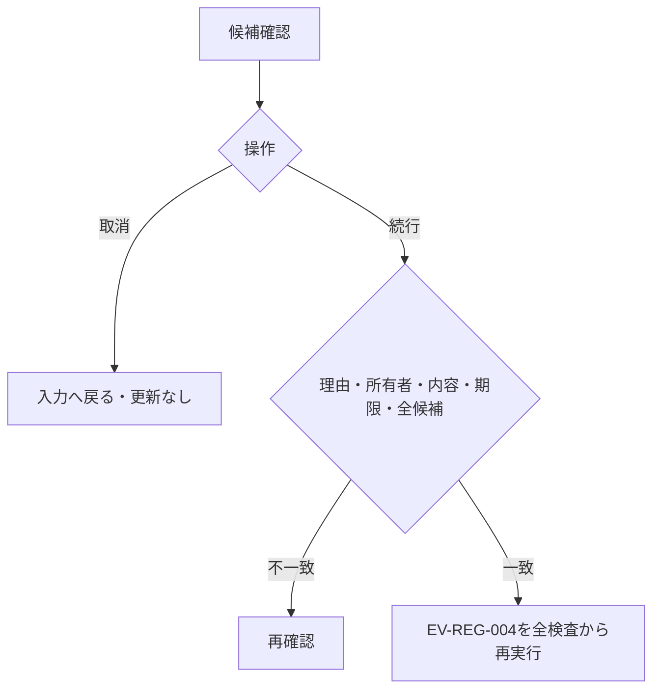

#### SQL・テーブル関連（ER図）

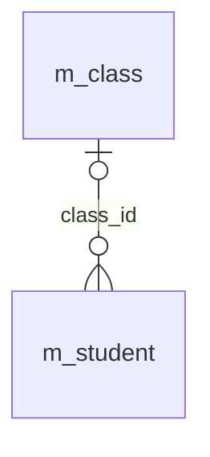

名称参照は未所属・停止値を残す外部結合相当。コードは用途ごとの別名で**分類と値**を結合する。図は読取りの関連であり、履歴への書込みや削除連動を意味しない。単独の存在確認・採番・書込みの表関連は下記操作IDで特定する。

#### DB操作の詳細

`OP-DUP`。下記「DB操作定義」の同名操作を実行する。保存系ではINSERTとUPDATEをモードで選択し、両方を実行しない。

#### 結果・例外時の扱い

入力不備は原入力保持、対象不在はE-STU-103、版競合はE-STU-105。確認待ちは保存を確定せず、変更なしはI-STU-004。成功通知は学生と履歴の確定確認後だけ。確定結果不明はE-COM-004と検索確認の案内。 各イベントで実行していない処理の結果状態は発生対象外。

### EV-REG-006 論理削除

#### 処理概要

管理者が対象と理由を確認して通常検索から除外する。

#### 処理手順

1. 対象ID・読込時版・削除理由・明示確認のみを受ける。編集中の氏名・住所・生年月日等は保存しない。
2. 同時保存制御下でOP-STUDENTを再読込し権限・非削除・版を検証する。対象不在と版競合を区別する。
3. OP-DELETEで削除属性と更新管理情報だけを変更しOP-AUDITと一括確定。確定後に検索へ戻る。

##### 実装詳細

入口：`btnDelete.Click`。機能内の入力・結果型は項目一覧、共通実装は[方式別共通仕様](../../共通/方式別/VB.NET_WinForms/01_共通実装仕様.md)を使用する。 対象ID・ExpectedVersionは検証するが、利用者・権限・業務日は信頼する実行側で決定する。保存値は固定許可列に限定し、結果種別により画面遷移を分岐する。

#### 処理フロー

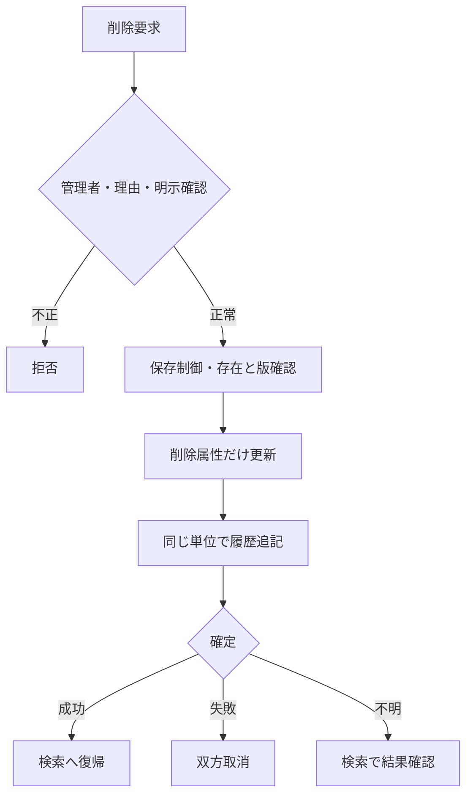

#### SQL・テーブル関連（ER図）

名称参照は未所属・停止値を残す外部結合相当。コードは用途ごとの別名で**分類と値**を結合する。図は読取りの関連であり、履歴への書込みや削除連動を意味しない。単独の存在確認・採番・書込みの表関連は下記操作IDで特定する。

#### DB操作の詳細

`OP-STUDENT` → `OP-DELETE` → `OP-AUDIT`。下記「DB操作定義」の同名操作を実行する。保存系ではINSERTとUPDATEをモードで選択し、両方を実行しない。

#### 結果・例外時の扱い

入力不備は原入力保持、対象不在はE-STU-103、版競合はE-STU-105。確認待ちは保存を確定せず、変更なしはI-STU-004。成功通知は学生と履歴の確定確認後だけ。確定結果不明はE-COM-004と検索確認の案内。 各イベントで実行していない処理の結果状態は発生対象外。

### EV-REG-007 取消・再読込・検索へ戻る

#### 処理概要

原入力の取消、最新取得、検索への復帰を区別する。

#### 処理手順

1. 新規クリアは初期値、編集取消は最後の読込時スナップショットへ戻す。DBから最新取得する処理ではない。
2. 再読込は明示確認後OP-STUDENTを実行し値と版をともに置換。競合時に版だけを最新にしない。
3. 戻る・ウィンドウ終了は未保存変更の破棄確認を行い、取消を既定とする。保存結果不明は再保存前の検索確認を案内する。

##### 実装詳細

入口：`btnReset / btnReload / btnBack / FormClosing`。機能内の入力・結果型は項目一覧、共通実装は[方式別共通仕様](../../共通/方式別/VB.NET_WinForms/01_共通実装仕様.md)を使用する。 編集用値と原スナップショットを別に保持。変換失敗を未入力へ置換せず、エラー項目と原入力を返す。

#### 処理フロー

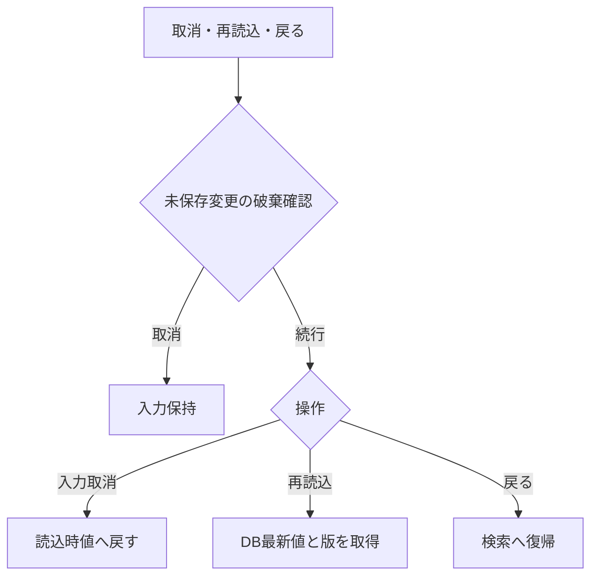

#### SQL・テーブル関連（ER図）

名称参照は未所属・停止値を残す外部結合相当。コードは用途ごとの別名で**分類と値**を結合する。図は読取りの関連であり、履歴への書込みや削除連動を意味しない。単独の存在確認・採番・書込みの表関連は下記操作IDで特定する。

#### DB操作の詳細

`OP-STUDENT`。下記「DB操作定義」の同名操作を実行する。保存系ではINSERTとUPDATEをモードで選択し、両方を実行しない。

#### 結果・例外時の扱い

入力不備は原入力保持、対象不在はE-STU-103、版競合はE-STU-105。確認待ちは保存を確定せず、変更なしはI-STU-004。成功通知は学生と履歴の確定確認後だけ。確定結果不明はE-COM-004と検索確認の案内。 各イベントで実行していない処理の結果状態は発生対象外。

### DB操作定義

操作の業務契約は[共通データアクセス](../../共通/08_データアクセス仕様.md)が正本。本機能における具体的な対象・引数・確定単位は以下。

#### OP-CODE

| 項目 | 内容 |
| --- | --- |
| 対象テーブル | m_code_category / m_code |
| 操作 | 参照 |
| 実行条件・引数 | 分類、用途（検索／新規選択／既存表示）、既存値、業務日 |
| 取得・設定項目／対象条件 | 分類・値・名称・表示順・利用可否・期間。分類＋値で取得 |
| 件数・順序 | 候補0件を検出。既定値を先頭値へ代替しない |
| 確定・取消 | 参照のみ |

#### OP-CLASS

| 項目 | 内容 |
| --- | --- |
| 対象テーブル | m_class / m_code / m_student |
| 操作 | 参照 |
| 実行条件・引数 | 用途、年度、学年、在籍区分、在籍期間、既存所属、業務日、人数参照要否 |
| 取得・設定項目／対象条件 | 年度・学年・クラスID・コード・名称・期間・定員。人数集計は登録側で要求した場合のみ。検索の候補取得では学生を集計しない |
| 件数・順序 | 年度降順、学年表示順、クラス表示順、クラスコード、ID |
| 確定・取消 | 参照のみ、人数は予約ではない |

#### OP-STUDENT

| 項目 | 内容 |
| --- | --- |
| 対象テーブル | m_student / m_class / m_code |
| 操作 | 参照 |
| 実行条件・引数 | 対象学生ID |
| 取得・設定項目／対象条件 | 非削除の1件、全保存値・版・参照名称。名称はLEFT JOIN相当 |
| 件数・順序 | 0件E-STU-103、1件正常、複数件は整合性障害 |
| 確定・取消 | 画面読込は参照のみ。保存時の再検証は保存単位内 |

#### OP-EXISTS

| 項目 | 内容 |
| --- | --- |
| 対象テーブル | m_student / m_class / m_code_category / m_code |
| 操作 | 参照 |
| 実行条件・引数 | 用途（検索／保存）、分類付きコード・クラスID・選択補助。保存だけ対象ID・完全な学籍番号・期待版 |
| 取得・設定項目／対象条件 | 検索は指定コード・クラスの存在と年度学年の整合のみ。学籍番号前方一致に重複・完全一致存在検査をしない。保存は全行学籍番号一意、分類付き存在、変更有無、有効性を再検査 |
| 件数・順序 | 未存在／重複／組合せ／停止を区別。未指定の検索条件は検査対象外 |
| 確定・取消 | 検索は参照のみ、保存は保護した最新値で確認 |

#### OP-CAPACITY

| 項目 | 内容 |
| --- | --- |
| 対象テーブル | m_student / m_class |
| 操作 | 参照 |
| 実行条件・引数 | 旧席、新席、対象学生ID |
| 取得・設定項目／対象条件 | 非削除01/02、自分以外の対象クラス人数と定員 |
| 件数・順序 | 新席が未設定でなく、旧席から追加・異動するときだけ人数＋1≦定員。卒業・退学・削除による席解放はこの加算検査をしない。定員未設定は制限なし |
| 確定・取消 | 保存制御取得後に判定、休学も1席 |

#### OP-DUP

| 項目 | 内容 |
| --- | --- |
| 対象テーブル | m_student / m_class |
| 操作 | 参照 |
| 実行条件・引数 | 日付型生年月日、氏名照合値、カナ照合値、自分ID |
| 取得・設定項目／対象条件 | 非削除かつ自分除外、同生年月日かつ氏名キーORカナキー一致 |
| 件数・順序 | 全ID・版をID順、表示は最大20件。クラス名は表示のみ |
| 確定・取消 | 確認照合は同時保存制御内、応答待ちは解放 |

#### OP-INSERT

| 項目 | 内容 |
| --- | --- |
| 対象テーブル | m_student |
| 操作 | 登録 |
| 実行条件・引数 | 検証済み19入力、生成照合値2、固定分類、認証情報 |
| 取得・設定項目／対象条件 | 学生ID自動採番、版1、作成更新情報設定、未削除 |
| 件数・順序 | 必ず1件。学籍番号一意制約でも競合防止 |
| 確定・取消 | OP-AUDITと同一確定単位 |

#### OP-UPDATE

| 項目 | 内容 |
| --- | --- |
| 対象テーブル | m_student |
| 操作 | 更新 |
| 実行条件・引数 | 対象ID、期待版、学籍番号以外18入力、生成照合値2 |
| 取得・設定項目／対象条件 | 対象ID＋期待版＋非削除。作成情報・学籍番号・分類・削除情報は変更なし |
| 件数・順序 | 更新1件。0件は存在再確認後不在／版競合に分離 |
| 確定・取消 | OP-AUDITと一括、版＋1。変更なしは実行しない |

#### OP-AUDIT

| 項目 | 内容 |
| --- | --- |
| 対象テーブル | t_operation_log |
| 操作 | 登録 |
| 実行条件・引数 | 対象、操作、前後版、変更項目名、実行者・時点・理由・受付番号 |
| 取得・設定項目／対象条件 | 変更した物理項目名だけ。個人情報の値はコピーしない |
| 件数・順序 | 実際の変更1件につき履歴1件。追記専用 |
| 確定・取消 | 業務変更と同じ接続・保存単位。失敗は双方取消 |

#### OP-DELETE

| 項目 | 内容 |
| --- | --- |
| 対象テーブル | m_student |
| 操作 | 更新（論理削除） |
| 実行条件・引数 | 対象ID、期待版、理由、認証情報 |
| 取得・設定項目／対象条件 | 削除状態・日時・者・理由、更新日時・者・版だけ変更 |
| 件数・順序 | 更新1件。編集中の一般項目を含めない |
| 確定・取消 | 物理DELETEではない。OP-AUDITと一括 |

### ネイティブイベント・通信の対応

#### 登録イベント・状態

`LoadAsync`で最新の非削除学生と版を取得。不在は終了し、新規へ切替えない。`_originalModel`を複製し、フォームが保存済Entityを直接変更しない。参照は全入力readonly、保存・削除・取消を非表示。

`btnSave.Click`：二重実行抑止→読取・正規化→入力検査→共通保存手順。結果はSaved/NoChange/ConfirmationRequired/ValidationFailed/Conflict/Unknownに分ける。ConfirmationRequiredならDB処理を終了してから確認ダイアログを開き、理由と確認情報を付けて再度保存処理へ入る。確認中は接続・Txを保持しない。

`btnDelete.Click`：保存済ID・ExpectedVersion・理由・明示確認だけを渡す。入力途中の業務値を削除サービスへ送らない。管理者以外は拒否。`btnReset`は原スナップショット、`btnReload`は確認後最新値、`FormClosing`は未保存破棄確認。保存の確定後だけ`_dirty=False`、成功結果を返して閉じる。

### 業務判断の決定表

#### 主要な業務チェック

| チェック | 判定 | 結果 |
| --- | --- | --- |
| 学籍番号重複 | 削除済みを含む全学生で使用済み | 保存不可。番号の再利用も不可 |
| 同一人物候補 | 非削除の他学生と生年月日が同じ、氏名またはカナの照合値が同じ | 別人確認・理由付きなら保存可 |
| コード存在 | 正しい分類内に値がある | 不存在は保存不可 |
| コード利用可否 | 新規・変更する値が有効・期間内 | 不可値は保存不可。既存の同値保持は可 |
| クラス存在 | 選択クラスが実在し年度・学年が一致 | 不存在・不一致は保存不可 |
| 日付 | 生年月日≦入学日≦本日、終了日も本日以前 | 不整合は保存不可 |
| 連絡手段 | 本人電話・メール・緊急電話の1つ以上 | 不足は保存不可 |
| 緊急連絡先 | 氏名・続柄・電話を全部空または全部入力 | 一部だけは保存不可 |
| 他者の更新 | 画面読込後に別操作が更新済み | 上書きせずエラー。入力を保持 |
| 理由 | 必要な操作で空白でない200文字以内 | 不足は保存不可 |

#### クラス選択・定員の決定表

| 保存後の状態・変更 | クラス要否・利用規則 | 定員 |
| --- | --- | --- |
| 新規の在学・休学、別クラスへの異動、卒業等から在学へ訂正 | 必須。利用可かつ本日が利用期間内 | 自分を除いた在学・休学人数＋1が定員以下 |
| 在学・休学のまま同じクラスを保持 | 存在必須。期間外等でも住所などの変更は可、見直し警告 | 席が増えないため既存の超過だけでは拒否しない |
| 新規の卒業・退学 | 任意。指定するならクラス利用期間と入学～終了日の期間が重なる | 席を消費しない |
| 卒業・退学の最終所属・在籍日付・区分を変更 | 停止・過去クラスも可。指定した期間の重なりを確認 | 席を消費しない |
| 卒業・退学の最終所属・在籍日付・区分を変えず住所等だけ変更 | 既存値を保持できる | 席を消費しない |
| 論理削除 | 元のクラス情報を保持 | 削除後は人数に含めない |

休学も1席を使用する。定員未設定は制限なし。定員40人に対し39人在籍で同時に2人を登録した場合は片方だけ保存でき、超過させない。期間の重なりは1日以上あればよく、卒業日がクラス利用期間内に入ることまでは必須にしない。

#### 在籍区分の状態遷移

| 変更前 | 変更後 | 実行者・条件 |
| --- | --- | --- |
| 在学・休学 | 在学・休学・卒業・退学 | 担当者または管理者。変更後の日付・クラス規則を満たす |
| 卒業・退学 | 同一区分 | 担当者または管理者。通常項目の訂正可 |
| 卒業・退学 | 別区分 | 管理者のみ。確認・変更理由が必須 |
| 新規 | 任意の4区分 | 担当者または管理者。過去データ登録を認める |

在籍区分は日付到来だけで自動変更しない。再入学や年度別履歴は本版に含まない。

## 項目移送仕様

| 移送ID | 項目ID | 関連イベント | 画面側 | 処理変数 | DB側・出力値 | 方向 | 変換ID | 未設定 | 移送条件・説明 | 異常時 |
| --- | --- | --- | --- | --- | --- | --- | --- | --- | --- | --- |
| MAP-REG-001 | REG-001 | EV-REG-001,EV-REG-002 | lblStudentId | StudentId | m_student.student_id | O（表示） | 非適用 | 表示欠損は－、マスタ欠落は不整合表示 | 表示のみ、登録時自動採番 | 取得不整合は明示・行を無言で落とさない |
| MAP-REG-002 | REG-002 | EV-REG-004 | txtStudentNo | StudentEditModel.StudentNo | m_student.student_no | I/O（表示・保存） | N-06 | 不可 | 新規のみ設定。登録後不変、削除済み含め一意 | 入力不正は原入力保持・DB処理なし |
| MAP-REG-003 | REG-003 | EV-REG-004 | txtStudentName | StudentEditModel.StudentName | m_student.student_name | I/O（表示・保存） | N-02 | 不可 | N-02、原表記を保存 | 入力不正は原入力保持・DB処理なし |
| MAP-REG-004 | REG-004 | EV-REG-004 | txtStudentNameKana | StudentEditModel.StudentNameKana | m_student.student_name_kana | I/O（表示・保存） | N-04,N-05 | 不可 | N-04、全角カナ100文字 | 入力不正は原入力保持・DB処理なし |
| MAP-REG-005 | REG-005 | EV-REG-004 | birthDateInput | StudentEditModel.BirthDate | m_student.birth_date | I/O（表示・保存） | N-11 | 不可 | 和暦入力→厳密変換→日付保存、DATE-R01 | 入力不正は原入力保持・DB処理なし |
| MAP-REG-006 | REG-006 | EV-REG-004 | cboGender | StudentEditModel.GenderCode | m_student.gender_code | I/O（表示・保存） | N-07 | 不可 | コード値保存／性別分類のコード名称表示 | 入力不正は原入力保持・DB処理なし |
| MAP-REG-007 | REG-007 | EV-REG-004 | txtPostalCode | StudentEditModel.PostalCode | m_student.postal_code | I/O（表示・保存） | N-08 | 不可 | N-08、数字7桁保存、3桁－4桁表示 | 入力不正は原入力保持・DB処理なし |
| MAP-REG-008 | REG-008 | EV-REG-004 | cboPrefecture | StudentEditModel.PrefectureCode | m_student.prefecture_code | I/O（表示・保存） | N-07 | 不可 | コード値保存／都道府県分類の名称表示 | 入力不正は原入力保持・DB処理なし |
| MAP-REG-009 | REG-009 | EV-REG-004 | txtAddressLine1 | StudentEditModel.AddressLine1 | m_student.address_line1 | I/O（表示・保存） | N-02 | 不可 | N-02、市区町村・番地、200文字 | 入力不正は原入力保持・DB処理なし |
| MAP-REG-010 | REG-010 | EV-REG-004 | txtAddressLine2 | StudentEditModel.AddressLine2 | m_student.address_line2 | I/O（表示・保存） | N-02 | NULL相当 | N-02、任意200文字、空は未設定 | 入力不正は原入力保持・DB処理なし |
| MAP-REG-011 | REG-011 | EV-REG-004 | txtPhoneNumber | StudentEditModel.PhoneNumber | m_student.phone_number | I/O（表示・保存） | N-09 | NULL相当 | N-09、連絡手段条件あり | 入力不正は原入力保持・DB処理なし |
| MAP-REG-012 | REG-012 | EV-REG-004 | txtEmailAddress | StudentEditModel.EmailAddress | m_student.email_address | I/O（表示・保存） | N-10 | NULL相当 | N-10、連絡手段条件あり | 入力不正は原入力保持・DB処理なし |
| MAP-REG-013 | REG-013 | EV-REG-004 | dtpAdmissionDate | StudentEditModel.AdmissionDate | m_student.admission_date | I/O（表示・保存） | N-11 | 不可 | 西暦入力・表示、DATE-R02 | 入力不正は原入力保持・DB処理なし |
| MAP-REG-014 | REG-014 | EV-REG-004 | cboEnrollmentStatus | StudentEditModel.EnrollmentStatusCode | m_student.enrollment_status_code | I/O（表示・保存） | N-07 | 不可 | 値保存／在籍区分分類の名称表示 | 入力不正は原入力保持・DB処理なし |
| MAP-REG-015 | REG-015 | EV-REG-004 | dtpEnrollmentEndDate | StudentEditModel.EnrollmentEndDate | m_student.enrollment_end_date | I/O（表示・保存） | N-11 | NULL相当 | 西暦。03/04で必須、01/02は未設定 | 入力不正は原入力保持・DB処理なし |
| MAP-REG-016 | REG-016 | EV-REG-004 | cboSchoolYear | SchoolYear | m_class.school_year | I/O（選択補助・保存なし） | N-11 | NULL相当 | 選択補助・整合検査のみ。学生へ保存しない | 入力不正は原入力保持・DB処理なし |
| MAP-REG-017 | REG-017 | EV-REG-004 | cboGrade | GradeCode | m_class.grade_code | I/O（選択補助・保存なし） | N-07 | NULL相当 | 選択補助。学年名称は学年分類のコード名称 | 入力不正は原入力保持・DB処理なし |
| MAP-REG-018 | REG-018 | EV-REG-004 | cboClass | StudentEditModel.ClassId | m_student.class_id | I/O（表示・保存） | 非適用 | NULL相当 | 識別番号保存／年度・学年・コード・名称表示 | 入力不正は原入力保持・DB処理なし |
| MAP-REG-019 | REG-019 | EV-REG-004 | lblCapacity | Occupancy / Capacity | count of m_student / m_class.capacity | O（表示） | 非適用 | 表示欠損は－、マスタ欠落は不整合表示 | 非削除01/02の参考人数。確保予約ではない | 取得不整合は明示・行を無言で落とさない |
| MAP-REG-020 | REG-020 | EV-REG-004 | txtEmergencyContactName | StudentEditModel.EmergencyContactName | m_student.emergency_contact_name | I/O（表示・保存） | N-02 | NULL相当 | 緊急3項目は全部入力または全部未設定 | 入力不正は原入力保持・DB処理なし |
| MAP-REG-021 | REG-021 | EV-REG-004 | cboRelationship | StudentEditModel.RelationshipCode | m_student.relationship_code | I/O（表示・保存） | N-07 | NULL相当 | 値保存／続柄分類のコード名称表示 | 入力不正は原入力保持・DB処理なし |
| MAP-REG-022 | REG-022 | EV-REG-004 | txtEmergencyPhoneNumber | StudentEditModel.EmergencyPhoneNumber | m_student.emergency_phone_number | I/O（表示・保存） | N-09 | NULL相当 | N-09、緊急3項目一式 | 入力不正は原入力保持・DB処理なし |
| MAP-REG-023 | REG-023 | EV-REG-004 | txtRemarks | StudentEditModel.Remarks | m_student.remarks | I/O（表示・保存） | N-01 | NULL相当 | プレーンテキスト、1000文字、改行可 | 入力不正は原入力保持・DB処理なし |
| MAP-REG-024 | REG-024 | EV-REG-005 | txtOperationReason | OperationReason | t_operation_log.operation_reason | I（関連保存） | N-01 | NULL相当 | 警告続行・終了区分訂正時必須、200文字 | 入力不正は原入力保持・DB処理なし |
| MAP-REG-025 | REG-025 | EV-REG-002 | lblUpdatedAt / lblUpdatedBy | UpdatedAt / UpdatedBy | updated_at / updated_by | O（表示） | 非適用 | 表示欠損は－、マスタ欠落は不整合表示 | システム設定。西暦日時、日本時間 | 取得不整合は明示・行を無言で落とさない |
| MAP-REG-026 | REG-026 | EV-REG-006 | DlgDeleteConfirm.txtReason | DeleteReason | delete_reason / t_operation_log.operation_reason | I（関連保存） | N-01 | NULL相当 | 削除時のみ、200文字、編集中の業務値は保存しない | 入力不正は原入力保持・DB処理なし |
| MAP-REG-032 | REG-032 | EV-REG-005 | DlgDuplicateConfirm.dgvCandidates | DuplicateCandidates | OP-DUP result | 操作／表示 | 非適用 | 表示欠損は－、マスタ欠落は不整合表示 | 全候補件数＋最大20件、個人情報を最小化 | 取得不整合は明示・行を無言で落とさない |

## 項目更新仕様

| 更新ID | 項目ID | 対象 | 登録 | 更新 | 論理削除 | 規則・設定元 |
| --- | --- | --- | --- | --- | --- | --- |
| UPD-002 | REG-002 | m_student.student_no | 検証済み入力値 | 変更なし | 変更なし | 新規のみ設定。登録後不変、削除済み含め一意 |
| UPD-003 | REG-003 | m_student.student_name | 検証済み入力値 | 同左。空の任意値は未設定で上書き | 変更なし | N-02、原表記を保存 |
| UPD-004 | REG-004 | m_student.student_name_kana | 検証済み入力値 | 同左。空の任意値は未設定で上書き | 変更なし | N-04、全角カナ100文字 |
| UPD-005 | REG-005 | m_student.birth_date | 検証済み入力値（生年月日は日付へ変換） | 同左。空の任意値は未設定で上書き | 変更なし | 和暦入力→厳密変換→日付保存、DATE-R01 |
| UPD-006 | REG-006 | m_student.gender_code | 検証済み入力値 | 同左。空の任意値は未設定で上書き | 変更なし | コード値保存／性別分類のコード名称表示 |
| UPD-007 | REG-007 | m_student.postal_code | 検証済み入力値 | 同左。空の任意値は未設定で上書き | 変更なし | N-08、数字7桁保存、3桁－4桁表示 |
| UPD-008 | REG-008 | m_student.prefecture_code | 検証済み入力値 | 同左。空の任意値は未設定で上書き | 変更なし | コード値保存／都道府県分類の名称表示 |
| UPD-009 | REG-009 | m_student.address_line1 | 検証済み入力値 | 同左。空の任意値は未設定で上書き | 変更なし | N-02、市区町村・番地、200文字 |
| UPD-010 | REG-010 | m_student.address_line2 | 検証済み入力値 | 同左。空の任意値は未設定で上書き | 変更なし | N-02、任意200文字、空は未設定 |
| UPD-011 | REG-011 | m_student.phone_number | 検証済み入力値 | 同左。空の任意値は未設定で上書き | 変更なし | N-09、連絡手段条件あり |
| UPD-012 | REG-012 | m_student.email_address | 検証済み入力値 | 同左。空の任意値は未設定で上書き | 変更なし | N-10、連絡手段条件あり |
| UPD-013 | REG-013 | m_student.admission_date | 検証済み入力値 | 同左。空の任意値は未設定で上書き | 変更なし | 西暦入力・表示、DATE-R02 |
| UPD-014 | REG-014 | m_student.enrollment_status_code | 検証済み入力値 | 同左。空の任意値は未設定で上書き | 変更なし | 値保存／在籍区分分類の名称表示 |
| UPD-015 | REG-015 | m_student.enrollment_end_date | 検証済み入力値 | 同左。空の任意値は未設定で上書き | 変更なし | 西暦。03/04で必須、01/02は未設定 |
| UPD-018 | REG-018 | m_student.class_id | 検証済み入力値 | 同左。空の任意値は未設定で上書き | 変更なし | 識別番号保存／年度・学年・コード・名称表示 |
| UPD-020 | REG-020 | m_student.emergency_contact_name | 検証済み入力値 | 同左。空の任意値は未設定で上書き | 変更なし | 緊急3項目は全部入力または全部未設定 |
| UPD-021 | REG-021 | m_student.relationship_code | 検証済み入力値 | 同左。空の任意値は未設定で上書き | 変更なし | 値保存／続柄分類のコード名称表示 |
| UPD-022 | REG-022 | m_student.emergency_phone_number | 検証済み入力値 | 同左。空の任意値は未設定で上書き | 変更なし | N-09、緊急3項目一式 |
| UPD-023 | REG-023 | m_student.remarks | 検証済み入力値 | 同左。空の任意値は未設定で上書き | 変更なし | プレーンテキスト、1000文字、改行可 |
| UPD-101 | REG-003／004 | name_key / kana_key | 共通04で生成 | 元の氏名等から再生成 | 変更なし | 入力された照合値を信用しない |
| UPD-102 | REG-001 | student_id | 自動採番 | 変更なし | 変更なし | 最大値＋1は禁止 |
| UPD-103 | ― | gender_category / prefecture_category / enrollment_category / relationship_category | 定義済み分類を設定 | 変更なし | 変更なし | 利用者の入力から設定しない |
| UPD-104 | ― | created_at / created_by | 共通03・01 | 変更なし | 変更なし | システム設定 |
| UPD-105 | REG-025 | updated_at / updated_by / row_version | 実行時点・実行者・1 | 実変更時だけ実行時点・実行者・版＋1 | 同左 | 期待版一致が条件、変更なしでは更新しない |
| UPD-106 | REG-026／031 | is_deleted / deleted_at / deleted_by / delete_reason | 未削除、削除属性未設定 | 変更なし | 削除済・実行時点・実行者・検査済理由 | 削除時に一般入力を保存しない |
| UPD-107 | REG-024／026 | t_operation_log | 前版未設定・後版1・操作新規 | 前後版・変更項目名・操作更新 | 前後版・変更項目名・操作論理削除 | 対象識別、実行者時点、理由、受付番号、重複確認有無。値は複写しない |

## 補足説明

### 制約・正本

本書は1機能を対象とし、複数クラス・API・パネルはその内部実装である。マスタ保守、共通UI、物理テーブル、ビルド・配備は[方式別共通仕様](../../共通/方式別/VB.NET_WinForms/01_共通実装仕様.md)を参照する。

### 試験観点

[共通T-01～28](../../共通/06_要件対応・設計判断.md)と[DATE-T01～20](../../共通/07_日付・和暦仕様.md)の該当項目を実装工程で実施する。入力→処理値→DB→再表示を往復確認し、Unicode最大長、日付境界、停止候補、最終席競合、旧版、履歴失敗、保存結果不明を含める。

[レビュー結果](../../../docs/仕様書レビュー結果.md)。文書検査と実装試験合格を区別する。

### 実装上の移送・制御補足

#### 物理バインド・変数定義

##### 登録の全入力対応

| UIの末尾名 | StudentEditModelプロパティ | m_student列 | 必須・保存長 |
| --- | --- | --- | --- |
| StudentNo | StudentNo | student_no | 必須20、更新不変 |
| StudentName | StudentName | student_name | 必須100 |
| StudentNameKana | StudentNameKana | student_name_kana | 入力200、保存必須100 |
| birthDateInput.Era / Year / Month / Day | BirthDateInput→BirthDate As DateOnly? | birth_date | 必須、共通16で厳密変換 |
| Gender | GenderCode | gender_code | 初期0、1桁 |
| PostalCode | PostalCode | postal_code | 入力10、保存7桁 |
| Prefecture | PrefectureCode | prefecture_code | 必須2桁 |
| AddressLine1/2 | AddressLine1/2 | address_line1/2 | 1必須・2任意、各200 |
| PhoneNumber | PhoneNumber | phone_number | 条件付き、入力32・保存16 |
| EmailAddress | EmailAddress | email_address | 条件付き254 |
| AdmissionDate | AdmissionDate | admission_date | 必須日付 |
| EnrollmentStatus | EnrollmentStatusCode | enrollment_status_code | 必須2桁、初期01 |
| EnrollmentEndDate | EnrollmentEndDate | enrollment_end_date | 03・04で必須 |
| Class | ClassId | class_id | 01・02で必須Long? |
| EmergencyContactName | EmergencyContactName | emergency_contact_name | 一式100 |
| Relationship | RelationshipCode | relationship_code | 一式2桁 |
| EmergencyPhoneNumber | EmergencyPhoneNumber | emergency_phone_number | 一式16 |
| Remarks | Remarks | remarks | 任意1000 |
| OperationReason | OperationReason | t_operation_log.operation_reason | 条件付き200 |
| SchoolYear/Grade | SchoolYear/GradeCode | 保存しない | クラス選択補助 |

テキスト・カナは共通N-01～12。生年月日以外の必須日付にも未入力状態を持つ共通NullableDateControlを用い、未入力をDate.MinValueで保存しない。ID・ExpectedVersion・確認情報・元検索フォーム参照は非表示のモデルで保持。

##### REG-005 生年月日の物理移送契約

| 項目 | 定義 |
| --- | --- |
| 入力コントロール | birthDateInput.Era / Year / Month / Day |
| 入力→内部値 | BirthDateInput（4つのString）→StudentEditModel.BirthDate As DateOnly? |
| 共通呼出 | JapaneseDateService.ParseBirthDate / FormatBirthDate。業務日・元号定義版を渡す |
| 保存先 | m_student.birth_date。元号・元号年を別列へ保存しない |
| 既存値→画面 | 内部日付から4入力値と和暦表示を生成。日付に時差変換を適用しない |
| エラー | 元号・年・月・日の原入力を保持しREG-005へE-DATE-001または002等を関連付ける。変換失敗をNULL扱いしない |

既存のBirthDate／BirthDateIso／E-BIRTH-DATE等は変換後の内部日付を指す。生年月日の入力欄を西暦の単一DatePickerや単一テキストへ戻さない。日付型の必須性は保存命令を確定するときに検査し、新規画面の未入力状態と区別する。

##### 型と制御情報

| 対象 | 規約 |
| --- | --- |
| 日付型 | DateOnly / DateOnly? |
| ID・版 | 方式別ID型を使用し近似数へ変換しない。新規は対象・期待版なし、更新削除は正のID・期待版必須 |
| 隠し状態 | 原スナップショット、編集値、期待版、戻りContext、確認Token、要求連番、Busyを分離。利用者権限は入力にしない |
| 生年月日 | REG-005は元号・年・月・日のRaw文字列→共通16→birth_date。HTML上の名称と内部日付値を区別する |
| 一覧出力 | 一覧取得DTOはOP-PAGEの11表示項目＋学生ID。birth_dateは和暦表示へ、updated_atは西暦日本時間へ変換 |
| 未設定 | 任意文字の空は共通04でNULL相当。変換失敗をNULLや0にしない |

### 開発入力と責務

本機能を実装する直接入力は、本書、[方式別共通仕様](../../共通/方式別/VB.NET_WinForms/01_共通実装仕様.md)、[DB定義](../../DB定義/PostgreSQL/01_DB定義書.md)、[方式別開発規約](../../../docs/開発規約/VB.NET_WinForms.md)、[共通開発規約](../../../docs/開発規約.md)である。基本設計は背景理解・承認確認に用いる。項目の必須・長さ・初期値は本書に再掲し、[共通項目制約](../../共通/09_項目制約定義.md)と一致させる。

raw入力は表示用に保持し、正規化成功後の値だけを型付き命令に移す。型変換エラーをNULLと扱わない。生年月日は和暦4入力、変換後のみbirth_dateとして保存する。氏名・カナの照合値は保存側が再生成する。操作イベントごとの引数・結果分岐は本書イベント仕様に従い、共通呼出しの成功を業務保存の成功と混同しない。

本書の構成要素IDは親項目の細分化であり、新たな業務要件を追加するものではない。内部名が前版で未指定だった表示用変数は本版の実装設計名。ソースが実在するという主張ではない。

### 更新表の補足

EV-REG-004・006から呼び出す。新規19入力、通常更新18入力（学籍番号以外）、生成照合値2の対応を固定する。更新・削除は対象ID＋期待版＋非削除で1件を要求し、0件の場合は不在／競合を区別する。

### 長さと物理領域の解釈

項目一覧の「言語型」は検証途中のモデルを含む。DateOnly?等の未設定状態を許容しても、保存時の必須検査を省略しない。Raw入力と正規化値を別領域へ保持する。対応DB型・NULL可否は採用DB定義と同じ値を再掲している。

Unicode入力はスカラー値で業務長を判定し、UTF-16のMaxLength／HTML maxlengthが同じ数字だから正しいとは判断しない。画面部品の物理入力上限は必要に応じ2Nコード単位以上を確保し、共通検査でNスカラー値を厳守する。描画モックのdata-business-maxlengthが業務上限であり、HTMLの物理ガード値は業務上限を拡張する指定ではない。
