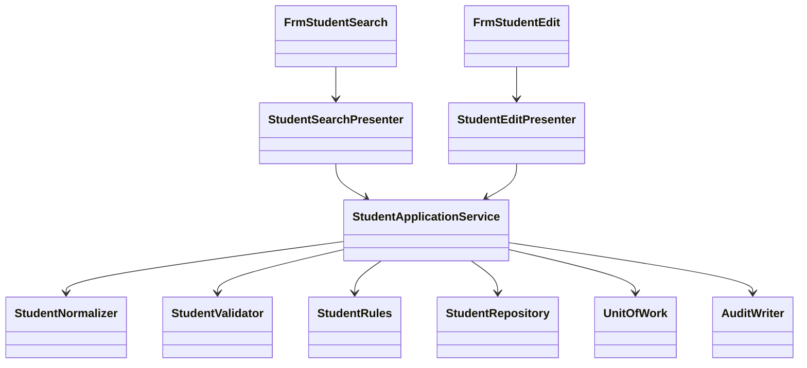

# VB.NET / WinForms 言語依存仕様書

版3.0／2026-10-10。[画面詳細](01_詳細仕様書.md)。Windows・.NET 10を仮定。製品根拠は[共通06](../../共通/06_要件対応・設計判断.md)のS-02・07・12。

## 1. 構造・命名・型

```text
StudentManagement.WinForms/Forms/FrmStudentSearch.vb, FrmStudentEdit.vb
StudentManagement.WinForms/Controls/NullableDateControl.vb, CodeComboControl.vb
StudentManagement.WinForms/Presenters/StudentSearchPresenter.vb, StudentEditPresenter.vb
StudentManagement.Application/StudentApplicationService.vb, MasterMaintenanceService.vb
StudentManagement.Application/StudentNormalizer.vb, StudentValidator.vb, StudentRules.vb
StudentManagement.Domain/Student.vb, StudentDraft.vb, SchoolClass.vb, CodeEntry.vb
StudentManagement.Infrastructure/StudentRepository.vb, MasterRepository.vb, UnitOfWork.vb
StudentManagement.Infrastructure/ConfirmationStore.vb, AuditWriter.vb, CurrentUserAdapter.vb
StudentManagement.Maintenance/Program.vb
```

`Option Strict On / Option Explicit On / Option Infer On`。型・プロパティPascalCase、ローカルcamelCase、privateフィールド先頭_。FormはPresenterへ操作を委譲、PresenterはFormインターフェイスを使い、業務サービスはWindows.Formsに依存しない。



| 意味 | VB.NET型 | NULL・注意 |
| --- | --- | --- |
| ID・版 | Long／Nullable(Of Long) | Integerへ狭めない。上限前に採番・版加算停止 |
| 人数・並び順・ページ | Integer | 非負。定員はInteger? |
| 日付 | DateOnly／DateOnly? | UIのDateTimeから年月日だけ取得 |
| 時点 | DateTimeOffset | UTC保持、表示時日本時間 |
| 任意文字 | String、Nothing | String.EmptyとDB NULLを正規化で統一 |
| 真偽 | Boolean | DBNullをFalseに黙って変換しない |
| DBパラメーターNULL | DBNull.Value | AddWithValueで型を推測せずNpgsqlDbTypeを指定 |

## 2. 物理テーブル：全89列

共通管理列A＝`created_at timestamptz NOT NULL, created_by varchar(64) NOT NULL, updated_at timestamptz NOT NULL, updated_by varchar(64) NOT NULL, row_version bigint NOT NULL DEFAULT 1`。以下の`?`はNULL可、その他はNOT NULL。`ID`＝bigint GENERATED ALWAYS AS IDENTITY、`Vn`＝varchar(n)、`D`＝date、`T`＝timestamptz、`B`＝boolean、`I`＝integer、`L`＝bigint。Vnは業務文字数の上限。列名をsnake_case→PascalCaseに機械的変換した名前をVB Entityプロパティとし、語中数字は保持する（address_line1→AddressLine1）。

| テーブル | 論理項目順の物理列・型 |
| --- | --- |
| m_student（30＋A=35） | student_id ID; student_no V20; student_name V100; student_name_kana V100; name_key V2000; kana_key V100; birth_date D; gender_category V30; gender_code V1; postal_code V7; prefecture_category V30; prefecture_code V2; address_line1 V200; address_line2 V200?; phone_number V16?; email_address V254?; admission_date D; enrollment_category V30; enrollment_status_code V2; enrollment_end_date D?; class_id L?; emergency_contact_name V100?; relationship_category V30; relationship_code V2?; emergency_phone_number V16?; remarks V1000?; is_deleted B DEFAULT false; deleted_at T?; deleted_by V64?; delete_reason V200?; A |
| m_class（12＋A=17） | class_id ID; school_year smallint; grade_category V30; grade_code V2; class_code V10; class_name V50; valid_from D; valid_to D; capacity I?; display_order I DEFAULT 0; is_active B DEFAULT true; remarks V500?; A |
| m_code_category（6＋A=11） | category_id V30; category_name V50; code_length smallint; allow_add B; is_active B DEFAULT true; remarks V500?; A |
| m_code（9＋A=14） | category_id V30; code_value V10; code_name V100; display_order I DEFAULT 0; is_active B DEFAULT true; valid_from D; valid_to D?; is_protected B; remarks V500?; A |
| t_operation_log（12） | log_id ID; target_table V30; target_key V200; operation_type V10; before_version L?; after_version L; changed_columns jsonb; executed_by V64; executed_at T; correlation_id uuid; operation_reason V200?; duplicate_confirmed B DEFAULT false |

Aは列5つを末尾に実際に展開する。t_operation_logにはAを重ねて追加しない。target_tableは許可5表のうち履歴自体を除く4値、target_keyはIDまたは分類＋値。changed_columnsは物理列名のJSON配列で、個人情報値を含めない。OperationTypeはCREATE/UPDATE/DELETE/DISABLE/ENABLE。

### キー・制約・索引

| 名前 | 定義 |
| --- | --- |
| pk_student / uq_student_no | student_id主キー、student_no全行一意（削除済みも対象） |
| pk_class / uq_class_year_code | class_id主キー、school_year＋class_code一意 |
| pk_code_category / pk_code | category_id主キー、コードは(category_id,code_value)複合主キー |
| fk_student_class | class_id→m_class.class_id、ON DELETE RESTRICT |
| fk_student_gender/prefecture/enrollment/relationship | 分類列＋値列→m_code、RESTRICT。続柄値NULL可 |
| fk_class_grade / fk_code_category | (grade_category,grade_code)→m_code、m_code.category_id→m_code_category |
| ck_*_category | 学生4分類はGENDER/PREFECTURE/ENROLLMENT_STATUS/RELATIONSHIP、クラスはGRADEに固定 |
| ck_student_dates | birth_date≦admission_date、01/02は終了日NULLかつclass_id非NULL、03/04は終了日非NULLかつ入学日以上 |
| ck_student_contact | 連絡先の1つ以上、緊急3項目全部NULLまたは全部非NULL |
| ck_student_deleted | 未削除なら削除3項目全NULL、削除なら3項目全非NULL |
| ck_class_limits | 年度1900～9998、開始≦終了かつ年度内、capacity NULLまたは1～9999、display_order≧0 |
| ck_code_limits | code_length 1～10、値は数字、期間順、display_order≧0。分類固定桁は保守サービス／DB更新入口で検査 |
| ix_student_birth | birth_date、非削除行。氏名キー2000をB-tree複合キーへ無条件に入れない |
| ix_student_class_status | (class_id,enrollment_status_code) WHERE NOT is_deleted |
| ix_student_admission / ix_student_updated | admission_date / updated_at、非削除行 |
| ix_student_phone / ix_student_emergency_phone | 本人／緊急電話、非削除行 |
| ix_operation_target | (target_table,target_key,executed_at) |

各版は正数、更新時+1。現在日による検査は変動するためCHECKに埋めず保存入口で実行。メール・電話形式、必須空白、照合キー生成はサービスで検証しDB入口にも必要な検査を置く。学籍番号・クラスコードを大文字ASCIIにして保存、識別用列はバイナリー相当の決定的照合。全5表の業務上の意味・最大長は基本03に対応する。

## 3. SQL・保存単位

`StudentRepository`は型付きNpgsqlParameterを使用し、接続・Txを呼出元から受ける。SQL本文へ入力値・並び順文字列を直接連結しない。識別子を動的にする場合はサーバー定義の許可表から選ぶ。

```sql
-- 全書込み経路とマスタ保守が同じキーを使う評価用の短時間直列化
SELECT pg_advisory_xact_lock(75310, 1);
-- ロック取得後に別ステートメントで最新行・マスタを読む（Read Committed）
SELECT * FROM m_student WHERE student_id=$1 AND NOT is_deleted FOR UPDATE;
SELECT count(*) FROM m_student
 WHERE class_id=$1 AND enrollment_status_code IN ('01','02')
   AND NOT is_deleted AND ($2::bigint IS NULL OR student_id<>$2);
SELECT student_id,row_version FROM m_student
 WHERE NOT is_deleted AND birth_date=$1
   AND (name_key=$2 OR kana_key=$3)
   AND ($4::bigint IS NULL OR student_id<>$4)
 ORDER BY student_id;
UPDATE m_student SET student_name=$1,name_key=$2,
 updated_at=$3,updated_by=$4,row_version=row_version+1
 WHERE student_id=$5 AND row_version=$6 AND NOT is_deleted
 RETURNING row_version;
```

最後のSQLは列割当の抜粋。実更新は画面の全19保存入力＋生成name_key/kana_keyを固定許可列で更新する。student_no、作成情報、削除情報、分類固定値は一般UPDATEに含めない。新規INSERTは入力＋生成キー＋分類固定値＋作成更新情報＋row_version=1。削除UPDATEはis_deleted、deleted_at/by/reason、updated_at/by、row_versionだけ。更新・削除件数は必ず1件、0なら存在と版を再確認してE-STU-103/105。採番はRETURNING、MAX+1は禁止。

保存順は共通03。Read Committed＋上記ゲート→最新版取得→権限・業務検査→候補確認→学生変更→履歴→Commit。確認待ちはRollbackで抜ける。例外時Rollback、確定結果不明は検索確認。長時間保護を防ぐlock_timeout=5秒、statement_timeout=15秒を評価基準とする。全書込みが規約を守ることが条件で、管理者の直接SQLは通常運用に含めない。

検索はReadOnly RepeatableReadで件数と一覧を揃える。最大10001件のIDを数え、10000以下だけページ取得。FROM m_student s LEFT JOIN m_class c、名称は分類＋値のLEFT JOINで有効性条件を付けない。学籍前方・氏名カナ部分はLIKE ... ESCAPE '!'、状態は型付き配列、電話OR、日付両端。既定student_no COLLATE "C", student_id。氏名順はname_key COLLATE "C"、他はadmission_date/updated_at、常にstudent_idを追加。OFFSETとLIMITは数値パラメーター。

## 4. 共通モジュールの実装

共通01～03＝CurrentUserAdapter/AuthorizationService/BusinessClock、04～05＝StudentNormalizer/StudentValidator、06～10＝MasterRepository/StudentRules/ClassCapacityService/DuplicateService、11＝ConfirmationStore、12＝SearchContext、13＝UnitOfWork、14＝AuditWriter、15＝MessageCatalog/DisplayFormatter。

```vb
Public Interface IStudentApplicationService
    Function SearchAsync(criteria As StudentSearchCriteria, page As Integer,
                         pageSize As Integer, ct As CancellationToken) As Task(Of SearchResult)
    Function SaveAsync(command As StudentSaveCommand,
                       ct As CancellationToken) As Task(Of SaveResult)
    Function DeleteAsync(command As StudentDeleteCommand,
                         ct As CancellationToken) As Task(Of SaveResult)
End Interface
```

StudentSaveCommandはStudentId As Long?、ExpectedVersion As Long?、Draft As StudentDraft、SelectionHints、Confirmation、OperationReason。StudentDraftの全プロパティは物理列対応表の編集可能業務21列（入力19＋生成キー2）。Entityの管理列をUIに双方向バインドしない。

照合キーはString.Normalize(FormKC)、ToUpperInvariant、Runeベースの空白・文字数処理、カナ対応変換。Nothing/空文字を正規化しDBNullへ変換。文字長はString.Lengthだけで判定しない。Npgsql例外はSqlState23505＋制約名で番号重複、23503で参照不整合、40001/40P01/55P03で競合・再確認へ変換。SQL本文を表示しない。

## 5. 状態・権限境界・配置

評価時SearchContextはフォーム別メモリー、30分、利用者失効で破棄。DuplicateConfirmationは10分、利用者・セッション・対象・版・正規化全業務値・全候補ID/版を保存し、保存時の再検索と比較。フォーム内の確認済Booleanだけでは続行しない。

ネイティブクライアント直結を選ぶため、本番では個別に認証したDB主体と実行専用のDB更新入口を組み合わせる。`student_api.prepare_save`は検査後に確認情報をサーバーに発行、`student_api.commit_save`は確認情報・理由を再検証し学生＋履歴を確定する契約とする。補助`t_confirmation`はtoken uuid PK、principal V64、session_id uuid、target_id L?、expected_version L?、payload_hash bytea、candidate_hash bytea、expires_at T、consumed Bを保持し、業務5表と別。直接DMLをREVOKE、共有パスワード埋込みを禁止。閲覧／編集／削除権限はDB更新入口でもDB主体から検査する。フォーム内評価サービスをそのまま改造可能なクライアントへ強いセキュリティ境界として配備しない。

ビルドは.vbprojでTargetFramework=net10.0-windows、UseWindowsForms=true、OptionStrict=On。デザイナー生成.vbと業務処理を分ける。Npgsqlパッチ版を固定、設定は環境の秘密管理から取得。GUIはUIスレッドで更新し、I/O完了をAwaitして戻す。キャンセル時に保存の確定を取り消せたと断定しない。依存版・DB入口実装・認証結合・DPI・障害復旧を配備前に試験する。これらは仕様でありビルド済み成果物ではない。
