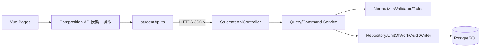

# Vue / C# API 言語依存仕様書

版3.0／2026-10-10。[画面詳細](01_詳細仕様書.md)。技術資料：[共通06](../../共通/06_要件対応・設計判断.md) S-04・05・07・12・14。

## 1. 構造・責務

```text
frontend/src/pages/StudentSearchPage.vue, StudentEditPage.vue
frontend/src/components/StudentForm.vue, StudentGrid.vue, Pager.vue
frontend/src/components/CodeSelect.vue, ClassSelector.vue, MessagePanel.vue
frontend/src/components/DuplicateDialog.vue, DeleteDialog.vue
frontend/src/composables/useStudentSearch.ts, useStudentEditor.ts, useDirtyGuard.ts
frontend/src/api/studentApi.ts, contracts.ts, apiClient.ts
backend/Controllers/StudentsApiController.cs
backend/Contracts/StudentSearchRequest.cs, StudentSaveRequest.cs, ApiResult.cs
backend/Application/StudentQueryService.cs, StudentCommandService.cs, MasterMaintenanceService.cs
backend/Domain/StudentDraft.cs, Student.cs, SchoolClass.cs, CodeEntry.cs
backend/Infrastructure/StudentRepository.cs, UnitOfWork.cs, AuditWriter.cs
```



VueはSingle File ComponentとComposition API、TypeScript strict。Vueのリアクティブ値とAPI DTOを同一参照で共有しない。コンポーネントはpropsを直接変更せずupdateイベントを送る。`v-html`に学生値を渡さず通常のテキスト補間を使用。[S-05]

```typescript
export type EntityId = string; // 10進整数、Numberへ変換しない
export interface StudentSaveRequest {
  studentNo: string; studentName: string; studentNameKana: string;
  birthDate: string; genderCode: string; postalCode: string;
  prefectureCode: string; addressLine1: string; addressLine2: string | null;
  phoneNumber: string | null; emailAddress: string | null;
  admissionDate: string; enrollmentStatusCode: string;
  enrollmentEndDate: string | null; classId: EntityId | null;
  emergencyContactName: string | null; relationshipCode: string | null;
  emergencyPhoneNumber: string | null; remarks: string | null;
  schoolYear: number | null; gradeCode: string | null;
  expectedVersion: EntityId | null; duplicateToken: string | null;
  operationReason: string | null; returnContextId: string | null;
}
```

C#側の同名PascalCaseプロパティはraw入力を保持し、ID文字列→long、日付文字列→DateOnly、年→intを厳密検査。最大本文64KiB、未知プロパティと同名重複を拒否。数値やboolから文字列へ暗黙変換しない。

## 2. 共通処理の層分担

| 共通契約 | フロント | API側の正本 |
| --- | --- | --- |
| 共通01～03 | user表示、失効案内 | CurrentUserAccessor、AuthorizationService、BusinessClock |
| 共通04～05 | 長さ・形式の入力補助 | StudentNormalizer、StudentValidator |
| 共通06～10 | 候補描画・人数参考・警告 | MasterLookupService、StudentRules、CapacityService、DuplicateService |
| 共通11 | トークンを一時保持して再送 | DuplicateConfirmationStore、全内容・候補・期限検査 |
| 共通12 | draftとapplied、画面遷移 | SearchContextStore、所有者・版・期限 |
| 共通13～14 | 結果を待つ。DB操作なし | UnitOfWork、AuditWriter |
| 共通15 | MessagePanel、項目エラー | ExceptionMapper、MessageCatalog |

フロントだけに必須・存在・定員・権限を実装しない。正規化の最終結果はAPI側を正本とし、フロント差異は共通テストベクトルで検出する。

## 3. DB物理仕様：全89列

PostgreSQL 18、UTF-8。ID=bigint identity、L=bigint、I=integer、B=boolean、D=date、T=timestamptz、Vn=varchar(n)。?はNULL可。他はNOT NULL。Aはcreated_at T、created_by V64、updated_at T、updated_by V64、row_version L DEFAULT 1。Entity名はPascalCaseへ対応、API出力はcamelCase。DBのLはJSONで文字列。

| 表・列数 | 全列 |
| --- | --- |
| m_student・35 | student_id ID; student_no V20; student_name V100; student_name_kana V100; name_key V2000; kana_key V100; birth_date D; gender_category V30; gender_code V1; postal_code V7; prefecture_category V30; prefecture_code V2; address_line1 V200; address_line2 V200?; phone_number V16?; email_address V254?; admission_date D; enrollment_category V30; enrollment_status_code V2; enrollment_end_date D?; class_id L?; emergency_contact_name V100?; relationship_category V30; relationship_code V2?; emergency_phone_number V16?; remarks V1000?; is_deleted B DEFAULT false; deleted_at T?; deleted_by V64?; delete_reason V200?; A |
| m_class・17 | class_id ID; school_year smallint; grade_category V30; grade_code V2; class_code V10; class_name V50; valid_from D; valid_to D; capacity I?; display_order I DEFAULT 0; is_active B DEFAULT true; remarks V500?; A |
| m_code_category・11 | category_id V30; category_name V50; code_length smallint; allow_add B; is_active B DEFAULT true; remarks V500?; A |
| m_code・14 | category_id V30; code_value V10; code_name V100; display_order I DEFAULT 0; is_active B DEFAULT true; valid_from D; valid_to D?; is_protected B; remarks V500?; A |
| t_operation_log・12 | log_id ID; target_table V30; target_key V200; operation_type V10; before_version L?; after_version L; changed_columns jsonb; executed_by V64; executed_at T; correlation_id uuid; operation_reason V200?; duplicate_confirmed B DEFAULT false |

PK＝student_id/class_id/category_id/(category_id,code_value)/log_id。UQ＝student_no全件と(school_year,class_code)。FK＝学生クラス、学生4分類組→m_code、クラス学年組→m_code、m_code分類→m_code_category。RESTRICTで参照先実体を残す。固定分類をCHECK、必須空白・版>0・在籍日付と所属・生年月日≦入学日・連絡手段・緊急一式・削除属性一式・クラス年度内期間と定員・コード期間を行内制約と保存検証で保護する。現在日、有効性、分類桁、定員集計はAPI側の保存時確認。

索引＝非削除birth_date、(class_id,enrollment_status_code)、admission_date、updated_at、本人・緊急電話。履歴は(target_table,target_key,executed_at)。name_key2000は無条件B-treeに入れず、重複候補は生年月日で絞る。CodeEntryのコード値は数値化せず、01を保持する。

## 4. SQL・確定単位

QueryServiceはReadOnly RepeatableReadで最大10001件のキー件数とページ取得を実行。SELECTは一覧12項目相当の必要列のみで、住所2・メール・緊急電話・備考をJSONへ返さない。名称はLEFT JOIN、分類＋値で結合、有効性で既存行を消さない。

条件ビルダーは常にNOT s.is_deleted、指定条件AND、在籍は配列、電話は本人OR緊急、日付両端、未所属NULL。LIKEは入力の!/%/_をエスケープしNpgsqlParameterで渡す。ソートキーをstudent_no COLLATE "C" / name_key COLLATE "C" / admission_date / updated_atへ許可表で変換、同順位student_id。ページ・LIMIT/OFFSETも数値パラメーター。

保存・削除・全マスタ保守はRead Committed Tx内で`SELECT pg_advisory_xact_lock(75310,1)`を取得し、その後の別SQLで最新版・マスタを読む。単一学校の書込みを短時間直列化する評価設計。これにより同一人物候補の別クラス同時登録やマスタ停止とも順序付ける。全経路でゲートが必要。

```sql
UPDATE m_student
SET student_name=$1,name_key=$2,updated_at=$3,updated_by=$4,
    row_version=row_version+1
WHERE student_id=$5 AND row_version=$6 AND NOT is_deleted
RETURNING row_version;
```

列は更新方式の抜粋。実更新は学籍番号以外の18入力＋生成照合値2＋更新情報・版。新規は19入力＋照合値2＋分類固定値＋作成・更新＋版1。削除は削除状態・日時・者・理由と更新情報・版だけ。採番はidentity RETURNING、MAX+1禁止。0件更新は存在と旧版を確認して404/409。

定員は非削除01/02かつ自分以外を集計し新席増加時だけ+1。候補は非削除、自分以外、同生年月日、氏名キーORカナキー、全IDと版。全検査後に学生＋t_operation_logを同一Txで確定。ログは変更列配列・実行者・対象・前後版・理由、値の複写なし。確認を返す前にRollbackしてロック解放。DB障害時は両方取消、Commit成否不明は別扱い。

## 5. 認証・状態・通信

基準は同一オリジンにSPAとAPIを配置、認証はSecure/HttpOnly Cookie。Cookie認証なのでJSON APIも明示的なCSRFトークン検証を行う。API bootstrapでCSRF要求トークンを返しメモリー保持、変更系と検索POSTにRequestVerificationTokenヘッダー。credentialsはsame-origin。CORSワイルドカードと資格情報の併用をしない。トークン・個人情報をlocalStorageへ保存しない。[S-14]

基準APIサーバー1台。SearchContextは256bit乱数ID、所有者・ログインセッション・画面タブ、実行済条件、ページ、ソート、Revision、30分期限。Context単位排他で更新し古いRevisionを拒否。DuplicateConfirmationは10分、全正規化業務値＋対象・版のハッシュと全候補ID/版ハッシュ。理由・補助条件は別検査。確認トークンの並行消費禁止、成功で消費、内容変更・結果不明で失効。複数台では共有状態ストア・保護鍵が必須。

認証UserIdと役割はAPIで取得し、JSONのRole・CreatedBy等を拒否。通信はHTTPS、全個人情報応答no-store、DB秘密はAPIだけ。ログは受付番号・処理名・SQLSTATE等の分類だけで要求本文・個人情報・トークンを除外する。

## 6. 例外・配備・検証

401未認証、403権限、400要求／CSRF、404対象なし、409版競合／重複確認、422業務検査、503DB障害。エラーJSONはoutcome、messageId、message、fieldErrors、correlationId、retryBySearch。SQLSTATE23505は制約名で学籍／マスタ重複、23503は参照、0件更新は版競合。fetchがタイムアウトしただけで保存失敗と断定しない。

Vue依存版をpackage-lock等で固定、TypeScript型検査と本番ビルド。C#はnet10.0・Nullable有効・Npgsql版固定。Nodeやビルドツールの実際の対応版は実装時に固定しCIで検証する。秘密・実学生をソースに含めない。SPAのルーティングフォールバックと/api配下を混同せず、APIエラーをindex.htmlで返さない。

Vue部品試験、API契約試験、認証・CSRF結合、実DB2接続競合、E2E新規→警告→保存→検索復帰、64bitID、オフライン・期限切れ・応答逆転を試験する。静的設計書の生成をビルド・実機試験の合格とはしない。
