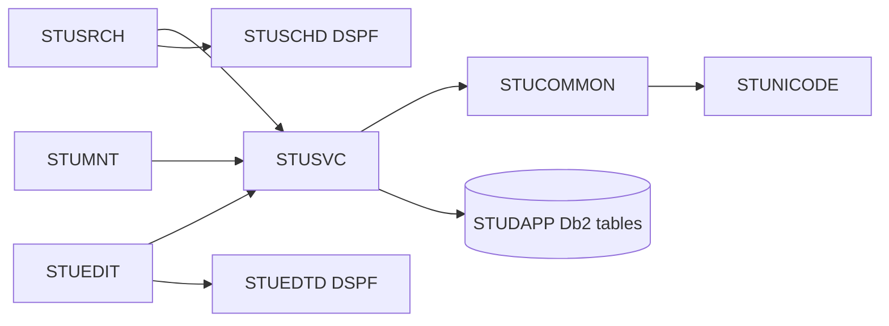

<!-- spec-meta: {"schema":"spec-md/1.0","documentId":"AS400_RPG-COM-AS400_RPG","version":"8.4","path":"test-project1/spec/AS400_RPG/共通/方式別/01_共通実装仕様.md","sheets":[{"heading":"オブジェクト・プログラム構造","kind":"GRID","sheet":"01_オブジェクト・プログラム構造"},{"heading":"SQL・コミットメント制御","kind":"GRID","sheet":"02_SQL・コミットメント制御"},{"heading":"DDS・状態・認証","kind":"GRID","sheet":"03_DDS・状態・認証"},{"heading":"共通規約・日付実装","kind":"GRID","sheet":"04_共通規約・日付実装"}],"isolationProfile":"AS400_RPG"} -->
# AS400／RPG 共通実装仕様

| 項目 | 内容 |
| --- | --- |
| 版数・改訂日 | 8.4／2026-10-25 |
| 対象方式 | AS400／RPG |
| 適用 | 設計上の実装契約。製品コードの実装・コンパイルは未実施 |

開発入力：[学生検索詳細](../../詳細仕様書/01_学生検索画面.md)／[学生登録詳細](../../詳細仕様書/02_学生登録画面.md)／[共通実装](01_共通実装仕様.md)／[DB定義](../../DB定義/Db2_for_i/01_DB定義書.md)／[方式別開発規約](../../規約/AS400_RPG.md)／[共通開発規約](../../規約/開発規約.md)。

## オブジェクト・プログラム構造

| 区分 | 物理オブジェクト・ソース | 責務 |
| --- | --- | --- |
| プログラム | STUDPGM/STUSRCH、STUEDIT | 検索・登録の画面イベント |
| 表示ファイル | STUDPGM/STUSCHD、STUEDTD | DDS条件・一覧・入力・確認・補助編集 |
| サービスプログラム | STUDPGM/STUSVC | StSearchStudents、StLoadStudent、StSaveStudent、StDeleteStudent、StMaintainClass、StMaintainCode |
| 共通サービス | STUDPGM/STUCOMMON | StAuthorize、StClock、StNormalize、StValidate、StMessage、StConfirm |
| Unicode補助 | STUDPGM/STUNICODE | CCSID変換、Unicode正規化、scalar数、エスケープ編集。別途実装するILE C補助とのバインド契約 |
| 管理者処理 | STUDPGM/STUMNT | IFS承認データの保守投入 |
| SQL表 | STUDAPP | 業務5表＋制御表 |
| COPY | STUTYPES、STUPROTO | Qualified DS、プロトタイプ、結果定数 |
| バインド | STUBND | サービスプログラムの公開手続きとシグネチャー |

共通01～03はStAuthorize/StClock、04～05はStNormalize/StValidate、06～10はStLookupCodes/StLookupClasses/StCheckRules/StCheckCapacity/StFindDuplicates、11はStConfirm、12はSearchContext DS、13はStBeginWork/StEndWork、14はStAppendAudit、15はStMessage。



クラス図ではなく呼出構造図とする。画面側からUPDATE命令を直接発行せず、保存単位をStSaveStudent等へ集約する。

## SQL・コミットメント制御

評価版は補助表`STUDAPP.T_WRITE_GUARD`（システム名STGUARD）を追加：guard_id SMALLINT PRIMARY KEY CHECK(guard_id=1)、lock_bit SMALLINT NOT NULL CHECK IN(0,1)。初期1行(1,0)。業務表ではない。検索の件数・一覧と全書込みが同じ行を更新して短時間保護し、整合する結果を得る。MVCCのスナップショットを仮定しない。

```sql
UPDATE STUDAPP.T_WRITE_GUARD
   SET LOCK_BIT=1-LOCK_BIT WHERE GUARD_ID=1;
SELECT STUDENT_ID,ROW_VERSION FROM STUDAPP.M_STUDENT
 WHERE STUDENT_ID=:studentId AND IS_DELETED=0;
SELECT COUNT(*) INTO :occupancy FROM STUDAPP.M_STUDENT
 WHERE CLASS_ID=:classId AND IS_DELETED=0
   AND ENROLLMENT_STATUS_CODE IN ('01','02')
   AND STUDENT_ID<>:excludeStudentId;
```

新規のexcludeStudentIdは0（自動IDは正数）を用いる。対象読込・マスタ存在・版・定員・全候補検査はゲート取得後。更新は固定列割当と`WHERE STUDENT_ID=:id AND ROW_VERSION=:expectedVersion AND IS_DELETED=0`、ROW_VERSION=ROW_VERSION+1。GET DIAGNOSTICSのROW_COUNTで1件を確認。新規IDはINSERT直後、同じ接続でIDENTITY_VAL_LOCALを取得し、監査INSERTを先行させない。

INSERTは19業務入力＋2照合値＋固定分類＋作成更新＋版1、UPDATEは学籍番号以外18入力＋照合値2＋更新情報、削除は削除4属性と更新情報・版だけ。履歴は同じコミットメント定義内で追記。成功COMMIT、入力・版・確認待ち・例外はROLLBACK。検索は結果をメモリーへコピー後ROLLBACKしてゲート変更を取り消す。全DML対象とゲートがジャーナル対象でなければ起動検査で停止する。[S-11]

SQLRPGLEはCOMMIT(*CS)、同じ名前付きactivation groupを採用、コミットメント定義を共用。Tx中にEXFMT、入力待ち、外部対話をしない。ジョブ終了・MONITOR例外でもRollback経路を通す。DBロック待ち上限は配備設定で有限にし、待ち時間超過時はE-COM-004と再確認。検索も書込みもゲートで直列化するため性能は実機測定が必要。

検索SQLは最大10001件のキーを取得して上限判定。同じ条件とゲート保護下で20/50/100件をOFFSET/FETCHまたはROW_NUMBERで取得。動的値はPREPARE/OPEN USINGでバインド。学籍番号前方・氏名照合部分一致のLIKE ESCAPE '!'によるリテラル処理と在籍内ORを適用。ClassId完全一致以外の年度・学年・未所属・都道府県・電話・期間条件を受け付けない。SearchCriteria DSは正規化後のstudentNo/nameKey/classId/statusSelected(1 To 4)だけ。SearchCriteriaRawは原入力を別保持し、氏名raw8のvargraphic(16)から正規化nameKey最大160のvargraphic(320)へ移す。編集もeditWorkRaw（郵便raw10はvargraphic(20)）とeditWork（正規化郵便7）を別領域とする。容量と移送順は両画面詳細のRaw DS節に従う。名称は分類＋値のLEFT JOINで有効性を条件にしない。ソートは許可4項目＋学生IDだけ。

## DDS・状態・認証

DDS物理名、可視窓W・プログラムバイトD・SI/SO・前後属性セルの予約は[Text方式規約](../../規約/AS400_RPG.md)の「DDS物理名・属性とSI/SOの予約」に従う。HTML状態名と物理レコード名を区別し、行桁図の合格をDDS/5250実機合格に読み替えない。

DSPFはDSPSIZ(27 132)、COND/SFLCTL/SFLROW/EDSTUDENT/PICK/CNFRM/LONGTXTのレコード構成。サブファイルはSFLPAG(8)、SFLSIZ(101)、SFLDSP/SFLDSPCTL/SFLCLRを状態で制御。RRNとstudentIdの対応をresultRowsに持つ。実際のDDS源にはDBCS表示桁とソースCCSIDを反映し、モックの日本語文字幅をそのままDDS列数にしない。[S-10]

検索DSと確認DSはジョブ・利用者・画面識別別。確認DSには対象・版・正規化全入力・全候補ID/版のダイジェスト・10分期限。複数候補はストリーミングで全集合ハッシュを計算し、20件表示で判定を打ち切らない。確認中にゲートを解放し、再確定で候補を再集計。共有のグローバル確認済フラグを設けない。

認証はIBM iの実行ユーザープロファイルと承認済み認可設定から取得。画面のUSERLABELを権限の根拠にしない。業務データファイルの直接変更権限を制限し、許可プログラム経由にする。権限採用を使用する場合は所有者プロファイルを最小権限とし、任意のSQL・IFSパス・コマンドを渡せない設計を必須とする。


#### Text系・5250の行桁と取得ページ

画面種別はText系とし、DSPSIZ(27 132)を維持する。固定の等幅文字セルを採用し、マウスやWeb部品へ依存しない。1～7行に4検索条件、件数・並び順・状態・一覧見出し、8～23行に1学生2物理行×8学生、24～27行に端末位置・検索日時・固定キーを配置する。入力欄は下線、保護表示は無下線。条件の短いコード・学籍番号・氏名に必要な桁だけを割り当てる。

SFLPAG(8)、SFLSIZ(101)。RRNはDB取得ページ内の1～pageSizeで、resultRowsのstudentIdへ解決する。選択欄へ2=編集または5=参照を1件だけ入力してEnterを押す。選択があるEnterは行呼出しを優先し、条件を再検索しない。複数選択・不正選択値はメッセージを出して保持し、権限を再検査する。選択なしのEnterだけが検索で、編集中条件を検査して適用する。Tab/Shift+Tabは条件と選択欄を行桁順に移動する。

PageUp/Downは同じ取得ページ内を8学生送りし、20件は8/8/4、50件は8×6/2、100件は8×12/4とする。F7/F10は前/次DB頁、F15/F16は先頭/最後DB頁で、取得後は端末先頭へ戻す。端末内の境界でDB頁を勝手に跨がない。未検索・0件・上限超過・到達端点では無効とする。頁・ソート操作はAppliedCriteriaだけを使う。F9の並び順とF11の20/50/100件はPICKで選び、取消は未変更、確定時はDB1頁・端末先頭へ戻す。

F4はカーソル項目候補、F8はカーソルがある一覧学生の全文参照LONGTXT、F5は初期条件と未検索へ戻す、F6は新規（作成権限）、F12はメニュー。PICKは1選択=Enter確定・F12取消、PageUp/Downで8候補送り。全文参照は保護表示でF10反映を無効とする。結果外の表示RRNや空行をIDにせず、行呼出し前に対象と認可を再確認する。

全角2・半角1セルは設計図の計測である。DDSのDBCS属性・SI/SO制御の符号化長とCCSID往復は別途検証し、変換不能値を代替文字で保存しない。長いクラス名・更新者などは末尾に「… F8」と表示し、元Unicode値をDSに保持して全文へ到達する。実機DDSコンパイル、5250エミュレーター、CCSID往復は未実施である。

#### Text系・通常編集1画面と全項目到達

画面種別はText系、5250の固定27行×132桁とする。HTMLは等幅文字セルの配置図であり、Webの入力部品やカードへ置き換えない。EDSTUDENTに通常入力を集約する。旧2パネルの空行を統合し、短い学籍番号・日付・在籍・性別・年度学年を左右に並べ、住所各1行、メール1行、備考3行、理由2行を確保した。通常のパネル切替は不要で、全19保存入力と全34論理項目の到達を維持する。

1～2行は画面・モード・対象、3～12行は基本・住所連絡先・在籍所属・緊急、13～15行は備考、16～17行は確認変更理由、18～23行は人数・制約・メッセージ・更新情報、24～27行は固定キーと操作状態とする。短いコードや日付の入力を長文幅へ拡張しない。新規では学籍番号も入力可能、編集では保護、参照では全欄保護。生年月日は元号・年・月・日の4原入力のままである。

F4はカーソル項目の候補PICK、F8はカーソル項目のLONGTXT、F9は次の項目エラー、F10は全項目検査・保存、F5は取消、F14は再読込、F12は検索復帰、F23は管理者論理削除。通常Enterは原入力反映と連動だけで保存せず、F9の旧パネル切替用途は廃止する。カーソルはTab/Shift+Tabで入力欄を行桁順に移動し、保護表示を飛ばす。キーが無効な状態では行末案内を変更し、サーバー相当の処理側でも拒否する。

備考と理由の物理継続欄は改行位置・原Unicode文字位置・変更範囲を別に持つ。画面上の折返しをLFとして保存しない。長いraw値、画面符号化で欄内に収まらない値、変換不能Unicode値はF8で全文へ到達する。LONGTXTのF10は原項目に返すだけでDB保存せず、F12は補助変更だけを取消。表示セル・DDS符号化バイト・rawスカラー上限・保存上限は別物であり、表示幅による切捨てを禁止する。

重複確認CNFRM_DUPでは全候補件数と最大20件の表示範囲を示し、1面8候補でPageUp/Down。F10明示続行とF12取消を固定し、Enterでは続行しない。CNFRM_DELETEはREG-026の削除理由とF23明示確定、CNFRM_DISCARDはF10破棄とF12取消を持つ。確認レコードは必要時だけ表示し、通常入力の追加ページではない。DBロックを保持して入力待ちせず、確認後に認可・版・全入力・全候補・期限を再検査する。


## 共通規約・日付実装

対象読者は実務経験５年程度のプログラマー。[検索詳細](../../詳細仕様書/01_学生検索画面.md)／[登録詳細](../../詳細仕様書/02_学生登録画面.md)／[開発規約](../../規約/開発規約.md)／[日付正本](../07_日付・和暦仕様.md)。

共通16の入力は元号識別値・年・月・日という原文字列4値と業務日。出力は正規化日付と和暦表示文字列、または項目エラー。共通17は項目種別と日付／年度にDATE-R01～06を適用する。変換で不正日を補正しない。OS全体の暦設定を変更しない。元号表の版を画面・保存側で一致させる。

| 役割 | 実装仕様 |
| --- | --- |
| 共通16物理名 | StParseBirthDate / StFormatBirthDate、DDS EBERA・EBYEAR・EBMONTH・EBDAY |
| 内部日付型 | date、SQL NULLは別標識 |
| 入力と保存 | 和暦原入力4値から日付を生成。StudentDraft等のbirth_date相当は正規化日付。元号をDBへ重複保存しない |
| 呼出境界 | 本方式はText系5250画面。和暦原入力4値を業務処理へ渡し厳密変換する。取得時は内部日付を和暦表示に変換。Web JSON契約は本方式に適用しない |
| 表示 | 一覧・参照・重複確認のBirthDateWareki相当文字列は共通16で生成。その他の日付・日時は西暦 |
| 例外 | CHK-032～034、E-DATE-001～003。構文検査後、実在日、元号境界、逆変換、業務範囲、前後関係を順に検査 |
| 参考試験 | DATE-T01～20。ライブラリーの解析成功だけで元号境界を合格にしない |

### 保守入口・方式固有の適合条件

#### Unicode補助・保守・試験

5250表示で変換できない文字は`[U+20BB7]`等で注意を表示し、元Unicode値をDSに保持する。変更していない項目を画面バッファから全上書きしない。変換不能値の編集はF8の明示的Unicode入力モードで`\u{20BB7}`等のエスケープを受け、逆変換・文字数検査して保存。通常入力モードではエスケープを勝手に解釈しない。バックスラッシュ自体は補助モードで二重化する。長文は文字境界単位で分割し全範囲を編集できることを試験する。

`STUMNT`管理者プログラムは承認済みIFS入力を読み、StMaintainClass/Codeを呼ぶ。初期5分類70値、保護値・キー不変、クラス参照・定員・期間と履歴を同じゲートで処理する。

共通T-01～28に加え、5250画面サイズ、SFL8学生（2物理行/学生）と取得20/50/100の境界、READC選択、Fキーの権限、DDS桁とUnicode文字数、CCSID往復、ジョブ異常終了のRollback、全表ジャーナル開始、2ジョブ競合を実機検証する。

### 派生分類と監査の共通実装

新規／通常更新は[共通データアクセス](../08_データアクセス仕様.md)の緊急４保存項目一式を適用する。続柄分類を常にRELATIONSHIPへ設定する処理は禁止し、続柄値未設定時は分類もNULLへバインドする。コード値を更新する際は分類も同時更新し、変更列監査へ含める。必須３分類は固定のまま。

マスタ監査は[共通モジュール](../03_共通モジュール設計.md)の状態遷移表に従い、停止中の名称変更はUPDATE、状態が実際に停止へ変わる時だけDISABLEとする。認証不成立はE-COM-001、認証済み利用者の認可拒否はE-COM-002を使用し、実装の誤った番号を仕様値として採用しない。

