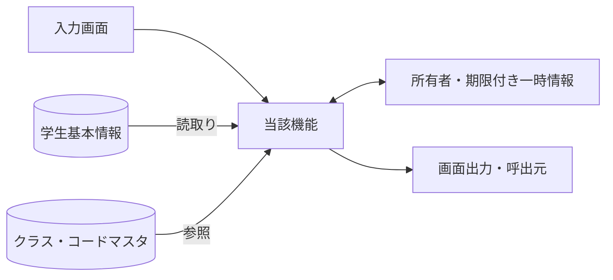
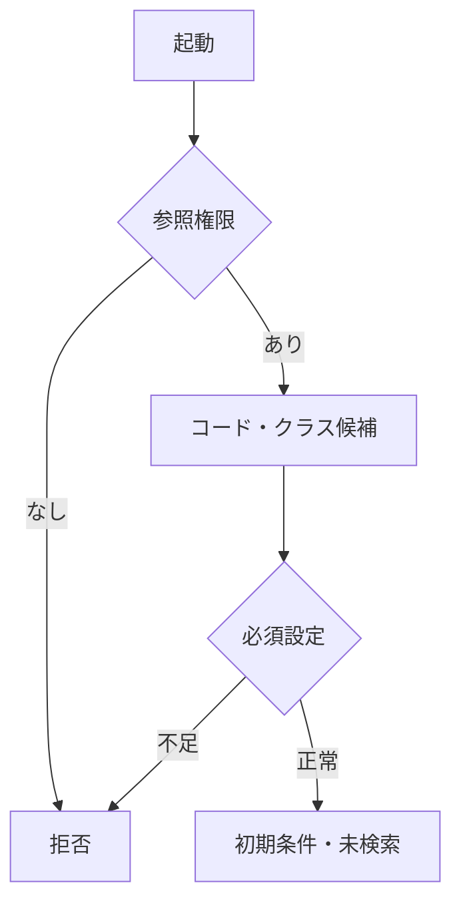
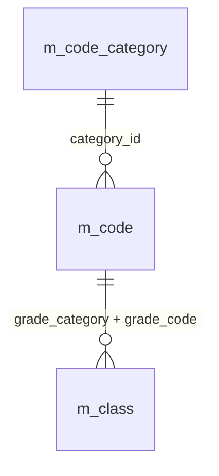
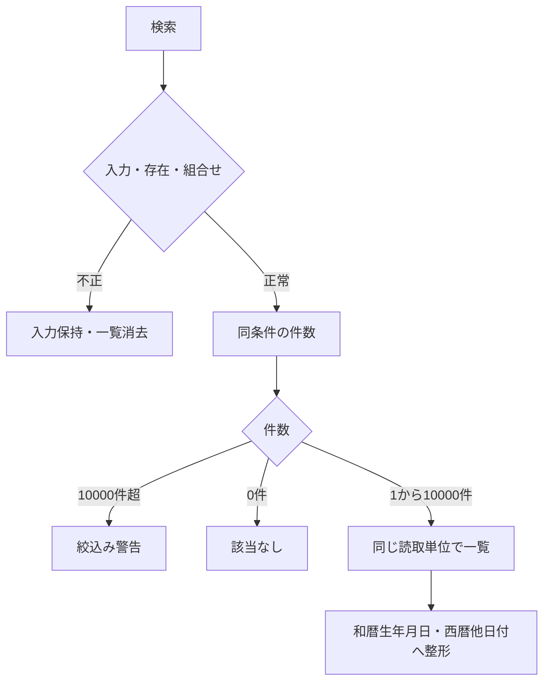
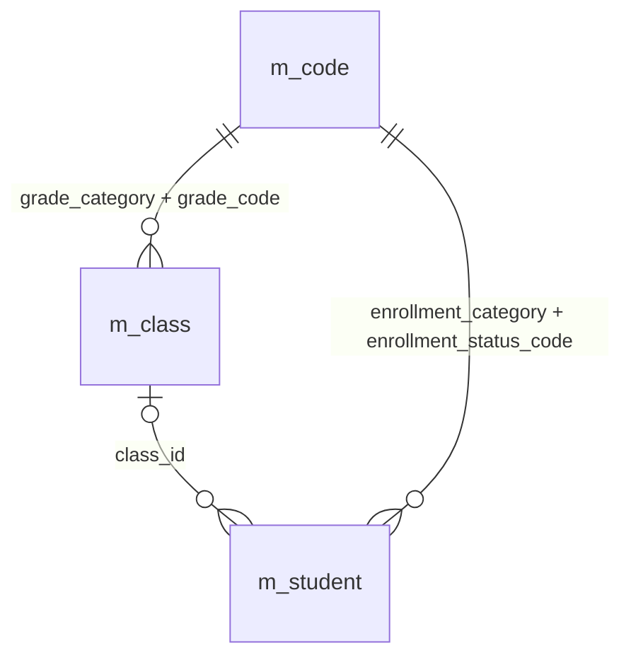
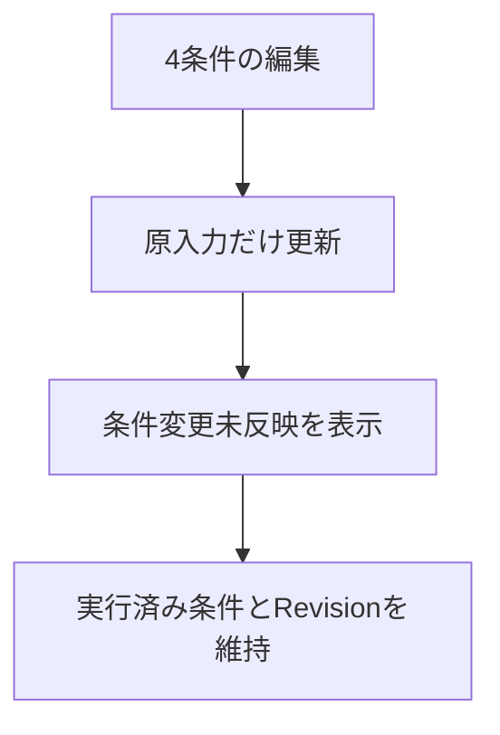
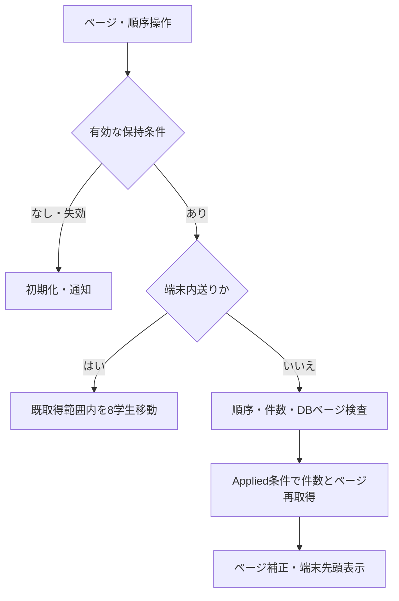
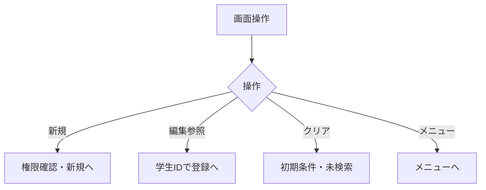
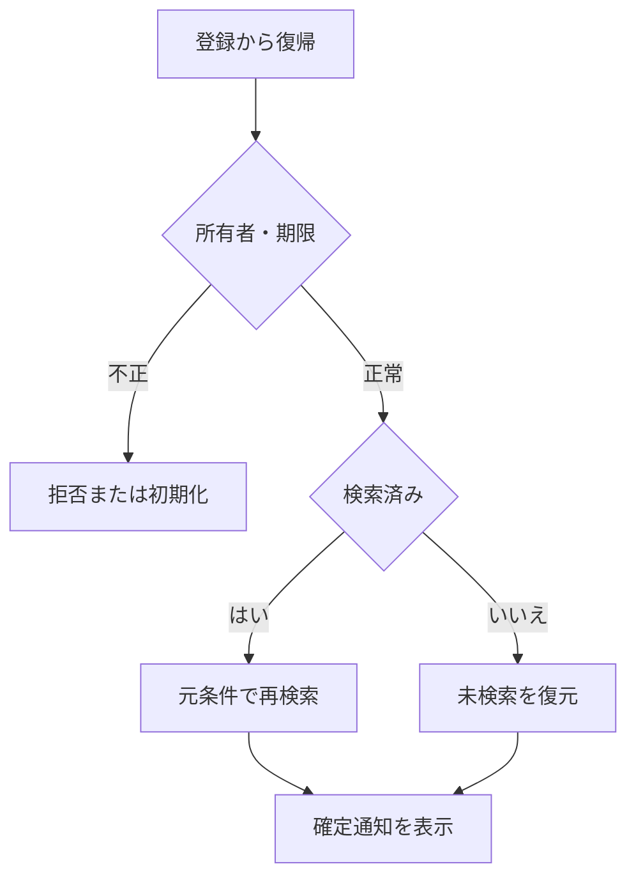

<!-- spec-meta: {"schema":"spec-md/1.0","documentId":"AS400_RPG-DET-AS400_RPG-SCR-STU-001","version":"8.5","path":"test-project1/spec/AS400_RPG/詳細仕様書/01_学生検索画面.md","sheets":[{"heading":"概要","kind":"GRID","sheet":"01_概要"},{"heading":"項目一覧","kind":"LIST","sheet":"02_項目一覧","key":["項目ID"]},{"heading":"選択候補一覧","kind":"LIST","sheet":"03_選択候補一覧","key":["候補ID"]},{"heading":"内部項目一覧","kind":"LIST","sheet":"04_内部項目一覧","key":["内部項目ID"]},{"heading":"イベント仕様","kind":"GRID","sheet":"05_イベント仕様"},{"heading":"項目移送仕様","kind":"LIST","sheet":"06_項目移送仕様","key":["移送ID"]},{"heading":"補足説明","kind":"GRID","sheet":"07_補足説明"}],"isolationProfile":"AS400_RPG"} -->
# 学生検索画面 詳細仕様書（AS400／RPG）

| 項目 | 内容 |
| --- | --- |
| システム名 | 学生管理システム |
| 機能ID | SCR-STU-001 |
| 版数・改訂日 | 8.5／2026-10-25 |
| 対象読者 | 実務経験５年程度のプログラマー |
| 状態 | 実装前の設計仕様。実装・コンパイル・実機試験は未実施 |
| 開発方式 | AS400／RPG |
| 対応基本設計 | [基本設計](../基本設計書/01_学生検索画面.md) |

## 概要

### 概要説明

検索条件と一覧を管理する。業務DBは参照のみ。

| 責務 | 物理構成 |
| --- | --- |
| 画面・提示制御 | STUSRCH / STUSCHD |
| 業務処理・共通呼出 | StSearchStudents |
| 共通実装仕様 | [方式別共通仕様・DB定義・開発規約](../共通/方式別/01_共通実装仕様.md) |
| 原則 | DB列・変数・型は本書・共通仕様・DB定義・開発規約。業務要件を言語都合で弱めない |

### 画面設計

#### 画面レイアウト（描画可能な埋め込みHTML）

画面の配置は下記の埋め込みHTMLを正本とし、基本設計にも同じ断片を掲載する。値は架空の設計例であり、製品実機の画面ではない。PNGや別配置の簡略図、単独HTMLプレビューは併置しない。CSSと等幅文字を保持するHTML表示で確認し、ビューアーが要素を除去した表示を正規の配置とみなさない。描画確認用の抽出HTML・画像は方式内.tmp/だけで扱い、今回の検査記録と入出力manifestは方式内build/spec-generation/の固定先へ更新する。

<!-- screen-html-start: SRC -->

<section class="text-panel active" data-panel="COND_SFLCTL" data-record="SFLCTL" data-state="normal">
学生検索 ／ 27行×132桁・架空値

<pre class="term-row" data-row="1"> 学生管理  学生検索                                                                                TEXT / 5250</pre>
<pre class="term-row" data-row="2"> 学籍番号                      氏名  見本                      前方一致 / 氏名部分一致</pre>
<pre class="term-row" data-row="3"> クラス                          すべて（全年度・停止・期間外を含む） F4候補</pre>
<pre class="term-row" data-row="4"> 在籍      1  在学   1  休学   0  卒業   0  退学   1=選択 0=解除 / 全0=全区分</pre>
<pre class="term-row" data-row="5"> 20件  1-20件              取得  20    順序  学籍番号          昇順    DB頁1/1</pre>
<pre class="term-row" data-row="6"> [情報] 検索完了。条件編集だけでは一覧を変更しません。</pre>
<pre class="term-row" data-row="7"> 選  学籍番号          氏名                カナ                                    生年月日（和暦）</pre>
<pre class="term-row" data-row="8">     S2026-0001        見本 太郎           ミホン タロウ                           平成20年05月15日        </pre>
<pre class="term-row" data-row="9">     2026   学年なし                 C-A               Aクラス                                             在学          </pre>
<pre class="term-row" data-row="10">     S2026-0002        見本 太郎           ミホン タロウ                           平成20年05月15日        </pre>
<pre class="term-row" data-row="11">     2026   学年なし                 C-A               Aクラス                                             在学          </pre>
<pre class="term-row" data-row="12">     S2026-0003        見本 太郎           ミホン タロウ                           平成20年05月15日        </pre>
<pre class="term-row" data-row="13">     2026   学年なし                 C-A               Aクラス                                             在学          </pre>
<pre class="term-row" data-row="14">     S2026-0004        見本 太郎           ミホン タロウ                           平成20年05月15日        </pre>
<pre class="term-row" data-row="15">     2026   学年なし                 C-A               Aクラス                                             在学          </pre>
<pre class="term-row" data-row="16">     S2026-0005        見本 太郎           ミホン タロウ                           平成20年05月15日        </pre>
<pre class="term-row" data-row="17">     2026   学年なし                 C-A               Aクラス                                             在学          </pre>
<pre class="term-row" data-row="18">     S2026-0006        見本 太郎           ミホン タロウ                           平成20年05月15日        </pre>
<pre class="term-row" data-row="19">     2026   学年なし                 C-A               Aクラス                                             在学          </pre>
<pre class="term-row" data-row="20">     S2026-0007        見本 太郎           ミホン タロウ                           平成20年05月15日        </pre>
<pre class="term-row" data-row="21">     2026   学年なし                 C-A               Aクラス                                             在学          </pre>
<pre class="term-row" data-row="22">     S2026-0008        見本 太郎           ミホン タロウ                           平成20年05月15日        </pre>
<pre class="term-row" data-row="23">     2026   学年なし                 C-A               Aクラス                                             在学          </pre>
<pre class="term-row" data-row="24"> 端末1/3  PageUp/Down=取得頁内8件  F7前DB頁 F10次DB頁 F15先頭 F16最後                                </pre>
<pre class="term-row" data-row="25"> 検索日時:2026/10/25 10:00:00  実行条件:氏名見本、在学/休学                                                    </pre>
<pre class="term-row" data-row="26"> Enter検索     F5クリア      F6新規      F12メニュー     F4候補 F8全文 F9順序 F11件数</pre>
<pre class="term-row" data-row="27"> 選択欄2=編集 / 5=参照を入力しEnter。選択がないEnterだけが検索。Tab=次入力欄。</pre>

</section>
<section class="text-panel" data-panel="PICK" data-record="PICK" data-state="normal">
候補選択 ／ 27行×132桁・架空値

<pre class="term-row" data-row="1"> 学生管理  候補選択（カーソル項目）</pre>
<pre class="term-row" data-row="2"> 対象:クラス / 全年度・年度・学年・コード・名称で識別 / 停止・期間外は用途別に可否表示</pre>
<pre class="term-row" data-row="3"> 選  ID                     年度 / 学年 / コード / 名称 / 選択可否</pre>
<pre class="term-row" data-row="4"></pre>
<pre class="term-row" data-row="5">     101                    2026 / 学年なし / C-A / Aクラス / 選択可</pre>
<pre class="term-row" data-row="6">                            停止・期間外の既存値は名称を残し、無断で先頭候補に置換しません。</pre>
<pre class="term-row" data-row="7"></pre>
<pre class="term-row" data-row="8"></pre>
<pre class="term-row" data-row="9"></pre>
<pre class="term-row" data-row="10"></pre>
<pre class="term-row" data-row="11"></pre>
<pre class="term-row" data-row="12"></pre>
<pre class="term-row" data-row="13"></pre>
<pre class="term-row" data-row="14"></pre>
<pre class="term-row" data-row="15"></pre>
<pre class="term-row" data-row="16"></pre>
<pre class="term-row" data-row="17"></pre>
<pre class="term-row" data-row="18"></pre>
<pre class="term-row" data-row="19"></pre>
<pre class="term-row" data-row="20"></pre>
<pre class="term-row" data-row="21"> 全1件 / 表示1-1件 / 入力欄に1を入れてEnterで選択。複数選択はエラー。</pre>
<pre class="term-row" data-row="22"></pre>
<pre class="term-row" data-row="23"></pre>
<pre class="term-row" data-row="24"> PageUp/Down=候補画面内移動（8候補/面） / 到達端点では移動しない</pre>
<pre class="term-row" data-row="25"> Enter選択  F8候補の全文参照</pre>
<pre class="term-row" data-row="26"> F12候補取消（既定）</pre>
<pre class="term-row" data-row="27"> 選択は元の原入力欄に返すだけ。検索・学生保存・DB更新は実行しません。</pre>

</section>
<section class="text-panel" data-panel="LONGTXT" data-record="LONGTXT" data-state="normal">
全文・Unicode補助 ／ 27行×132桁・架空値

<pre class="term-row" data-row="1"> 学生管理  全文・Unicode補助（通常画面からF8）</pre>
<pre class="term-row" data-row="2"> 対象:SRC-021 / 氏名8文字 / 参照専用 / 原Unicodeを保持</pre>
<pre class="term-row" data-row="3"> 通常文字 / 明示UnicodeモードをF6で切替。以下はASCIIエスケープの例。</pre>
<pre class="term-row" data-row="4"></pre>
<pre class="term-row" data-row="5"> \u{20BB7}野 太郎                                                                                                                </pre>
<pre class="term-row" data-row="6"></pre>
<pre class="term-row" data-row="7"> Unicodeモードでは\u{HEX}=1スカラー、\n=LF、\\=バックスラッシュ。</pre>
<pre class="term-row" data-row="8"> 通常モードの同じ綴りは文字列として保持。モード変更だけで原値を上書きしません。</pre>
<pre class="term-row" data-row="9"></pre>
<pre class="term-row" data-row="10"></pre>
<pre class="term-row" data-row="11"></pre>
<pre class="term-row" data-row="12"></pre>
<pre class="term-row" data-row="13"></pre>
<pre class="term-row" data-row="14"></pre>
<pre class="term-row" data-row="15"></pre>
<pre class="term-row" data-row="16"></pre>
<pre class="term-row" data-row="17"></pre>
<pre class="term-row" data-row="18"></pre>
<pre class="term-row" data-row="19"></pre>
<pre class="term-row" data-row="20"> 表示位置と原Unicode位置の対応を保持。変換不能/行末/原改行を切捨てません。</pre>
<pre class="term-row" data-row="21"> [エラー] 未完のエスケープ・不正スカラー・上限超過なら現在欄に保持して戻さない。</pre>
<pre class="term-row" data-row="22"></pre>
<pre class="term-row" data-row="23"></pre>
<pre class="term-row" data-row="24"> PageUp/Down=前後の文字範囲（保存ではない） / 範囲内に切れたエスケープを作らない</pre>
<pre class="term-row" data-row="25"> F6表示形式切替 / 参照専用のためF10反映は無効</pre>
<pre class="term-row" data-row="26"> F12補助編集取消（既定・原項目を保持）</pre>
<pre class="term-row" data-row="27"> 参照/一覧から開いたときは全欄保護・F10反映無効。Tab順と復帰カーソルを保持。</pre>

</section>

Text系の仕様図。下線=入力可能、無下線=保護表示。DB・DDS・5250実機は未実行。

<!-- screen-html-end: SRC -->

#### 小規模運用に合わせた検索契約

学籍番号の前方一致、氏名照合値の部分一致、クラスIDの完全一致、在籍区分の集合という4条件だけを使用する。4条件はAND、在籍区分内はOR。空の文字列・未選択クラスは条件なし。在籍区分は初期01・02、全解除は01～04の全区分。全条件未指定でも非削除と参照権限の制約を常に適用する。初回・クリアでは自動検索しない。

SRC-003／004／005／007／009／010／011／012は廃止し、IDを再利用しない。学年なしはクラス候補に含むが、年度・学年の独立条件、未所属のみ、カナ・都道府県・電話・入学日期間による検索を設けない。クラス候補は全年度・停止・期間外を含み、年度／学年名称／コード／名称を一体表示する。未所属はクラス未指定の結果から確認できる。登録時の年度・学年連動、住所・連絡先・日付の保存検査は維持する。

一覧の論理表示はSRC-020～026と030の8項目。氏名とカナを同じ表示領域に置き、7列相当へ整理する。SRC-027住所・028本人電話・029更新日時は一覧投影から外し、学生編集／参照で確認する。更新日時による並び替えは維持し、そのソート用値は表示DTOへ返さない。取得単位20／50／100、許可4ソートと方向、10,000件上限、同順位学生ID、認可・Revision・復帰を変更しない。

保持状態はCriteriaFormatVersion=2を持ち、所有者・セッション・画面・30分期限・Revisionと照合する。旧形式・廃止条件を含む状態はW-SRC-002で初期化し、未知の条件キーを黙って無視しない。ネイティブ入力DS／クラスへ旧プロパティを残して受け付けることも禁止する。最新Revisionだけを採用し、旧応答や古い復帰で一覧を上書きしない。

#### Text系・5250の行桁と取得ページ

画面種別はText系とし、DSPSIZ(27 132)を維持する。固定の等幅文字セルを採用し、マウスやWeb部品へ依存しない。1～7行に4検索条件、件数・並び順・状態・一覧見出し、8～23行に1学生2物理行×8学生、24～27行に端末位置・検索日時・固定キーを配置する。入力欄は下線、保護表示は無下線。条件の短いコード・学籍番号・氏名に必要な桁だけを割り当てる。

SFLPAG(8)、SFLSIZ(101)。RRNはDB取得ページ内の1～pageSizeで、resultRowsのstudentIdへ解決する。選択欄へ2=編集または5=参照を1件だけ入力してEnterを押す。選択があるEnterは行呼出しを優先し、条件を再検索しない。複数選択・不正選択値はメッセージを出して保持し、権限を再検査する。選択なしのEnterだけが検索で、編集中条件を検査して適用する。Tab/Shift+Tabは条件と選択欄を行桁順に移動する。

PageUp/Downは同じ取得ページ内を8学生送りし、20件は8/8/4、50件は8×6/2、100件は8×12/4とする。F7/F10は前/次DB頁、F15/F16は先頭/最後DB頁で、取得後は端末先頭へ戻す。端末内の境界でDB頁を勝手に跨がない。未検索・0件・上限超過・到達端点では無効とする。頁・ソート操作はAppliedCriteriaだけを使う。F9の並び順とF11の20/50/100件はPICKで選び、取消は未変更、確定時はDB1頁・端末先頭へ戻す。

F4はカーソル項目候補、F8はカーソルがある一覧学生の全文参照LONGTXT、F5は初期条件と未検索へ戻す、F6は新規（作成権限）、F12はメニュー。PICKは1選択=Enter確定・F12取消、PageUp/Downで8候補送り。全文参照は保護表示でF10反映を無効とする。結果外の表示RRNや空行をIDにせず、行呼出し前に対象と認可を再確認する。

全角2・半角1セルは設計図の計測である。DDSのDBCS属性・SI/SO制御の符号化長とCCSID往復は別途検証し、変換不能値を代替文字で保存しない。長いクラス名・更新者などは末尾に「… F8」と表示し、元Unicode値をDSに保持して全文へ到達する。実機DDSコンパイル、5250エミュレーター、CCSID往復は未実施である。

#### 検索の行桁・物理入力属性

原点(1,1)、行:桁と表示セル幅は埋込みHTMLのdata属性を正とする。QSTUNO=2:12幅15（A/B）、QNAME=2:38幅20（O型/B）、QCLASS=3:12幅19（A/B）、QST01～04=4:12/22/32/42各1（A/B）。QSIZE=5:34幅3、QSORT=5:46幅16、QDIR=5:64幅4は保護表示でF11/F9のPICK確定だけで変更する。SFLROW.ROPTは8/10/12/14/16/18/20/22行の2桁目各1（A/B）、他のサブファイル項目は保護とする。SFLROWの相対1行はStudentNo=6幅15、StudentName=24幅18、StudentNameKana=44幅38、BirthDateWareki=84幅24、相対2行はSchoolYear=6幅4、GradeName=13幅22、ClassCode=38幅15、ClassName=56幅48、EnrollmentName=108幅14。長い表示は末尾「… F8」で全文参照へ案内し、参照元値を変更しない。

#### 検索Raw DSと正規化DSの分離

QNAMEはcriteriaRaw.name（vargraphic(16)、raw8スカラー）へ受ける。criteria.nameKeyは正規化後専用のvargraphic(320)で最大160スカラーを保持し、Raw8の画面領域を照合値160の領域へ流用しない。QSTUNOはcriteriaRaw.studentNo（vargraphic(30)、raw15）へ受け、N-06後にcriteria.studentNoへ移す。QCLASSはcriteriaRaw.classId（vargraphic(38)、raw19）で原入力を保持し、完全な数字と範囲を検査してからcriteria.classIdのint(20)へ変換する。QST01～04は各raw文字1（vargraphic(2)）を保持し、0/1だけを検査後、1のQST01/QST02/QST03/QST04を固定業務コード01/02/03/04へそれぞれ写像し、0は除外する。全0は空集合として全4区分を検索する。SQL INへ0/1を直接渡さず、2桁の在籍コード集合だけを渡す。DDS窓に収まらない符号化/Unicode原値はF8補助とRaw DSで保持する。

OP-COUNT/OP-PAGEとAppliedCriteriaには検証済み正規化DSだけを渡す。Raw DS、未適用条件、AppliedCriteriaのスナップショットは別領域で、条件入力・検証失敗・候補取消だけで実行済み一覧を再取得しない。通常の検索失敗時の一覧消去は既存イベント仕様に従う。

#### 表示状態・モード別制御

[共通UI状態](../共通/04_共通UI部品設計.md)に従う。初回は未検索。処理中は二重検索を抑止し、0件・上限超過・検索失敗を区別する。参照権限では新規登録を表示せず行操作を参照とする。検索画面では生年月日を編集しない。

### ファイル・DB入出力関係

#### 入出力一覧

方向は当該機能から見たもの。画面入力、DB読取り、DB書込みを区別する。

| IO-ID | 分類 | 対象 | 入出力 | 主な項目 | 保存単位・備考 |
| --- | --- | --- | --- | --- | --- |
| 01 | 画面 | 入力条件・操作 | 入力 | 当該機能の項目一覧 | 要求開始時の値を複製 |
| 02 | 永続DB | m_student | 入力（参照） | 学生基本情報・版 | 更新なし |
| 03 | 永続DB | m_class | 入力（参照） | 年度・学年・名称・期間・定員 | 学生機能からマスタを更新しない |
| 04 | 永続DB | m_code_category / m_code | 入力（参照） | 分類・値・名称・有効性 | 学生機能からマスタを更新しない |
| 05 | 一時情報 | ジョブ内DS・QTEMP | 入出力 | 確定検索条件・ページ・原入力・確認対象 | 業務表と別。所有者・期限を検査 |
| 06 | 外部ファイル | なし | なし | CSV・帳票・取込は本機能の対象外 | 仕様書MDを業務IOに数えない |
| 07 | 画面 | 一覧・メッセージ | 出力 | 個人情報は必要項目のみ | DB保存とは別の出力 |

#### データ操作関連図

認証情報・業務日時は共通01～03から取得。マスタ保守の承認入力ファイルは画面機能のIOに含めず、方式別共通仕様に定義する。

### 実装契約の配置

共用クラス／プログラム構造は[方式別共通仕様](../共通/方式別/01_共通実装仕様.md)、SQLの永続項目・制約は[DB定義](../DB定義/Db2_for_i/01_DB定義書.md)、命名・配備は[開発規約](../規約/AS400_RPG.md)へ分離する。本機能の具体的な画面・変数・DB割当・イベント順序は本書を正とし、共通契約を引数と結果で具体化する。

## 項目一覧

| 項目ID | グループ | 論理項目名 | 種類 | 入出力 | 入力最大長 | 保存・正規化最大長 | 長さ単位 | 必須区分 | 必須条件 | 初期値 | 未設定値 | 表示形式・許容範囲 | 関連論理DB項目 | 物理コントロール | 変数・プロパティ | 言語型 | 物理DB項目 | 候補ID | 正規化ID | チェックID | 関連イベント | DB連携説明 | Raw入力表現 | 対応DB型 | 対応DB_NULL可否 |
| --- | --- | --- | --- | --- | --- | --- | --- | --- | --- | --- | --- | --- | --- | --- | --- | --- | --- | --- | --- | --- | --- | --- | --- | --- | --- |
| SRC-001 | 検索条件 | 学籍番号 | 文字入力 | I（検索条件） | 15 | 15 | Unicodeスカラー値 | 任意 | 未指定は条件なし。CHK-003は番号形式だけ、重複・変更不可は非適用 | 空 | NULL相当 | 15文字以内 | 学生基本情報・学籍番号 | QSTUNO | criteria.studentNo | vargraphic(30)＋スカラー数検査 | m_student.student_no | － | N-06 | CHK-002,CHK-003 | EV-SRC-002 | 前方一致、N-06。保存なし | 画面文字列（空・不正を保持）／DDS文字領域＋NULL標識 | m_student.student_no:VARCHAR(15) CCSID 1208 | m_student.student_no:不可 |
| SRC-002 | 検索条件 | 氏名 | 文字入力 | I（検索条件） | 8 | 160 | Unicodeスカラー値 | 任意 | 表示氏名ではなく照合キーに部分一致 | 空 | NULL相当 | 原入力8文字以内、正規化後160文字以内 | 学生基本情報・氏名照合用情報 | QNAME | criteriaRaw.name → criteria.nameKey | Raw vargraphic(16) / 正規化 vargraphic(320) | m_student.name_key | － | N-03 | CHK-002 | EV-SRC-002 | N-03後の部分一致。氏名の原表記と区別 | 画面文字列（空・不正を保持）／DDS文字領域＋NULL標識 | m_student.name_key:VARGRAPHIC(320) CCSID 1200 | m_student.name_key:不可 |
| SRC-006 | 検索条件 | クラス | 選択 | I（検索条件） | 19 | 64bit正整数 | 数字またはASCII文字 | 任意 | 全年度の実在クラス。停止・期間外も許容 | すべて | NULL相当 | 正の整数。型範囲は方式別DB定義 | 学生基本情報・現在・最終所属クラス | QCLASS | criteria.classId | int(20)＋int(5) NULL標識 | m_student.class_id | クラス | 非適用 | CHK-010 | EV-SRC-002 | クラスID完全一致。年度・学年は表示識別だけ | 画面文字列（空・不正を保持）／DDS文字領域＋NULL標識 | m_student.class_id:BIGINT | m_student.class_id:可 |
| SRC-008 | 検索条件 | 在籍区分 | 複数選択 | I（検索条件） | 2×最大4件 | 2×最大4件 | 数字またはASCII文字 | 任意 | 空配列は全区分。重複値・未定義値は拒否 | 01,02 | 空配列 | 在学・休学・卒業・退学 | 学生基本情報・在籍区分 | QST01 / QST02 / QST03 / QST04 | criteria.statusSelected(1 To 4) | varchar(2) dim(4)＋件数 | m_student.enrollment_status_code | 在籍区分 | N-07 | CHK-010,CHK-024 | EV-SRC-002 | 複数値はいずれか一致、全解除は全区分 | 選択値の配列／チェック状態／DDS文字領域＋NULL標識 | m_student.enrollment_status_code:VARCHAR(2) CCSID 1208 | m_student.enrollment_status_code:不可 |
| SRC-013 | 操作 | 検索 | 操作 | 操作 | 非適用 | 非適用 | 非適用 | 非適用 | 表示または操作項目 | 条件を検査して1ページ目を表示 | 非適用 | ― | DB保存なし | Enter | search | イベント／引数はイベント仕様 | － | － | 非適用 | 非適用 | EV-SRC-002 | 入力検査後、最初のページを取得 | 入力対象外 | 非適用（操作・計算または一覧DTO） | 非適用 |
| SRC-014 | 操作 | クリア | 操作 | 操作 | 非適用 | 非適用 | 非適用 | 非適用 | 表示または操作項目 | 初期条件・未検索へ戻す | 非適用 | ― | DB保存なし | F5 | clear | イベント／引数はイベント仕様 | － | － | 非適用 | 非適用 | EV-SRC-005 | 初期条件・未検索へ、保持条件を消去 | 入力対象外 | 非適用（操作・計算または一覧DTO） | 非適用 |
| SRC-015 | 操作 | 新規登録 | 操作 | 操作 | 非適用 | 非適用 | 非適用 | 非適用 | 表示または操作項目 | 担当者・管理者だけ表示 | 非適用 | ― | DB保存なし | F6 | new | イベント／引数はイベント仕様 | － | － | 非適用 | 非適用 | EV-SRC-005 | 権限を確認し学生登録へ遷移 | 入力対象外 | 非適用（操作・計算または一覧DTO） | 非適用 |
| SRC-016 | 操作 | メニューへ | 操作 | 操作 | 非適用 | 非適用 | 非適用 | 非適用 | 表示または操作項目 | 共通メニューへ戻る | 非適用 | ― | DB保存なし | F12 | menu | イベント／引数はイベント仕様 | － | － | 非適用 | 非適用 | EV-SRC-005 | 共通メニューへ | 入力対象外 | 非適用（操作・計算または一覧DTO） | 非適用 |
| SRC-017 | 結果・一覧 | 検索件数・表示範囲 | 表示 | O（表示） | 非適用 | 表示元の上限：件数0～10000・範囲0～10000 | 非適用 | 自動表示 | 入力対象外。取得結果または計算値を表示 | 未検索 | 表示欠損は－、マスタ欠落は不整合表示 | 件数0～10000・範囲0～10000 | 計算：全条件一致の学生件数 | RCOUNT | totalCount / RangeFrom / RangeTo | 表示DTO／複合項目は内部項目一覧 | count of matching student_id | － | 非適用 | 非適用 | EV-SRC-002 | 未検索／0件／上限超過を区別 | 入力対象外 | 非適用（操作・計算または一覧DTO） | 非適用 |
| SRC-018 | 結果・一覧 | 検索日時 | 表示 | O（表示） | 非適用 | 表示元の上限：西暦日時19文字 | 非適用 | 自動表示 | 入力対象外。取得結果または計算値を表示 | 未検索 | 表示欠損は－、マスタ欠落は不整合表示 | 西暦日時19文字 | 計算：今回の検索実行日時 | SRCHTIME | searchedAt | 表示DTO／複合項目は内部項目一覧 | RequestContext.ExecutedAt | － | 非適用 | 非適用 | EV-SRC-002 | 西暦日時、日本時間。DB保存なし | 入力対象外 | 非適用（操作・計算または一覧DTO） | 非適用 |
| SRC-019 | 結果・一覧 | 表示件数 | 選択 | I（表示指定） | 3 | 保存なし | 数字またはASCII文字 | 必須 | 20・50・100のみ | 20 | 不可 | 表示規則による | DB保存なし：取得範囲 | QSIZE | pageSize | int(10)＋int(5) NULL標識 | pageSize | 表示件数 | 非適用 | CHK-024 | EV-SRC-004 | 20／50／100、既定20 | 画面文字列（空・不正を保持）／DDS文字領域＋NULL標識 | 非適用（操作・計算または一覧DTO） | 非適用 |
| SRC-020 | 結果・一覧 | 学籍番号 | 表示 | O（表示） | 非適用 | 表示元の上限：15 | 非適用 | 自動表示 | 入力対象外。取得結果または計算値を表示 | 未検索 | 表示欠損は－、マスタ欠落は不整合表示 | 15 | 学生基本情報・学籍番号 | SFLROW.RSTUNO | studentNo | 表示DTO／複合項目は内部項目一覧 | m_student.student_no | － | 非適用 | 非適用 | EV-SRC-002,EV-SRC-004,EV-SRC-006 | 保存済み文字列、文字順 | 入力対象外 | m_student.student_no:VARCHAR(15) CCSID 1208 | m_student.student_no:不可 |
| SRC-021 | 結果・一覧 | 氏名 | 表示 | O（表示） | 非適用 | 表示元の上限：8 | 非適用 | 自動表示 | 入力対象外。取得結果または計算値を表示 | 未検索 | 表示欠損は－、マスタ欠落は不整合表示 | 8 | 学生基本情報・学生氏名 | SFLROW.RNAME | studentName | 表示DTO／複合項目は内部項目一覧 | m_student.student_name | － | 非適用 | 非適用 | EV-SRC-002,EV-SRC-004,EV-SRC-006 | 登録表記のまま文字列表示 | 入力対象外 | m_student.student_name:VARGRAPHIC(16) CCSID 1200 | m_student.student_name:不可 |
| SRC-022 | 結果・一覧 | 氏名カナ | 表示 | O（表示） | 非適用 | 表示元の上限：18 | 非適用 | 自動表示 | 入力対象外。取得結果または計算値を表示 | 未検索 | 表示欠損は－、マスタ欠落は不整合表示 | 18 | 学生基本情報・学生氏名カナ | SFLROW.RKANA | studentNameKana | 表示DTO／複合項目は内部項目一覧 | m_student.student_name_kana | － | 非適用 | 非適用 | EV-SRC-002,EV-SRC-004,EV-SRC-006 | 保存済みカナ表記 | 入力対象外 | m_student.student_name_kana:VARGRAPHIC(36) CCSID 1200 | m_student.student_name_kana:不可 |
| SRC-023 | 結果・一覧 | 生年月日 | 表示 | O（表示） | 非適用 | 表示元の上限：共通和暦書式 | 非適用 | 自動表示 | 入力対象外。取得結果または計算値を表示 | 未検索 | 表示欠損は－、マスタ欠落は不整合表示 | 共通和暦書式 | 学生基本情報・生年月日 | SFLROW.RBIRTH | birthDateWareki | 表示DTO／複合項目は内部項目一覧 | m_student.birth_date | － | 非適用 | 非適用 | EV-SRC-002,EV-SRC-004,EV-SRC-006 | 和暦表示。共通16で日付から変換 | 入力対象外 | m_student.birth_date:DATE | m_student.birth_date:不可 |
| SRC-024 | 結果・一覧 | 年度・学年 | 表示 | O（表示） | 非適用 | 表示元の上限：年度4桁＋学年名称12 | 非適用 | 自動表示 | 入力対象外。取得結果または計算値を表示 | 未検索 | 表示欠損は－、マスタ欠落は不整合表示 | 年度4桁＋学年名称12 | クラスマスタ・学校年度／学年→コード管理マスタ（学年）・コード名称 | SFLROW.RYEAR / RGRADE | schoolYear / GradeName | 表示DTO／複合項目は内部項目一覧 | m_class.school_year / grade_code → m_code.code_name | － | 非適用 | 非適用 | EV-SRC-002,EV-SRC-004,EV-SRC-006 | 年度は西暦、学年は名称。未所属は－ | 入力対象外 | m_class.school_year:SMALLINT／m_code.code_name:VARGRAPHIC(24) CCSID 1200 | m_class.school_year:不可；m_code.code_name:不可 |
| SRC-025 | 結果・一覧 | クラス | 表示 | O（表示） | 非適用 | 表示元の上限：コード9＋名称18＋注記 | 非適用 | 自動表示 | 入力対象外。取得結果または計算値を表示 | 未検索 | 表示欠損は－、マスタ欠落は不整合表示 | コード9＋名称18＋注記 | 学生基本情報・現在・最終所属クラス→クラスマスタ・クラスコード／クラス名 | SFLROW.RCCODE / RCNAME | classCode / ClassName | 表示DTO／複合項目は内部項目一覧 | m_student.class_id → m_class.class_code / class_name | － | 非適用 | 非適用 | EV-SRC-002,EV-SRC-004,EV-SRC-006 | 未所属／停止／期間外を区別 | 入力対象外 | m_class.class_code:VARCHAR(9) CCSID 1208／m_class.class_name:VARGRAPHIC(36) CCSID 1200 | m_class.class_code:不可；m_class.class_name:不可 |
| SRC-026 | 結果・一覧 | 在籍区分 | 表示 | O（表示） | 非適用 | 表示元の上限：名称12 | 非適用 | 自動表示 | 入力対象外。取得結果または計算値を表示 | 未検索 | 表示欠損は－、マスタ欠落は不整合表示 | 名称12 | 学生基本情報・在籍区分→コード管理マスタ（在籍区分）・コード名称 | SFLROW.RSTATUS | enrollmentName | 表示DTO／複合項目は内部項目一覧 | m_student.enrollment_status_code → m_code.code_name | － | 非適用 | 非適用 | EV-SRC-002,EV-SRC-004,EV-SRC-006 | 種別と値で結合、名称未取得でも学生行を落とさない | 入力対象外 | m_code.code_name:VARGRAPHIC(24) CCSID 1200 | m_code.code_name:不可 |
| SRC-030 | 結果・一覧 | 編集／参照 | 操作 | 操作 | 非適用 | 非適用 | 非適用 | 非適用 | 表示または操作項目 | 未検索 | 非適用 | 表示規則による | 学生基本情報・学生管理番号 | SFLROW.ROPT | openSelectedStudent | イベント／引数はイベント仕様 | m_student.student_id | － | 非適用 | 非適用 | EV-SRC-005 | 行番号ではなく対象IDで遷移、遷移先で再取得 | 入力対象外 | 非適用（操作・計算または一覧DTO） | 非適用 |
| SRC-031 | 結果・一覧 | ページ操作 | 操作 | 操作 | 非適用 | 非適用 | 非適用 | 非適用 | 表示または操作項目 | 未検索 | 非適用 | 表示規則による | DB保存なし：取得範囲 | PageUp / PageDown / F7 / F10 / F15 / F16 | page | イベント／引数はイベント仕様 | page / pageSize | － | 非適用 | 非適用 | EV-SRC-004 | 端末内8学生の前後移動とDB前後・先頭最後の取得ページを分離。有効範囲へ再補正 | 入力対象外 | 非適用（操作・計算または一覧DTO） | 非適用 |
| SRC-032 | 結果操作 | 並び順項目 | 選択 | I（表示指定） | 13 | 保存なし | Unicodeスカラー値 | 必須 | studentNo・name・admissionDate・updatedAtのみ | studentNo | 不可 | 固定候補 | 検索：学籍番号／氏名照合用情報／入学日／更新日時 | QSORT | sortKey | vargraphic(20)＋スカラー数検査 | sortKey | 並び順 | 非適用 | CHK-024 | EV-SRC-004 | 許可4項目。最後に学生ID昇順を加える | 画面文字列（空・不正を保持）／DDS文字領域＋NULL標識 | 非適用（操作・計算または一覧DTO） | 非適用 |
| SRC-033 | 結果操作 | 並び順方向 | 選択 | I（表示指定） | 4 | 保存なし | Unicodeスカラー値 | 必須 | asc・descのみ | asc | 不可 | 固定候補 | DB保存なし：取得順 | QDIR | sortDirection | vargraphic(20)＋スカラー数検査 | sortDirection | 昇降順 | 非適用 | CHK-024 | EV-SRC-004 | 昇順／降順。初期は昇順 | 画面文字列（空・不正を保持）／DDS文字領域＋NULL標識 | 非適用（操作・計算または一覧DTO） | 非適用 |

## 選択候補一覧

| 候補ID | 参照元・分類 | 選択値 | 表示値 | 抽出条件 | 表示順 | 初期値・連動 |
| --- | --- | --- | --- | --- | --- | --- |
| クラス | クラスマスタ・コード管理マスタ（学年） | class_id | 年度・学年・クラスコード・クラス名 | 全年度・停止・期間外を含む全クラス。検索用途では年度学年で候補を絞らない | 年度降順→学年表示順→クラス表示順→コード→ID | すべて。上位条件・連動なし。年度・学年・コード・名称を一体表示 |
| 在籍区分 | コード管理マスタ（在籍区分） | ENROLLMENT_STATUS / code_value | コード名称 | 在籍分類01～04。停止も表示し検索可、保護値を維持 | 表示順→コード値 | 検索01・02／新規登録01、全解除検索は全区分 |
| 表示件数 | 共通UI固定定義 | 20 / 50 / 100 | 20件／50件／100件 | 固定3候補。業務コードではない | 20→50→100 | 20、変更で1ページへ |
| 並び順 | 共通UI固定定義 | studentNo / name / admissionDate / updatedAt | 学籍番号／氏名／入学日／更新日時 | 固定4候補。自由文字でDB列を指定しない | 左記順 | 学籍番号 |
| 昇降順 | 共通UI固定定義 | asc / desc | 昇順／降順 | 固定2候補 | 昇順→降順 | 昇順 |

## 内部項目一覧

| 内部項目ID | 親項目ID | 論理名 | 変数・コントロール | 型 | 最大長・範囲 | 必須条件 | 未設定 | 設定元 | 用途・制約 |
| --- | --- | --- | --- | --- | --- | --- | --- | --- | --- |
| SRC-INT-001 | SRC-017 | 件数 | TotalCount | 非負整数 | 5 | 検索成功時 | 未検索／上限超過は未設定 | OP-COUNT / page | 0件の範囲は0～0。表示件数と混同しない |
| SRC-INT-002 | SRC-017 | 開始位置 | RangeFrom | 非負整数 | 5 | 検索成功時 | 未検索／上限超過は未設定 | OP-COUNT / page | 0件の範囲は0～0。表示件数と混同しない |
| SRC-INT-003 | SRC-017 | 終了位置 | RangeTo | 非負整数 | 5 | 検索成功時 | 未検索／上限超過は未設定 | OP-COUNT / page | 0件の範囲は0～0。表示件数と混同しない |
| SRC-INT-004 | SRC-024 | 年度 | StudentListItem.SchoolYear | 任意整数 | 4 | 表示 | 未所属は－ | m_class.school_year | 1900～9998、西暦 |
| SRC-INT-005 | SRC-024 | 学年名称 | StudentListItem.GradeName | varchar/vargraphic | 12 | 表示 | 未所属は－ | m_code GRADE.code_name | 保存値でなく名称 |
| SRC-INT-006 | SRC-025 | クラスコード | StudentListItem.ClassCode | varchar/vargraphic | 9 | 表示 | 未所属表示 | m_class | 名称欠落で学生行を消さない |
| SRC-INT-007 | SRC-025 | クラス名称 | StudentListItem.ClassName | varchar/vargraphic | 18 | 表示 | 未所属表示 | m_class | 名称欠落で学生行を消さない |
| SRC-INT-008 | SRC-023 | 内部生年月日 | StudentListItem.BirthDate | date＋int(5) NULL標識 | 日付／ISO10 | 取得時必須 | 欠損はデータ不整合 | m_student.birth_date | 共通16で和暦へ変換。時差を適用しない |
| SRC-INT-009 | SRC-030 | 対象学生ID | StudentId | int(20)（正64bit） | 19 | 更新削除・既存読込時 | 新規はNULL | DB採番値／行モデル／ルート | 行番号ではない。権限・存在を再確認 |
| SRC-INT-010 | SRC-031 | 検索状態キー | ContextId | varchar/vargraphic | 36 | 復帰または一覧操作時 | 初回だけ未指定 | 共通12のUUID文字表記または同一形式のインスタンスキー | 利用者・セッション・画面ごと、30分 |
| SRC-INT-011 | SRC-013 | 処理中 | IsBusy | 真偽 | 1 | 自動 | false | 処理開始終了 | UI再入防止のみ。DB排他は共通13 |
| SRC-INT-012 | SRC-013 | 応答世代 | RequestSequence | 非負整数 | 数値 | 非同期要求時 | 0初期 | 画面内要求連番 | 旧応答を無視。桁あふれ時は採番継続しない |

## イベント仕様

### EV-SRC-001 初期表示

#### 処理概要

認証済み利用者がメニューから起動。学生一覧は取得しない。

#### 処理手順

1. 共通01・02で参照権限を確認し、共通03で業務日時を確定する。
2. OP-CODE・OP-CLASSで候補取得。在学・休学、20件、学籍番号昇順、未検索を設定する。必須マスタ不足なら検索を不可とする。
3. 共通12の画面別状態を作成する。復帰識別がある場合はEV-SRC-006へ進む。

##### 実装詳細

入口：`STUSRCH初期・STUAUTH`。機能内の入力・結果型は項目一覧、共通実装は[方式別共通仕様](../共通/方式別/01_共通実装仕様.md)を使用する。 `Draft`相当の未実行値と`AppliedCriteria`相当の確定条件を分離。呼出引数を複製し、結果を返した要求が最新であることを確認して画面へ移送する。

#### 処理フロー

#### SQL・テーブル関連（ER図）

名称参照は未所属・停止値を残す外部結合相当。コードは用途ごとの別名で**分類と値**を結合する。図は読取りの関連であり、履歴への書込みや削除連動を意味しない。単独の存在確認・採番・書込みの表関連は下記操作IDで特定する。

#### DB操作の詳細

`OP-CODE` → `OP-CLASS`。下記「DB操作定義」の同名操作を実行する。

#### 結果・例外時の扱い

入力不備は項目エラーと原入力を保持。検索要求の失敗は一覧消去、0件はI-SRC-001、上限超過はW-SRC-001。権限不備・他者の保持情報は拒否する。条件変更だけでは既存一覧を再検索しない。 各イベントで実行していない処理の結果状態は発生対象外。

### EV-SRC-002 検索実行

#### 処理概要

入力した検索条件で、非削除学生を検索する。

#### 処理手順

1. 入力を複製し共通04・05で4条件の正規化、桁、クラスID、在籍集合を検査する。未知・廃止条件を含む入力は値が空でもE-SRC-001として拒否する。項目エラーは入力保持・一覧消去、DB検索なし。
2. OP-EXISTSで在籍の分類付き存在とクラスIDの存在を検査する。検索では停止・期間外の既存値を許容する。
3. OP-COUNT・OP-PAGEへ同じ確定条件を渡す。10001件で上限、0件は該当なし、それ以外は最初のページを表示する。件数と一覧の読取りを揃える。
4. 正常時に実行済み条件を共通12へ保持。生年月日は共通16で和暦表示。他の日付・日時は西暦。

##### 実装詳細

入口：`COND Enter`。機能内の入力・結果型は項目一覧、共通実装は[方式別共通仕様](../共通/方式別/01_共通実装仕様.md)を使用する。 `Draft`相当の未実行値と`AppliedCriteria`相当の確定条件を分離。呼出引数を複製し、結果を返した要求が最新であることを確認して画面へ移送する。

#### 処理フロー

#### SQL・テーブル関連（ER図）

名称参照は未所属・停止値を残す外部結合相当。コードは用途ごとの別名で**分類と値**を結合する。図は読取りの関連であり、履歴への書込みや削除連動を意味しない。単独の存在確認・採番・書込みの表関連は下記操作IDで特定する。

#### DB操作の詳細

`OP-EXISTS` → `OP-COUNT` → `OP-PAGE`。下記「DB操作定義」の同名操作を実行する。

#### 結果・例外時の扱い

入力不備は項目エラーと原入力を保持。検索要求の失敗は一覧消去、0件はI-SRC-001、上限超過はW-SRC-001。権限不備・他者の保持情報は拒否する。条件変更だけでは既存一覧を再検索しない。 各イベントで実行していない処理の結果状態は発生対象外。

### EV-SRC-003 条件変更の未反映表示

#### 処理概要

4条件の編集を受け付け、現在の一覧が最後に実行した条件によることを知らせる。

#### 処理手順

1. 原入力だけを更新し、実行済み条件・選択行・検索状態のRevisionを変更しない。
2. 「条件変更未反映。検索を実行してください」を表示する。クラス候補の再取得・上位条件の連動・自動検索は行わない。
3. ページ・並び替えは実行済み条件で行う。検索実行またはクリアで未反映表示を解除する。

#### 処理フロー

#### SQL・テーブル関連（ER図）

DBアクセスなし。原入力と表示状態だけを更新するためER図は対象外。

#### DB操作の詳細

なし。OP-CLASS・OP-COUNT・OP-PAGEを呼び出さない。

#### 結果・例外時の扱い

原入力を保持する。条件編集中のエラーや既存一覧を、検索成功・0件・上限超過へ置き換えない。再入中の操作は受け付けない。

### EV-SRC-004 並び替え・ページ移動

#### 処理概要

実行済み条件の結果を別の順序・ページで取得する。

#### 処理手順

1. 共通12から保持条件を取得し、所有者・期限・形式版2・期待Revisionを確認する。未検索は不可、失効・旧形式はW-SRC-002。入力途中の条件を混ぜない。
2. PageUp/PageDownは既取得resultRowsの範囲内で端末表示位置を8学生ずつ移動する。先頭・末尾なら移動せず案内し、DBを再検索しない。
3. F9は許可4ソート・方向、F11は取得20/50/100を検査し、DB1ページ目・端末先頭へ戻す。F7/F10は前/次、F15/F16は先頭/最後のDB取得ページとして有効範囲を検査する。未検索・0件・上限超過では不可、現在が該当端点なら状態を案内しDB取得しない。
4. DB取得操作に限り、AppliedCriteriaを使ってOP-COUNT・OP-PAGEを同じ読取単位で実行する。件数減少は最終有効DBページへ補正し端末先頭へ。0件は一覧なし・ページ操作不可。実行済み条件は変更しない。

##### 実装詳細

入口：`PageUp/Down（端末内8学生）・F7/F10/F15/F16（DB前後・先頭最後頁）・F9（順序）・F11（件数）`。機能内の入力・結果型は項目一覧、共通実装は[方式別共通仕様](../共通/方式別/01_共通実装仕様.md)を使用する。 `Draft`相当の未実行値と`AppliedCriteria`相当の確定条件を分離。呼出引数を複製し、結果を返した要求が最新であることを確認して画面へ移送する。

#### 処理フロー

#### SQL・テーブル関連（ER図）

端末内の8学生送りはDB参照なし。以下はDB取得操作だけの関連。

名称参照は未所属・停止値を残す外部結合相当。コードは用途ごとの別名で**分類と値**を結合する。図は読取りの関連であり、履歴への書込みや削除連動を意味しない。単独の存在確認・採番・書込みの表関連は下記操作IDで特定する。

#### DB操作の詳細

PageUp/PageDownはDB操作なし。F7/F10/F15/F16・F9/F11によるDB取得時だけ`OP-COUNT` → `OP-PAGE`。下記「DB操作定義」の同名操作を実行する。

#### 結果・例外時の扱い

入力不備は項目エラーと原入力を保持。検索要求の失敗は一覧消去、0件はI-SRC-001、上限超過はW-SRC-001。権限不備・他者の保持情報は拒否する。条件変更だけでは既存一覧を再検索しない。 各イベントで実行していない処理の結果状態は発生対象外。

### EV-SRC-005 新規・編集・参照・クリア

#### 処理概要

選択欄の2/5とEnter、またはFキーを受け付ける。

#### 処理手順

1. 新規は作成権限を確認し学生登録へ。検索条件を登録値へ流用しない。
2. 編集・参照は選択行の学生管理番号で登録機能を起動する。行番号・表示名を識別子にしない。読込みは登録側の責務。
3. クリアは初期条件・未検索へ戻し共通12も初期化。メニューへ戻る処理はDB更新なし。

##### 実装詳細

入口：`READC 2/5・F6・F5`。機能内の入力・結果型は項目一覧、共通実装は[方式別共通仕様](../共通/方式別/01_共通実装仕様.md)を使用する。 `Draft`相当の未実行値と`AppliedCriteria`相当の確定条件を分離。呼出引数を複製し、結果を返した要求が最新であることを確認して画面へ移送する。

#### 処理フロー

#### SQL・テーブル関連（ER図）

DB参照なし。ER図は対象外。

#### DB操作の詳細

このイベントで業務DBを読み書きしない。遷移先の読込みと混同しない。

#### 結果・例外時の扱い

入力不備は項目エラーと原入力を保持。検索要求の失敗は一覧消去、0件はI-SRC-001、上限超過はW-SRC-001。権限不備・他者の保持情報は拒否する。条件変更だけでは既存一覧を再検索しない。 各イベントで実行していない処理の結果状態は発生対象外。

### EV-SRC-006 学生登録からの復帰

#### 処理概要

保存・削除・取消・戻るから検索状態を復元する。

#### 処理手順

1. 共通12で所有者・認証・画面・期限・CriteriaFormatVersion=2・Revisionを確認。他者状態は拒否、期限切れ・旧形式はW-SRC-002で初期化する。
2. 未検索から起動していた場合は未検索へ。検索済みなら元条件でOP-COUNT・OP-PAGEを再実行し最新DBを表示する。
3. 確定済み成功通知だけを表示。保存した学生が条件外でも検索条件を変更しない。

##### 実装詳細

入口：`STUEDITから復帰`。機能内の入力・結果型は項目一覧、共通実装は[方式別共通仕様](../共通/方式別/01_共通実装仕様.md)を使用する。 `Draft`相当の未実行値と`AppliedCriteria`相当の確定条件を分離。呼出引数を複製し、結果を返した要求が最新であることを確認して画面へ移送する。

#### 処理フロー

#### SQL・テーブル関連（ER図）

名称参照は未所属・停止値を残す外部結合相当。コードは用途ごとの別名で**分類と値**を結合する。図は読取りの関連であり、履歴への書込みや削除連動を意味しない。単独の存在確認・採番・書込みの表関連は下記操作IDで特定する。

#### DB操作の詳細

`OP-COUNT` → `OP-PAGE`。下記「DB操作定義」の同名操作を実行する。

#### 結果・例外時の扱い

入力不備は項目エラーと原入力を保持。検索要求の失敗は一覧消去、0件はI-SRC-001、上限超過はW-SRC-001。権限不備・他者の保持情報は拒否する。条件変更だけでは既存一覧を再検索しない。 各イベントで実行していない処理の結果状態は発生対象外。

### DB操作定義

操作の業務契約は[共通データアクセス](../共通/08_データアクセス仕様.md)が正本。本機能における具体的な対象・引数・確定単位は以下。

#### OP-CODE

| 項目 | 内容 |
| --- | --- |
| 対象テーブル | m_code_category / m_code |
| 操作 | 参照 |
| 実行条件・引数 | 分類、用途（検索／新規選択／既存表示）、既存値、業務日 |
| 取得・設定項目／対象条件 | 分類・値・名称・表示順・利用可否・期間。分類＋値で取得 |
| 件数・順序 | 候補0件を検出。既定値を先頭値へ代替しない |
| 確定・取消 | 参照のみ |

#### OP-CLASS

| 項目 | 内容 |
| --- | --- |
| 対象テーブル | m_class / m_code / m_student |
| 操作 | 参照 |
| 実行条件・引数 | 用途。検索は全年度・停止・期間外を含み人数なし、登録だけ年度・学年・在籍区分・在籍期間・既存所属・業務日・人数要否 |
| 取得・設定項目／対象条件 | 年度・学年・クラスID・コード・名称・期間・定員。人数集計は登録側で要求した場合のみ。検索の候補取得では学生を集計しない |
| 件数・順序 | 年度降順、学年表示順、クラス表示順、クラスコード、ID |
| 確定・取消 | 参照のみ、人数は予約ではない |

#### OP-EXISTS

| 項目 | 内容 |
| --- | --- |
| 対象テーブル | m_student / m_class / m_code_category / m_code |
| 操作 | 参照 |
| 実行条件・引数 | 用途（検索／保存）、分類付きコード・クラスID・選択補助。保存だけ対象ID・完全な学籍番号・期待版 |
| 取得・設定項目／対象条件 | 検索は在籍コードの分類付き存在とクラスIDの存在のみ。年度・学年は検索入力でない。学籍番号前方一致に重複・完全一致存在検査をしない。保存は全行学籍番号一意、分類付き存在、変更有無、有効性を再検査 |
| 件数・順序 | 未存在／重複／組合せ／停止を区別。未指定の検索条件は検査対象外 |
| 確定・取消 | 検索は参照のみ、保存は保護した最新値で確認 |

#### OP-COUNT

| 項目 | 内容 |
| --- | --- |
| 対象テーブル | m_student s LEFT JOIN m_class c |
| 操作 | 参照 |
| 実行条件・引数 | 正規化後の実行済み検索条件 |
| 取得・設定項目／対象条件 | 非削除必須、指定項目AND、在籍集合内OR。全条件一致IDだけ最大10001件 |
| 件数・順序 | 10001件は上限、10000件以下は実件数。0件は該当なし |
| 確定・取消 | OP-PAGEと同じ読取り整合性 |

#### OP-PAGE

| 項目 | 内容 |
| --- | --- |
| 対象テーブル | m_student s / m_class c / m_code g, es |
| 操作 | 参照 |
| 実行条件・引数 | OP-COUNTと同じ条件、ページ、件数、許可並び順 |
| 取得・設定項目／対象条件 | 一覧8論理項目（020～026・030）の7列相当＋学生ID。住所・電話・更新日時・住所2・メール・緊急連絡先・備考を返さない。操作030はUI生成 |
| 件数・順序 | 全一致集合をソート後ページ化。同順位学生ID昇順 |
| 確定・取消 | 参照のみ、旧結果を最新として残さない |

### ネイティブイベント・通信の対応

#### 検索・パネルイベント

初期はSTUAUTH、候補、01/02、20件、未検索。Enterは条件正規化→CHK検査→DB検索。入力不備はメッセージと項目を指示し条件パネル維持。未知・廃止条件を拒否。F4クラス候補は全年度・停止・期間外を含み、年度・学年・コード・名称を一体表示する。条件変更は未反映表示だけ。

検索結果の1ページ20/50/100件をプログラムの`resultRows`へ読み、SFLに展開する。SFLPAG(8)、SFLSIZ(101)、1学生2物理行とする。PageUp/Downは取得ページ内8学生送りでDBページを自動変更しない。F7/F10は前後、F15/F16は先頭/最後DBページを指定する。未検索・0件・上限超過・該当端点では無効、DBページが変わった場合だけ再取得する。ソート・件数変更は1ページへ戻し、現在の条件未実行ならappliedCriteriaだけを使用する。

READCで変更された選択行を読み、hidden studentIdで編集／参照を開く。閲覧者の2=編集要求は参照へ案内し、保存プロシージャーも権限を拒否。編集終了後は元の検索コンテキストで再検索。QTEMPまたはジョブ内DSの条件は利用者・ジョブ・画面識別単位、30分で失効。ジョブを跨いで自動復元する要件はない。

## 項目移送仕様

| 移送ID | 項目ID | 関連イベント | 画面側 | 処理変数 | DB側・出力値 | 方向 | 変換ID | 未設定 | 移送条件・説明 | 異常時 |
| --- | --- | --- | --- | --- | --- | --- | --- | --- | --- | --- |
| MAP-SRC-001 | SRC-001 | EV-SRC-002 | QSTUNO | criteria.studentNo | m_student.student_no | I（検索条件） | N-06 | NULL相当 | 前方一致、N-06。保存なし | 入力不正は原入力保持・DB処理なし |
| MAP-SRC-002 | SRC-002 | EV-SRC-002 | QNAME | criteriaRaw.name → criteria.nameKey | m_student.name_key | I（検索条件） | N-03 | NULL相当 | N-03後の部分一致。氏名の原表記と区別 | 入力不正は原入力保持・DB処理なし |
| MAP-SRC-006 | SRC-006 | EV-SRC-002 | QCLASS | criteria.classId | m_student.class_id | I（検索条件） | 非適用 | NULL相当 | クラスID完全一致。年度・学年は表示識別だけ | 入力不正は原入力保持・DB処理なし |
| MAP-SRC-008 | SRC-008 | EV-SRC-002 | QST01 / QST02 / QST03 / QST04 | criteria.statusSelected(1 To 4) | m_student.enrollment_status_code | I（検索条件） | N-07 | 空配列 | 複数値はいずれか一致、全解除は全区分 | 入力不正は原入力保持・DB処理なし |
| MAP-SRC-017 | SRC-017 | EV-SRC-002 | RCOUNT | totalCount / RangeFrom / RangeTo | count of matching student_id | O（表示） | 非適用 | 表示欠損は－、マスタ欠落は不整合表示 | 未検索／0件／上限超過を区別 | 取得不整合は明示・行を無言で落とさない |
| MAP-SRC-018 | SRC-018 | EV-SRC-002 | SRCHTIME | searchedAt | RequestContext.ExecutedAt | O（表示） | 非適用 | 表示欠損は－、マスタ欠落は不整合表示 | 西暦日時、日本時間。DB保存なし | 取得不整合は明示・行を無言で落とさない |
| MAP-SRC-019 | SRC-019 | EV-SRC-004 | QSIZE | pageSize | pageSize | I（表示指定） | 非適用 | 不可 | 20／50／100、既定20 | 入力不正は原入力保持・DB処理なし |
| MAP-SRC-020 | SRC-020 | EV-SRC-002,EV-SRC-004,EV-SRC-006 | SFLROW.RSTUNO | studentNo | m_student.student_no | O（表示） | 非適用 | 表示欠損は－、マスタ欠落は不整合表示 | 保存済み文字列、文字順 | 取得不整合は明示・行を無言で落とさない |
| MAP-SRC-021 | SRC-021 | EV-SRC-002,EV-SRC-004,EV-SRC-006 | SFLROW.RNAME | studentName | m_student.student_name | O（表示） | 非適用 | 表示欠損は－、マスタ欠落は不整合表示 | 登録表記のまま文字列表示 | 取得不整合は明示・行を無言で落とさない |
| MAP-SRC-022 | SRC-022 | EV-SRC-002,EV-SRC-004,EV-SRC-006 | SFLROW.RKANA | studentNameKana | m_student.student_name_kana | O（表示） | 非適用 | 表示欠損は－、マスタ欠落は不整合表示 | 保存済みカナ表記 | 取得不整合は明示・行を無言で落とさない |
| MAP-SRC-023 | SRC-023 | EV-SRC-002,EV-SRC-004,EV-SRC-006 | SFLROW.RBIRTH | birthDateWareki | m_student.birth_date | O（表示） | 非適用 | 表示欠損は－、マスタ欠落は不整合表示 | 和暦表示。共通16で日付から変換 | 取得不整合は明示・行を無言で落とさない |
| MAP-SRC-024 | SRC-024 | EV-SRC-002,EV-SRC-004,EV-SRC-006 | SFLROW.RYEAR / RGRADE | schoolYear / GradeName | m_class.school_year / grade_code → m_code.code_name | O（表示） | 非適用 | 表示欠損は－、マスタ欠落は不整合表示 | 年度は西暦、学年は名称。未所属は－ | 取得不整合は明示・行を無言で落とさない |
| MAP-SRC-025 | SRC-025 | EV-SRC-002,EV-SRC-004,EV-SRC-006 | SFLROW.RCCODE / RCNAME | classCode / ClassName | m_student.class_id → m_class.class_code / class_name | O（表示） | 非適用 | 表示欠損は－、マスタ欠落は不整合表示 | 未所属／停止／期間外を区別 | 取得不整合は明示・行を無言で落とさない |
| MAP-SRC-026 | SRC-026 | EV-SRC-002,EV-SRC-004,EV-SRC-006 | SFLROW.RSTATUS | enrollmentName | m_student.enrollment_status_code → m_code.code_name | O（表示） | 非適用 | 表示欠損は－、マスタ欠落は不整合表示 | 種別と値で結合、名称未取得でも学生行を落とさない | 取得不整合は明示・行を無言で落とさない |
| MAP-SRC-032 | SRC-032 | EV-SRC-004 | QSORT | sortKey | sortKey | I（表示指定） | 非適用 | 不可 | 許可4項目。最後に学生ID昇順を加える | 入力不正は原入力保持・DB処理なし |
| MAP-SRC-033 | SRC-033 | EV-SRC-004 | QDIR | sortDirection | sortDirection | I（表示指定） | 非適用 | 不可 | 昇順／降順。初期は昇順 | 入力不正は原入力保持・DB処理なし |

## 補足説明

DDS物理名、可視窓W・プログラムバイトD・SI/SO・前後属性セルの予約は[Text方式規約](../規約/AS400_RPG.md)の「DDS物理名・属性とSI/SOの予約」に従う。HTML状態名と物理レコード名を区別し、行桁図の合格をDDS/5250実機合格に読み替えない。

### 制約・正本

本書は1機能を対象とし、複数クラス・API・パネルはその内部実装である。マスタ保守、共通UI、物理テーブル、ビルド・配備は[方式別共通仕様](../共通/方式別/01_共通実装仕様.md)を参照する。

### 試験観点

[共通T-01～28](../共通/06_要件対応・設計判断.md)と[DATE-T01～20](../共通/07_日付・和暦仕様.md)の該当項目を実装工程で実施する。入力→処理値→DB→再表示を往復確認し、Unicode最大長、日付境界、停止候補、最終席競合、旧版、履歴失敗、保存結果不明を含める。

レビュー結果。文書検査と実装試験合格を区別する。

### 実装上の移送・制御補足

#### 物理バインド・変数定義

##### 条件・RPG変数

| DDS名 | プログラム内の型付き値 | DB対象 |
| --- | --- | --- |
| QSTUNO | criteria.studentNo | STUDAPP.M_STUDENT.STUDENT_NO、前方一致 |
| QNAME | criteria.nameKey | NAME_KEY部分一致 |
| QCLASS | criteria.classIdとNULL標識 | M_STUDENT.CLASS_ID |
| QST01～04 | criteria.statusSelected(1～4) | ENROLLMENT_STATUS_CODE、全0は条件なし |
| QSIZE/QSORT/QDIR | pageSize/sortKey/sortDirection | 20/50/100・許可4項目・昇降順 |

検索に日付入力は置かない。birthDateは一覧取得した内部日付から和暦表示へ変換する。

##### 型と制御情報

| 対象 | 規約 |
| --- | --- |
| 日付型 | date、SQL NULLは別標識 |
| ID・版 | 方式別ID型を使用し近似数へ変換しない。新規は対象・期待版なし、更新削除は正のID・期待版必須 |
| 隠し状態 | 原スナップショット、編集値、期待版、戻りContext、確認Token、要求連番、Busyを分離。利用者権限は入力にしない |
| 生年月日 | 一覧の日付値→共通16→和暦表示（入力なし） |
| 一覧出力 | 一覧取得DTOはOP-PAGEの8論理項目（7列相当）＋学生ID。birth_dateだけ和暦表示へ変換。更新日時は並び替えの内部値に限り、表示DTOへ返さない |
| 未設定 | 任意文字の空は共通04でNULL相当。変換失敗をNULLや0にしない |

### 開発入力と責務

本機能を実装する直接入力は、本書、[方式別共通仕様](../共通/方式別/01_共通実装仕様.md)、[DB定義](../DB定義/Db2_for_i/01_DB定義書.md)、[方式別開発規約](../規約/AS400_RPG.md)、[共通開発規約](../規約/開発規約.md)である。基本設計は背景理解・承認確認に用いる。項目の必須・長さ・初期値は本書に再掲し、[共通項目制約](../共通/09_項目制約定義.md)と一致させる。

raw入力は表示用に保持し、正規化成功後の値だけを型付き命令に移す。型変換エラーをNULLと扱わない。生年月日は和暦4入力、変換後のみbirth_dateとして保存する。氏名・カナの照合値は保存側が再生成する。操作イベントごとの引数・結果分岐は本書イベント仕様に従い、共通呼出しの成功を業務保存の成功と混同しない。

本書の構成要素IDは親項目の細分化であり、新たな業務要件を追加するものではない。内部名が前版で未指定だった表示用変数は本版の実装設計名。ソースが実在するという主張ではない。

### 長さと物理領域の解釈

項目一覧の「言語型」は検証途中のモデルを含む。RPG date＋NULL標識で未設定状態を保持しても、保存時の必須検査を省略しない。Raw入力と正規化値を別領域へ保持する。対応DB型・NULL可否は採用DB定義と同じ値を再掲している。

Unicode業務長はスカラー値、DDS混在入力はCCSID変換後のSI/SO込み符号化長で検査する。画面窓へ収まらない入力と変換不能文字はF8の補助へ渡し、原Unicode DSを保持する。HTMLの表示セル幅を業務上限やDDSバイト長とみなさない。

### 画面キーの対応

Enter＝選択欄が1件なら行呼出し、選択なしなら検索（複数・不正選択はエラー）。F4＝カーソル項目の候補、F5＝クリア、F6＝新規（作成権限のみ）、F12＝メニュー。PageUp/PageDown＝現在のDB取得ページ内を8学生ずつ前後移動し、端末内の先頭・末尾を越えてもDBページを自動変更しない。F7＝前DB取得ページ、F10＝次DB取得ページ、F15＝先頭DB取得ページ、F16＝最後DB取得ページ。未検索・0件・上限超過・該当端点ではページキーを無効とし、同じページを再取得しない。F9＝許可4ソートと方向、F11＝取得件数20/50/100の選択。ソート・取得件数変更時はDB1ページ目と端末先頭へ戻す。いずれも最後のAppliedCriteriaを使用し、条件編集中値を混ぜない。
