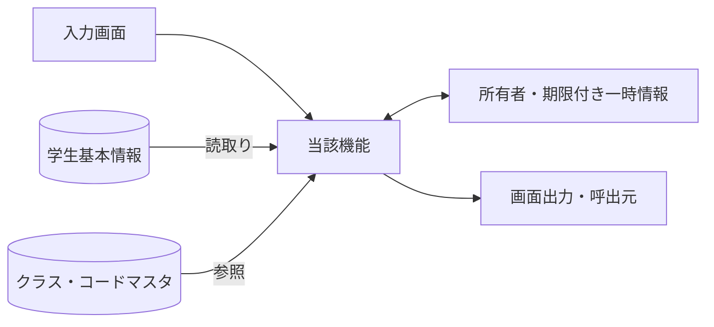
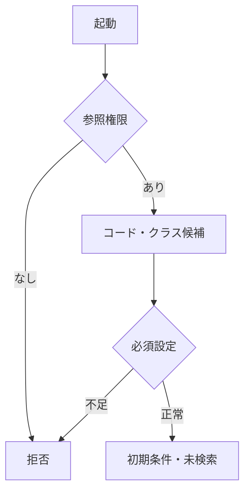
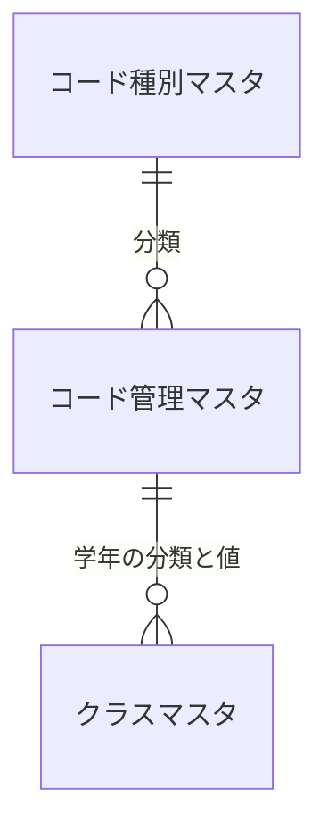
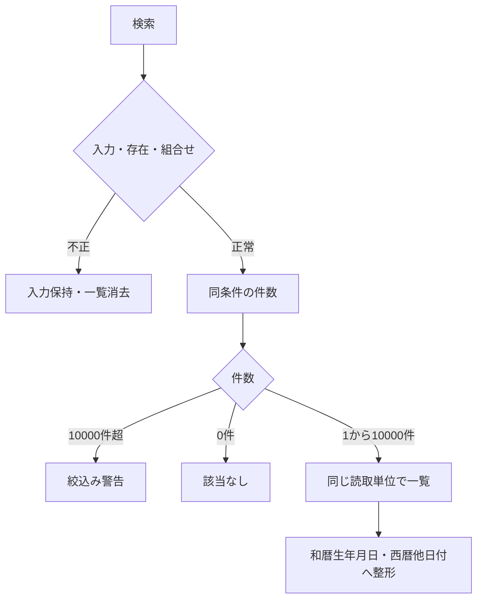
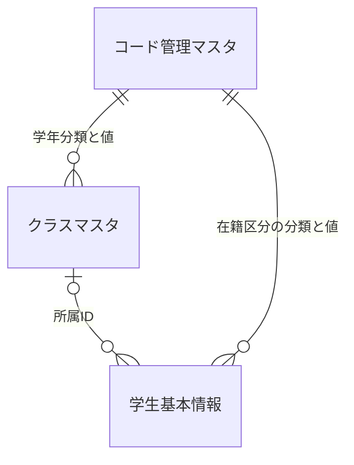
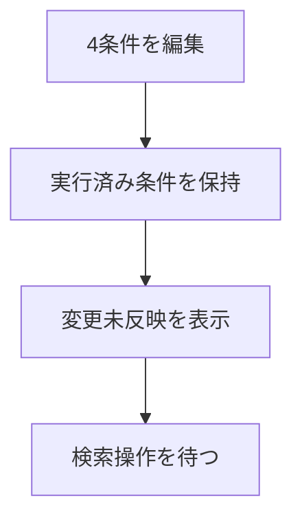
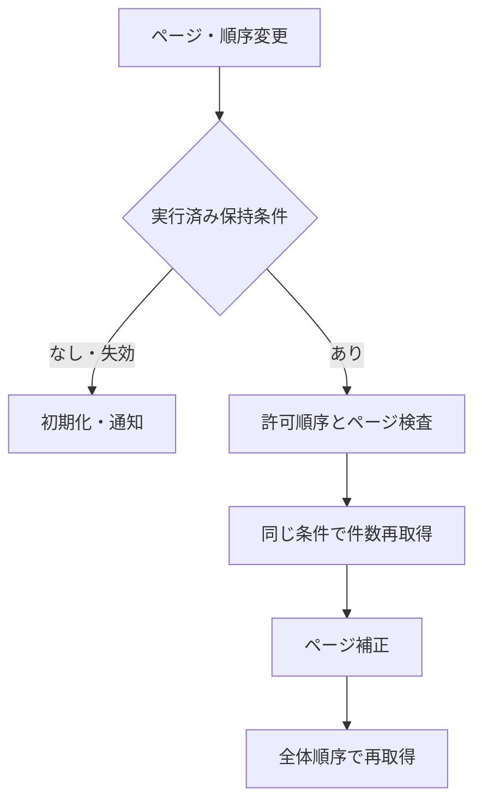
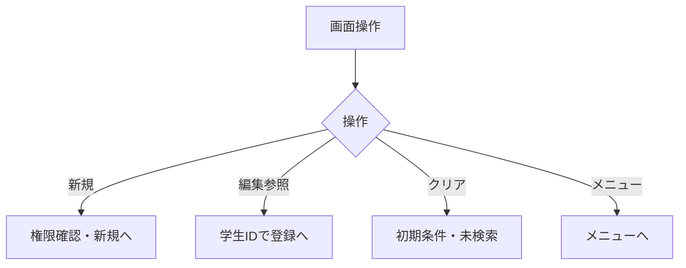
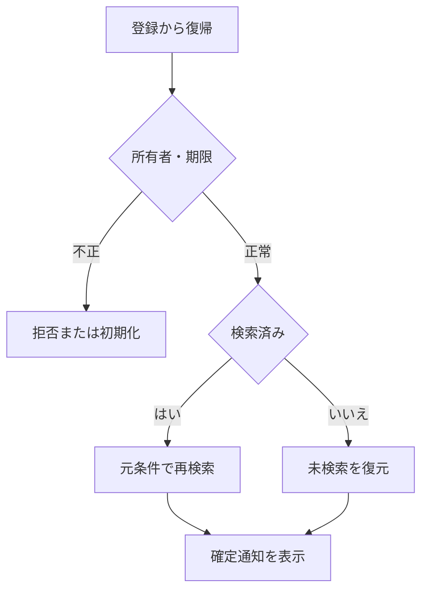

<!-- spec-meta: {"schema":"spec-md/1.0","documentId":"COBOL-BAS-STU-01","version":"8.4","path":"test-project1/spec/COBOL/基本設計書/01_学生検索画面.md","sheets":[{"heading":"概要","kind":"GRID","sheet":"01_概要"},{"heading":"項目一覧","kind":"LIST","sheet":"02_項目一覧","key":["項目ID"]},{"heading":"選択候補一覧","kind":"LIST","sheet":"03_選択候補一覧","key":["候補ID"]},{"heading":"イベント仕様","kind":"GRID","sheet":"04_イベント仕様"},{"heading":"補足説明","kind":"GRID","sheet":"05_補足説明"}],"isolationProfile":"COBOL"} -->
# 学生検索画面 基本設計書

| 項目 | 内容 |
| --- | --- |
| システム名 | 学生管理システム |
| 機能ID | SCR-STU-001 |
| 版数・改訂日 | 8.4／2026-10-25 |
| 対象読者 | 顧客（所在団体のIT部門） |
| 状態 | 実装前の設計仕様。実装・コンパイル・実機試験は未実施 |

## 概要

### 概要説明

学生の基本情報を条件指定して検索し、学生登録画面の新規・編集・参照へ進む。検索画面では学生情報を変更しない。成績を検索・表示しない。単一校を対象とし、年度・学年は現在または最終所属クラスの属性を示す。過去の年度別所属履歴を検索するものではない。

| 情報 | 内容 |
| --- | --- |
| 開始契機 | 共通メニューからの起動、学生登録画面からの復帰 |
| 利用者 | 閲覧者、担当者、管理者 |
| 参照情報 | 学生基本情報、クラスマスタ、コード種別マスタ、コード管理マスタ |
| 呼出先 | 学生登録画面 |
| 対象外 | 成績、帳票、一覧の直接編集、一括更新、削除済み学生の照会 |

### 画面設計

#### 画面レイアウト（詳細と共通の埋め込みHTML）

以下は詳細仕様と同一の埋め込みHTMLによる配置定義である。論理項目と状態の説明は本文で補い、別配置の簡略図やPNGを重ねて置かない。架空値の仕様モックであり実機画面ではない。等幅文字と空白を保持するHTML表示で確認する。

<!-- screen-html-start: SRC -->

<section class="cobol-text-panel spec-screen" data-family="TEXT" data-screen="SRC" data-state="normal" data-rows="27" data-cols="132" aria-label="COBOL文字端末 SRC normal"><pre>学生管理 / 学生検索    COBOL Text系    管理者                                                                                       情報: 検索完了。条件変更はF5検索まで未反映。                                                                                                                                                                                                                            学籍番号:                         氏名:    見本                                                                                     クラスID:                          すべて（F4で年度/学年/コード/名称を確認）                                                        在籍区分:    01[X]在学 02[X]休学 03[ ]卒業 04[ ]退学                                                                                取得件数:    20    20/50/100  並び:   1  1番号 2氏名 3入学日 4更新日時  方向:        A  A昇順/D降順                                                                                                                                                                     検索結果:2件  取得頁:1/1  表示窓:1/1                            検索日時:2026/10/25 10:00:00                                        選択 学籍番号        氏名              生年月日               年度/学年                                                             _   S2026-0001       見本 太郎         平成20年05月15日        2026 学年なし                                                            カナ: ミホン タロウ                         クラス:  C-A Aクラス                                       在学                     _   S2026-0002       見本 花子         平成20年07月20日        2026 学年なし                                                            カナ: ミホン ハナコ                         クラス:  C-A Aクラス                                       休学                                                                                                                                                                                                                                                                                                                                                                                                                                                                                                                                                                     結果は4件x2行の表示窓。長い名称・和暦はF8全文。選択行は学生IDで識別。                                                               行選択:  01   Enter:編集/参照（権限に従う）                                                                                                                                                                                                                             F5=検索        F6=クリア         F2=新規登録           F3=メニュー                                                                  PgUp/PgDn=表示窓の前/次  F7/F10=取得頁の前/次  Ctrl+Home/End=取得先頭/最後                                                          在籍欄のX/空欄を切替。全解除=全区分。クラス未設定=すべて。Spaceは在籍欄だけ切替。                                                                                                                                                                                       Tab/Shift+Tab:項目移動  F4:候補  F8:全文  F1:項目説明  Enter:検査・操作要求                                                         27行x132桁 / 全角2桁・半角1桁 / 架空データの仕様モック / 実機未検証                                                                 </pre></section>
<section hidden class="cobol-text-panel spec-screen" data-family="TEXT" data-screen="SRC" data-state="candidate" data-rows="27" data-cols="132" aria-label="COBOL文字端末 SRC candidate"><pre>学生管理 / クラス候補    COBOL Text系    管理者                                                                                     情報: 選択番号で決定。ID/年度/学年/コード/名称を照合。検索は停止・期間外も表示。                                                                                                                                                                                        候補件数:2  表示:1-2  選択番号:           01                                                                                                                                                                                                                            番号 ID                  年度 学年          コード    状態 / 名称                                                                   01   1                   2026 学年なし      C-A       有効 / Aクラス                                                                                                                                                                                                    02   2                   2025 学年なし      C-A       停止 / Aクラス                                                                                                                                                                                                                                                                                                                                                                                                                                                                                                                                                                                                                                                                                                                                                                                                                                                                                                                                                                                                                                                                                                                                                                                                                                                                                                                                                                                                                                                                                                                                                                                                                                                                                                                F4候補は6件x2行。長い値は選択行F8全文。F12で選択前の値へ戻る。                                                                                                                                                                                                          F12=取消（既定）  Enter=選択内容の検査  PgUp/PgDn=表示窓移動                                                                                                                                                                                                            Tab/Shift+Tab:項目移動  F4:候補  F8:全文  F1:項目説明  Enter:検査・操作要求                                                         27行x132桁 / 全角2桁・半角1桁 / 架空データの仕様モック / 実機未検証                                                                 </pre></section>
<!-- screen-html-end: SRC -->

#### 表示状態

| 状態 | 条件欄 | 結果欄 | 操作 |
| --- | --- | --- | --- |
| 初回・クリア直後 | 初期条件 | 「条件を指定して検索してください」。件数・日時なし | 一覧操作は使用不可 |
| 検索中 | 入力値を保持 | 処理中表示 | 二重検索を抑止 |
| 入力エラー | 入力値と項目別エラー | 前回結果を消去 | 修正後に検索 |
| 0件 | 実行した条件を保持 | 「該当する学生がありません。」 | ページ操作不可 |
| 上限超過 | 実行した条件を保持 | 絞込みを要求。一部だけの一覧は出さない | 条件追加後に検索 |
| 正常 | 実行した条件 | 件数、一覧、検索日時 | 有効なページ操作 |
| 条件変更・未実行 | 変更値を保持 | 最後に実行した結果と「条件変更は未反映」 | ページ操作は最後の実行条件を使う |
| システムエラー | 入力値を保持 | 前回結果を最新結果として残さない | 受付番号を案内 |

生年月日は和暦、その他の日付・日時・年度は西暦。例示値は架空。日付範囲の正本は[共通日付仕様](../共通/07_日付・和暦仕様.md)。

#### 小規模運用の検索と配置

学生を特定する入口を学籍番号・氏名・クラス・在籍区分の4条件へ限定する。学籍番号はN-06後の前方一致、氏名はN-03後のname_key部分一致、クラスはID完全一致、在籍区分の複数値だけOR、異なる条件はANDとする。未指定条件は追加しない。非削除は常時必須で利用者が解除できない。初回とクリアは在学・休学、20件、学籍番号昇順、未検索。全区分解除は全区分とし、空条件でも明示的な検索操作後に取得する。

氏名カナ・年度・学年・未所属のみ・都道府県・電話番号・入学日開始終了（SRC-003/004/005/007/009/010/011/012）は廃止しIDを予約する。未知の条件名と廃止したキーは空文字・null・falseでも拒否し、無視して検索しない。登録・編集の同名項目、保存値、コード・クラス制約は維持する。

クラス候補は全年度・停止・期間外を含み、年度／学年名称／コード／名称で識別する。独立した年度・学年・未所属条件、検索中の候補連動を設けない。EV-SRC-003は条件変更未反映の表示だけでDBを呼ばない。

一覧は学籍番号、氏名、カナ、生年月日、年度と学年、クラス、在籍区分、操作の8論理項目を固定行桁で表示する。SRC-027住所・028電話・029更新日時は検索応答から除外し、必要時は既存の編集／参照で確認する。氏名等は表示窓で参照し、F8全文で元値を確認できる。20/50/100件、許可4ソートと昇降順、学生IDの同順位順序、10,000件上限を維持する。

#### Text系の固定桁配置と操作

本方式はText系とし、通常検索は27行×132桁の固定パネルにする。行・桁は左上(1,1)、半角1桁・全角2桁を設計上の表示単位とする。このサイズは今回の設計値であり、COBOL処理系や端末製品の標準値を断定しない。等幅16px/行高20pxのHTMLは仕様モックの表示媒体だけで、製品のWebフォームではない。各行末まで132桁を確保し、自動折返し・カード・プルダウン・ボタンを置かない。

| 項目ID・領域 | 行,桁 | 表示幅（半角桁） | 属性・操作 |
| --- | --- | --- | --- |
| SRC-001 学籍番号 | 4,14 | 15 | U、前方一致。raw上限15スカラーは維持、全角原入力はF8でも扱う |
| SRC-002 氏名 | 4,44 | 16 | U、原入力8スカラー・正規化後160は維持 |
| SRC-006 クラス | 5,14 | 19 | U、ID原入力またはF4候補。説明は同じ行36桁から |
| SRC-008 在籍 | 6,14 | 60 | U、4区分のX/空欄。各値と件数は既存型、空欄全部は全区分 |
| SRC-019/032/033 取得件数・ソート・方向 | 7,14 / 7,39 / 7,86 | 3 / 1 / 1 | U、20/50/100、1～4、A/Dを検査後に既存値へ対応付ける |
| SRC-017/018 件数・検索日時 | 9,1 / 9,65 | 60 / 40 | P、取得頁と表示窓を区別 |
| SRC-020～026 一覧 | 11～18,5～132 | 4件、1件2行 | P。番号15、氏名16、カナ36、和暦22、年度学年30、クラス48、在籍24の表示窓 |
| SRC-030 編集/参照 | 20,10 | 2 | U、表示窓内行01～04。サーバー保持の学生IDへ変換し再取得 |
| SRC-013/014/015/016 | 22行 | 操作文字 | F5検索/F6クリア/F2新規/F3メニュー。権限による操作可否は既存どおり |
| SRC-031 ページ操作 | 23行 | 操作文字 | PgUp/PgDnは表示窓、F7/F10は取得頁前後、Ctrl+Home/Endは取得先頭/最後 |

P=保護表示、U=入力、R=見出し反転、E=警告・エラー。色だけに依存せず文字で意味を示す。検索条件は4条件を維持し、氏名等を画面幅の都合で削らない。取得1頁20/50/100件と物理表示窓4件を分離する。窓内移動は取得済み同じ応答の行を表示するだけでDB呼出しなし。取得頁の移動だけEV-SRC-004を実行し、最後の確定条件を使う。新検索/並び/件数変更で取得頁・表示窓とも先頭へ戻す。検索から復帰は取得頁・窓開始位置・選択学生IDを所有者付き状態へ保持し、学生削除等で窓が空なら最後の有効窓へ補正する。

短縮表示は元値を切捨てず表示窓にのみ適用する。表示幅に収まらない和暦・クラス・学年・名称はF8の保護全文パネルで確認でき、元値の保存・検索応答は変えない。4件の各行は11/12,13/14,15/16,17/18を使用する。F4候補は6件×2行、PgUp/PgDnで候補集合を移動し、年度・学年・コード・名称・停止を照合、F8で長い候補を全文確認する。検索クラスは全年度・停止・期間外を保持する。

Enterは入力検査と選択行の編集/参照要求。検索の実行はF5。Tab/Shift+Tabは有効なU項目を画面順に移動し、F1は当該項目の説明、F12は補助パネルを閉じ元入力と起点へ戻る。在籍欄以外のSpaceは文字入力。初回/0件/上限超過/処理中/条件未反映/障害は2行目へ文字表示し、エラーが複数または長い場合は別のエラー一覧パネルへ切替、選択番号で不正項目へ戻す。背景の操作は受け付けず、原入力・確定条件は別管理する。ソート表示1/2/3/4はstudentNo/name/admissionDate/updatedAt、A/Dはasc/descへ固定対応させる。画面形式版はcobol-text-1、検索条件形式版はsearch-compact-1を分け、旧GUI座標・窓を黙示継承しない。

端末入力・表示は製品未選定のアダプター契約。UTF-8の既存raw/実長/NULL標識、正規化・業務スカラー長検査を維持する。表示できないUnicodeを代替文字へ保存しない。結合文字・補助文字は表示セル幅を独断で1/2桁へ固定せず、F8のコードポイント編集（U+XXXX列と原値プレビュー）で完全往復し、利用できる端末/IME/鍵盤割当はQA-TEXT-COBOLで実機確認する。通常パネルが27×132を確保できない場合は起動時に適合不可を通知し、文字縮小や項目欠落で起動しない。

### ファイル・DB入出力関係

#### 入出力一覧

方向は当該機能から見たもの。画面入力、DB読取り、DB書込みを区別する。

| IO-ID | 分類 | 対象 | 入出力 | 主な項目 | 保存単位・備考 |
| --- | --- | --- | --- | --- | --- |
| 01 | 画面 | 入力条件・操作 | 入力 | 当該機能の項目一覧 | 要求開始時の値を複製 |
| 02 | 永続DB | 学生基本情報 | 入力（参照） | 学生基本情報・版 | 更新なし |
| 03 | 永続DB | クラスマスタ | 入力（参照） | 年度・学年・名称・期間・定員 | 学生機能からマスタを更新しない |
| 04 | 永続DB | コード種別マスタ／コード管理マスタ | 入力（参照） | 分類・値・名称・有効性 | 学生機能からマスタを更新しない |
| 05 | 一時情報 | 検索状態・確認情報（共通管理） | 入出力 | 確定検索条件・ページ・原入力・確認対象 | 業務表と別。所有者・期限を検査 |
| 06 | 外部ファイル | なし | なし | CSV・帳票・取込は本機能の対象外 | 仕様書MDを業務IOに数えない |
| 07 | 画面 | 一覧・メッセージ | 出力 | 個人情報は必要項目のみ | DB保存とは別の出力 |

#### データ操作関連図

認証情報・業務日時は共通01～03から取得。マスタ保守の承認入力ファイルは画面機能のIOに含めず、方式別共通仕様に定義する。

## 項目一覧

| 項目ID | グループ | 論理項目名 | 種類 | 入出力 | 入力最大長 | 保存・正規化最大長 | 長さ単位 | 必須区分 | 必須条件 | 初期値 | 未設定値 | 表示形式・許容範囲 | 関連論理DB項目 | 候補ID | 正規化ID | チェックID | 関連イベント | DB連携説明 |
| --- | --- | --- | --- | --- | --- | --- | --- | --- | --- | --- | --- | --- | --- | --- | --- | --- | --- | --- |
| SRC-001 | 検索条件 | 学籍番号 | 文字入力 | I（検索条件） | 15 | 15 | Unicodeスカラー値 | 任意 | 未指定は条件なし。CHK-003は番号形式だけ、重複・変更不可は非適用 | 空 | NULL相当 | 15文字以内 | 学生基本情報・学籍番号 | － | N-06 | CHK-002,CHK-003 | EV-SRC-002 | 前方一致、N-06。保存なし |
| SRC-002 | 検索条件 | 氏名 | 文字入力 | I（検索条件） | 8 | 160 | Unicodeスカラー値 | 任意 | 表示氏名ではなく照合キーに部分一致 | 空 | NULL相当 | 原入力8文字以内、正規化後160文字以内 | 学生基本情報・氏名照合用情報 | － | N-03 | CHK-002 | EV-SRC-002 | N-03後の部分一致。氏名の原表記と区別 |
| SRC-006 | 検索条件 | クラス | 選択 | I（検索条件） | ID桁 | ID | 数字またはASCII文字 | 任意 | 実在するクラスID。全年度、停止・期間外も可 | すべて | NULL相当 | 正の整数。型範囲は方式別DB定義 | 学生基本情報・現在・最終所属クラス | クラス | 非適用 | CHK-010 | EV-SRC-002 | クラスID完全一致。年度・学年の独立入力なし |
| SRC-008 | 検索条件 | 在籍区分 | 複数選択 | I（検索条件） | 2×最大4件 | 2×最大4件 | 数字またはASCII文字 | 任意 | 空配列は全区分。重複値・未定義値は拒否 | 01,02 | 空配列 | 在学・休学・卒業・退学 | 学生基本情報・在籍区分 | 在籍区分 | N-07 | CHK-010,CHK-024 | EV-SRC-002 | 複数値はいずれか一致、全解除は全区分 |
| SRC-013 | 操作 | 検索 | 操作 | 操作 | 非適用 | 非適用 | 非適用 | 非適用 | 表示または操作項目 | 条件を検査して1ページ目を表示 | 非適用 | ― | DB保存なし | － | 非適用 | 非適用 | EV-SRC-002 | 入力検査後、最初のページを取得 |
| SRC-014 | 操作 | クリア | 操作 | 操作 | 非適用 | 非適用 | 非適用 | 非適用 | 表示または操作項目 | 初期条件・未検索へ戻す | 非適用 | ― | DB保存なし | － | 非適用 | 非適用 | EV-SRC-005 | 初期条件・未検索へ、保持条件を消去 |
| SRC-015 | 操作 | 新規登録 | 操作 | 操作 | 非適用 | 非適用 | 非適用 | 非適用 | 表示または操作項目 | 担当者・管理者だけ表示 | 非適用 | ― | DB保存なし | － | 非適用 | 非適用 | EV-SRC-005 | 権限を確認し学生登録へ遷移 |
| SRC-016 | 操作 | メニューへ | 操作 | 操作 | 非適用 | 非適用 | 非適用 | 非適用 | 表示または操作項目 | 共通メニューへ戻る | 非適用 | ― | DB保存なし | － | 非適用 | 非適用 | EV-SRC-005 | 共通メニューへ |
| SRC-017 | 結果・一覧 | 検索件数・表示範囲 | 表示 | O（表示） | 非適用 | 表示元の上限：件数0～10000・範囲0～10000 | 非適用 | 自動表示 | 入力対象外。取得結果または計算値を表示 | 未検索 | 表示欠損は－、マスタ欠落は不整合表示 | 件数0～10000・範囲0～10000 | 計算：全条件一致の学生件数 | － | 非適用 | 非適用 | EV-SRC-002 | 未検索／0件／上限超過を区別 |
| SRC-018 | 結果・一覧 | 検索日時 | 表示 | O（表示） | 非適用 | 表示元の上限：西暦日時19文字 | 非適用 | 自動表示 | 入力対象外。取得結果または計算値を表示 | 未検索 | 表示欠損は－、マスタ欠落は不整合表示 | 西暦日時19文字 | 計算：今回の検索実行日時 | － | 非適用 | 非適用 | EV-SRC-002 | 西暦日時、日本時間。DB保存なし |
| SRC-019 | 結果・一覧 | 表示件数 | 選択 | I（表示指定） | 3 | 保存なし | 数字またはASCII文字 | 必須 | 20・50・100のみ | 20 | 不可 | 表示規則による | DB保存なし：取得範囲 | 表示件数 | 非適用 | CHK-024 | EV-SRC-004 | 20／50／100、既定20 |
| SRC-020 | 結果・一覧 | 学籍番号 | 表示 | O（表示） | 非適用 | 表示元の上限：15 | 非適用 | 自動表示 | 入力対象外。取得結果または計算値を表示 | 未検索 | 表示欠損は－、マスタ欠落は不整合表示 | 15 | 学生基本情報・学籍番号 | － | 非適用 | 非適用 | EV-SRC-002,EV-SRC-004,EV-SRC-006 | 保存済み文字列、文字順 |
| SRC-021 | 結果・一覧 | 氏名 | 表示 | O（表示） | 非適用 | 表示元の上限：8 | 非適用 | 自動表示 | 入力対象外。取得結果または計算値を表示 | 未検索 | 表示欠損は－、マスタ欠落は不整合表示 | 8 | 学生基本情報・学生氏名 | － | 非適用 | 非適用 | EV-SRC-002,EV-SRC-004,EV-SRC-006 | 氏名を上段、SRC-022のカナを下段に同一セルで表示 |
| SRC-022 | 結果・一覧 | 氏名カナ | 表示 | O（表示） | 非適用 | 表示元の上限：18 | 非適用 | 自動表示 | 入力対象外。取得結果または計算値を表示 | 未検索 | 表示欠損は－、マスタ欠落は不整合表示 | 18 | 学生基本情報・学生氏名カナ | － | 非適用 | 非適用 | EV-SRC-002,EV-SRC-004,EV-SRC-006 | SRC-021と同一セルの2段目。全文を折返し表示 |
| SRC-023 | 結果・一覧 | 生年月日 | 表示 | O（表示） | 非適用 | 表示元の上限：共通和暦書式 | 非適用 | 自動表示 | 入力対象外。取得結果または計算値を表示 | 未検索 | 表示欠損は－、マスタ欠落は不整合表示 | 共通和暦書式 | 学生基本情報・生年月日 | － | 非適用 | 非適用 | EV-SRC-002,EV-SRC-004,EV-SRC-006 | 和暦表示。共通16で日付から変換 |
| SRC-024 | 結果・一覧 | 年度・学年 | 表示 | O（表示） | 非適用 | 表示元の上限：年度4桁＋学年名称12 | 非適用 | 自動表示 | 入力対象外。取得結果または計算値を表示 | 未検索 | 表示欠損は－、マスタ欠落は不整合表示 | 年度4桁＋学年名称12 | クラスマスタ・学校年度／学年→コード管理マスタ（学年）・コード名称 | － | 非適用 | 非適用 | EV-SRC-002,EV-SRC-004,EV-SRC-006 | 年度は西暦、学年は名称。未所属は－ |
| SRC-025 | 結果・一覧 | クラス | 表示 | O（表示） | 非適用 | 表示元の上限：コード9＋名称18＋注記 | 非適用 | 自動表示 | 入力対象外。取得結果または計算値を表示 | 未検索 | 表示欠損は－、マスタ欠落は不整合表示 | コード9＋名称18＋注記 | 学生基本情報・現在・最終所属クラス→クラスマスタ・クラスコード／クラス名 | － | 非適用 | 非適用 | EV-SRC-002,EV-SRC-004,EV-SRC-006 | 未所属／停止／期間外を区別 |
| SRC-026 | 結果・一覧 | 在籍区分 | 表示 | O（表示） | 非適用 | 表示元の上限：名称12 | 非適用 | 自動表示 | 入力対象外。取得結果または計算値を表示 | 未検索 | 表示欠損は－、マスタ欠落は不整合表示 | 名称12 | 学生基本情報・在籍区分→コード管理マスタ（在籍区分）・コード名称 | － | 非適用 | 非適用 | EV-SRC-002,EV-SRC-004,EV-SRC-006 | 種別と値で結合、名称未取得でも学生行を落とさない |
| SRC-030 | 結果・一覧 | 編集／参照 | 操作 | 操作 | 非適用 | 非適用 | 非適用 | 非適用 | 表示または操作項目 | 未検索 | 非適用 | 表示規則による | 学生基本情報・学生管理番号 | － | 非適用 | 非適用 | EV-SRC-005 | 行番号ではなく対象IDで遷移、遷移先で再取得 |
| SRC-031 | 結果・一覧 | ページ操作 | 操作 | 操作 | 非適用 | 非適用 | 非適用 | 非適用 | 表示または操作項目 | 未検索 | 非適用 | 表示規則による | DB保存なし：取得範囲 | － | 非適用 | 非適用 | EV-SRC-004 | 先頭・前・次・最後。有効範囲へ再補正 |
| SRC-032 | 結果操作 | 並び順項目 | 選択 | I（表示指定） | 13 | 保存なし | Unicodeスカラー値 | 必須 | studentNo・name・admissionDate・updatedAtのみ | studentNo | 不可 | 固定候補 | 検索：学籍番号／氏名照合用情報／入学日／更新日時 | 並び順 | 非適用 | CHK-024 | EV-SRC-004 | 許可4項目。最後に学生ID昇順を加える |
| SRC-033 | 結果操作 | 並び順方向 | 選択 | I（表示指定） | 4 | 保存なし | Unicodeスカラー値 | 必須 | asc・descのみ | asc | 不可 | 固定候補 | DB保存なし：取得順 | 昇降順 | 非適用 | CHK-024 | EV-SRC-004 | 昇順／降順。初期は昇順 |

## 選択候補一覧

| 候補ID | 参照元・分類 | 選択値 | 表示値 | 抽出条件 | 表示順 | 初期値・連動 |
| --- | --- | --- | --- | --- | --- | --- |
| クラス | クラスマスタ・コード管理マスタ（学年） | クラス管理番号 | 年度・学年・クラスコード・クラス名 | 全年度・停止・期間外を含む。検索では人数集計なし | 年度降順→学年表示順→クラス表示順→コード→ID | すべて。独立した上位条件・候補連動なし |
| 在籍区分 | コード管理マスタ（在籍区分） | 在籍区分コード値 | コード名称 | 分類ENROLLMENT_STATUSの01～04。停止を含む | 表示順→コード値 | 01・02、全解除は全区分 |
| 表示件数 | 共通UI固定定義 | 20 / 50 / 100 | 20件／50件／100件 | 固定3候補。業務コードではない | 20→50→100 | 20、変更で1ページへ |
| 並び順 | 共通UI固定定義 | 学籍番号／氏名／入学日／更新日時 | 学籍番号／氏名／入学日／更新日時 | 固定4候補。自由文字でDB列を指定しない | 左記順 | 学籍番号 |
| 昇降順 | 共通UI固定定義 | 昇順／降順 | 昇順／降順 | 固定2候補 | 昇順→降順 | 昇順 |

## イベント仕様

### EV-SRC-001 初期表示

#### 処理概要

認証済み利用者がメニューから起動。学生一覧は取得しない。

#### 処理手順

1. 共通01・02で参照権限を確認し、共通03で業務日時を確定する。
2. OP-CODE・OP-CLASSで候補取得。在学・休学、20件、学籍番号昇順、未検索を設定する。必須マスタ不足なら検索を不可とする。
3. 共通12の画面別状態を作成する。復帰識別がある場合はEV-SRC-006へ進む。

#### 処理フロー

#### SQL・テーブル関連（ER図）

名称参照は未所属・停止値を残す外部結合相当。コードは用途ごとの別名で**分類と値**を結合する。図は読取りの関連であり、履歴への書込みや削除連動を意味しない。単独の存在確認・採番・書込みの表関連は下記操作IDで特定する。

#### DB操作の詳細

`OP-CODE` → `OP-CLASS`。下記「DB操作定義」の同名操作を実行する。

#### 結果・例外時の扱い

入力不備は項目エラーと原入力を保持。検索要求の失敗は一覧消去、0件はI-SRC-001、上限超過はW-SRC-001。権限不備・他者の保持情報は拒否する。条件変更だけでは既存一覧を再検索しない。 各イベントで実行していない処理の結果状態は発生対象外。

### EV-SRC-002 検索実行

#### 処理概要

入力した検索条件で、非削除学生を検索する。

#### 処理手順

1. 入力を複製し共通04・05で4条件の正規化、桁、選択値と許可キーを検査する。項目エラーは入力保持・一覧消去、DB検索なし。
2. OP-EXISTSで指定した在籍区分の分類付き存在とクラスIDの存在を検査する。検索では停止・期間外の既存値を許容する。
3. OP-COUNT・OP-PAGEへ同じ確定条件を渡す。10001件で上限、0件は該当なし、それ以外は最初のページを表示する。件数と一覧の読取りを揃える。
4. 正常時に実行済み条件を共通12へ保持。生年月日は共通16で和暦表示。他の日付・日時は西暦。

#### 処理フロー

#### SQL・テーブル関連（ER図）

名称参照は未所属・停止値を残す外部結合相当。コードは用途ごとの別名で**分類と値**を結合する。図は読取りの関連であり、履歴への書込みや削除連動を意味しない。単独の存在確認・採番・書込みの表関連は下記操作IDで特定する。

#### DB操作の詳細

`OP-EXISTS` → `OP-COUNT` → `OP-PAGE`。下記「DB操作定義」の同名操作を実行する。

#### 結果・例外時の扱い

入力不備は項目エラーと原入力を保持。検索要求の失敗は一覧消去、0件はI-SRC-001、上限超過はW-SRC-001。権限不備・他者の保持情報は拒否する。条件変更だけでは既存一覧を再検索しない。 各イベントで実行していない処理の結果状態は発生対象外。

### EV-SRC-003 条件変更未反映

#### 処理概要

4条件の編集を未実行状態として表示する。自動検索・候補連動は行わない。

#### 処理手順

1. 編集値と最後の実行済み条件を分離し、「条件変更は未反映」を表示する。
2. クラスは全候補から選択する。年度・学年の独立入力、候補の再取得や選択の自動解除は行わない。
3. 検索操作でEV-SRC-002へ進む。ページ移動では最後に実行した条件を使用する。

#### 処理フロー

#### SQL・テーブル関連（ER図）

業務DB参照なし。ER図は非適用。

#### DB操作の詳細

OP-CLASS・OP-COUNT・OP-PAGEは呼び出さない。保持された実行条件を更新しない。

#### 結果・例外時の扱い

検索成功までは一覧を実行済み条件に対応付ける。未検索状態では一覧を作らない。入力途中の値を確定条件と扱わない。

### EV-SRC-004 並び替え・ページ移動

#### 処理概要

実行済み条件の結果を別の順序・ページで取得する。

#### 処理手順

1. 共通12から保持条件を取得。未検索は不可、期限切れはW-SRC-002。入力途中の条件を混ぜない。
2. 並び順4項目・方向2種・件数20/50/100・正のページ番号を検査する。並び順・件数変更時は1ページへ戻す。
3. OP-COUNT・OP-PAGEを再実行。件数減少時は最終有効ページへ補正。0件は一覧なし・ページ操作不可。

#### 処理フロー

#### SQL・テーブル関連（ER図）

名称参照は未所属・停止値を残す外部結合相当。コードは用途ごとの別名で**分類と値**を結合する。図は読取りの関連であり、履歴への書込みや削除連動を意味しない。単独の存在確認・採番・書込みの表関連は下記操作IDで特定する。

#### DB操作の詳細

`OP-COUNT` → `OP-PAGE`。下記「DB操作定義」の同名操作を実行する。

#### 結果・例外時の扱い

入力不備は項目エラーと原入力を保持。検索要求の失敗は一覧消去、0件はI-SRC-001、上限超過はW-SRC-001。権限不備・他者の保持情報は拒否する。条件変更だけでは既存一覧を再検索しない。 各イベントで実行していない処理の結果状態は発生対象外。

### EV-SRC-005 新規・編集・参照・クリア

#### 処理概要

表示窓内の選択番号＋Enter、または画面に表示した対応機能キーを受け付ける。

#### 処理手順

1. 新規は作成権限を確認し学生登録へ。検索条件を登録値へ流用しない。
2. 編集・参照は選択行の学生管理番号で登録機能を起動する。行番号・表示名を識別子にしない。読込みは登録側の責務。
3. クリアは初期条件・未検索へ戻し共通12も初期化。メニューへ戻る処理はDB更新なし。

#### 処理フロー

#### SQL・テーブル関連（ER図）

DB参照なし。ER図は対象外。

#### DB操作の詳細

このイベントで業務DBを読み書きしない。遷移先の読込みと混同しない。

#### 結果・例外時の扱い

入力不備は項目エラーと原入力を保持。検索要求の失敗は一覧消去、0件はI-SRC-001、上限超過はW-SRC-001。権限不備・他者の保持情報は拒否する。条件変更だけでは既存一覧を再検索しない。 各イベントで実行していない処理の結果状態は発生対象外。

### EV-SRC-006 学生登録からの復帰

#### 処理概要

保存・削除・取消・戻るから検索状態を復元する。

#### 処理手順

1. 共通12で所有者・認証・画面・期限・形式版search-compact-1を確認。他者状態は拒否、期限切れは初期化する。
2. 未検索から起動していた場合は未検索へ。検索済みなら元条件でOP-COUNT・OP-PAGEを再実行し最新DBを表示する。
3. 確定済み成功通知だけを表示。保存した学生が条件外でも検索条件を変更しない。

#### 処理フロー

#### SQL・テーブル関連（ER図）

名称参照は未所属・停止値を残す外部結合相当。コードは用途ごとの別名で**分類と値**を結合する。図は読取りの関連であり、履歴への書込みや削除連動を意味しない。単独の存在確認・採番・書込みの表関連は下記操作IDで特定する。

#### DB操作の詳細

`OP-COUNT` → `OP-PAGE`。下記「DB操作定義」の同名操作を実行する。

#### 結果・例外時の扱い

入力不備は項目エラーと原入力を保持。検索要求の失敗は一覧消去、0件はI-SRC-001、上限超過はW-SRC-001。権限不備・他者の保持情報は拒否する。条件変更だけでは既存一覧を再検索しない。 各イベントで実行していない処理の結果状態は発生対象外。

### DB操作定義

操作の業務契約は[共通データアクセス](../共通/08_データアクセス仕様.md)が正本。本機能における具体的な対象・引数・確定単位は以下。

#### OP-CODE

| 項目 | 内容 |
| --- | --- |
| 対象テーブル | コード種別マスタ・コード管理マスタ |
| 操作 | 参照 |
| 実行条件・引数 | 分類、用途（検索／新規選択／既存表示）、既存値、業務日 |
| 取得・設定項目／対象条件 | 分類・値・名称・表示順・利用可否・期間。分類＋値で取得 |
| 件数・順序 | 候補0件を検出。既定値を先頭値へ代替しない |
| 確定・取消 | 参照のみ |

#### OP-CLASS

| 項目 | 内容 |
| --- | --- |
| 対象テーブル | クラスマスタ・コード管理マスタ（学年）・学生基本情報 |
| 操作 | 参照 |
| 実行条件・引数 | 用途、年度、学年、在籍区分、在籍期間、既存所属、業務日、人数参照要否 |
| 取得・設定項目／対象条件 | 年度・学年・クラスID・コード・名称・期間・定員。人数集計は登録側で要求した場合のみ。検索の候補取得では学生を集計しない |
| 件数・順序 | 年度降順、学年表示順、クラス表示順、クラスコード、ID |
| 確定・取消 | 参照のみ、人数は予約ではない |

#### OP-EXISTS

| 項目 | 内容 |
| --- | --- |
| 対象テーブル | 学生基本情報・クラスマスタ・コード種別マスタ・コード管理マスタ |
| 操作 | 参照 |
| 実行条件・引数 | 用途（検索／保存）、分類付きコード・クラスID・選択補助。保存だけ対象ID・完全な学籍番号・期待版 |
| 取得・設定項目／対象条件 | 検索は指定在籍区分とクラスIDの存在のみ（停止・期間外可）。学籍番号前方一致に重複・完全一致存在検査をしない。保存は全行学籍番号一意、分類付き存在、変更有無、有効性を再検査 |
| 件数・順序 | 未存在／重複／組合せ／停止を区別。未指定の検索条件は検査対象外 |
| 確定・取消 | 検索は参照のみ、保存は保護した最新値で確認 |

#### OP-COUNT

| 項目 | 内容 |
| --- | --- |
| 対象テーブル | 学生基本情報・クラスマスタ |
| 操作 | 参照 |
| 実行条件・引数 | 正規化後の実行済み検索条件 |
| 取得・設定項目／対象条件 | 非削除固定。学籍番号前方・氏名name_key部分・クラスID完全をAND、在籍区分だけOR。未指定は条件なし。最大10001件 |
| 件数・順序 | 10001件は上限、10000件以下は実件数。0件は該当なし |
| 確定・取消 | OP-PAGEと同じ読取り整合性 |

#### OP-PAGE

| 項目 | 内容 |
| --- | --- |
| 対象テーブル | 学生基本情報・クラスマスタ・コード管理マスタ（学年・在籍区分） |
| 操作 | 参照 |
| 実行条件・引数 | OP-COUNTと同じ条件、ページ、件数、許可並び順 |
| 取得・設定項目／対象条件 | 一覧8論理項目を固定行桁表示＋非表示学生ID。住所・電話・更新日時・メール・緊急連絡先・備考を返さない |
| 件数・順序 | 全一致集合をソート後ページ化。同順位学生ID昇順 |
| 確定・取消 | 参照のみ、旧結果を最新として残さない |

## 補足説明

停止・期間外のコード／クラスも検索候補と名称表示に含める。表示名称を取得できない異常があっても学生の行を消さず、不整合を明示する。文字の「%」「_」「!」を入力しても検索対象が意図せず広がらないものとする。検索条件や個人情報を画面アドレス・永続保存へ残さない。

| 受入観点 | 期待結果 |
| --- | --- |
| 初回、クリア | 在学・休学が選択済み、未検索 |
| 氏名空白差・全角番号 | N-03／N-06どおりに検索。検索カナ条件なし |
| 停止クラス、卒業 | 過去の最終所属を含めて検索できる |
| 廃止条件名・未知条件名 | 空値でもE-SRC-002。旧状態形式はW-SRC-002で未検索へ |
| 0件・10,000件・10,001件 | 該当なし・正常一覧・上限警告を区別 |
| 条件変更後にページ移動 | 最後に実行した条件で移動し、未反映を明示 |
| 閲覧者の更新操作 | 操作できない |
| 同一接続内の複数画面インスタンスから復帰 | 条件・成功メッセージを混同しない。別接続・再認証後は状態を引き継がない |

関連：[学生登録](02_学生登録画面.md)／[共通UI](../共通/04_共通UI部品設計.md)／[共通チェック](../共通/05_チェック・メッセージ設計.md)

### 正本・受入観点

共通業務は共通03・05・07・08、技術実装は方式別詳細を正本とする。顧客IT部門は入出力、権限、画面とDBの追跡、競合・障害時結果を確認する。言語の構文説明は本書に含めない。

[適合試験一覧](../共通/06_要件対応・設計判断.md)とレビュー結果を参照。

### 項目と一覧章の扱い

項目一覧・選択候補一覧は表だけのLIST章とする。入力上限、保存上限、必須区分と条件を区別する。項目IDは前版のまま。詳細の内部項目は同じ論理項目の細分化であり新たな業務機能ではない。

### 廃止・一覧除外IDの予約

以下は現行項目一覧・移送対象ではなく変更履歴。IDは再利用しない。登録・編集とDBの保存項目は維持する。

| 予約ID | 旧項目・対応 | 現行の扱い |
| --- | --- | --- |
| SRC-003 | 氏名カナ | 検索条件廃止・空値でも送信拒否 |
| SRC-004 | 年度 | 検索条件廃止・空値でも送信拒否 |
| SRC-005 | 学年 | 検索条件廃止・空値でも送信拒否 |
| SRC-007 | 未所属のみ | 検索条件廃止・空値でも送信拒否 |
| SRC-009 | 都道府県 | 検索条件廃止・空値でも送信拒否 |
| SRC-010 | 電話番号 | 検索条件廃止・空値でも送信拒否 |
| SRC-011 | 入学日・開始 | 検索条件廃止・空値でも送信拒否 |
| SRC-012 | 入学日・終了 | 検索条件廃止・空値でも送信拒否 |
| SRC-027 | 住所 | 一覧応答から除外・編集参照で確認 |
| SRC-028 | 本人電話 | 一覧応答から除外・編集参照で確認 |
| SRC-029 | 更新日時 | 一覧応答から除外・編集参照で確認 |
