<!-- spec-meta: {"schema":"spec-md/1.0","documentId":"COBOL-BAS-STU-02","version":"8.5","path":"test-project1/spec/COBOL/基本設計書/02_学生登録画面.md","sheets":[{"heading":"概要","kind":"GRID","sheet":"01_概要"},{"heading":"項目一覧","kind":"LIST","sheet":"02_項目一覧","key":["項目ID"]},{"heading":"選択候補一覧","kind":"LIST","sheet":"03_選択候補一覧","key":["候補ID"]},{"heading":"イベント仕様","kind":"GRID","sheet":"04_イベント仕様"},{"heading":"項目更新仕様","kind":"LIST","sheet":"05_項目更新仕様","key":["更新ID"]},{"heading":"補足説明","kind":"GRID","sheet":"06_補足説明"},{"heading":"Windows認証なしサンプル","kind":"GRID","sheet":"07_Windows認証なしサンプル"}],"isolationProfile":"COBOL"} -->
# 学生登録画面 基本設計書

| 項目 | 内容 |
| --- | --- |
| システム名 | 学生管理システム |
| 機能ID | SCR-STU-002 |
| 版数・改訂日 | 8.5／2026-10-25 |
| 対象読者 | 顧客（所在団体のIT部門） |
| 状態 | 実装前の設計仕様。実装・コンパイル・実機試験は未実施 |

## 概要

### 概要説明

学生の氏名、住所、連絡先、生年月日、在籍状態、現在／最終所属クラスを管理する。新規登録・編集・参照は同じ画面を使用する。元版の追加提案である管理者向け論理削除を引き継ぐ。成績は管理しない。

| 情報 | 内容 |
| --- | --- |
| 呼出元・復帰先 | 学生検索画面 |
| 保存単位 | 学生1人とその操作履歴をまとめて保存 |
| 参照情報 | クラスマスタ、コード種別マスタ、コード管理マスタ |
| 通常の削除 | 学生情報を物理的に消さず通常検索・参照から除外する |
| 対象外 | 学籍番号訂正、削除復元、物理消去、所属履歴一覧、将来の異動予約 |

### 画面設計

#### 画面レイアウト（詳細と共通の埋め込みHTML）

以下は詳細仕様と同一の埋め込みHTMLによる配置定義である。論理項目と状態の説明は本文で補い、別配置の簡略図やPNGを重ねて置かない。架空値の仕様モックであり実機画面ではない。等幅文字と空白を保持するHTML表示で確認する。

<!-- screen-html-start: REG -->

<section class="cobol-text-panel spec-screen" data-family="TEXT" data-screen="REG" data-state="normal" data-rows="27" data-cols="132" aria-label="COBOL文字端末 REG normal"><pre>学生管理 / 学生編集    COBOL Text系    管理者                                                                                       情報: *必須 +条件付き。保存前の入力です。                                                                                           管理番号:  10001                 更新:2026/10/25 09:00:00  更新者:operator.demo                                                     [基本情報]                                                                                                                          *学籍番号:   S2026-0001           *氏名:   見本 太郎             *氏名カナ:    ミホン タロウ                                        *生年月日:   H  20   05 15  元号/年/月/日       *性別:   0    未回答（F4候補）                                                      [住所・本人連絡先]                                                                                                                  *郵便番号:   100-0000       *都道府県:     13   東京都           +本人電話:    03-0000-0000                                         *住所1:      見本市見本町1-1                                    住所2:         見本ビル201                                          +メール:     sample@example.invalid                                                                                                 [在籍・所属]                                                                                                                        *入学日:     2026-04-01     *在籍区分:     01   在学             +終了日:                                                           年度補助:    2026           学年補助:      00   学年なし         +クラスID:    1                                                    人数/定員:   18/30（参考）               所属:2026/学年なし/C-A/Aクラス（F4で全文候補）                                             [緊急連絡先・備考・理由]                                                                                                            +緊急氏名:   見本 保護者          +続柄:   01   父               +緊急電話:    090-0000-0000                                        備考:        連絡は本人電話を優先してください。                                                                    F8全文           +変更理由:                                                                                                         F8全文           本人電話/メール/緊急電話の1つ以上。緊急3項目は一式。所属人数は保存時再検査。                                                        在学/休学:クラス必須・終了日なし。卒業/退学:終了日必須。住所45字/備考120字/理由60字。                                                                                                                                                                                   F5=更新        F6=編集取消           F9=再読込           F3=検索へ             F11=論理削除                                         編集時の学籍番号は保護。新規はF5=登録。閲覧者は全欄保護、更新/削除キーなし。                                                        コード欄F4=候補。長文F8=全文入力。確認・候補表示中に背景の更新キーは受け付けない。                                                                                                                                                                                      Tab/Shift+Tab:項目移動  F4:候補  F8:全文  F1:項目説明  Enter:検査・操作要求                                                         27行x132桁 / 全角2桁・半角1桁 / 架空データの仕様モック / 実機未検証                                                                 </pre></section>
<section hidden class="cobol-text-panel spec-screen" data-family="TEXT" data-screen="REG" data-state="error" data-rows="27" data-cols="132" aria-label="COBOL文字端末 REG error"><pre>学生管理 / 項目エラー    COBOL Text系    管理者                                                                                     エラー: 入力内容を確認してください。入力値を保持し、学生DBは更新していません。                                                                                                                                                                                                                                                                                                                              番号 項目          メッセージ                                                                                                                                                                                                                                           01   氏名          氏名を入力してください。（REG-003 / CHK-001）                                                                                                                                                                                                        02   本人連絡先    本人電話/メール/緊急電話のいずれかを入力してください。                                                                                                                                                                                                                                                                                                                                                                                                                                                                                                                                                                                                                                                                                                                                                                                                                                                                                                                                                                                                                                                                                                                                                                                                                                                                                                                                                                                                                                   選択番号:    01                                                                                                                                                                                                                                                         Enter=該当項目へ戻る  F12=入力へ戻る。最初の不正項目へカーソルを置く。                                                                                                                                                                                                  F12=取消（既定）  Enter=選択内容の検査  PgUp/PgDn=表示窓移動                                                                                                                                                                                                            Tab/Shift+Tab:項目移動  F4:候補  F8:全文  F1:項目説明  Enter:検査・操作要求                                                         27行x132桁 / 全角2桁・半角1桁 / 架空データの仕様モック / 実機未検証                                                                 </pre></section>
<section hidden class="cobol-text-panel spec-screen" data-family="TEXT" data-screen="REG" data-state="duplicate" data-rows="27" data-cols="132" aria-label="COBOL文字端末 REG duplicate"><pre>学生管理 / 重複候補の確認    COBOL Text系    管理者                                                                                 警告: 同一生年月日かつ氏名またはカナが一致。別人であることを確認してください。                                                                                                                                                                                          全候補:2件 / 表示対象:最大20件 / この窓:1-2                                                                                                                                                                                                                             学籍番号        氏名              生年月日               年度 / クラス / 在籍                                                       S2026-0001      見本 太郎         平成20年05月15日       2026 / C-A / 在学                                                                                                                                                                                              S2025-0001      見本 太郎         平成20年05月15日       2025 / C-B / 休学                                                                                                                                                                                                                                                                                                                                                                                                                                                                                                                                                                                                                                                                                                                                                                                                                                                                                                                                                                                                                                                                                                                                                          確認理由:    同姓同名の別人であることを確認したため。                                                                                                                                                                                                                   別人確認:    N   Yを明示入力してF5=続行。Enterだけでは保存しない。                                                                                                                                                                                                      F12=取消（既定）                                                                                                                    候補は6件x2行の窓。全候補の検査は表示最大20件に限定しない。理由全文はF8。                                                           F12=取消（既定）  Enter=選択内容の検査  PgUp/PgDn=表示窓移動                                                                                                                                                                                                            Tab/Shift+Tab:項目移動  F4:候補  F8:全文  F1:項目説明  Enter:検査・操作要求                                                         27行x132桁 / 全角2桁・半角1桁 / 架空データの仕様モック / 実機未検証                                                                 </pre></section>
<section hidden class="cobol-text-panel spec-screen" data-family="TEXT" data-screen="REG" data-state="delete" data-rows="27" data-cols="132" aria-label="COBOL文字端末 REG delete"><pre>学生管理 / 論理削除の確認    COBOL Text系    管理者                                                                                 警告: 管理者だけが実行可能。編集中の氏名・住所等は保存しません。                                                                                                                                                                                                                                                                                                                                            対象:S2026-0001 / 見本 太郎 / 学生ID:10001                                                                                                                                                                                                                                                                                                                                                                                                                                                                                                                                                                                                                                          *削除理由:   誤登録のため。                                                                                                                                                                                                                                                                                                                                                                                                                                                                                                                                                                                                                                                                                                                                                                                                                                                                                                                                                                                                                                                                     削除承認:    N   Yを明示入力してF5。Enterだけでは削除しない。                                                                                                                                                                                                                                                                                                                                                                                                                                                                                   F12=取消（既定）                                                                                                                                                                                                                                                        F12=取消（既定）  Enter=選択内容の検査  PgUp/PgDn=表示窓移動                                                                                                                                                                                                            Tab/Shift+Tab:項目移動  F4:候補  F8:全文  F1:項目説明  Enter:検査・操作要求                                                         27行x132桁 / 全角2桁・半角1桁 / 架空データの仕様モック / 実機未検証                                                                 </pre></section>
<section hidden class="cobol-text-panel spec-screen" data-family="TEXT" data-screen="REG" data-state="discard" data-rows="27" data-cols="132" aria-label="COBOL文字端末 REG discard"><pre>学生管理 / 変更破棄の確認    COBOL Text系    管理者                                                                                 警告: 保存していない変更を破棄しますか。元の入力は取消まで保持します。                                                                                                                                                                                                                                                                                                                                                                                                                                                                          待機操作:検索へ戻る（RESET/RELOAD/BACKのサーバー保持pendingAction）                                                                                                                                                                                                                                                                                                                                                                                                                                                                                                                                                                                                                                                                                                                                                                                                                                                                                                                                                                                                                                                                                                                                                                                                                                                                                                                                                                                                                                                                                                                                                                             破棄承認:    N   Yを明示入力してF5。F12で入力へ戻る。                                                                                                                                                                                                                                                                                                                                                                                                                                                                                           F12=取消（既定）                                                                                                                                                                                                                                                        F12=取消（既定）  Enter=選択内容の検査  PgUp/PgDn=表示窓移動                                                                                                                                                                                                            Tab/Shift+Tab:項目移動  F4:候補  F8:全文  F1:項目説明  Enter:検査・操作要求                                                         27行x132桁 / 全角2桁・半角1桁 / 架空データの仕様モック / 実機未検証                                                                 </pre></section>
<section hidden class="cobol-text-panel spec-screen" data-family="TEXT" data-screen="REG" data-state="fulltext" data-rows="27" data-cols="132" aria-label="COBOL文字端末 REG fulltext"><pre>学生管理 / 備考の全文編集    COBOL Text系    管理者                                                                                 情報: REG-023 備考 / raw上限120 Unicodeスカラー / 保存上限120 / 取消は入力を復元。                                                                                                                                                                                      現在:120/120文字  表示窓:1-120  F8起点:備考                                                                                                                                                                                                                             備備備備備備備備備備備備備備備備備備備備備備備備備備備備備備備備備備備備備備備備                                                    備備備備備備備備備備備備備備備備備備備備備備備備備備備備備備備備備備備備備備備備                                                    備備備備備備備備備備備備備備備備備備備備備備備備備備備備備備備備備備備備備備備備                                                                                                                                                                                                                                                                                                                                                                                                                                                                                                                                                                                                                                                                                                                                                                                                                                                                                                                                                                                                                                                                                                                                                                                                                                                                                                                                                                                                                                                                                                                                                                改行を含む原入力を保持。全角2/半角1は配置用。結合文字/補助文字はUnicode編集経路で扱う。                                                                                                                                                                                 F5=原入力へ反映（DB保存なし）  F12=元値で戻る  長さ超過は切捨てず項目エラー                                                                                                                                                                                             F12=取消（既定）  Enter=選択内容の検査  PgUp/PgDn=表示窓移動                                                                                                                                                                                                            Tab/Shift+Tab:項目移動  F4:候補  F8:全文  F1:項目説明  Enter:検査・操作要求                                                         27行x132桁 / 全角2桁・半角1桁 / 架空データの仕様モック / 実機未検証                                                                 </pre></section>
<!-- screen-html-end: REG -->

重複確認・論理削除確認・変更破棄確認は各操作時だけの別状態。削除理由は削除確認へ配置。取消を既定とする。

#### 重複候補の確認

配置は上記HTMLの確認状態を用いる。同じ生年月日で氏名または氏名カナが一致する候補を表示し、確認理由を必須とする。取消を既定とし、別人と明示確認した場合だけ続行する。

候補は最大20件を表示し、全候補件数も表示する。候補の住所・電話・メールは表示しない。警告は同一人物と断定するものではなく、正当に異なる学生を排除しない。

#### 削除確認

配置は上記HTMLの削除確認状態を用いる。対象学生と必須の削除理由を表示し、取消を既定とする。編集中の氏名・住所等は保存せず、明示確認後だけ論理削除を実行する。

生年月日は和暦、その他の日付・日時・年度は西暦。例示値は架空。日付範囲の正本は[共通日付仕様](../共通/07_日付・和暦仕様.md)。

#### Text系の固定桁配置と確認状態

通常編集はText系の27行×132桁パネルへまとめる。左上(1,1)、半角1桁・全角2桁。短い番号・コード・日付の幅と長い入力の幅を分け、ラベルと入力左端を14/44/80桁へ揃える。住所・メール・備考・理由は表示窓を使用し、横移動またはF8全文入力で全原入力へ到達する。行末での自動折返し、Webフォーム・ボタン・プルダウン・常時モーダル積載を使わない。HTMLは等幅の配置見本で、端末製品の実装方式や標準サイズを確定するものではない。

| 項目ID・領域 | 行,桁 | 表示幅（半角桁） | 属性・到達手段 |
| --- | --- | --- | --- |
| REG-001 管理番号 / REG-025更新情報 | 3,12 / 3,34 | 19 / 76 | P、長い更新者はF8保護全文 |
| REG-002 学籍番号 / 003氏名 / 004カナ | 5,14 / 5,44 / 5,80 | 15 / 16 / 36 | U、新規のみ学籍番号U、編集はP。カナraw36文字/正規化後18は維持 |
| REG-005 元号/年/月/日 | 6,14 / 6,17 / 6,22 / 6,25 | 1 / 4 / 2 / 2 | U、元号1桁のM/T/S/H/RをMEIJI/TAISHO/SHOWA/HEISEI/REIWAへ対応。F4は共通暦候補、新規4値は空 |
| REG-006 性別 | 6,58 | 2 | U、コード入力またはF4候補 |
| REG-007 郵便 / 008都道府県 / 011電話 | 8,14 / 8,44 / 8,80 | 10 / 2 / 20 | U、郵便raw10/保存7、電話raw20/保存16を維持 |
| REG-009/010 住所1/2 | 9,14 / 9,80 | 各45 | U、各raw/保存45スカラー。全角45字は90桁、F8/欄内横移動で全文 |
| REG-012 メール | 10,14 | 60 | U、raw/保存60スカラー、F8で不正全角原入力も保持 |
| REG-013/014/015 入学日/在籍/終了日 | 12,14 / 12,44 / 12,80 | 10 / 2 / 10 | U、コードはF4、日付は既存西暦原入力 |
| REG-016/017/018 年度/学年補助/クラス | 13,14 / 13,44 / 13,80 | 4 / 2 / 19 | U、F4候補。上位変更時に不適合クラスを解除、確定前入力保持 |
| REG-019 所属人数・定員 | 14,14 | 24 | P、人数は参考。クラス詳細は42桁から表示/F8 |
| REG-020/021/022 緊急氏名/続柄/電話 | 16,14 / 16,44 / 16,80 | 16 / 2 / 20 | U、3項目一式・条件付き必須を維持 |
| REG-023 備考 / 024変更理由 | 17,14 / 18,14 | 各100 | U、F8全文。raw/保存120 / 60スカラー。表示窓と保存長を区別 |
| REG-027/028/029/030/031 | 22行 | 操作文字 | F5登録/更新、F6取消、F9再読込、F3検索へ、F11論理削除 |
| REG-032/033/034 | 重複確認パネル | 候補6件×2行/確認1桁 | P候補、U明示Y、F5続行、F12取消既定 |
| REG-026 削除理由 | 削除確認10,14 | 100 | U、raw/保存60、F8全文。管理者の明示Y+F5だけ実行 |

REG-001～034の意味・ID、保存19入力＋2生成値／通常更新18入力＋2生成値、条件付き必須・正規化・DB・認可・監査・確定境界は維持する。各U項目の末尾空白を画面パディングと混同せず実長を保持する。生年月日の4原入力は独立し、元号の表示コードをDBへ重複保存しない。表示コード1桁は元号識別値の既存raw上限10を縮める指定ではなく、不正原入力もF8の元号編集で保持し検査する。

Tab/Shift+Tabで有効なU項目を画面順へ移動。F4候補はコード・値・名称・有効性を別パネルへ表示し、選択番号+Enterで原入力へ反映、F12で元値へ戻る。候補は6件×2行の窓で全候補を辿り、長いクラス等はF8保護全文で確認する。所属候補は既存の年度/学年連動・停止既存保持を維持する。F1は項目説明、F8はカーソル項目の全文編集/参照。Enter単独は検査・候補選択だけで登録/更新/削除/別人続行を行わない。

F8では項目名・現在スカラー数・上限を表示し、120スカラーの備考は最大240表示桁として80桁×3行で全到達する。住所は90桁、メール・理由は120桁、rawカナ最大72桁を確保し、改行・結合文字・補助文字を含む原入力はコードポイント編集（U+XXXX列と原値プレビュー）でも完全往復する。F5は原入力への反映だけ、F12は元値で復帰し、DB保存を呼ばない。処理できない端末では代替保存/切捨てをせずエラーを示す。欄内スクロールは表示窓の移動であり取得ページではない。

入力エラーは2行目と該当項目のE属性へ表示し、複数/長文はエラー一覧パネルへ切り替える。選択番号+Enterで該当項目へ戻り、raw入力を全保持する。重複・削除・変更破棄/再読込は別の確認パネルで背景操作を遮断し、N/取消を既定とする。確認欄をYへ変更した後F5を押した場合だけサーバー保持の確認種別・pendingActionを実行し、Enterや直前のキーを続行へ流用しない。F12で確認を失効、入力と起点へ戻す。重複は全候補数と最大20表示対象、1窓6件×2行、F8全文、理由必須、候補全体を照合する。削除ではREG-026だけ必須、未保存の学生項目は更新しない。確認待ちにDB保存単位・ロックを保持せず、続行で認可・版・全候補・定員を再検査する。

新規は空/既定値、学籍番号U、F5登録。F5のSAVE操作はモードに従ってCREATE/UPDATE actionへ変換する。閲覧者はPで更新/削除キーを受け付けず、担当者は通常編集、論理削除は管理者のみ。取消/再読込/検索復帰の未保存確認、版競合、結果不明は既存状態を維持し、自動保存・自動再送をしない。Windows標準Console／Win32 W APIを技術選定済みとし、実Unicode glyph/IME/キーの適合はQA-TEXT-COBOLの未検証事項。27×132を確保できない端末で項目を欠落させて起動しない。

### ファイル・DB入出力関係

#### 入出力一覧

方向は当該機能から見たもの。画面入力、DB読取り、DB書込みを区別する。

| IO-ID | 分類 | 対象 | 入出力 | 主な項目 | 保存単位・備考 |
| --- | --- | --- | --- | --- | --- |
| 01 | 画面 | 入力値・操作・確認理由 | 入力 | 当該機能の項目一覧 | 要求開始時の値を複製 |
| 02 | 永続DB | 学生基本情報 | 入出力（参照・登録・更新・論理削除） | 学生基本情報・版 | 学生1件。履歴と一括確定 |
| 03 | 永続DB | クラスマスタ | 入力（参照） | 年度・学年・名称・期間・定員 | 学生機能からマスタを更新しない |
| 04 | 永続DB | コード種別マスタ／コード管理マスタ | 入力（参照） | 分類・値・名称・有効性 | 学生機能からマスタを更新しない |
| 08 | 永続DB | 操作履歴 | 出力（追記） | 対象・前後版・変更項目名・実行者・理由 | 学生変更と同一保存単位、実変更時のみ1件 |
| 05 | 一時情報 | 検索状態・確認情報（共通管理） | 入出力 | 確定検索条件・ページ・原入力・確認対象 | 業務表と別。所有者・期限を検査 |
| 06 | 外部ファイル | なし | なし | CSV・帳票・取込は本機能の対象外 | 仕様書MDを業務IOに数えない |
| 07 | 画面 | 表示値・確認・保存結果 | 出力 | 個人情報は必要項目のみ | DB保存とは別の出力 |

#### データ操作関連図

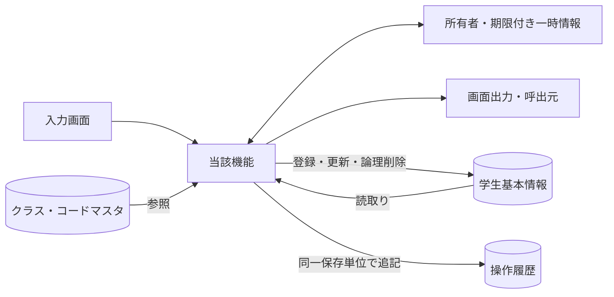

認証情報・業務日時は共通01～03から取得。マスタ保守の承認入力ファイルは画面機能のIOに含めず、方式別共通仕様に定義する。

## 項目一覧

| 項目ID | グループ | 論理項目名 | 種類 | 入出力 | 入力最大長 | 保存・正規化最大長 | 長さ単位 | 必須区分 | 必須条件 | 初期値 | 未設定値 | 表示形式・許容範囲 | 関連論理DB項目 | 候補ID | 正規化ID | チェックID | 関連イベント | DB連携説明 |
| --- | --- | --- | --- | --- | --- | --- | --- | --- | --- | --- | --- | --- | --- | --- | --- | --- | --- | --- |
| REG-001 | 基本 | 学生管理番号 | 表示 | O（表示） | 非適用 | 非適用 | 非適用 | 自動表示 | 入力対象外。取得結果または計算値を表示 | システム設定 | 表示欠損は－、マスタ欠落は不整合表示 | ID正の整数 | 学生基本情報・学生管理番号 | － | 非適用 | 非適用 | EV-REG-001,EV-REG-002 | 表示のみ、登録時自動採番 |
| REG-002 | 基本 | 学籍番号 | 文字入力 | I/O（表示・保存） | 15 | 15 | Unicodeスカラー値 | 必須 | 新規登録時。既存は表示のみ・変更不可 | 新規は空／未設定 | 不可 | 15文字以内 | 学生基本情報・学籍番号 | － | N-06 | CHK-001,CHK-002,CHK-003,CHK-004 | EV-REG-004 | 新規のみ設定。登録後不変、削除済み含め一意 |
| REG-003 | 基本 | 氏名 | 文字入力 | I/O（表示・保存） | 8 | 8 | Unicodeスカラー値 | 必須 | 通常保存時 | 新規は空／未設定 | 不可 | 8文字以内 | 学生基本情報・学生氏名 | － | N-02 | CHK-001,CHK-002,CHK-005 | EV-REG-004 | N-02、原表記を保存 |
| REG-004 | 基本 | 氏名カナ | 文字入力 | I/O（表示・保存） | 36 | 18 | Unicodeスカラー値 | 必須 | 通常保存時 | 新規は空／未設定 | 不可 | 原入力36文字以内、正規化後18文字以内 | 学生基本情報・学生氏名カナ | － | N-04,N-05 | CHK-001,CHK-002,CHK-006,CHK-005 | EV-REG-004 | N-04、全角カナ18文字 |
| REG-005 | 基本 | 生年月日 | 和暦日付 | I/O（表示・保存） | 元号10・年4・月2・日2 | 日付 | 年4桁・ISO10文字 | 必須 | 元号・年・月・日すべて。新規は全部空 | 新規は空／未設定 | 不可 | 和暦（DATE-R01） | 学生基本情報・生年月日 | 元号 | N-11 | CHK-001,CHK-007,CHK-008,CHK-032,CHK-033 | EV-REG-004 | 和暦入力→厳密変換→日付保存、DATE-R01 |
| REG-006 | 基本 | 性別 | 選択 | I/O（表示・保存） | 1 | 1 | 数字またはASCII文字 | 必須 | 未回答を0として許容。NULL不可 | 0（未回答） | 不可 | 数字1桁。候補一覧の分類・値 | 学生基本情報・性別 | 性別 | N-07 | CHK-010,CHK-011 | EV-REG-004 | コード値保存／性別分類のコード名称表示 |
| REG-007 | 住所 | 郵便番号 | 文字入力 | I/O（表示・保存） | 10 | 7 | Unicodeスカラー値 | 必須 | 通常保存時 | 新規は空／未設定 | 不可 | 入力10文字、保存7桁 | 学生基本情報・郵便番号 | － | N-08 | CHK-001,CHK-002,CHK-016 | EV-REG-004 | N-08、数字7桁保存、3桁－4桁表示 |
| REG-008 | 住所 | 都道府県 | 選択 | I/O（表示・保存） | 2 | 2 | 数字またはASCII文字 | 必須 | 通常保存時 | 新規は空／未設定 | 不可 | 数字2桁。候補一覧の分類・値 | 学生基本情報・都道府県 | 都道府県 | N-07 | CHK-001,CHK-010,CHK-011 | EV-REG-004 | コード値保存／都道府県分類の名称表示 |
| REG-009 | 住所 | 住所1 | 文字入力 | I/O（表示・保存） | 45 | 45 | Unicodeスカラー値 | 必須 | 通常保存時 | 新規は空／未設定 | 不可 | 45文字以内 | 学生基本情報・住所1 | － | N-02 | CHK-001,CHK-002 | EV-REG-004 | N-02、市区町村・番地、45文字 |
| REG-010 | 住所 | 住所2 | 文字入力 | I/O（表示・保存） | 45 | 45 | Unicodeスカラー値 | 任意 | 空白除去後空はNULL | 新規は空／未設定 | NULL相当 | 45文字以内 | 学生基本情報・住所2 | － | N-02 | CHK-002 | EV-REG-004 | N-02、任意45文字、空は未設定 |
| REG-011 | 連絡先 | 本人電話 | 文字入力 | I/O（表示・保存） | 20 | 16 | Unicodeスカラー値 | 条件付き | 本人電話・本人メール・緊急電話のいずれか1つ以上 | 新規は空／未設定 | NULL相当 | 原入力20文字以内、正規化後16文字以内 | 学生基本情報・本人電話 | － | N-09 | CHK-002,CHK-017,CHK-019 | EV-REG-004 | N-09、連絡手段条件あり |
| REG-012 | 連絡先 | 本人メール | 文字入力 | I/O（表示・保存） | 60 | 60 | Unicodeスカラー値 | 条件付き | 本人電話・本人メール・緊急電話のいずれか1つ以上 | 新規は空／未設定 | NULL相当 | 60文字以内 | 学生基本情報・本人メール | － | N-10 | CHK-002,CHK-018,CHK-019 | EV-REG-004 | N-10、連絡手段条件あり |
| REG-013 | 在籍 | 入学日 | 西暦日付 | I/O（表示・保存） | 10 | 日付 | 年4桁・ISO10文字 | 必須 | 通常保存時。生年月日以上・業務日以下 | 新規は空／未設定 | 不可 | 西暦yyyy/MM/dd、入力yyyy-MM-dd、DATE-R02 | 学生基本情報・入学日 | － | N-11 | CHK-001,CHK-007,CHK-008,CHK-033 | EV-REG-004 | 西暦入力・表示、DATE-R02 |
| REG-014 | 在籍 | 在籍区分 | 選択 | I/O（表示・保存） | 2 | 2 | 数字またはASCII文字 | 必須 | 01在学・02休学・03卒業・04退学 | 01（在学） | 不可 | 数字2桁。候補一覧の分類・値 | 学生基本情報・在籍区分 | 在籍区分 | N-07 | CHK-001,CHK-010,CHK-011,CHK-009,CHK-026 | EV-REG-004 | 値保存／在籍区分分類の名称表示 |
| REG-015 | 在籍 | 卒業・退学日 | 西暦日付 | I/O（表示・保存） | 10 | 日付 | 年4桁・ISO10文字 | 条件付き | 03・04で必須、01・02ではNULL | 新規は空／未設定 | NULL相当 | 西暦yyyy/MM/dd、入力yyyy-MM-dd、DATE-R02 | 学生基本情報・卒業・退学日 | － | N-11 | CHK-007,CHK-009,CHK-033 | EV-REG-004 | 西暦。03/04で必須、01/02は未設定 |
| REG-016 | 所属補助 | 年度 | 選択 | I/O（選択補助・保存なし） | 4 | 保存なし | 数字またはASCII文字 | 任意 | 選択補助。値があれば年度範囲・クラス実値を検査 | 当年度 | NULL相当 | 西暦1900～9998 | 選択補助：クラスマスタ・学校年度 | 年度 | N-11 | CHK-010,CHK-014,CHK-034 | EV-REG-004 | 選択補助・整合検査のみ。学生へ保存しない |
| REG-017 | 所属補助 | 学年 | 選択 | I/O（選択補助・保存なし） | 2 | 保存なし | 数字またはASCII文字 | 任意 | 選択補助。値があればコード存在とクラス実値を検査 | すべて | NULL相当 | 数字2桁。候補一覧の分類・値 | 選択補助：クラスマスタ・学年 | 学年 | N-07 | CHK-010,CHK-014 | EV-REG-004 | 選択補助。学年名称は学年分類のコード名称 |
| REG-018 | 所属 | クラス | 選択 | I/O（表示・保存） | ID桁 | ID | 数字またはASCII文字 | 条件付き | 01・02で必須、03・04は任意 | 新規は空／未設定 | NULL相当 | 正の整数。型範囲は方式別DB定義 | 学生基本情報・現在・最終所属クラス | クラス | 非適用 | CHK-010,CHK-012,CHK-013,CHK-014,CHK-015,CHK-031 | EV-REG-004 | 識別番号保存／年度・学年・コード・名称表示 |
| REG-019 | 所属 | 所属人数・定員 | 表示 | O（表示） | 非適用 | 非適用 | 非適用 | 自動表示 | 入力対象外。取得結果または計算値を表示 | システム設定 | 表示欠損は－、マスタ欠落は不整合表示 | 人数は非負整数・定員1～9999またはNULL | 集計：学生基本情報・在籍区分／クラス、クラスマスタ・定員 | － | 非適用 | 非適用 | EV-REG-004 | 非削除01/02の参考人数。確保予約ではない |
| REG-020 | 緊急 | 緊急連絡先氏名 | 文字入力 | I/O（表示・保存） | 8 | 8 | Unicodeスカラー値 | 条件付き | 緊急氏名・続柄・電話のいずれか入力時は全3項目必須 | 新規は空／未設定 | NULL相当 | 8文字以内 | 学生基本情報・緊急連絡先氏名 | － | N-02 | CHK-002,CHK-020 | EV-REG-004 | 緊急3項目は全部入力または全部未設定 |
| REG-021 | 緊急 | 緊急連絡先続柄 | 選択 | I/O（表示・保存） | 2 | 2 | 数字またはASCII文字 | 条件付き | 緊急氏名・続柄・電話のいずれか入力時は全3項目必須 | 新規は空／未設定 | NULL相当 | 数字2桁。候補一覧の分類・値 | 学生基本情報・緊急連絡先続柄 | 続柄 | N-07 | CHK-010,CHK-011,CHK-020 | EV-REG-004 | 続柄値・名称を対応。未選択なら続柄分類もNULL、選択時は分類を処理設定（UPD-103） |
| REG-022 | 緊急 | 緊急連絡先電話 | 文字入力 | I/O（表示・保存） | 20 | 16 | Unicodeスカラー値 | 条件付き | 緊急氏名・続柄・電話のいずれか入力時は全3項目必須 | 新規は空／未設定 | NULL相当 | 原入力20文字以内、正規化後16文字以内 | 学生基本情報・緊急連絡先電話 | － | N-09 | CHK-002,CHK-017,CHK-019,CHK-020 | EV-REG-004 | N-09、緊急3項目一式 |
| REG-023 | その他 | 備考 | 文字入力 | I/O（表示・保存） | 120 | 120 | Unicodeスカラー値 | 任意 | 空白除去後空はNULL。LF改行可 | 新規は空／未設定 | NULL相当 | 120文字以内 | 学生基本情報・備考 | － | N-01 | CHK-002 | EV-REG-004 | プレーンテキスト、120文字、改行可 |
| REG-024 | 確認 | 確認・変更理由 | 文字入力 | I（関連保存） | 60 | 60 | Unicodeスカラー値 | 条件付き | 重複確認続行、卒業・退学からの区分訂正時に必須 | 新規は空／未設定 | NULL相当 | 60文字以内 | 関連保存：操作履歴・操作・確認理由 | － | N-01 | CHK-002,CHK-025,CHK-026 | EV-REG-005 | 警告続行・終了区分訂正時必須、60文字 |
| REG-025 | 更新情報 | 更新日時・更新者 | 表示 | O（表示） | 非適用 | 非適用 | 非適用 | 自動表示 | 入力対象外。取得結果または計算値を表示 | システム設定 | 表示欠損は－、マスタ欠落は不整合表示 | 日時19文字・更新者64文字 | 表示：学生基本情報・更新日時／更新者 | － | 非適用 | 非適用 | EV-REG-002 | システム設定。西暦日時、日本時間 |
| REG-026 | 削除確認 | 削除理由 | 文字入力 | I（関連保存） | 60 | 60 | Unicodeスカラー値 | 条件付き | 論理削除イベントで必須。通常保存では使用しない | 新規は空／未設定 | NULL相当 | 60文字以内 | 保存：学生基本情報・削除理由／操作履歴・操作・確認理由 | － | N-01 | CHK-001,CHK-002,CHK-027 | EV-REG-006 | 削除時のみ、60文字、編集中の業務値は保存しない |
| REG-027 | 操作・確認 | 登録／更新 | 操作 | 操作／表示 | 非適用 | 非適用 | 非適用 | 非適用 | 表示または操作項目 | 権限・モードに従う | 非適用 | ― | DB保存なし（呼出処理はイベント仕様） | － | 非適用 | 非適用 | EV-REG-004 | 保存処理を呼ぶ |
| REG-028 | 操作・確認 | 入力クリア／編集取消 | 操作 | 操作／表示 | 非適用 | 非適用 | 非適用 | 非適用 | 表示または操作項目 | 権限・モードに従う | 非適用 | ― | DB保存なし（呼出処理はイベント仕様） | － | 非適用 | 非適用 | EV-REG-007 | 新規は初期値、既存は読込時値 |
| REG-029 | 操作・確認 | 最新情報を再読込 | 操作 | 操作／表示 | 非適用 | 非適用 | 非適用 | 非適用 | 表示または操作項目 | 権限・モードに従う | 非適用 | ― | DB保存なし（呼出処理はイベント仕様） | － | 非適用 | 非適用 | EV-REG-007 | 確認後にDB最新値を取得 |
| REG-030 | 操作・確認 | 検索へ戻る | 操作 | 操作／表示 | 非適用 | 非適用 | 非適用 | 非適用 | 表示または操作項目 | 権限・モードに従う | 非適用 | ― | DB保存なし（呼出処理はイベント仕様） | － | 非適用 | 非適用 | EV-REG-007 | 未保存破棄確認後に復帰 |
| REG-031 | 操作・確認 | 論理削除 | 操作 | 操作／表示 | 非適用 | 非適用 | 非適用 | 非適用 | 表示または操作項目 | 権限・モードに従う | 非適用 | ― | DB保存なし（呼出処理はイベント仕様） | － | 非適用 | 非適用 | EV-REG-006 | 管理者のみ、理由・明示確認 |
| REG-032 | 操作・確認 | 重複候補一覧 | 表示 | 操作／表示 | 非適用 | 非適用 | 非適用 | 自動表示 | 入力対象外。取得結果または計算値を表示 | 権限・モードに従う | 表示欠損は－、マスタ欠落は不整合表示 | 最大20行、全候補件数は別表示 | 学生基本情報・学籍番号／学生氏名／生年月日／所属クラス | － | 非適用 | 非適用 | EV-REG-005 | 全候補件数＋最大20件、個人情報を最小化 |
| REG-033 | 操作・確認 | 別人と確認して続行 | 操作 | 操作／表示 | 非適用 | 非適用 | 非適用 | 非適用 | 表示または操作項目 | 権限・モードに従う | 非適用 | ― | DB保存なし（呼出処理はイベント仕様） | － | 非適用 | 非適用 | EV-REG-005 | 理由・確認情報付きで保存を再検証 |
| REG-034 | 操作・確認 | 確認取消 | 操作 | 操作／表示 | 非適用 | 非適用 | 非適用 | 非適用 | 表示または操作項目 | 権限・モードに従う | 非適用 | ― | DB保存なし（呼出処理はイベント仕様） | － | 非適用 | 非適用 | EV-REG-005 | 入力へ戻る。DB更新なし |

## 選択候補一覧

| 候補ID | 参照元・分類 | 選択値 | 表示値 | 抽出条件 | 表示順 | 初期値・連動 |
| --- | --- | --- | --- | --- | --- | --- |
| 年度 | クラスマスタ・学校年度 | 学校年度 | 年度 | 停止・過去年度を含め範囲1900～9998。新規登録は当年度を選択補助へ | 年度降順 | 検索すべて／登録当年度、クラス0件を区別 |
| 学年 | コード管理マスタ（学年） | 学年コード値 | コード名称 | 検索は停止を含む。新規選択は有効値、既存値は別枠保持 | 表示順→コード値 | すべて。学年なし00は未所属と別 |
| クラス | クラスマスタ・コード管理マスタ（学年） | クラス管理番号 | 年度・学年・クラスコード・クラス名 | 検索は停止を含む。登録は共通モジュール07の新規所属／最終所属／既存保持の区別 | 年度降順→学年表示順→クラス表示順→コード→ID | 検索すべて／新規未選択。上位変更で不適合なら解除 |
| 在籍区分 | コード管理マスタ（在籍区分） | 在籍区分コード値 | コード名称 | 検索は分類内の値。登録の新規選択は有効値。01～04は保護 | 表示順→コード値 | 検索01・02／新規登録01、全解除検索は全区分 |
| 都道府県 | コード管理マスタ（都道府県） | 都道府県コード値 | コード名称 | 検索は停止を含む。登録新規選択は有効、既存同値は保持 | 表示順→コード値 | 検索すべて／登録未選択 |
| 性別 | コード管理マスタ（性別） | 性別コード値 | コード名称 | 新規選択は有効値。既存同値は保持。未回答0は保護 | 表示順→コード値 | 新規0、未回答を許容 |
| 続柄 | コード管理マスタ（緊急連絡先続柄） | 続柄コード値 | コード名称 | 新規選択は有効、既存同値は保持 | 表示順→コード値 | 未選択。緊急3項目一式 |
| 元号 | 共通日付仕様（文書07）・元号の変換定義（共通暦定義） | 共通定義の元号識別値 | 元号名 | 生年月日の許容範囲に重なる元号、業務日まで | 新しい元号順 | 未選択。変更時に年・月・日の範囲を再検証 |

## イベント仕様

### EV-REG-001 新規画面表示

#### 処理概要

作成権限のある利用者が新規モードを開く。

#### 処理手順

1. 共通01・02・03で権限と業務日時を確定。OP-CODE・OP-CLASSで候補と初期値の存在を確認する。
2. 性別0、在籍01、年度は当年度。他の値、特に生年月日・入学日を未入力にする。学生管理番号・版は未採番。
3. 必須コード不足は保存不可。クラス0件はW-STU-108。在学・休学はクラス設定まで保存不可だが卒業等の過去入力は妨げない。

#### 処理フロー

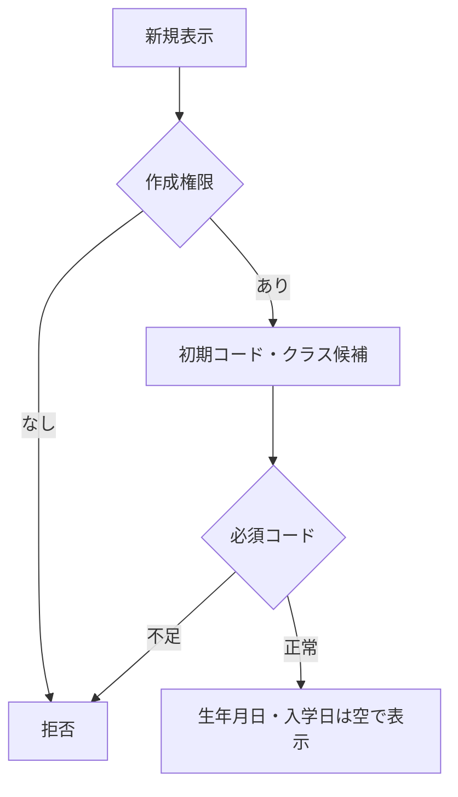

#### SQL・テーブル関連（ER図）

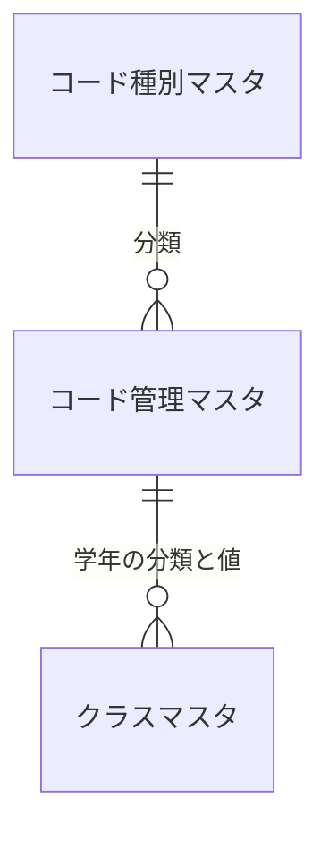

名称参照は未所属・停止値を残す外部結合相当。コードは用途ごとの別名で**分類と値**を結合する。図は読取りの関連であり、履歴への書込みや削除連動を意味しない。単独の存在確認・採番・書込みの表関連は下記操作IDで特定する。

#### DB操作の詳細

`OP-CODE` → `OP-CLASS`。下記「DB操作定義」の同名操作を実行する。保存系ではINSERTとUPDATEをモードで選択し、両方を実行しない。

#### 結果・例外時の扱い

入力不備は原入力保持、対象不在はE-STU-103、版競合はE-STU-105。確認待ちは保存を確定せず、変更なしはI-STU-004。成功通知は学生と履歴の確定確認後だけ。確定結果不明はE-COM-004と検索確認の案内。 各イベントで実行していない処理の結果状態は発生対象外。

### EV-REG-002 編集・参照画面表示

#### 処理概要

既存学生の識別番号で最新値を表示する。

#### 処理手順

1. OP-STUDENTへ学生管理番号を渡し非削除1件を取得。不在はE-STU-103、新規へ切替えない。
2. 学生・クラス・コード名称を取得し、元の値と更新管理番号を読込時スナップショットへ複製。編集値とは分離する。
3. 生年月日を和暦へ変換。学籍番号・管理項目は表示のみ、閲覧者は全項目表示のみ。停止・期間外の既存値を消さない。

#### 処理フロー

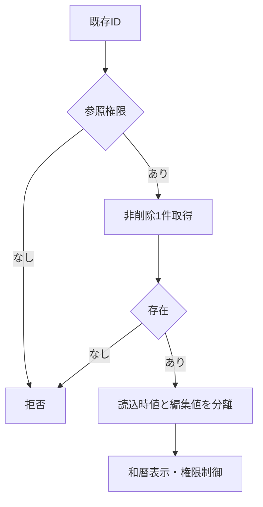

#### SQL・テーブル関連（ER図）

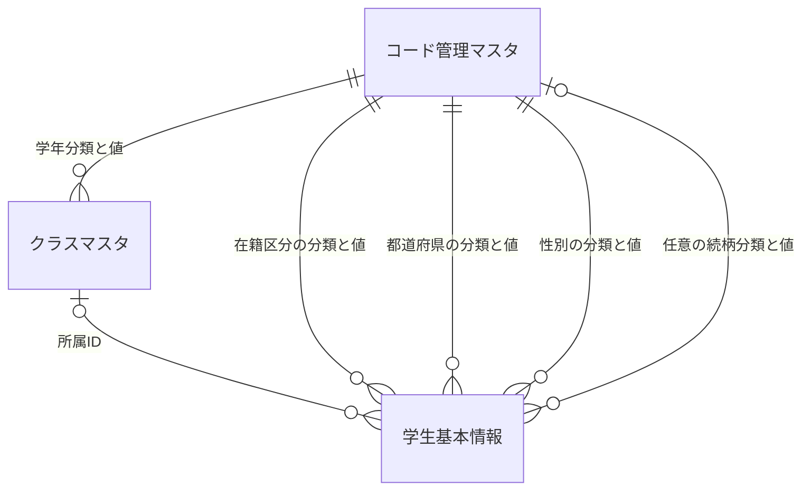

名称参照は未所属・停止値を残す外部結合相当。コードは用途ごとの別名で**分類と値**を結合する。図は読取りの関連であり、履歴への書込みや削除連動を意味しない。単独の存在確認・採番・書込みの表関連は下記操作IDで特定する。

#### DB操作の詳細

`OP-STUDENT` → `OP-CODE` → `OP-CLASS`。下記「DB操作定義」の同名操作を実行する。保存系ではINSERTとUPDATEをモードで選択し、両方を実行しない。

#### 結果・例外時の扱い

入力不備は原入力保持、対象不在はE-STU-103、版競合はE-STU-105。確認待ちは保存を確定せず、変更なしはI-STU-004。成功通知は学生と履歴の確定確認後だけ。確定結果不明はE-COM-004と検索確認の案内。 各イベントで実行していない処理の結果状態は発生対象外。

### EV-REG-003 入力補助

#### 処理概要

所属・在籍・生年月日の入力部品を連動させる。

#### 処理手順

1. 共通16・17で生年月日の元号・年・月・日を厳密検査。不正値を次元号・翌月へ補正せず原入力を保持する。
2. 在籍01/02はクラス必須・終了日なし、03/04は終了日必須・最終所属任意。終了区分からの訂正は権限・理由条件を表示する。
3. 年度・学年・区分変更に応じOP-CLASSで候補を再取得。不適合値解除を通知し、人数は参考表示とする。

#### 処理フロー

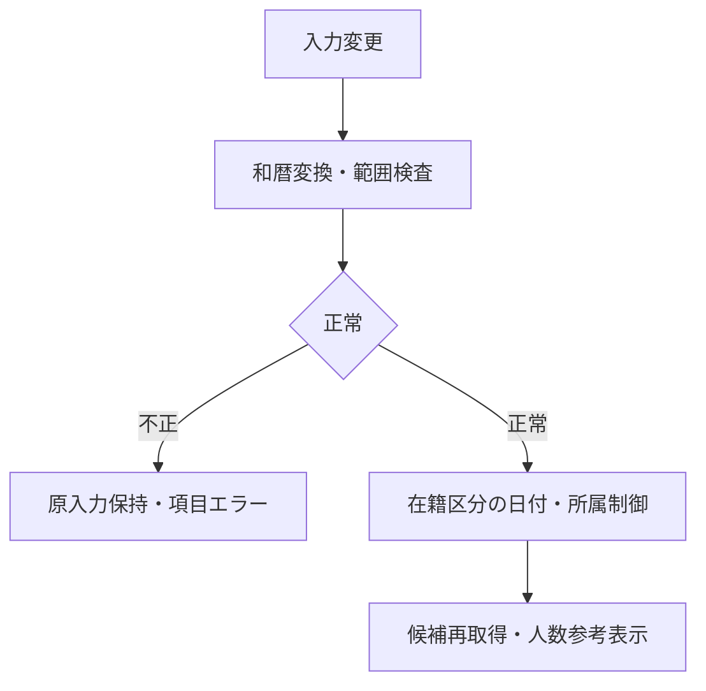

#### SQL・テーブル関連（ER図）

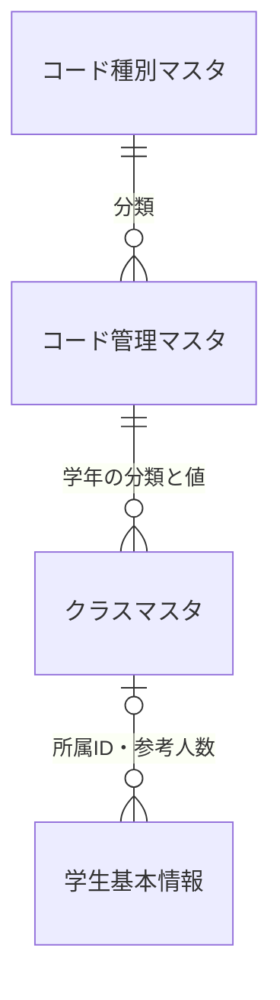

名称参照は未所属・停止値を残す外部結合相当。コードは用途ごとの別名で**分類と値**を結合する。図は読取りの関連であり、履歴への書込みや削除連動を意味しない。単独の存在確認・採番・書込みの表関連は下記操作IDで特定する。

#### DB操作の詳細

`OP-CLASS`。下記「DB操作定義」の同名操作を実行する。保存系ではINSERTとUPDATEをモードで選択し、両方を実行しない。

#### 結果・例外時の扱い

入力不備は原入力保持、対象不在はE-STU-103、版競合はE-STU-105。確認待ちは保存を確定せず、変更なしはI-STU-004。成功通知は学生と履歴の確定確認後だけ。確定結果不明はE-COM-004と検索確認の案内。 各イベントで実行していない処理の結果状態は発生対象外。

### EV-REG-004 新規登録・更新

#### 処理概要

検証済み学生1件と操作履歴1件を一括確定する。

#### 処理手順

1. 入力19業務項目を複製。和暦原入力は共通16で日付へ変換、共通04・05・17で正規化・必須・範囲・連絡手段を検査する。 続柄未選択なら分類もNULL、選択時は続柄分類を算定する。緊急一式４保存項目を変更なし比較・保存・監査へ渡す。
2. 共通13の短い保存単位内で同時保存制御を取得。既存モードのみOP-STUDENTを実行し、OP-EXISTSとともに最新存在・版・分類・クラス・日付・区分権限を再検証し、学籍番号不変・全行一意を確認する。
3. OP-CAPACITYで旧席から新席が増加する場合だけ定員を検査する。変更なしなら版・更新日時・履歴を増やさずI-STU-004。
4. OP-DUPで全候補と版を確認。未確認なら保存単位を終了して確認画面へ。確認待ちにDBロックを持たない。
5. OP-INSERTまたはOP-UPDATEで学生1件、OP-AUDITで履歴1件を確定。失敗は双方取消、成否不明は自動再送せず検索確認。

#### 処理フロー

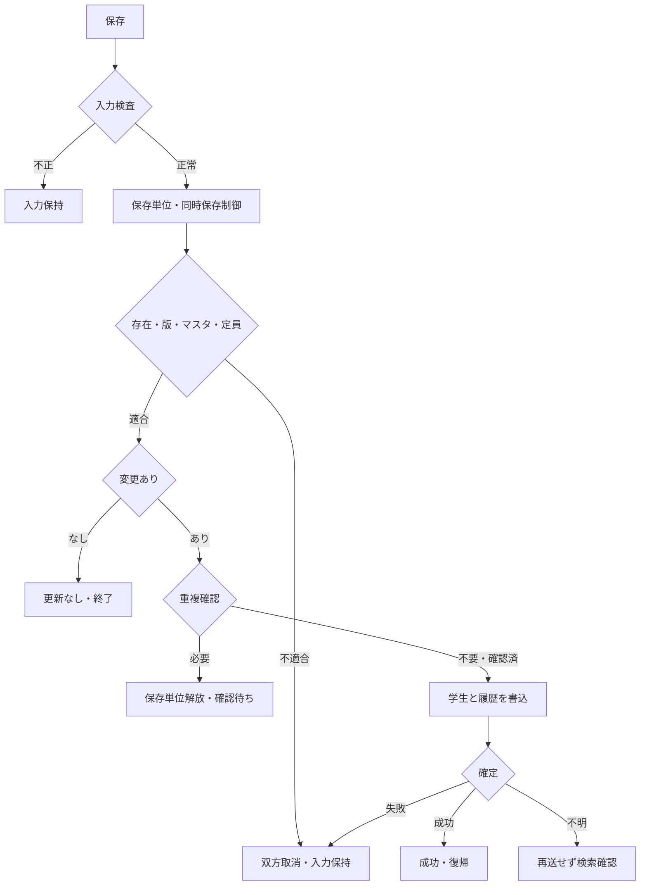

#### SQL・テーブル関連（ER図）

名称参照は未所属・停止値を残す外部結合相当。コードは用途ごとの別名で**分類と値**を結合する。図は読取りの関連であり、履歴への書込みや削除連動を意味しない。単独の存在確認・採番・書込みの表関連は下記操作IDで特定する。

#### DB操作の詳細

`OP-STUDENT` → `OP-EXISTS` → `OP-CAPACITY` → `OP-DUP` → `OP-INSERT` → `OP-UPDATE` → `OP-AUDIT`。下記「DB操作定義」の同名操作を実行する。保存系ではINSERTとUPDATEをモードで選択し、両方を実行しない。

#### 結果・例外時の扱い

入力不備は原入力保持、対象不在はE-STU-103、版競合はE-STU-105。確認待ちは保存を確定せず、変更なしはI-STU-004。成功通知は学生と履歴の確定確認後だけ。確定結果不明はE-COM-004と検索確認の案内。 各イベントで実行していない処理の結果状態は発生対象外。

### EV-REG-005 重複候補の確認続行・取消

#### 処理概要

別人確認と理由を保存処理へ引き渡す。

#### 処理手順

1. 候補は全件数と最大20件の学籍番号・氏名・和暦生年月日・クラスのみ。既定操作は取消。
2. 続行では共通11により本人・認証状態・対象・旧版・正規化内容・全候補IDと版・10分期限を照合。相違はW-STU-102で再確認する。
3. 理由を付けEV-REG-004を再実行し全検査を行う。取消は入力画面に留まりDB更新なし。

#### 処理フロー

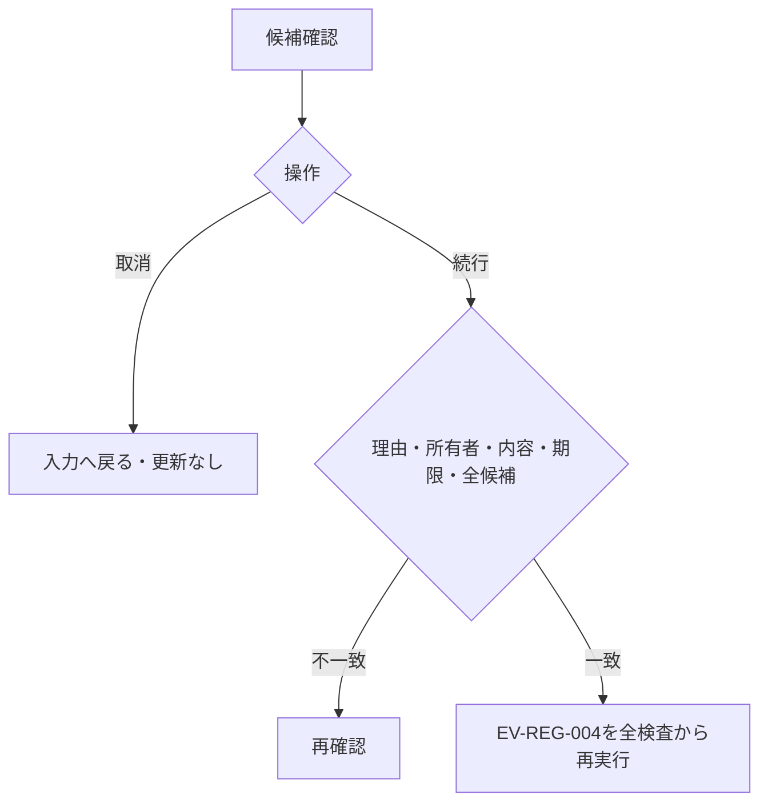

#### SQL・テーブル関連（ER図）

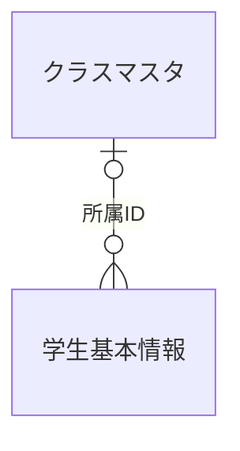

名称参照は未所属・停止値を残す外部結合相当。コードは用途ごとの別名で**分類と値**を結合する。図は読取りの関連であり、履歴への書込みや削除連動を意味しない。単独の存在確認・採番・書込みの表関連は下記操作IDで特定する。

#### DB操作の詳細

`OP-DUP`。下記「DB操作定義」の同名操作を実行する。保存系ではINSERTとUPDATEをモードで選択し、両方を実行しない。

#### 結果・例外時の扱い

入力不備は原入力保持、対象不在はE-STU-103、版競合はE-STU-105。確認待ちは保存を確定せず、変更なしはI-STU-004。成功通知は学生と履歴の確定確認後だけ。確定結果不明はE-COM-004と検索確認の案内。 各イベントで実行していない処理の結果状態は発生対象外。

### EV-REG-006 論理削除

#### 処理概要

管理者が対象と理由を確認して通常検索から除外する。

#### 処理手順

1. 対象ID・読込時版・削除理由・明示確認のみを受ける。編集中の氏名・住所・生年月日等は保存しない。
2. 同時保存制御下でOP-STUDENTを再読込し権限・非削除・版を検証する。対象不在と版競合を区別する。
3. OP-DELETEで削除属性と更新管理情報だけを変更しOP-AUDITと一括確定。確定後に検索へ戻る。

#### 処理フロー

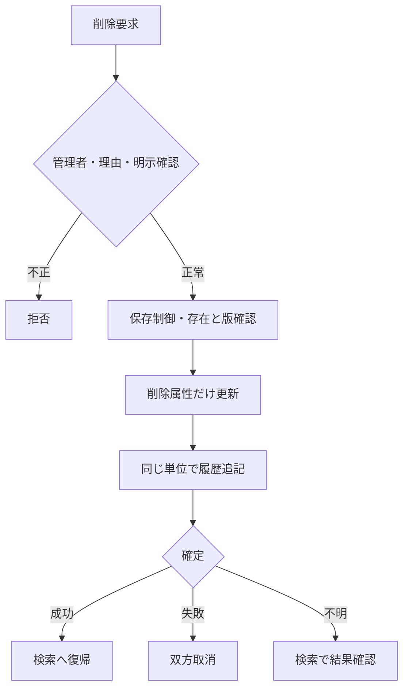

#### SQL・テーブル関連（ER図）

名称参照は未所属・停止値を残す外部結合相当。コードは用途ごとの別名で**分類と値**を結合する。図は読取りの関連であり、履歴への書込みや削除連動を意味しない。単独の存在確認・採番・書込みの表関連は下記操作IDで特定する。

#### DB操作の詳細

`OP-STUDENT` → `OP-DELETE` → `OP-AUDIT`。下記「DB操作定義」の同名操作を実行する。保存系ではINSERTとUPDATEをモードで選択し、両方を実行しない。

#### 結果・例外時の扱い

入力不備は原入力保持、対象不在はE-STU-103、版競合はE-STU-105。確認待ちは保存を確定せず、変更なしはI-STU-004。成功通知は学生と履歴の確定確認後だけ。確定結果不明はE-COM-004と検索確認の案内。 各イベントで実行していない処理の結果状態は発生対象外。

### EV-REG-007 取消・再読込・検索へ戻る

#### 処理概要

原入力の取消、最新取得、検索への復帰を区別する。

#### 処理手順

1. 新規クリアは初期値、編集取消は最後の読込時スナップショットへ戻す。DBから最新取得する処理ではない。
2. 再読込は明示確認後OP-STUDENTを実行し値と版をともに置換。競合時に版だけを最新にしない。
3. 戻る・ウィンドウ終了は未保存変更の破棄確認を行い、取消を既定とする。保存結果不明は再保存前の検索確認を案内する。

#### 処理フロー

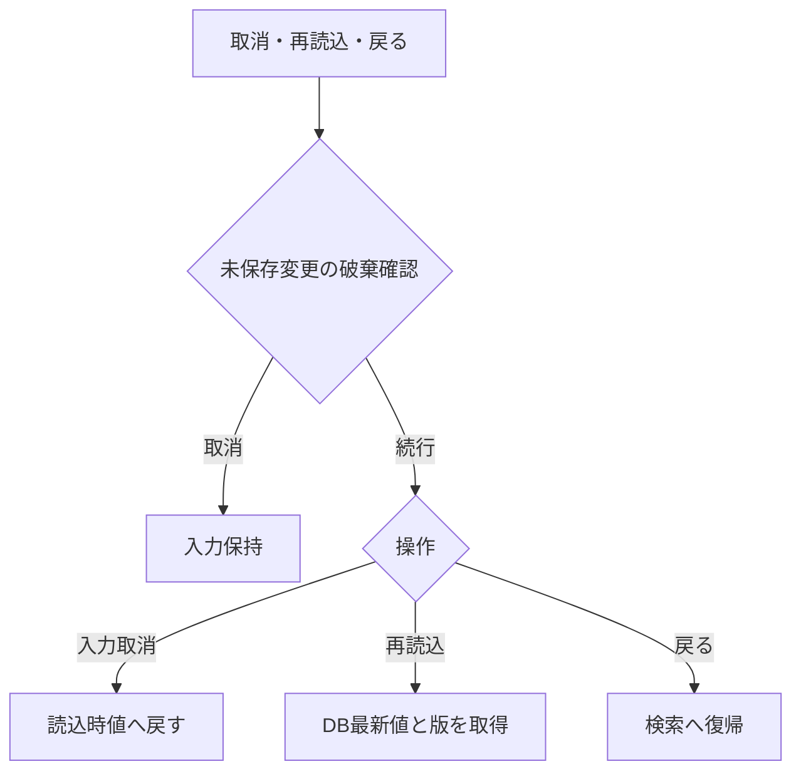

#### SQL・テーブル関連（ER図）

名称参照は未所属・停止値を残す外部結合相当。コードは用途ごとの別名で**分類と値**を結合する。図は読取りの関連であり、履歴への書込みや削除連動を意味しない。単独の存在確認・採番・書込みの表関連は下記操作IDで特定する。

#### DB操作の詳細

`OP-STUDENT`。下記「DB操作定義」の同名操作を実行する。保存系ではINSERTとUPDATEをモードで選択し、両方を実行しない。

#### 結果・例外時の扱い

入力不備は原入力保持、対象不在はE-STU-103、版競合はE-STU-105。確認待ちは保存を確定せず、変更なしはI-STU-004。成功通知は学生と履歴の確定確認後だけ。確定結果不明はE-COM-004と検索確認の案内。 各イベントで実行していない処理の結果状態は発生対象外。

### DB操作定義

操作の業務契約は[共通データアクセス](../共通/08_データアクセス仕様.md)が正本。本機能における具体的な対象・引数・確定単位は以下。

#### OP-CODE

| 項目 | 内容 |
| --- | --- |
| 対象テーブル | コード種別マスタ・コード管理マスタ |
| 操作 | 参照 |
| 実行条件・引数 | 分類、用途（検索／新規選択／既存表示）、既存値、業務日 |
| 取得・設定項目／対象条件 | 分類・値・名称・表示順・利用可否・期間。分類＋値で取得 |
| 件数・順序 | 候補0件を検出。既定値を先頭値へ代替しない |
| 確定・取消 | 参照のみ |

#### OP-CLASS

| 項目 | 内容 |
| --- | --- |
| 対象テーブル | クラスマスタ・コード管理マスタ（学年）・学生基本情報 |
| 操作 | 参照 |
| 実行条件・引数 | 用途、年度、学年、在籍区分、在籍期間、既存所属、業務日、人数参照要否 |
| 取得・設定項目／対象条件 | 年度・学年・クラスID・コード・名称・期間・定員。人数集計は登録側で要求した場合のみ。検索の候補取得では学生を集計しない |
| 件数・順序 | 年度降順、学年表示順、クラス表示順、クラスコード、ID |
| 確定・取消 | 参照のみ、人数は予約ではない |

#### OP-STUDENT

| 項目 | 内容 |
| --- | --- |
| 対象テーブル | 学生基本情報・クラスマスタ・コード管理マスタ |
| 操作 | 参照 |
| 実行条件・引数 | 対象学生ID |
| 取得・設定項目／対象条件 | 非削除の1件、全保存値・版・参照名称。名称はLEFT JOIN相当 |
| 件数・順序 | 0件E-STU-103、1件正常、複数件は整合性障害 |
| 確定・取消 | 画面読込は参照のみ。保存時の再検証は保存単位内 |

#### OP-EXISTS

| 項目 | 内容 |
| --- | --- |
| 対象テーブル | 学生基本情報・クラスマスタ・コード種別マスタ・コード管理マスタ |
| 操作 | 参照 |
| 実行条件・引数 | 用途（検索／保存）、分類付きコード・クラスID・選択補助。保存だけ対象ID・完全な学籍番号・期待版 |
| 取得・設定項目／対象条件 | 検索は指定在籍区分の分類付き存在とクラスID存在のみ。停止・期間外も可。学籍番号前方一致に重複・完全一致存在検査をしない。保存は全行学籍番号一意、分類付き存在、変更有無、有効性を再検査 |
| 件数・順序 | 未存在／重複／組合せ／停止を区別。未指定の検索条件は検査対象外 |
| 確定・取消 | 検索は参照のみ、保存は保護した最新値で確認 |

#### OP-CAPACITY

| 項目 | 内容 |
| --- | --- |
| 対象テーブル | 学生基本情報・クラスマスタ |
| 操作 | 参照 |
| 実行条件・引数 | 旧席、新席、対象学生ID |
| 取得・設定項目／対象条件 | 非削除01/02、自分以外の対象クラス人数と定員 |
| 件数・順序 | 新席が未設定でなく、旧席から追加・異動するときだけ人数＋1≦定員。卒業・退学・削除による席解放はこの加算検査をしない。定員未設定は制限なし |
| 確定・取消 | 保存制御取得後に判定、休学も1席 |

#### OP-DUP

| 項目 | 内容 |
| --- | --- |
| 対象テーブル | 学生基本情報・クラスマスタ |
| 操作 | 参照 |
| 実行条件・引数 | 日付型生年月日、氏名照合値、カナ照合値、自分ID |
| 取得・設定項目／対象条件 | 非削除かつ自分除外、同生年月日かつ氏名照合用情報または氏名カナ照合用情報一致 |
| 件数・順序 | 全ID・版をID順、表示は最大20件。クラス名は表示のみ |
| 確定・取消 | 確認照合は同時保存制御内、応答待ちは解放 |

#### OP-INSERT

| 項目 | 内容 |
| --- | --- |
| 対象テーブル | 学生基本情報 |
| 操作 | 登録 |
| 実行条件・引数 | 検証済み19入力、生成照合値2、固定分類、認証情報 |
| 取得・設定項目／対象条件 | 学生ID自動採番、版1、作成更新情報設定、未削除 |
| 件数・順序 | 必ず1件。学籍番号一意制約でも競合防止 |
| 確定・取消 | OP-AUDITと同一確定単位 |

#### OP-UPDATE

| 項目 | 内容 |
| --- | --- |
| 対象テーブル | 学生基本情報 |
| 操作 | 更新 |
| 実行条件・引数 | 対象ID、期待版、学籍番号以外18入力、生成照合値2 |
| 取得・設定項目／対象条件 | 対象ID＋期待版＋非削除。続柄分類を続柄と同時更新。作成情報・学籍番号・必須３分類・削除情報は変更なし |
| 件数・順序 | 更新1件。0件は存在再確認後不在／版競合に分離 |
| 確定・取消 | OP-AUDITと一括、版＋1。変更なしは実行しない |

#### OP-AUDIT

| 項目 | 内容 |
| --- | --- |
| 対象テーブル | 操作履歴 |
| 操作 | 登録 |
| 実行条件・引数 | 対象、操作、前後版、変更項目名、実行者・時点・理由・受付番号 |
| 取得・設定項目／対象条件 | 変更した変更項目名だけ。個人情報の値はコピーしない |
| 件数・順序 | 実際の変更1件につき履歴1件。追記専用 |
| 確定・取消 | 業務変更と同じ接続・保存単位。失敗は双方取消 |

#### OP-DELETE

| 項目 | 内容 |
| --- | --- |
| 対象テーブル | 学生基本情報 |
| 操作 | 更新（論理削除） |
| 実行条件・引数 | 対象ID、期待版、理由、認証情報 |
| 取得・設定項目／対象条件 | 削除状態・日時・者・理由、更新日時・者・版だけ変更 |
| 件数・順序 | 更新1件。編集中の一般項目を含めない |
| 確定・取消 | 物理DELETEではない。OP-AUDITと一括 |

### 業務判断の決定表

#### 主要な業務チェック

| チェック | 判定 | 結果 |
| --- | --- | --- |
| 学籍番号重複 | 削除済みを含む全学生で使用済み | 保存不可。番号の再利用も不可 |
| 同一人物候補 | 非削除の他学生と生年月日が同じ、氏名またはカナの照合値が同じ | 別人確認・理由付きなら保存可 |
| コード存在 | 正しい分類内に値がある | 不存在は保存不可 |
| コード利用可否 | 新規・変更する値が有効・期間内 | 不可値は保存不可。既存の同値保持は可 |
| クラス存在 | 選択クラスが実在し年度・学年が一致 | 不存在・不一致は保存不可 |
| 日付 | 生年月日≦入学日≦本日、終了日も本日以前 | 不整合は保存不可 |
| 連絡手段 | 本人電話・メール・緊急電話の1つ以上 | 不足は保存不可 |
| 緊急連絡先 | 氏名・続柄・電話を全部空または全部入力 | 一部だけは保存不可 |
| 他者の更新 | 画面読込後に別操作が更新済み | 上書きせずエラー。入力を保持 |
| 理由 | 必要な操作で空白でない60文字以内 | 不足は保存不可 |

#### クラス選択・定員の決定表

| 保存後の状態・変更 | クラス要否・利用規則 | 定員 |
| --- | --- | --- |
| 新規の在学・休学、別クラスへの異動、卒業等から在学へ訂正 | 必須。利用可かつ本日が利用期間内 | 自分を除いた在学・休学人数＋1が定員以下 |
| 在学・休学のまま同じクラスを保持 | 存在必須。期間外等でも住所などの変更は可、見直し警告 | 席が増えないため既存の超過だけでは拒否しない |
| 新規の卒業・退学 | 任意。指定するならクラス利用期間と入学～終了日の期間が重なる | 席を消費しない |
| 卒業・退学の最終所属・在籍日付・区分を変更 | 停止・過去クラスも可。指定した期間の重なりを確認 | 席を消費しない |
| 卒業・退学の最終所属・在籍日付・区分を変えず住所等だけ変更 | 既存値を保持できる | 席を消費しない |
| 論理削除 | 元のクラス情報を保持 | 削除後は人数に含めない |

休学も1席を使用する。定員未設定は制限なし。定員40人に対し39人在籍で同時に2人を登録した場合は片方だけ保存でき、超過させない。期間の重なりは1日以上あればよく、卒業日がクラス利用期間内に入ることまでは必須にしない。

#### 在籍区分の状態遷移

| 変更前 | 変更後 | 実行者・条件 |
| --- | --- | --- |
| 在学・休学 | 在学・休学・卒業・退学 | 担当者または管理者。変更後の日付・クラス規則を満たす |
| 卒業・退学 | 同一区分 | 担当者または管理者。通常項目の訂正可 |
| 卒業・退学 | 別区分 | 管理者のみ。確認・変更理由が必須 |
| 新規 | 任意の4区分 | 担当者または管理者。過去データ登録を認める |

在籍区分は日付到来だけで自動変更しない。再入学や年度別履歴は本版に含まない。

## 項目更新仕様

| 更新ID | 項目ID | 対象 | 登録 | 更新 | 論理削除 | 規則・設定元 |
| --- | --- | --- | --- | --- | --- | --- |
| UPD-002 | REG-002 | 学生基本情報・学籍番号 | 検証済み入力値 | 変更なし | 変更なし | 新規のみ設定。登録後不変、削除済み含め一意 |
| UPD-003 | REG-003 | 学生基本情報・学生氏名 | 検証済み入力値 | 同左。空の任意値は未設定で上書き | 変更なし | N-02、原表記を保存 |
| UPD-004 | REG-004 | 学生基本情報・学生氏名カナ | 検証済み入力値 | 同左。空の任意値は未設定で上書き | 変更なし | N-04、全角カナ18文字 |
| UPD-005 | REG-005 | 学生基本情報・生年月日 | 検証済み入力値（生年月日は日付へ変換） | 同左。空の任意値は未設定で上書き | 変更なし | 和暦入力→厳密変換→日付保存、DATE-R01 |
| UPD-006 | REG-006 | 学生基本情報・性別 | 検証済み入力値 | 同左。空の任意値は未設定で上書き | 変更なし | コード値保存／性別分類のコード名称表示 |
| UPD-007 | REG-007 | 学生基本情報・郵便番号 | 検証済み入力値 | 同左。空の任意値は未設定で上書き | 変更なし | N-08、数字7桁保存、3桁－4桁表示 |
| UPD-008 | REG-008 | 学生基本情報・都道府県 | 検証済み入力値 | 同左。空の任意値は未設定で上書き | 変更なし | コード値保存／都道府県分類の名称表示 |
| UPD-009 | REG-009 | 学生基本情報・住所1 | 検証済み入力値 | 同左。空の任意値は未設定で上書き | 変更なし | N-02、市区町村・番地、45文字 |
| UPD-010 | REG-010 | 学生基本情報・住所2 | 検証済み入力値 | 同左。空の任意値は未設定で上書き | 変更なし | N-02、任意45文字、空は未設定 |
| UPD-011 | REG-011 | 学生基本情報・本人電話 | 検証済み入力値 | 同左。空の任意値は未設定で上書き | 変更なし | N-09、連絡手段条件あり |
| UPD-012 | REG-012 | 学生基本情報・本人メール | 検証済み入力値 | 同左。空の任意値は未設定で上書き | 変更なし | N-10、連絡手段条件あり |
| UPD-013 | REG-013 | 学生基本情報・入学日 | 検証済み入力値 | 同左。空の任意値は未設定で上書き | 変更なし | 西暦入力・表示、DATE-R02 |
| UPD-014 | REG-014 | 学生基本情報・在籍区分 | 検証済み入力値 | 同左。空の任意値は未設定で上書き | 変更なし | 値保存／在籍区分分類の名称表示 |
| UPD-015 | REG-015 | 学生基本情報・卒業・退学日 | 検証済み入力値 | 同左。空の任意値は未設定で上書き | 変更なし | 西暦。03/04で必須、01/02は未設定 |
| UPD-018 | REG-018 | 学生基本情報・現在・最終所属クラス | 検証済み入力値 | 同左。空の任意値は未設定で上書き | 変更なし | 識別番号保存／年度・学年・コード・名称表示 |
| UPD-020 | REG-020 | 学生基本情報・緊急連絡先氏名 | 検証済み入力値 | 同左。空の任意値は未設定で上書き | 変更なし | 緊急3項目は全部入力または全部未設定 |
| UPD-021 | REG-021 | 学生基本情報・緊急連絡先続柄 | 検証済み入力値 | 同左。空の任意値は未設定で上書き | 変更なし | 続柄値・名称を対応。未選択なら続柄分類もNULL、選択時は分類を処理設定（UPD-103） |
| UPD-022 | REG-022 | 学生基本情報・緊急連絡先電話 | 検証済み入力値 | 同左。空の任意値は未設定で上書き | 変更なし | N-09、緊急3項目一式 |
| UPD-023 | REG-023 | 学生基本情報・備考 | 検証済み入力値 | 同左。空の任意値は未設定で上書き | 変更なし | プレーンテキスト、120文字、改行可 |
| UPD-101 | REG-003／004 | 氏名・氏名カナ照合用情報 | 共通04で生成 | 元の氏名等から再生成 | 変更なし | 入力された照合値を信用しない |
| UPD-102 | REG-001 | 学生管理番号 | 自動採番 | 変更なし | 変更なし | 最大値＋1は禁止 |
| UPD-103 | ― | 性別・都道府県・在籍区分・続柄のコード分類 | 必須３分類を固定設定。続柄未選択は分類もNULL、選択時のみ続柄分類を設定 | 必須３分類は維持。続柄分類は続柄と同時に設定／NULL化 | 変更なし | 利用者入力を受けず保存側で算定。新規・更新の派生値と変更列監査を一致 |
| UPD-104 | ― | 作成日時・作成者 | 共通03・01 | 変更なし | 変更なし | システム設定 |
| UPD-105 | REG-025 | 更新日時・更新者・更新管理番号 | 実行時点・実行者・1 | 実変更時だけ実行時点・実行者・版＋1 | 同左 | 期待版一致が条件、変更なしでは更新しない |
| UPD-106 | REG-026／031 | 削除状態・削除日時・削除者・削除理由 | 未削除、削除属性未設定 | 変更なし | 削除済・実行時点・実行者・検査済理由 | 削除時に一般入力を保存しない |
| UPD-107 | REG-024／026 | 操作履歴 | 前版未設定・後版1・操作新規 | 前後版・変更項目名・操作更新 | 前後版・変更項目名・操作論理削除 | 対象識別、実行者時点、理由、受付番号、重複確認有無。値は複写しない |

## 補足説明

同じ電話・メールを家族で共有しても登録可能とし、連絡先の重複だけでは拒否しない。学籍番号や氏名の検索・比較に使う文字変換は共通仕様に従う。個人情報の保存期間、削除復元、物理消去は運用要件の確認事項であり、論理削除を永久保存の承認とは扱わない。

関連：[論理テーブル](03_テーブル仕様書.md)／[コード](04_コード設計書.md)／[共通チェック](../共通/05_チェック・メッセージ設計.md)

### 正本・受入観点

共通業務は共通03・05・07・08、技術実装は方式別詳細を正本とする。顧客IT部門は入出力、権限、画面とDBの追跡、競合・障害時結果を確認する。言語の構文説明は本書に含めない。

[適合試験一覧](../共通/06_要件対応・設計判断.md)とレビュー結果を参照。

### 項目と一覧章の扱い

項目一覧・選択候補一覧は表だけのLIST章とする。入力上限、保存上限、必須区分と条件を区別する。項目IDは前版のまま。詳細の内部項目は同じ論理項目の細分化であり新たな業務機能ではない。

### 更新表の補足

EV-REG-004・006から呼び出す。新規19入力、通常更新18入力（学籍番号以外）、生成照合値2の対応を固定する。更新・削除は対象ID＋期待版＋非削除で1件を要求し、0件の場合は不在／競合を区別する。

## Windows認証なしサンプル

| 項目 | 本方式での適用 |
| --- | --- |
| 利用者指定 | 「Windowsで実行できる環境を想定する」「サンプルのため、認証はしない」 |
| 実行前提 | Windows x64／GnuCOBOL 3.2／同bit C／Windows標準ConsoleとWin32 W API／Windows ODBC Driver18。Linux・unixODBC・pkg-configの必須前提を置換する |
| 認証の例外 | このサンプルではログイン・Windows token・利用者/role mappingを行わず、実行側が固定actor `sample-user`、固定操作role `Administrator` を設定する。全サンプル機能確認用であり、本番認証・認可への適合を主張しない。一般の認証/権限表と用語は、本サンプルではこの例外を適用して読む |
| 信頼境界 | actor/role/sessionを端末rawまたはREMOTE_USER/ST_TRUSTED_ROLEから受付けない。DB接続の権限・TLS・保存時の業務検査・期待版・理由・同時保存・監査は維持する |
| 状態 | 接続ごとのCSPRNG32byte・64桁hex session、画面instance・要求ID・期待Revision・期限を照合。検索30分・確認10分。実キー活動だけがidle期限を更新し、timerでは延長しない。idle30分で失効し、終了/切断/再起動/別プロセスへ引き継がない |
| 正本と未実施 | [Windows実行環境](../共通/方式別/02_Windows実行環境.md)を適用。QA-AUTHは本サンプルで対象外、QA-TEXT-COBOLはOS/技術選定済み・実glyph/IME/キー適合未検証。実DB・本番受入・正式採点は未実施 |
