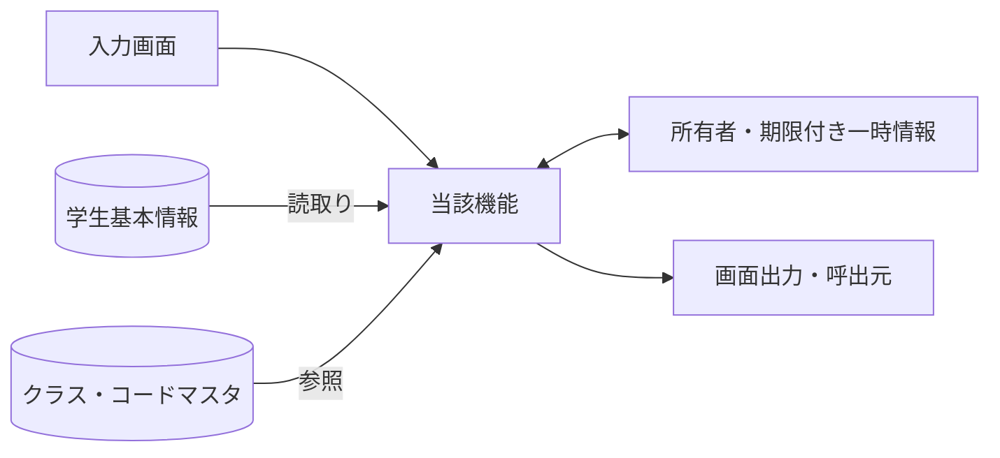
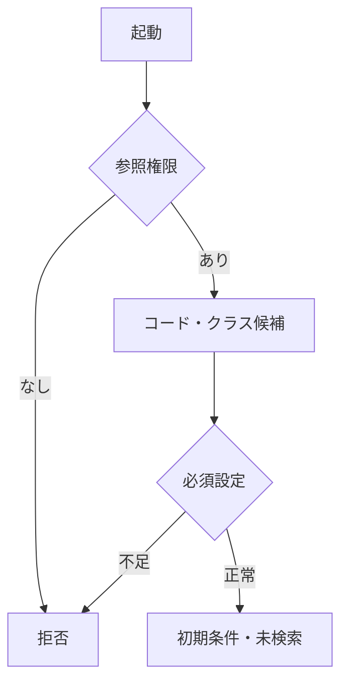
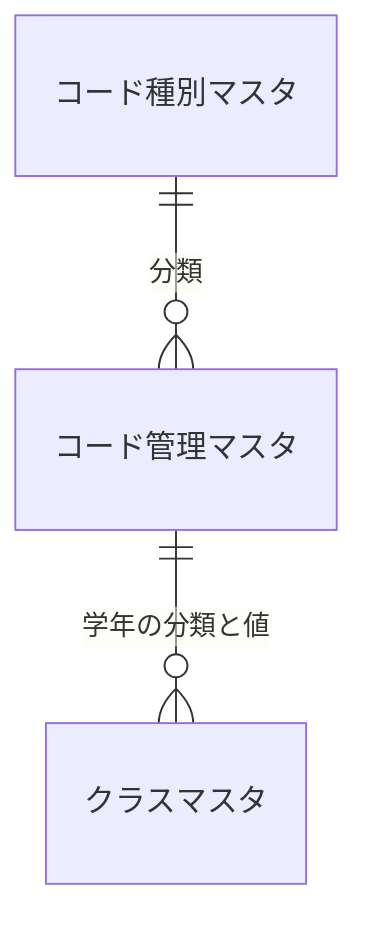
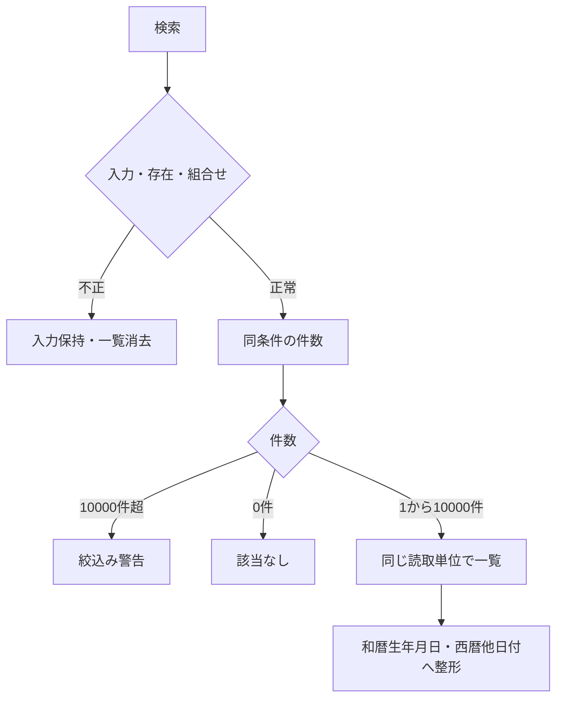
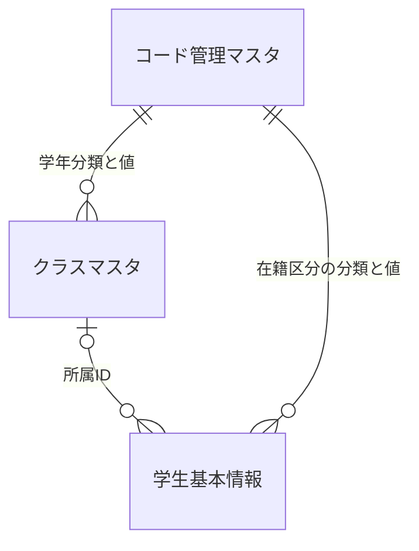
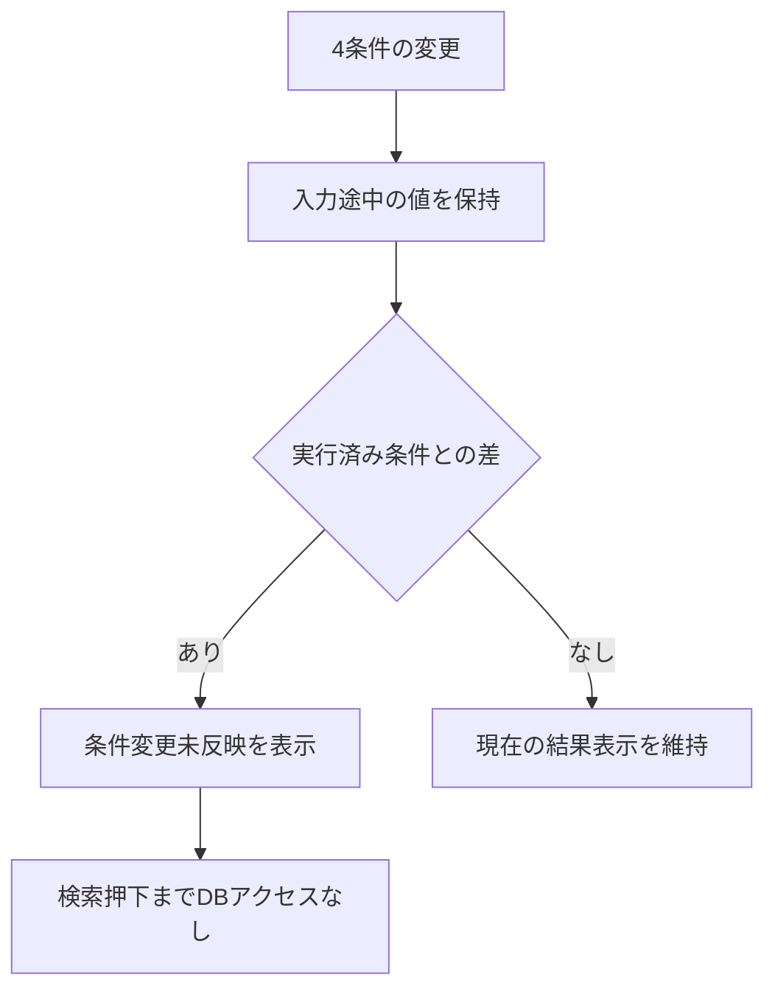
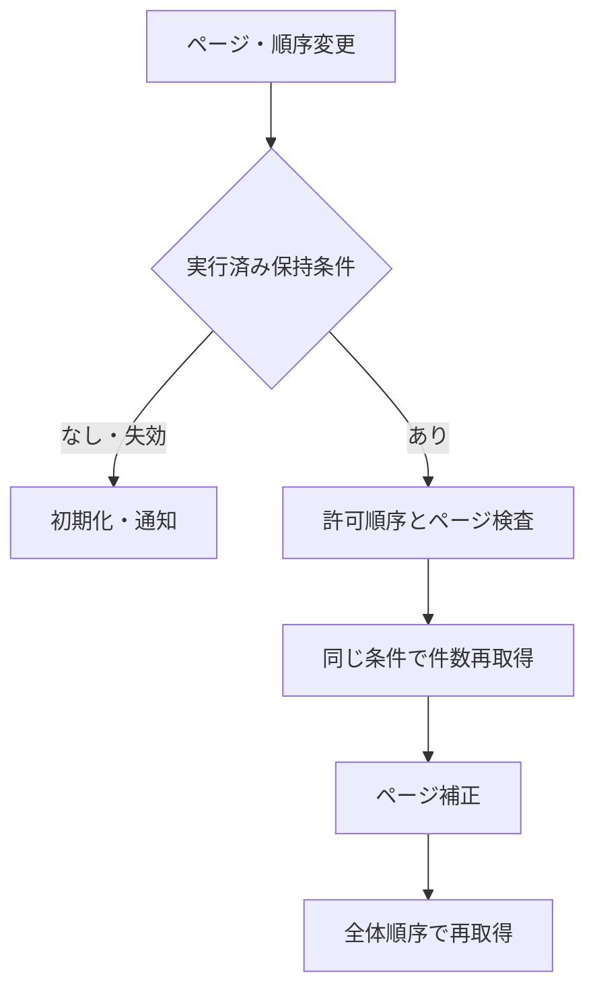
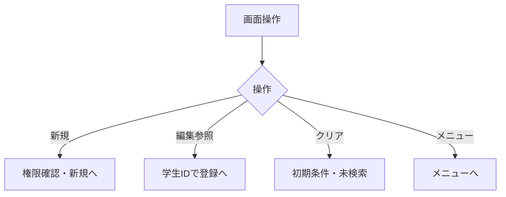
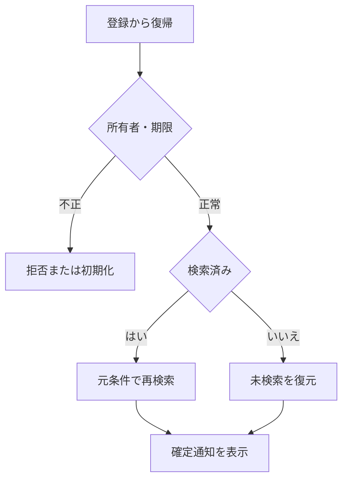

<!-- spec-meta: {"schema":"spec-md/1.0","documentId":"CSHARP_ASPNET-BAS-STU-01","version":"8.4","path":"test-project1/spec/CSharp_ASPNET/基本設計書/01_学生検索画面.md","sheets":[{"heading":"概要","kind":"GRID","sheet":"01_概要"},{"heading":"項目一覧","kind":"LIST","sheet":"02_項目一覧","key":["項目ID"]},{"heading":"選択候補一覧","kind":"LIST","sheet":"03_選択候補一覧","key":["候補ID"]},{"heading":"イベント仕様","kind":"GRID","sheet":"04_イベント仕様"},{"heading":"補足説明","kind":"GRID","sheet":"05_補足説明"}],"isolationProfile":"CSharp_ASPNET"} -->
# 学生検索画面 基本設計書

| 項目 | 内容 |
| --- | --- |
| システム名 | 学生管理システム |
| 機能ID | SCR-STU-001 |
| 版数・改訂日 | 8.4／2026-10-25 |
| 対象読者 | 顧客（所在団体のIT部門） |
| 状態 | 実装前の設計仕様。実装・コンパイル・実機試験は未実施 |

## 概要

### 概要説明

学生の基本情報を条件指定して検索し、学生登録画面の新規・編集・参照へ進む。検索画面では学生情報を変更しない。成績を検索・表示しない。単一校を対象とし、年度・学年は現在または最終所属クラスの属性を示す。過去の年度別所属履歴を検索するものではない。

| 情報 | 内容 |
| --- | --- |
| 開始契機 | 共通メニューからの起動、学生登録画面からの復帰 |
| 利用者 | 閲覧者、担当者、管理者 |
| 参照情報 | 学生基本情報、クラスマスタ、コード種別マスタ、コード管理マスタ |
| 呼出先 | 学生登録画面 |
| 対象外 | 成績、帳票、一覧の直接編集、一括更新、削除済み学生の照会 |

### 画面設計

#### 画面レイアウト（詳細と共通の埋め込みHTML）

小規模な学生管理の日常的な個人特定・クラス確認を対象とし、検索条件は学籍番号・氏名・クラス・在籍区分の4項目とする。学籍番号は前方一致、氏名は部分一致、クラスは選択値、在籍区分は複数選択とする。検索専用の詳細条件パネルは設けない。全条件の未指定を許容し、在籍区分の初期値は在学・休学とする。

表示値は架空の例。以下は検索済みの表示例であり、初回起動時の結果ではない。具体的な幅・余白・スクロールは[詳細の画面設計](../詳細仕様書/01_学生検索画面.md)に従う。

以下は詳細仕様と同一の埋め込みHTMLによる配置定義である。論理項目と状態の説明は本文で補い、別配置の簡略図やPNGを重ねて置かない。架空値の仕様モックであり実機画面ではない。CSSとフォーム要素を保持するHTML表示で確認する。

<!-- screen-html-start: SRC -->

  
仕様モック：すべて架空の表示例です。検索・画面遷移は動作しません。

  

    <header class="titlebar"><strong>学生管理システム</strong>利用者：見本担当者　｜　管理者</header>
    <main class="main">
      

        <h2>学生検索</h2>
        

          <button data-binding="New" data-control="New" data-field-id="SRC-015" type="button">新規登録</button>
          <button data-binding="Menu" data-control="Menu" data-field-id="SRC-016" type="button">メニューへ</button>
        

      

      <section class="criteria" aria-labelledby="src-criteria-heading">
        <h3 id="src-criteria-heading">検索条件</h3>
        

          

            <label class="field-label" for="src-student-no">学籍番号</label>
            <input id="src-student-no" class="input" name="Criteria.StudentNo" type="text" maxlength="30" data-business-maxlength="15" data-normalized-maxlength="15" value="" aria-describedby="src-student-no-hint">
            前方一致・15文字まで
          

          

            <label class="field-label" for="src-name">氏名</label>
            <input id="src-name" class="input" name="Criteria.Name" type="text" maxlength="16" data-business-maxlength="8" data-normalized-maxlength="160" value="見本" aria-describedby="src-name-hint">
            部分一致・8文字まで
          

          

            <label class="field-label" for="src-class">クラス</label>
            <select id="src-class" class="class-select" name="Criteria.ClassId" aria-describedby="src-class-hint">
              <option value="" selected>すべて</option>
              <option value="101">2026年度／第1学年／C-A／Aクラス</option>
              <option value="102">2026年度／第1学年／C-B／Bクラス</option>
              <option value="201">2025年度／第1学年／C-A／Aクラス（停止）</option>
            </select>
            年度・学年・コード・名称で選択（停止も含む）
          

          <fieldset class="field status-field" data-binding="criteria.StatusCodes" data-control="Criteria.StatusCodes" data-field-id="SRC-008" aria-describedby="src-status-hint">
            <legend class="field-label">在籍区分</legend>
            

              <label><input name="Criteria.StatusCodes" type="checkbox" value="01" checked>在学</label>
              <label><input name="Criteria.StatusCodes" type="checkbox" value="02" checked>休学</label>
              <label><input name="Criteria.StatusCodes" type="checkbox" value="03">卒業</label>
              <label><input name="Criteria.StatusCodes" type="checkbox" value="04">退学</label>
            

            すべて解除すると全区分を検索
          </fieldset>
          

            <button class="primary" data-binding="Search" data-control="Search" data-field-id="SRC-013" type="button">検索</button>
            <button data-binding="Clear" data-control="Clear" data-field-id="SRC-014" type="button">クリア</button>
          

        

      </section>
      

        <strong class="result-count" data-binding="TotalCount / RangeFrom / RangeTo" data-control="TotalCount / RangeFrom / RangeTo" data-field-id="SRC-017">検索結果 24件　1–20件を表示</strong>
        

          <label data-binding="PageSize" data-control="PageSize" data-field-id="SRC-019" for="src-page-size">表示件数 <select id="src-page-size" name="PageSize"><option value="20" selected>20件</option><option value="50">50件</option><option value="100">100件</option></select></label>
          <label data-binding="SortKey" data-control="SortKey" data-field-id="SRC-032" for="src-sort-key">並び順 <select id="src-sort-key" name="SortKey"><option value="studentNo" selected>学籍番号</option><option value="name">氏名</option><option value="admissionDate">入学日</option><option value="updatedAt">更新日時</option></select></label>
          <label data-binding="SortDirection" data-control="SortDirection" data-field-id="SRC-033" for="src-sort-direction">昇降順 <select id="src-sort-direction" name="SortDirection"><option value="asc" selected>昇順</option><option value="desc">降順</option></select></label>
        

      

      

        <table class="grid" aria-label="学生検索結果一覧">
          <colgroup><col style="width:13%"><col style="width:19%"><col style="width:17%"><col style="width:12%"><col style="width:21%"><col style="width:9%"><col style="width:9%"></colgroup>
          <thead>
            <tr>
              <th scope="col" data-binding="StudentNo" data-control="StudentNo" data-field-id="SRC-020">学籍番号</th>
              <th scope="col">氏名カナ</th>
              <th scope="col" data-binding="BirthDateWareki" data-control="BirthDateWareki" data-field-id="SRC-023">生年月日（和暦）</th>
              <th scope="col" data-binding="SchoolYear / GradeName" data-control="SchoolYear / GradeName" data-field-id="SRC-024">年度／学年</th>
              <th scope="col" data-binding="ClassCode / ClassName" data-control="ClassCode / ClassName" data-field-id="SRC-025">クラス</th>
              <th scope="col" data-binding="EnrollmentName" data-control="EnrollmentName" data-field-id="SRC-026">在籍区分</th>
              <th scope="col" data-binding="OpenSelectedStudent" data-control="OpenSelectedStudent" data-field-id="SRC-030">操作</th>
            </tr>
          </thead>
          <tbody>
            <tr><td>S2026-0001</td><td>見本 太郎ミホン タロウ</td><td>平成20年05月15日</td><td>2026年度第1学年</td><td>C-AAクラス</td><td>在学</td><td><button class="row-action" type="button" aria-label="見本 太郎の登録内容を編集">編集</button></td></tr>
            <tr><td>S2026-0002</td><td>見本 花子ミホン ハナコ</td><td>平成20年07月20日</td><td>2026年度第1学年</td><td>C-AAクラス</td><td>休学</td><td><button class="row-action" type="button" aria-label="見本 花子の登録内容を編集">編集</button></td></tr>
            <tr><td>S2026-0003</td><td>見本 一郎ミホン イチロウ</td><td>平成20年04月02日</td><td>2026年度第1学年</td><td>C-BBクラス</td><td>在学</td><td><button class="row-action" type="button" aria-label="見本 一郎の登録内容を編集">編集</button></td></tr>
            <tr><td>S2026-0004</td><td>見本 美咲ミホン ミサキ</td><td>平成20年06月18日</td><td>2026年度第1学年</td><td>C-BBクラス</td><td>在学</td><td><button class="row-action" type="button" aria-label="見本 美咲の登録内容を編集">編集</button></td></tr>
            <tr><td>S2026-0005</td><td>見本 翔ミホン ショウ</td><td>平成20年08月03日</td><td>2026年度第1学年</td><td>C-AAクラス</td><td>在学</td><td><button class="row-action" type="button" aria-label="見本 翔の登録内容を編集">編集</button></td></tr>
            <tr><td>S2026-0006</td><td>見本 結衣ミホン ユイ</td><td>平成20年09月12日</td><td>2026年度第1学年</td><td>C-AAクラス</td><td>在学</td><td><button class="row-action" type="button" aria-label="見本 結衣の登録内容を編集">編集</button></td></tr>
            <tr><td>S2026-0007</td><td>見本 陽菜ミホン ヒナ</td><td>平成20年10月24日</td><td>2026年度第1学年</td><td>C-BBクラス</td><td>休学</td><td><button class="row-action" type="button" aria-label="見本 陽菜の登録内容を編集">編集</button></td></tr>
            <tr><td>S2026-0008</td><td>見本 大輝ミホン ダイキ</td><td>平成20年11月01日</td><td>2026年度第1学年</td><td>C-BBクラス</td><td>在学</td><td><button class="row-action" type="button" aria-label="見本 大輝の登録内容を編集">編集</button></td></tr>
            <tr><td>S2026-0009</td><td>見本 葵ミホン アオイ</td><td>平成20年12月09日</td><td>2026年度第1学年</td><td>C-AAクラス</td><td>在学</td><td><button class="row-action" type="button" aria-label="見本 葵の登録内容を編集">編集</button></td></tr>
            <tr><td>S2026-0010</td><td>見本 蓮ミホン レン</td><td>平成21年01月11日</td><td>2026年度第1学年</td><td>C-AAクラス</td><td>在学</td><td><button class="row-action" type="button" aria-label="見本 蓮の登録内容を編集">編集</button></td></tr>
            <tr><td>S2026-0011</td><td>見本 陽翔ミホン ハルト</td><td>平成21年02月16日</td><td>2026年度第1学年</td><td>C-BBクラス</td><td>在学</td><td><button class="row-action" type="button" aria-label="見本 陽翔の登録内容を編集">編集</button></td></tr>
            <tr><td>S2026-0012</td><td>見本 紬ミホン ツムギ</td><td>平成21年03月21日</td><td>2026年度第1学年</td><td>C-BBクラス</td><td>在学</td><td><button class="row-action" type="button" aria-label="見本 紬の登録内容を編集">編集</button></td></tr>
            <tr><td>S2026-0013</td><td>見本 湊ミホン ミナト</td><td>平成20年04月14日</td><td>2026年度第1学年</td><td>C-AAクラス</td><td>休学</td><td><button class="row-action" type="button" aria-label="見本 湊の登録内容を編集">編集</button></td></tr>
            <tr><td>S2026-0014</td><td>見本 凛ミホン リン</td><td>平成20年05月07日</td><td>2026年度第1学年</td><td>C-AAクラス</td><td>在学</td><td><button class="row-action" type="button" aria-label="見本 凛の登録内容を編集">編集</button></td></tr>
            <tr><td>S2026-0015</td><td>見本 樹ミホン イツキ</td><td>平成20年06月28日</td><td>2026年度第1学年</td><td>C-BBクラス</td><td>在学</td><td><button class="row-action" type="button" aria-label="見本 樹の登録内容を編集">編集</button></td></tr>
            <tr><td>S2026-0016</td><td>見本 澪ミホン ミオ</td><td>平成20年07月06日</td><td>2026年度第1学年</td><td>C-BBクラス</td><td>在学</td><td><button class="row-action" type="button" aria-label="見本 澪の登録内容を編集">編集</button></td></tr>
            <tr><td>S2026-0017</td><td>見本 蒼ミホン アオ</td><td>平成20年08月22日</td><td>2026年度第1学年</td><td>C-AAクラス</td><td>在学</td><td><button class="row-action" type="button" aria-label="見本 蒼の登録内容を編集">編集</button></td></tr>
            <tr><td>S2026-0018</td><td>見本 杏ミホン アン</td><td>平成20年09月19日</td><td>2026年度第1学年</td><td>C-AAクラス</td><td>在学</td><td><button class="row-action" type="button" aria-label="見本 杏の登録内容を編集">編集</button></td></tr>
            <tr><td>S2026-0019</td><td>見本 悠真ミホン ユウマ</td><td>平成20年10月05日</td><td>2026年度第1学年</td><td>C-BBクラス</td><td>休学</td><td><button class="row-action" type="button" aria-label="見本 悠真の登録内容を編集">編集</button></td></tr>
            <tr><td>S2026-0020</td><td>見本 心春ミホン コハル</td><td>平成20年11月26日</td><td>2026年度第1学年</td><td>C-BBクラス</td><td>在学</td><td><button class="row-action" type="button" aria-label="見本 心春の登録内容を編集">編集</button></td></tr>
          </tbody>
        </table>
      

      

        <nav class="pager" aria-label="検索結果のページ" data-binding="Page" data-control="Page" data-field-id="SRC-031"><button type="button" disabled>先頭</button><button type="button" disabled>前へ</button><strong>1 / 2</strong><button type="button">次へ</button><button type="button">最後</button></nav>
        
検索日時：2026/10/23 10:00:00（日本時間）

      

      
検索が完了しました。実行条件：氏名「見本」、在学・休学。

    </main>
  

<!-- screen-html-end: SRC -->

［先頭］ ［前へ］　1／1ページ　［次へ］ ［最後］

<strong>閲覧者の場合：</strong>「新規登録」は表示せず、行の「編集」を「参照」に変更します。

#### 省スペース配置

標準確認領域はブラウザー本文1366×650 CSS px・100%とする。検索条件は2段以内、検索・クリアは条件入力と同じ行の右端、新規登録・メニューは画面見出し右に並べる。一覧は7列とし、氏名とカナを同じセル内に配置する。住所・本人電話・更新日時は学生登録画面の編集／参照で確認する。年度・学年は一覧およびクラス候補の識別表示に残す。

画面外側の縦横スクロールを生じさせず、条件・検索操作・一覧見出し・ページ操作・検索日時を一度に確認できるようにする。取得単位20／50／100件と一度に見える行数を分け、一覧領域だけを縦スクロールする。一覧の全取得行が同時に見えるという意味ではない。長い値は折返して全文を確認でき、行高は内容に応じて増やす。狭い画面や200%拡大時は可読性と操作を優先してページ全体の縦スクロールを許容する。

#### 表示状態

| 状態 | 条件欄 | 結果欄 | 操作 |
| --- | --- | --- | --- |
| 初回・クリア直後 | 初期条件 | 「条件を指定して検索してください」。件数・日時なし | 一覧操作は使用不可 |
| 検索中 | 入力値を保持 | 処理中表示 | 二重検索を抑止 |
| 入力エラー | 入力値と項目別エラー | 前回結果を消去 | 修正後に検索 |
| 0件 | 実行した条件を保持 | 「該当する学生がありません。」 | ページ操作不可 |
| 上限超過 | 実行した条件を保持 | 絞込みを要求。一部だけの一覧は出さない | 条件追加後に検索 |
| 正常 | 実行した条件 | 件数、一覧、検索日時 | 有効なページ操作 |
| 条件変更・未実行 | 変更値を保持 | 最後に実行した結果と「条件変更は未反映」 | ページ操作は最後の実行条件を使う |
| システムエラー | 入力値を保持 | 前回結果を最新結果として残さない | 受付番号を案内 |

生年月日は和暦、その他の日付・日時・年度は西暦。例示値は架空。日付範囲の正本は[共通日付仕様](../共通/07_日付・和暦仕様.md)。

### ファイル・DB入出力関係

#### 入出力一覧

方向は当該機能から見たもの。画面入力、DB読取り、DB書込みを区別する。

| IO-ID | 分類 | 対象 | 入出力 | 主な項目 | 保存単位・備考 |
| --- | --- | --- | --- | --- | --- |
| 01 | 画面 | 入力条件・操作 | 入力 | 当該機能の項目一覧 | 要求開始時の値を複製 |
| 02 | 永続DB | 学生基本情報 | 入力（参照） | 学生基本情報・版 | 更新なし |
| 03 | 永続DB | クラスマスタ | 入力（参照） | 年度・学年・名称・期間・定員 | 学生機能からマスタを更新しない |
| 04 | 永続DB | コード種別マスタ／コード管理マスタ | 入力（参照） | 分類・値・名称・有効性 | 学生機能からマスタを更新しない |
| 05 | 一時情報 | 検索状態・確認情報（共通管理） | 入出力 | 確定検索条件・ページ・原入力・確認対象 | 業務表と別。所有者・期限を検査 |
| 06 | 外部ファイル | なし | なし | CSV・帳票・取込は本機能の対象外 | 仕様書MDを業務IOに数えない |
| 07 | 画面 | 一覧・メッセージ | 出力 | 個人情報は必要項目のみ | DB保存とは別の出力 |

#### データ操作関連図

認証情報・業務日時は共通01～03から取得。マスタ保守の承認入力ファイルは画面機能のIOに含めず、方式別共通仕様に定義する。

## 項目一覧

| 項目ID | グループ | 論理項目名 | 種類 | 入出力 | 入力最大長 | 保存・正規化最大長 | 長さ単位 | 必須区分 | 必須条件 | 初期値 | 未設定値 | 表示形式・許容範囲 | 関連論理DB項目 | 候補ID | 正規化ID | チェックID | 関連イベント | DB連携説明 |
| --- | --- | --- | --- | --- | --- | --- | --- | --- | --- | --- | --- | --- | --- | --- | --- | --- | --- | --- |
| SRC-001 | 検索条件 | 学籍番号 | 文字入力 | I（検索条件） | 15 | 15 | Unicodeスカラー値 | 任意 | 未指定は条件なし。CHK-003は番号形式だけ、重複・変更不可は非適用 | 空 | NULL相当 | 15文字以内 | 学生基本情報・学籍番号 | － | N-06 | CHK-002,CHK-003 | EV-SRC-002 | 前方一致、N-06。保存なし |
| SRC-002 | 検索条件 | 氏名 | 文字入力 | I（検索条件） | 8 | 160 | Unicodeスカラー値 | 任意 | 表示氏名ではなく照合キーに部分一致 | 空 | NULL相当 | 原入力8文字以内、正規化後160文字以内 | 学生基本情報・氏名照合用情報 | － | N-03 | CHK-002 | EV-SRC-002 | N-03後の部分一致。氏名の原表記と区別 |
| SRC-006 | 検索条件 | クラス | 選択 | I（検索条件） | ID桁 | ID | 数字またはASCII文字 | 任意 | 実在するクラス。停止・期間外も検索可 | すべて | NULL相当 | 正の整数。型範囲は方式別DB定義 | 学生基本情報・現在・最終所属クラス | クラス | 非適用 | CHK-010 | EV-SRC-002 | 所属IDの完全一致。年度・学年は候補の識別表示だけ |
| SRC-008 | 検索条件 | 在籍区分 | 複数選択 | I（検索条件） | 2×最大4件 | 2×最大4件 | 数字またはASCII文字 | 任意 | 空配列は全区分。重複値・未定義値は拒否 | 01,02 | 空配列 | 在学・休学・卒業・退学 | 学生基本情報・在籍区分 | 在籍区分 | N-07 | CHK-010,CHK-024 | EV-SRC-002 | 複数値はいずれか一致、全解除は全区分 |
| SRC-013 | 操作 | 検索 | 操作 | 操作 | 非適用 | 非適用 | 非適用 | 非適用 | 表示または操作項目 | 条件を検査して1ページ目を表示 | 非適用 | ― | DB保存なし | － | 非適用 | 非適用 | EV-SRC-002 | 入力検査後、最初のページを取得 |
| SRC-014 | 操作 | クリア | 操作 | 操作 | 非適用 | 非適用 | 非適用 | 非適用 | 表示または操作項目 | 初期条件・未検索へ戻す | 非適用 | ― | DB保存なし | － | 非適用 | 非適用 | EV-SRC-005 | 初期条件・未検索へ、保持条件を消去 |
| SRC-015 | 操作 | 新規登録 | 操作 | 操作 | 非適用 | 非適用 | 非適用 | 非適用 | 表示または操作項目 | 担当者・管理者だけ表示 | 非適用 | ― | DB保存なし | － | 非適用 | 非適用 | EV-SRC-005 | 権限を確認し学生登録へ遷移 |
| SRC-016 | 操作 | メニューへ | 操作 | 操作 | 非適用 | 非適用 | 非適用 | 非適用 | 表示または操作項目 | 共通メニューへ戻る | 非適用 | ― | DB保存なし | － | 非適用 | 非適用 | EV-SRC-005 | 共通メニューへ |
| SRC-017 | 結果・一覧 | 検索件数・表示範囲 | 表示 | O（表示） | 非適用 | 表示元の上限：件数0～10000・範囲0～10000 | 非適用 | 自動表示 | 入力対象外。取得結果または計算値を表示 | 未検索 | 表示欠損は－、マスタ欠落は不整合表示 | 件数0～10000・範囲0～10000 | 計算：全条件一致の学生件数 | － | 非適用 | 非適用 | EV-SRC-002 | 未検索／0件／上限超過を区別 |
| SRC-018 | 結果・一覧 | 検索日時 | 表示 | O（表示） | 非適用 | 表示元の上限：西暦日時19文字 | 非適用 | 自動表示 | 入力対象外。取得結果または計算値を表示 | 未検索 | 表示欠損は－、マスタ欠落は不整合表示 | 西暦日時19文字 | 計算：今回の検索実行日時 | － | 非適用 | 非適用 | EV-SRC-002 | 西暦日時、日本時間。DB保存なし |
| SRC-019 | 結果・一覧 | 表示件数 | 選択 | I（表示指定） | 3 | 保存なし | 数字またはASCII文字 | 必須 | 20・50・100のみ | 20 | 不可 | 表示規則による | DB保存なし：取得範囲 | 表示件数 | 非適用 | CHK-024 | EV-SRC-004 | 20／50／100、既定20 |
| SRC-020 | 結果・一覧 | 学籍番号 | 表示 | O（表示） | 非適用 | 表示元の上限：15 | 非適用 | 自動表示 | 入力対象外。取得結果または計算値を表示 | 未検索 | 表示欠損は－、マスタ欠落は不整合表示 | 15 | 学生基本情報・学籍番号 | － | 非適用 | 非適用 | EV-SRC-002,EV-SRC-004,EV-SRC-006 | 保存済み文字列、文字順 |
| SRC-021 | 結果・一覧 | 氏名 | 表示 | O（表示） | 非適用 | 表示元の上限：8 | 非適用 | 自動表示 | 入力対象外。取得結果または計算値を表示 | 未検索 | 表示欠損は－、マスタ欠落は不整合表示 | 8 | 学生基本情報・学生氏名 | － | 非適用 | 非適用 | EV-SRC-002,EV-SRC-004,EV-SRC-006 | 登録表記のまま文字列表示 |
| SRC-022 | 結果・一覧 | 氏名カナ | 表示 | O（表示） | 非適用 | 表示元の上限：18 | 非適用 | 自動表示 | 入力対象外。取得結果または計算値を表示 | 未検索 | 表示欠損は－、マスタ欠落は不整合表示 | 18 | 学生基本情報・学生氏名カナ | － | 非適用 | 非適用 | EV-SRC-002,EV-SRC-004,EV-SRC-006 | 保存済みカナ表記 |
| SRC-023 | 結果・一覧 | 生年月日 | 表示 | O（表示） | 非適用 | 表示元の上限：共通和暦書式 | 非適用 | 自動表示 | 入力対象外。取得結果または計算値を表示 | 未検索 | 表示欠損は－、マスタ欠落は不整合表示 | 共通和暦書式 | 学生基本情報・生年月日 | － | 非適用 | 非適用 | EV-SRC-002,EV-SRC-004,EV-SRC-006 | 和暦表示。共通16で日付から変換 |
| SRC-024 | 結果・一覧 | 年度・学年 | 表示 | O（表示） | 非適用 | 表示元の上限：年度4桁＋学年名称12 | 非適用 | 自動表示 | 入力対象外。取得結果または計算値を表示 | 未検索 | 表示欠損は－、マスタ欠落は不整合表示 | 年度4桁＋学年名称12 | クラスマスタ・学校年度／学年→コード管理マスタ（学年）・コード名称 | － | 非適用 | 非適用 | EV-SRC-002,EV-SRC-004,EV-SRC-006 | 年度は西暦、学年は名称。未所属は－ |
| SRC-025 | 結果・一覧 | クラス | 表示 | O（表示） | 非適用 | 表示元の上限：コード9＋名称18＋注記 | 非適用 | 自動表示 | 入力対象外。取得結果または計算値を表示 | 未検索 | 表示欠損は－、マスタ欠落は不整合表示 | コード9＋名称18＋注記 | 学生基本情報・現在・最終所属クラス→クラスマスタ・クラスコード／クラス名 | － | 非適用 | 非適用 | EV-SRC-002,EV-SRC-004,EV-SRC-006 | 未所属／停止／期間外を区別 |
| SRC-026 | 結果・一覧 | 在籍区分 | 表示 | O（表示） | 非適用 | 表示元の上限：名称12 | 非適用 | 自動表示 | 入力対象外。取得結果または計算値を表示 | 未検索 | 表示欠損は－、マスタ欠落は不整合表示 | 名称12 | 学生基本情報・在籍区分→コード管理マスタ（在籍区分）・コード名称 | － | 非適用 | 非適用 | EV-SRC-002,EV-SRC-004,EV-SRC-006 | 種別と値で結合、名称未取得でも学生行を落とさない |
| SRC-030 | 結果・一覧 | 編集／参照 | 操作 | 操作 | 非適用 | 非適用 | 非適用 | 非適用 | 表示または操作項目 | 未検索 | 非適用 | 表示規則による | 学生基本情報・学生管理番号 | － | 非適用 | 非適用 | EV-SRC-005 | 行番号ではなく対象IDで遷移、遷移先で再取得 |
| SRC-031 | 結果・一覧 | ページ操作 | 操作 | 操作 | 非適用 | 非適用 | 非適用 | 非適用 | 表示または操作項目 | 未検索 | 非適用 | 表示規則による | DB保存なし：取得範囲 | － | 非適用 | 非適用 | EV-SRC-004 | 先頭・前・次・最後。有効範囲へ再補正 |
| SRC-032 | 結果操作 | 並び順項目 | 選択 | I（表示指定） | 13 | 保存なし | Unicodeスカラー値 | 必須 | studentNo・name・admissionDate・updatedAtのみ | studentNo | 不可 | 固定候補 | 検索：学籍番号／氏名照合用情報／入学日／更新日時 | 並び順 | 非適用 | CHK-024 | EV-SRC-004 | 許可4項目。最後に学生ID昇順を加える |
| SRC-033 | 結果操作 | 並び順方向 | 選択 | I（表示指定） | 4 | 保存なし | Unicodeスカラー値 | 必須 | asc・descのみ | asc | 不可 | 固定候補 | DB保存なし：取得順 | 昇降順 | 非適用 | CHK-024 | EV-SRC-004 | 昇順／降順。初期は昇順 |

## 選択候補一覧

| 候補ID | 参照元・分類 | 選択値 | 表示値 | 抽出条件 | 表示順 | 初期値・連動 |
| --- | --- | --- | --- | --- | --- | --- |
| クラス | クラスマスタ・コード管理マスタ（学年） | クラス管理番号 | 年度・学年・クラスコード・クラス名 | 全年度、停止・期間外を含む検索用候補。上位条件で絞らない | 年度降順→学年表示順→クラス表示順→コード→ID | すべて。クラス0件でも在籍区分・個人条件で検索可 |
| 在籍区分 | コード管理マスタ（在籍区分） | 在籍区分コード値 | コード名称 | 検索は分類内の値。登録の新規選択は有効値。01～04は保護 | 表示順→コード値 | 検索01・02／新規登録01、全解除検索は全区分 |
| 表示件数 | 共通UI固定定義 | 20 / 50 / 100 | 20件／50件／100件 | 固定3候補。業務コードではない | 20→50→100 | 20、変更で1ページへ |
| 並び順 | 共通UI固定定義 | 学籍番号／氏名／入学日／更新日時 | 学籍番号／氏名／入学日／更新日時 | 固定4候補。自由文字でDB列を指定しない | 左記順 | 学籍番号 |
| 昇降順 | 共通UI固定定義 | 昇順／降順 | 昇順／降順 | 固定2候補 | 昇順→降順 | 昇順 |

## イベント仕様

### EV-SRC-001 初期表示

#### 処理概要

認証済み利用者がメニューから起動。学生一覧は取得しない。

#### 処理手順

1. 共通01・02で参照権限を確認し、共通03で業務日時を確定する。
2. OP-CODE・OP-CLASSで候補取得。在学・休学、20件、学籍番号昇順、未検索を設定する。必須マスタ不足なら検索を不可とする。
3. 共通12の画面別状態を作成する。復帰識別がある場合はEV-SRC-006へ進む。

#### 処理フロー

#### SQL・テーブル関連（ER図）

名称参照は未所属・停止値を残す外部結合相当。コードは用途ごとの別名で**分類と値**を結合する。図は読取りの関連であり、履歴への書込みや削除連動を意味しない。単独の存在確認・採番・書込みの表関連は下記操作IDで特定する。

#### DB操作の詳細

`OP-CODE` → `OP-CLASS`。下記「DB操作定義」の同名操作を実行する。

#### 結果・例外時の扱い

入力不備は項目エラーと原入力を保持。検索要求の失敗は一覧消去、0件はI-SRC-001、上限超過はW-SRC-001。権限不備・他者の保持情報は拒否する。候補連動だけでは既存一覧を再検索しない。 各イベントで実行していない処理の結果状態は発生対象外。

### EV-SRC-002 検索実行

#### 処理概要

入力した検索条件で、非削除学生を検索する。

#### 処理手順

1. 入力を複製し共通04・05で学籍番号・氏名の正規化と桁、クラスID、在籍区分を検査する。項目エラーは入力保持・一覧消去、DB検索なし。廃止した条件を含む要求は拒否する。
2. OP-EXISTSで指定クラスと在籍区分の分類付き存在を検査する。検索では停止・期間外の値を許容する。年度・学年の独立条件は受け取らない。
3. OP-COUNT・OP-PAGEへ同じ確定条件を渡す。10001件で上限、0件は該当なし、それ以外は最初のページを表示する。件数と一覧の読取りを揃える。
4. 正常時に実行済み条件を共通12へ保持。生年月日は共通16で和暦表示。他の日付・日時は西暦。

#### 処理フロー

#### SQL・テーブル関連（ER図）

名称参照は未所属・停止値を残す外部結合相当。コードは用途ごとの別名で**分類と値**を結合する。図は読取りの関連であり、履歴への書込みや削除連動を意味しない。単独の存在確認・採番・書込みの表関連は下記操作IDで特定する。

#### DB操作の詳細

`OP-EXISTS` → `OP-COUNT` → `OP-PAGE`。下記「DB操作定義」の同名操作を実行する。

#### 結果・例外時の扱い

入力不備は項目エラーと原入力を保持。検索要求の失敗は一覧消去、0件はI-SRC-001、上限超過はW-SRC-001。権限不備・他者の保持情報は拒否する。候補連動だけでは既存一覧を再検索しない。 各イベントで実行していない処理の結果状態は発生対象外。

### EV-SRC-003 条件変更

#### 処理概要

4つの条件の変更を保持し、結果に未反映であることを示す。学生検索はまだ実行しない。

#### 処理手順

1. 入力途中の条件と最後に検索した条件を分けて保持する。クラス変更による他条件の自動設定・解除はない。
2. 検索済み条件との差があれば「条件変更は未反映」と表示する。未検索の場合は検索案内を継続する。
3. 一覧・ページ操作は最後の実行済み条件を使う。検索押下までDB検索・候補通信を実行しない。

#### 処理フロー

#### SQL・テーブル関連（ER図）

DB参照なし。入力途中の表示だけを変更するためER図は対象外。

#### DB操作の詳細

DB操作なし。候補は初期表示時に取得したものを使い、検索実行時に存在を再確認する。

#### 結果・例外時の扱い

入力不備は項目エラーと原入力を保持。検索要求の失敗は一覧消去、0件はI-SRC-001、上限超過はW-SRC-001。権限不備・他者の保持情報は拒否する。候補連動だけでは既存一覧を再検索しない。 各イベントで実行していない処理の結果状態は発生対象外。

### EV-SRC-004 並び替え・ページ移動

#### 処理概要

実行済み条件の結果を別の順序・ページで取得する。

#### 処理手順

1. 共通12から保持条件を取得。未検索は不可、期限切れはW-SRC-002。入力途中の条件を混ぜない。
2. 並び順4項目・方向2種・件数20/50/100・正のページ番号を検査する。並び順・件数変更時は1ページへ戻す。
3. OP-COUNT・OP-PAGEを再実行。件数減少時は最終有効ページへ補正。0件は一覧なし・ページ操作不可。

#### 処理フロー

#### SQL・テーブル関連（ER図）

名称参照は未所属・停止値を残す外部結合相当。コードは用途ごとの別名で**分類と値**を結合する。図は読取りの関連であり、履歴への書込みや削除連動を意味しない。単独の存在確認・採番・書込みの表関連は下記操作IDで特定する。

#### DB操作の詳細

`OP-COUNT` → `OP-PAGE`。下記「DB操作定義」の同名操作を実行する。

#### 結果・例外時の扱い

入力不備は項目エラーと原入力を保持。検索要求の失敗は一覧消去、0件はI-SRC-001、上限超過はW-SRC-001。権限不備・他者の保持情報は拒否する。候補連動だけでは既存一覧を再検索しない。 各イベントで実行していない処理の結果状態は発生対象外。

### EV-SRC-005 新規・編集・参照・クリア

#### 処理概要

行操作または機能ボタンを受け付ける。

#### 処理手順

1. 新規は作成権限を確認し学生登録へ。検索条件を登録値へ流用しない。
2. 編集・参照は選択行の学生管理番号で登録機能を起動する。行番号・表示名を識別子にしない。読込みは登録側の責務。
3. クリアは初期条件・未検索へ戻し共通12も初期化。メニューへ戻る処理はDB更新なし。

#### 処理フロー

#### SQL・テーブル関連（ER図）

DB参照なし。ER図は対象外。

#### DB操作の詳細

このイベントで業務DBを読み書きしない。遷移先の読込みと混同しない。

#### 結果・例外時の扱い

入力不備は項目エラーと原入力を保持。検索要求の失敗は一覧消去、0件はI-SRC-001、上限超過はW-SRC-001。権限不備・他者の保持情報は拒否する。候補連動だけでは既存一覧を再検索しない。 各イベントで実行していない処理の結果状態は発生対象外。

### EV-SRC-006 学生登録からの復帰

#### 処理概要

保存・削除・取消・戻るから検索状態を復元する。

#### 処理手順

1. 共通12で所有者・認証・画面・期限を確認。他者状態は拒否、期限切れは初期化する。
2. 未検索から起動していた場合は未検索へ。検索済みなら元条件でOP-COUNT・OP-PAGEを再実行し最新DBを表示する。
3. 確定済み成功通知だけを表示。保存した学生が条件外でも検索条件を変更しない。

#### 処理フロー

#### SQL・テーブル関連（ER図）

名称参照は未所属・停止値を残す外部結合相当。コードは用途ごとの別名で**分類と値**を結合する。図は読取りの関連であり、履歴への書込みや削除連動を意味しない。単独の存在確認・採番・書込みの表関連は下記操作IDで特定する。

#### DB操作の詳細

`OP-COUNT` → `OP-PAGE`。下記「DB操作定義」の同名操作を実行する。

#### 結果・例外時の扱い

入力不備は項目エラーと原入力を保持。検索要求の失敗は一覧消去、0件はI-SRC-001、上限超過はW-SRC-001。権限不備・他者の保持情報は拒否する。候補連動だけでは既存一覧を再検索しない。 各イベントで実行していない処理の結果状態は発生対象外。

### DB操作定義

操作の業務契約は[共通データアクセス](../共通/08_データアクセス仕様.md)が正本。本機能における具体的な対象・引数・確定単位は以下。

#### OP-CODE

| 項目 | 内容 |
| --- | --- |
| 対象テーブル | コード種別マスタ・コード管理マスタ |
| 操作 | 参照 |
| 実行条件・引数 | 分類、用途（検索／新規選択／既存表示）、既存値、業務日 |
| 取得・設定項目／対象条件 | 分類・値・名称・表示順・利用可否・期間。分類＋値で取得 |
| 件数・順序 | 候補0件を検出。既定値を先頭値へ代替しない |
| 確定・取消 | 参照のみ |

#### OP-CLASS

| 項目 | 内容 |
| --- | --- |
| 対象テーブル | クラスマスタ・コード管理マスタ（学年） |
| 操作 | 参照 |
| 実行条件・引数 | 用途＝検索、業務日。上位条件なし、人数参照なし |
| 取得・設定項目／対象条件 | 全年度のクラス管理番号・年度・学年・コード・名称・利用可否・期間。停止・期間外も候補に含め、年度・学年・コード・名称と注意表示で識別する。学生人数は集計しない |
| 件数・順序 | 年度降順、学年表示順、クラス表示順、クラスコード、ID |
| 確定・取消 | 参照のみ、人数は予約ではない |

#### OP-EXISTS

| 項目 | 内容 |
| --- | --- |
| 対象テーブル | 学生基本情報・クラスマスタ・コード種別マスタ・コード管理マスタ |
| 操作 | 参照 |
| 実行条件・引数 | 用途（検索／保存）、分類付きコード・クラスID・選択補助。保存だけ対象ID・完全な学籍番号・期待版 |
| 取得・設定項目／対象条件 | 検索は在籍区分コードと指定クラスの存在のみ。年度・学年の条件照合はなし。学籍番号前方一致に重複・完全一致存在検査をしない。保存は従来の一意・存在・有効性検査を維持 |
| 件数・順序 | 未存在／重複／組合せ／停止を区別。未指定の検索条件は検査対象外 |
| 確定・取消 | 検索は参照のみ、保存は保護した最新値で確認 |

#### OP-COUNT

| 項目 | 内容 |
| --- | --- |
| 対象テーブル | 学生基本情報 |
| 操作 | 参照 |
| 実行条件・引数 | 正規化後の実行済み検索条件 |
| 取得・設定項目／対象条件 | 非削除必須。学籍番号・氏名・クラス・在籍区分をAND、在籍区分内はOR。未指定は条件なし。全条件一致IDだけ最大10001件 |
| 件数・順序 | 10001件は上限、10000件以下は実件数。0件は該当なし |
| 確定・取消 | OP-PAGEと同じ読取り整合性 |

#### OP-PAGE

| 項目 | 内容 |
| --- | --- |
| 対象テーブル | 学生基本情報・クラスマスタ・コード管理マスタ（学年・在籍区分） |
| 操作 | 参照 |
| 実行条件・引数 | OP-COUNTと同じ条件、ページ、件数、許可並び順 |
| 取得・設定項目／対象条件 | 一覧7表示項目（学籍番号・氏名・カナ・生年月日・年度学年・クラス・在籍区分）＋操作用学生ID。氏名とカナは1列に統合して操作を含む7列。住所・電話・更新日時・メール・緊急連絡先・備考を返さない |
| 件数・順序 | 全一致集合をソート後ページ化。同順位学生ID昇順 |
| 確定・取消 | 参照のみ、旧結果を最新として残さない |

## 補足説明

停止・期間外のコード／クラスも検索候補と名称表示に含める。表示名称を取得できない異常があっても学生の行を消さず、不整合を明示する。文字の「%」「_」「!」を入力しても検索対象が意図せず広がらないものとする。検索条件や個人情報を画面アドレス・永続保存へ残さない。

| 受入観点 | 期待結果 |
| --- | --- |
| 初回、クリア | 在学・休学が選択済み、未検索 |
| 氏名の空白差・全角番号 | 共通変換規則どおりに検索 |
| 停止クラス、卒業 | 過去の最終所属を含めて検索できる |
| クラスを未指定 | 未所属を除外しない。独立した年度・学年や未所属専用条件はない |
| 0件・10,000件・10,001件 | 該当なし・正常一覧・上限警告を区別 |
| 条件変更後にページ移動 | 最後に実行した条件で移動し、未反映を明示 |
| 閲覧者の更新操作 | 操作できない |
| 複数タブから復帰 | 条件・成功メッセージを混同しない |

関連：[学生登録](02_学生登録画面.md)／[共通UI](../共通/04_共通UI部品設計.md)／[共通チェック](../共通/05_チェック・メッセージ設計.md)

### 正本・受入観点

共通業務は共通03・05・07・08、技術実装は方式別詳細を正本とする。顧客IT部門は入出力、権限、画面とDBの追跡、競合・障害時結果を確認する。言語の構文説明は本書に含めない。

[適合試験一覧](../共通/06_要件対応・設計判断.md)とレビュー結果を参照。

### 項目と一覧章の扱い

項目一覧・選択候補一覧は表だけのLIST章とする。入力上限、保存上限、必須区分と条件を区別する。存続項目のIDは維持し、廃止IDは再利用しない。詳細の内部項目は同じ論理項目の細分化であり新たな業務機能ではない。

### 8.1版の範囲と廃止ID

2026-10-23の利用者指示による検索画面の簡素化。小規模・少量データという前提に基づく設計判断であり、実件数や利用頻度を測定した結果ではない。業務DBの項目、学生登録・編集・参照、権限・保存検査は継続する。

| 廃止ID | 旧用途 | 8.1での扱い |
| --- | --- | --- |
| SRC-003 | 氏名カナ検索 | 独立検索欄を廃止。カナの登録・一覧表示は維持 |
| SRC-004、SRC-005 | 年度・学年検索 | クラス候補と一覧の識別表示へ集約 |
| SRC-007 | 未所属のみ検索 | 専用条件を廃止。クラス未指定なら未所属を含む |
| SRC-009、SRC-010 | 都道府県・電話検索 | 検索条件を廃止。既存の編集／参照で確認 |
| SRC-011、SRC-012 | 入学日範囲検索 | 範囲条件を廃止。登録日付の検査は維持 |
| SRC-027、SRC-028、SRC-029 | 一覧の住所・本人電話・更新日時 | 一覧から除き既存の編集／参照で確認 |

旧版8.0・版未設定・未知版の検索保持状態は新条件へ変換しない。これらの状態による検索・ページ・クリア・復帰を拒否して再検索を案内し、再初期表示で新状態を発行する。仕様モックの構造・描画確認と、アプリ実装・DB試験・正式採点は別に報告する。
