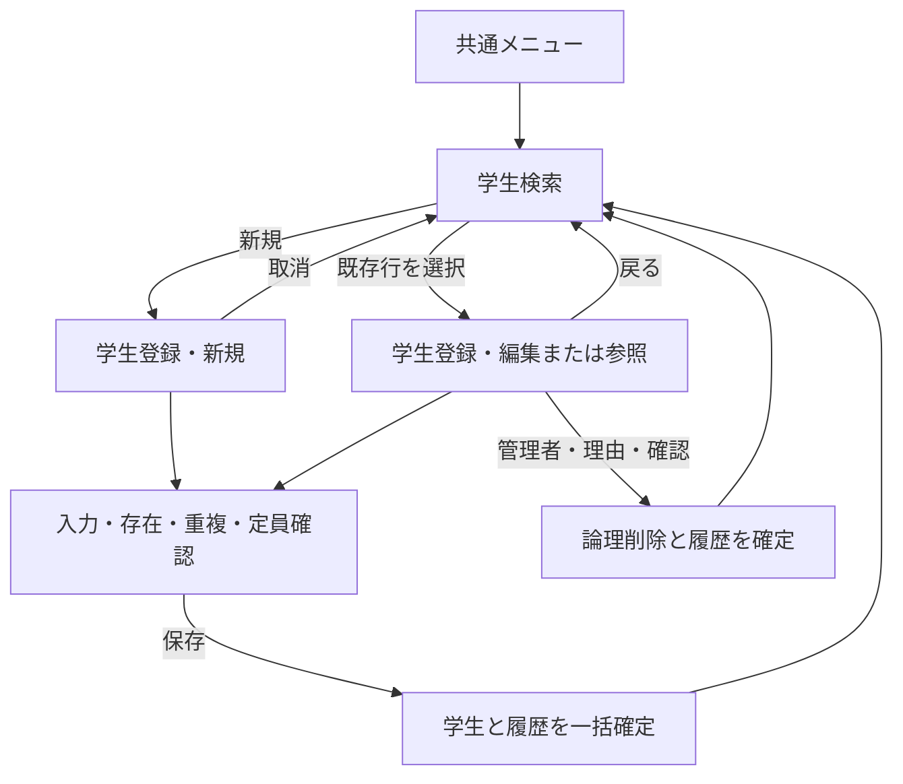

<!-- spec-meta: {"schema":"spec-md/1.0","documentId":"CSHARP_WPF-COM-STU-001","version":"8.1","path":"test-project1/spec/CSharp_WPF/共通/01_システム概要.md","sheets":[{"heading":"目的・対象","kind":"GRID","sheet":"01_目的・対象"},{"heading":"機能・情報","kind":"GRID","sheet":"02_機能・情報"},{"heading":"画面遷移","kind":"GRID","sheet":"03_画面遷移"},{"heading":"権限","kind":"GRID","sheet":"04_権限"},{"heading":"共通業務原則","kind":"GRID","sheet":"05_共通業務原則"},{"heading":"非機能・運用の共通条件","kind":"GRID","sheet":"06_非機能・運用の共通条件"}],"isolationProfile":"CSharp_WPF"} -->
# システム概要（言語非依存）

版：8.1／2026-10-25。文書ID：COM-STU-001。顧客・設計者共通。

## 目的・対象

本システムは、仕様書作成Agent・仕様からプログラムを生成するAgent・プログラムから仕様書を復元するAgentの往復生成評価用の題材である。現在は仕様書作成段階であり、下記の業務仕様と比較可能なID・制約・イベント・DB更新を整える。将来の機能・言語追加は版と評価基準を固定してから行う。独立した逆生成と評価の分担は[プロジェクト方針](../プロジェクト情報.md)を参照する。

学生の基本情報を検索・登録・編集する。氏名、生年月日、国内住所、本人連絡先、緊急連絡先、在籍区分、現在／最終所属クラスを管理する。成績、試験、科目、出欠、学費、帳票・CSV、一括更新は対象外。

単一校、業務画面2画面、業務テーブル5表を基本とする。登録画面は新規・編集・参照を共用し、管理者向け論理削除を含む。画面を物理的にタブ・端末パネルへ分割しても、業務上は同じ検索／登録画面の内訳として扱う。クラス・コードの保守画面は新設せず、管理者向けの保守処理を定義する。

## 機能・情報

| 機能 | 対象・動作 |
| --- | --- |
| 学生検索 | 条件、件数、一覧、並び順、ページ、検索から登録への遷移 |
| 学生登録 | 新規・編集・参照・論理削除、存在・重複・日付・定員の検査 |
| クラス管理 | 年度・学年・番号・名称・期間・定員を保守 |
| コード管理 | 性別、在籍区分、都道府県、続柄、学年の5分類70値 |
| 操作履歴 | 保存と同時に実行者・対象・変更項目・理由・前後版を記録 |
| 共通認証 | 外部の認証・利用者情報を利用。利用者マスタ・ログイン画面の開発は対象外 |

クラス所属は現在／最終の1件のみ。所属年度はクラスの属性であり、入学年度から推測しない。年度別所属履歴、兼籍、将来の異動予約、自動進級は含めない。

## 画面遷移

検索済みなら元条件・並び順・ページを復元して最新情報を再検索する。未検索から開いた場合は未検索へ戻す。変更後の学生が条件から外れても条件を無断で変えない。

## 権限

| 操作 | 閲覧者 | 担当者 | 管理者 |
| --- | --- | --- | --- |
| 検索・参照 | 可 | 可 | 可 |
| 新規・通常編集 | 不可 | 可 | 可 |
| 在学・休学からの区分変更 | 不可 | 可 | 可 |
| 卒業・退学から別区分への訂正 | 不可 | 不可 | 理由付きで可 |
| 論理削除 | 不可 | 不可 | 理由付きで可 |
| マスタ保守 | 不可 | 不可 | 可 |

画面表示だけでなく保存を受け付ける処理でも権限を確認する。クラス別の担当者制限は本版では設けない。本人や他学生の情報を利用者入力から認証情報として信用しない。認証基盤との結合方法・各環境のセキュリティ境界は方式別仕様に記載する。

## 共通業務原則

学籍番号は学校付番、登録後不変、削除済みも含め一意・再利用不可。同じ生年月日で氏名または氏名カナの照合値が一致する他学生は同一人物候補として警告するが、同姓同名の別人登録は確認理由付きで許容する。電話・メールは家族間で共有可。

生年月日≦入学日≦業務日。在学・休学は終了日なし、卒業・退学は入学日以上かつ業務日以前の終了日が必要。日付到来だけで状態を自動変更しない。学年はクラスの属性であり成績ではない。

定員は未削除の在学・休学で数える。新たな席を追加する保存時に人数を再確認し、同時保存でも超過させない。既存所属が期間外でも住所など無関係な変更を妨げない。新規選択可否と既存値保持可否を区別する。

学生またはマスタの変更と操作履歴は同じ確定単位。途中失敗は両方取り消す。同時編集では読込時の更新管理番号を照合し、他者の変更を上書きしない。正規化後の業務値に変更がない場合は版・日時・履歴を増やさない。通信断で結果不明なら成功・失敗を断定せず、再保存の前に検索確認を案内する。

## 非機能・運用の共通条件

| 項目 | 論理要件・設計目標 |
| --- | --- |
| 検索上限 | 10,000件。10,001件で上限超過。部分結果を全件のように表示しない |
| ページ件数 | 20・50・100。端末1パネルの表示行数とは区別する |
| 検索状態 | 利用者・ログイン状態・画面インスタンス別、最終利用から30分 |
| 重複確認 | 10分。利用者、対象、読込時版、入力内容、全候補と版に対応付ける |
| 日時 | 日本時間を業務日・表示基準とする。時点保存方式は詳細で決める |
| 文字 | 日本語を含むUnicode。業務文字数と物理バイト数を区別し、黙って切捨て・代替しない |
| UI | 見出し・入力・エラー・操作の順。長文を閲覧・修正する手段を確保 |
| 性能評価案 | 学生10万件、同時利用20人、代表検索3秒以内、通常保存2秒以内を評価目標とする。各方式で実測が必要 |
| 個人情報 | 画面アドレスや通常の障害ログへ氏名・住所・連絡先を残さない |
| 履歴 | 変更項目を記録するが、値の全履歴による過去状態の復元は保証しない |
| 保管・消去 | 保持期間、復元、物理消去、バックアップ世代の消去、復旧目標は稼働前に確定 |

7方式のいずれでも成績管理を追加しない。方式固有の補助テーブルや一時領域は業務5表と区別して詳細仕様へ記載する。7方式を同じ本番DBへ混在接続する設計ではない。
