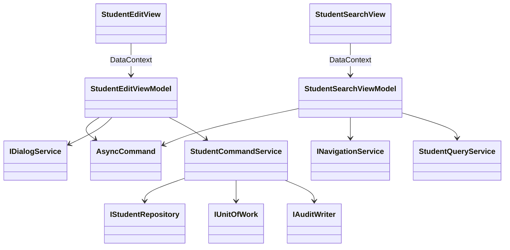

<!-- spec-meta: {"schema":"spec-md/1.0","documentId":"CSHARP_WPF-COM-CSharp_WPF","version":"8.5","path":"test-project1/spec/CSharp_WPF/共通/方式別/01_共通実装仕様.md","sheets":[{"heading":"MVVM構造","kind":"GRID","sheet":"01_MVVM構造"},{"heading":"Repository・SQL","kind":"GRID","sheet":"02_Repository・SQL"},{"heading":"共通処理とUI固有事項","kind":"GRID","sheet":"03_共通処理とUI固有事項"},{"heading":"共通規約・日付実装","kind":"GRID","sheet":"04_共通規約・日付実装"},{"heading":"画面最適化の方式適合","kind":"GRID","sheet":"05_画面最適化の方式適合"}],"isolationProfile":"CSharp_WPF"} -->
# C#／WPF 共通実装仕様

| 項目 | 内容 |
| --- | --- |
| 版数・改訂日 | 8.5／2026-10-25 |
| 対象方式 | C#／WPF |
| 適用 | 設計上の実装契約。製品コードの実装・コンパイルは未実施 |

開発入力：[学生検索詳細](../../詳細仕様書/01_学生検索画面.md)／[学生登録詳細](../../詳細仕様書/02_学生登録画面.md)／[共通実装](01_共通実装仕様.md)／[DB定義](../../DB定義/SQLServer/01_DB定義書.md)／[方式別開発規約](../../規約/CSharp_WPF.md)／[共通開発規約](../../規約/開発規約.md)。

## MVVM構造

```text
StudentManagement.Wpf/Views/StudentSearchView.xaml, StudentEditView.xaml
StudentManagement.Wpf/ViewModels/StudentSearchViewModel.cs, StudentEditViewModel.cs
StudentManagement.Wpf/Controls/NullableDateField.xaml, ClassSelector.xaml
StudentManagement.Wpf/Commands/AsyncCommand.cs
StudentManagement.Wpf/Services/NavigationService.cs, DialogService.cs
StudentManagement.Application/StudentQueryService.cs, StudentCommandService.cs
StudentManagement.Application/StudentNormalizer.cs, StudentValidator.cs, StudentRules.cs
StudentManagement.Domain/Student.cs, StudentDraft.cs, SchoolClass.cs, CodeEntry.cs
StudentManagement.Infrastructure/StudentRepository.cs, UnitOfWork.cs, AuditWriter.cs
```



ViewModelはINotifyPropertyChangedとINotifyDataErrorInfoを実装。AsyncCommandはCanExecute、IsRunning、CancellationToken、非同期例外の通知を持ち、async voidはICommand.Executeの最外部だけに封じる。外部MVVMライブラリー採用を必須にしない。

```csharp
public sealed record SaveCommandData(long? StudentId, long? ExpectedVersion,
    StudentDraft Draft, SelectionHints Hints, ConfirmationData? Confirmation,
    string? OperationReason);
public interface IStudentCommandService {
    Task<SaveResult> SaveAsync(SaveCommandData command, CancellationToken ct);
    Task<SaveResult> DeleteAsync(long id, long version, string reason,
                                CancellationToken ct);
}
```

`StudentDraft`は画面詳細の19入力＋NameKey・KanaKey。C#型は文字列string/string?、日付DateOnly/DateOnly?、ClassId long?。日時DateTimeOffset、件数・ページint。WPF DatePicker.SelectedDateはDateTime?なので専用部品がRawTextを保持してDateOnly?へ変換。不正値をnullとして必須検査だけに変えない。

## Repository・SQL

共通の保存・検索手順は[SQL Server DB定義](../../DB定義/SQLServer/01_DB定義書.md)の補足説明を適用する。ここで定義するRepository/UnitOfWorkはその入出力・確定境界を実装する。名前だけを別DBへ置換したSQLは使用しない。

## 共通処理とUI固有事項

共通01～03＝CurrentUserAdapter、AuthorizationService、BusinessClock。04～05＝StudentNormalizer、StudentValidator。06～10＝MasterLookupService、StudentRules、CapacityService、DuplicateService。11＝ConfirmationStore、12＝SearchContextStore、13＝UnitOfWork、14＝AuditWriter、15＝MessageCatalog。

```xml
<TextBox Text="{Binding Model.StudentName, UpdateSourceTrigger=PropertyChanged,
                ValidatesOnNotifyDataErrors=True}" />
<Button Content="更新" Command="{Binding SaveCommand}" />
<DataGrid ItemsSource="{Binding Items}" IsReadOnly="True"
          AutoGenerateColumns="False" CanUserAddRows="False" />
```

XAMLは実装例の抜粋。列定義は詳細01の現役7列・8論理項目、AutomationProperties.Nameは日本語論理名。値変換と業務検査を分け、DateOnlyを変換器で勝手に現在日へ置換しない。ObservableCollectionの更新はDispatcher経由。タスクの.Result/.WaitによるUIデッドロックを避ける。キャンセル・Window破棄を確かめてから結果を反映。

.NETのFormKC＋Invariant大文字＋Runeベース処理で共通N-01～12を実装。PropertyChangedを正規化中に循環させない。UI上の入力補助に失敗してもサーバー／DB更新入口の検査を省略しない。

## 共通規約・日付実装

対象読者は実務経験５年程度のプログラマー。[検索詳細](../../詳細仕様書/01_学生検索画面.md)／[登録詳細](../../詳細仕様書/02_学生登録画面.md)／[開発規約](../../規約/開発規約.md)／[日付正本](../07_日付・和暦仕様.md)。

共通16の入力は元号識別値・年・月・日という原文字列4値と業務日。出力は正規化日付と和暦表示文字列、または項目エラー。共通17は項目種別と日付／年度にDATE-R01～06を適用する。変換で不正日を補正しない。OS全体の暦設定を変更しない。元号表の版を画面・保存側で一致させる。

| 役割 | 実装仕様 |
| --- | --- |
| 共通16物理名 | JapaneseBirthDateField / JapaneseDateService |
| 内部日付型 | DateOnly / DateOnly? |
| 入力と保存 | 和暦原入力4値から日付を生成。StudentDraft等のbirth_date相当は正規化日付。元号をDBへ重複保存しない |
| 呼出境界 | 本方式はネイティブ画面。和暦原入力4値を業務処理へ渡し厳密変換する。取得時は内部日付を和暦表示に変換。Web JSON契約は本方式に適用しない |
| 表示 | 一覧・参照・重複確認のBirthDateWareki相当文字列は共通16で生成。その他の日付・日時は西暦 |
| 例外 | CHK-032～034、E-DATE-001～003。構文検査後、実在日、元号境界、逆変換、業務範囲、前後関係を順に検査 |
| 参考試験 | DATE-T01～20。ライブラリーの解析成功だけで元号境界を合格にしない |

### 保守入口・方式固有の適合条件

#### 共通部品・保守・試験

TextField、NullableDateField、CodeSelector、ClassSelector、MessagePanel、StudentGrid、Pager、ConfirmDialogをUserControl/DataTemplateとして実装。INotifyDataErrorInfoの項目エラーと全体Summaryを同期し、エラーの最初へフォーカスする。業務判定をIValueConverterに入れない。

`StudentMaintenance`のC#コンソール→MasterMaintenanceServiceで管理者保守。初期コード5分類70値、クラスキー不変・年度内一意、参照時の学年変更禁止、定員縮小・停止検査、履歴同時確定。画面数を増やさない。

共通T-01～28に加え、PropertyChanged通知漏れ、非同期Commandの再入、UIスレッド外のObservableCollection変更、Binding入力エラーの保持、DataGridのページ内だけの誤ソート、View終了後の非同期応答、キー操作・DPI・長文を試験する。

### SQL Server接続・型・共通呼出契約

検索Repositoryは型付き条件、page/pageSize、Cancellation/要求IDを受け、上限超過/件数/一覧/検索日時を返す。SqlServerUnitOfWorkは検索をSNAPSHOT、保存をREAD COMMITTED＋Transaction所有のsp_getapplockで制御する。全DBコマンドは同じConnection/Transactionを受け、個別Commitを禁止する。保存戻り値はSuccess/ValidationError/ConfirmationRequired/Conflict/NotFound/Unknownに分ける。OUTPUT値はCOMMIT確認前にSuccessへしない。

.NETはMicrosoft.Data.SqlClientを参照。SqlDbType.BigInt/Int/SmallInt/Bit/Date/DateTimeOffset/VarChar/NVarChar/UniqueIdentifier/VarBinaryをDB定義と対応させる。長さを推測するAddWithValueを標準にせず型とSizeを明示する。日付パラメーターはDateOnly対応を採用ドライバーで試験し、未対応アダプターではDateTimeの年月日をSqlDbType.Dateへ渡し時差変換しない。GUIDと画面token文字列の表現を混同しない。

WHERE/LIKE/ページ/例外・ゲート戻り値はSQL Server DB定義を正本とし、LIKEは!/%/_/[のリテラル化を含む。接続暗号化、証明書検証、認証主体を最小権限で分離。UIの権限表示だけを更新認可として使わない。

### 派生分類と監査の共通実装

新規／通常更新は[共通データアクセス](../08_データアクセス仕様.md)の緊急４保存項目一式を適用する。続柄分類を常にRELATIONSHIPへ設定する処理は禁止し、続柄値未設定時は分類もNULLへバインドする。コード値を更新する際は分類も同時更新し、変更列監査へ含める。必須３分類は固定のまま。

マスタ監査は[共通モジュール](../03_共通モジュール設計.md)の状態遷移表に従い、停止中の名称変更はUPDATE、状態が実際に停止へ変わる時だけDISABLEとする。認証不成立はE-COM-001、認証済み利用者の認可拒否はE-COM-002を使用し、実装の誤った番号を仕様値として採用しない。

## 画面最適化の方式適合

StudentSearchViewModelのDraftとStudentSearchCriteriaはStudentNoPrefix:string、NameKey:string、ClassId:long?、StatusCodes:IReadOnlyList<string>の4値。StudentEditViewはGridで基本を上段、下段3列へ配置し、INotifyDataErrorInfoを維持。Window終了後の非同期応答は破棄する。

小規模の学生管理という利用者指定を設計前提とし、件数・頻度の実測値とは扱わない。対象発見には学籍番号の前方一致（SRC-001）、氏名照合キーの部分一致（SRC-002）、クラスIDの完全一致（SRC-006）、在籍区分の複数OR（SRC-008）を使用する。4条件間はAND、未指定の条件は追加しない。初期在籍は在学・休学、全解除で全区分。論理削除済みは常に除外する。

SRC-003/004/005/007/009/010/011/012は廃止しIDを再利用しない。氏名カナ、年度・学年、未所属専用、都道府県、電話、入学期間による詳細絞込みは設けない。年度・学年はクラス候補と結果の識別情報へ集約する。候補は全年度・停止・期間外を含み、年度／学年／クラスコード／名称で区別する。候補なしは「すべて」を残し、停止値を理由に検索を拒否しない。

一覧は学籍番号、氏名＋カナ、生年月日（和暦）、年度＋学年、クラス、在籍区分、操作の7列・8論理項目（SRC-020/021/022/023/024/025/026/030）。SRC-027/028/029は一覧DTOから廃止し、住所・本人電話・更新情報は既存の学生編集／参照画面で確認する。検索の更新日時ソートは維持するが、更新日時を一覧DTOへ返す理由にしない。20/50/100件・既定20、許可4ソートと方向、1万件上限、非削除・認可・所有者・期限・Revision契約は維持する。

検索形式版は `student-search-compact-1` とする。既存のフォーム／Window別SearchContextの読出し時に形式版を照合する。旧版・形式版欠落は8条件だけ捨てて自動復元せず、検索状態全体を未検索・初期4条件・20件・学籍番号昇順へ再初期化し、旧形式のため初期化した旨を通知する。現行形式へ廃止／未知条件が渡された場合はCHK-024／E-COM-003で拒否し、黙って無視しない。形式版はRevisionと別に検査し、状態ID・期待Revision・所有者・画面インスタンス・30分期限の照合を省略しない。新しいHTTPエンドポイントは追加せず、ネイティブの型付き呼出しと状態ストアの境界へ適用する。

通常編集は基本情報6項目を上段の3列×2行へ置き、下段を「住所・本人連絡先」「在籍・所属」「緊急連絡先・備考・理由」の3列にする。更新情報と操作バーは通常フローの末尾に置き、入力・エラー・説明へ重ねない。REG-001～034と全保存項目、和暦4入力、原入力／保存文字数、条件付き必須、保存19入力／更新18入力＋生成照合値2は維持する。

通常表示の設計確認サイズは1366×650および1280×650 CSS px・100%。入力高さ34px、文字12px以上を基本とする。長い1行入力は標準部品内でカーソル移動して全文を編集でき、備考・理由は複数行で全文へ到達できる。狭幅、200%相当、項目エラー展開時は縦スクロールを許可する。通常編集に確認例を縦積みせず、重複・削除・未保存破棄は排他的な別ダイアログとする。埋め込みHTMLから作業用に抽出した同じ断片のdata-stateをduplicate/delete/discardへ切り替え、排他的な確認状態を検査する。取消を既定とし、確認待ちにDBロックを保持しない。
