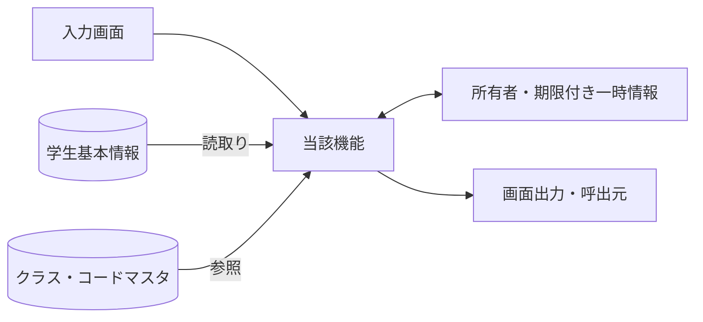
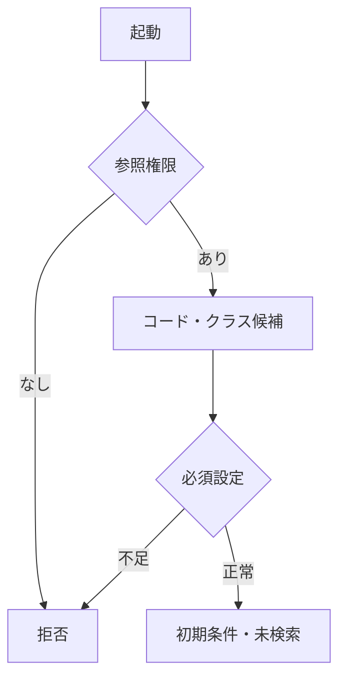
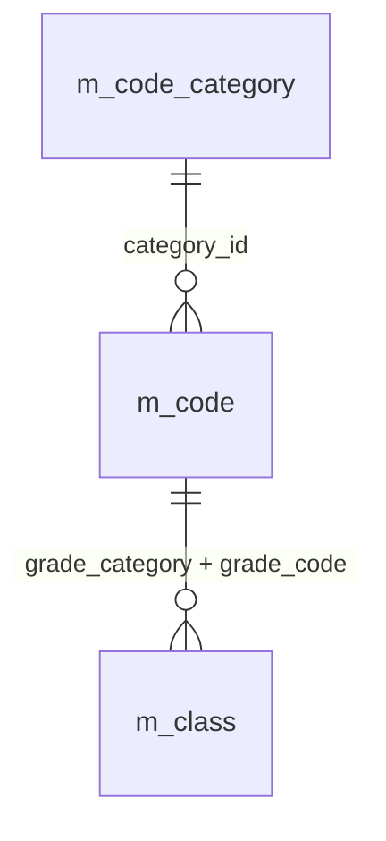
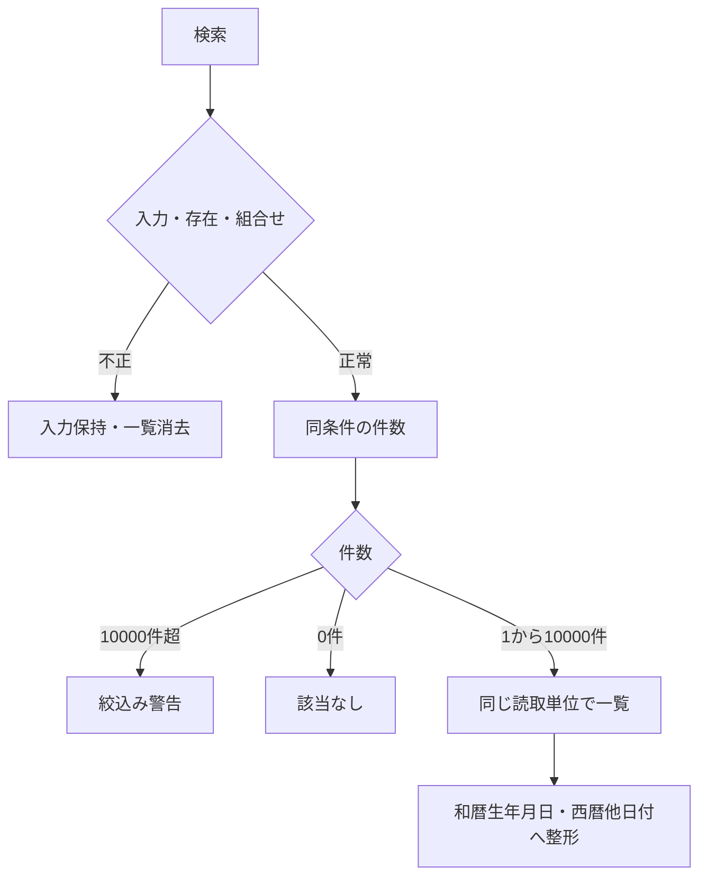
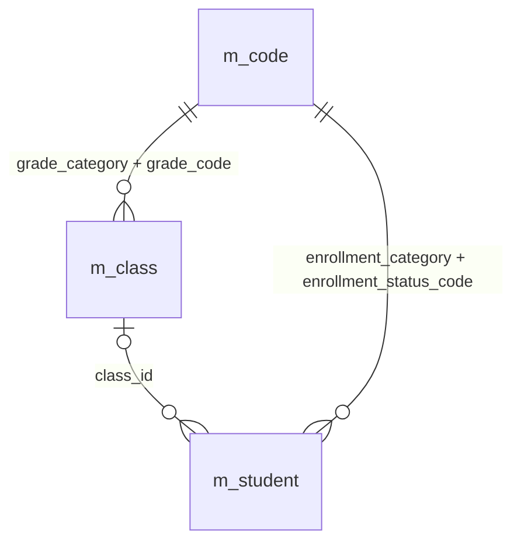
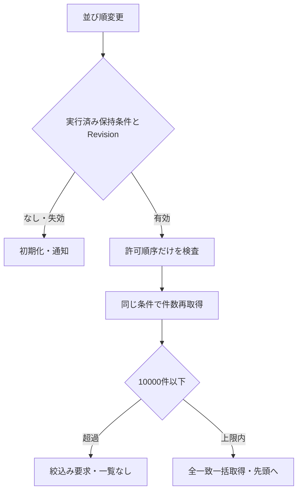
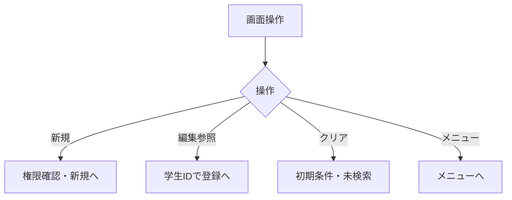
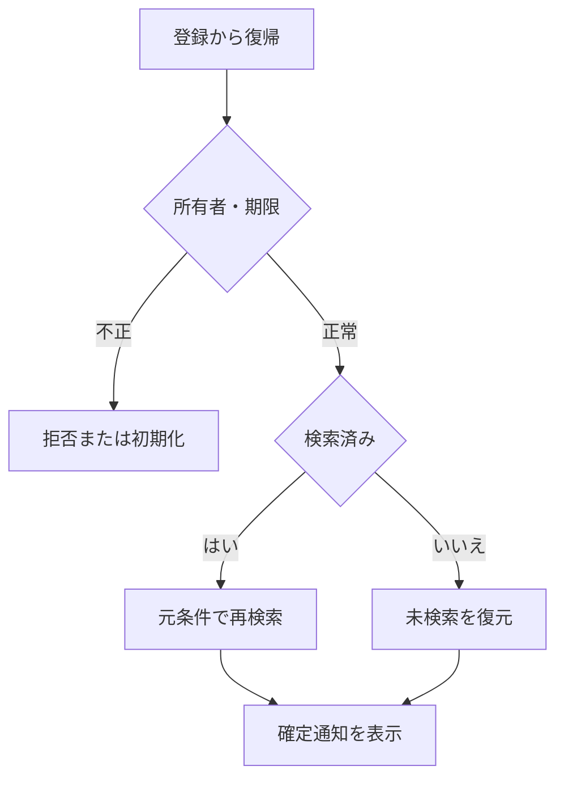

<!-- spec-meta: {"schema":"spec-md/1.0","documentId":"VB.NET_WINFORMS-DET-VB.NET_WinForms-SCR-STU-001","version":"8.4","path":"test-project1/spec/VB.NET_WinForms/詳細仕様書/01_学生検索画面.md","sheets":[{"heading":"概要","kind":"GRID","sheet":"01_概要"},{"heading":"項目一覧","kind":"LIST","sheet":"02_項目一覧","key":["項目ID"]},{"heading":"選択候補一覧","kind":"LIST","sheet":"03_選択候補一覧","key":["候補ID"]},{"heading":"内部項目一覧","kind":"LIST","sheet":"04_内部項目一覧","key":["内部項目ID"]},{"heading":"イベント仕様","kind":"GRID","sheet":"05_イベント仕様"},{"heading":"項目移送仕様","kind":"LIST","sheet":"06_項目移送仕様","key":["移送ID"]},{"heading":"補足説明","kind":"GRID","sheet":"07_補足説明"},{"heading":"検索画面最適化","kind":"GRID","sheet":"08_検索画面最適化"}],"isolationProfile":"VB.NET_WinForms"} -->
# 学生検索画面 詳細仕様書（VB.NET／WinForms）

| 項目 | 内容 |
| --- | --- |
| システム名 | 学生管理システム |
| 機能ID | SCR-STU-001 |
| 版数・改訂日 | 8.4／2026-10-25 |
| 対象読者 | 実務経験５年程度のプログラマー |
| 状態 | 実装前の設計仕様。実装・コンパイル・実機試験は未実施 |
| 開発方式 | VB.NET／WinForms |
| 対応基本設計 | [基本設計](../基本設計書/01_学生検索画面.md) |

## 概要

### 概要説明

検索条件と一覧を管理する。業務DBは参照のみ。

| 責務 | 物理構成 |
| --- | --- |
| 画面・提示制御 | FrmStudentSearch / StudentSearchPresenter |
| 業務処理・共通呼出 | StudentApplicationService |
| 共通実装仕様 | [方式別共通仕様・DB定義・開発規約](../共通/方式別/01_共通実装仕様.md) |
| 原則 | DB列・変数・型は本書・共通仕様・DB定義・開発規約。業務要件を言語都合で弱めない |

### 画面設計

#### 画面レイアウト（描画可能な埋め込みHTML）

画面の配置・色・入力欄・一覧・操作を表現した**静的HTMLモック**。サンプル値は架空。実装環境の実機画面ではなく、ブラウザーで描画した設計見本である。

画面配置の正本は本書の埋込みHTMLだけとする。基本設計も同じ配置断片を使用する。ブラウザー確認用の抽出物は方式内.tmp/で扱い、今回の検査と入出力manifestはbuild/spec-generation/の固定先へ保存する。MDビューアーのCSS・フォーム表示制限は、ブラウザーで確認した配置とは区別する。

<!-- screen-html-start: SRC -->

学生管理システム − 学生検索−　□　×

検索完了。条件を変えたら［検索］で反映します。在籍区分は全解除で全区分です。

<fieldset style="left:8px;top:36px;width:1164px;height:100px"><legend>検索条件</legend></fieldset>

<label>学籍番号</label><input aria-label="学籍番号" data-business-maxlength="15" data-normalized-maxlength="15" maxlength="30" style="width:144px" value=""/>

<label style="width:44px">氏名</label><input aria-label="氏名" data-business-maxlength="8" data-normalized-maxlength="160" maxlength="16" style="width:128px" value="見本"/>

<label style="width:64px">クラス</label><select aria-label="クラス" style="width:612px"><option>すべて</option><option>2026／学年なし／C-A／Aクラス</option></select>

<label>在籍区分</label>
<label><input checked="" data-binding="criteria.StatusCodes" data-code="01" data-control="chkStatus01" type="checkbox"/>在学</label><label><input checked="" data-binding="criteria.StatusCodes" data-code="02" data-control="chkStatus02" type="checkbox"/>休学</label><label><input data-binding="criteria.StatusCodes" data-code="03" data-control="chkStatus03" type="checkbox"/>卒業</label><label><input data-binding="criteria.StatusCodes" data-code="04" data-control="chkStatus04" type="checkbox"/>退学</label>

<button class="wf-button" data-binding="Search" data-control="btnSearch" data-field-id="SRC-013" style="left:720px;top:94px;width:88px" type="button">検索</button><button class="wf-button" data-binding="Clear" data-control="btnClear" data-field-id="SRC-014" style="left:816px;top:94px;width:88px" type="button">クリア</button><button class="wf-button" data-binding="New" data-control="btnNew" data-field-id="SRC-015" style="left:912px;top:94px;width:112px" type="button">新規登録</button><button class="wf-button" data-binding="Menu" data-control="btnMenu" data-field-id="SRC-016" style="left:1032px;top:94px;width:120px" type="button">メニューへ</button>

検索結果 2件（全件一括表示・一覧内スクロール）

<label style="width:56px">並び順</label><select aria-label="並び順" style="width:160px"><option>学籍番号</option><option>氏名</option><option>入学日</option><option>更新日時</option></select>

<label style="width:36px">方向</label><select aria-label="方向" style="width:96px"><option>昇順</option><option>降順</option></select>

<table><colgroup><col style="width:144px"/><col style="width:248px"/><col style="width:150px"/><col style="width:108px"/><col style="width:290px"/><col style="width:96px"/><col style="width:110px"/></colgroup><thead><tr><th data-binding="StudentNo" data-control="dgvStudents.StudentNo" data-field-id="SRC-020">学籍番号</th><th data-binding="StudentName" data-control="dgvStudents.StudentName / dgvStudents.StudentNameKana" data-field-id="SRC-021">氏名／カナ</th><th data-binding="BirthDateWareki" data-control="dgvStudents.BirthDateWareki" data-field-id="SRC-023">生年月日</th><th data-binding="SchoolYear / GradeName" data-control="dgvStudents.SchoolYear / GradeName" data-field-id="SRC-024">年度／学年</th><th data-binding="ClassCode / ClassName" data-control="dgvStudents.ClassCode / ClassName" data-field-id="SRC-025">クラス</th><th data-binding="EnrollmentName" data-control="dgvStudents.EnrollmentName" data-field-id="SRC-026">在籍区分</th><th data-binding="OpenSelectedStudent" data-control="dgvStudents.colAction" data-field-id="SRC-030">操作</th></tr></thead><tbody><tr><td>S2026-0001</td><td>見本 太郎 ミホン タロウ</td><td>平成20年05月15日</td><td>2026 学年なし</td><td>C-A／Aクラス</td><td>在学</td><td><button type="button">編集</button></td></tr><tr><td>S2026-0002</td><td>見本 花子 ミホン ハナコ</td><td>平成20年07月20日</td><td>2026 学年なし</td><td>C-A／Aクラス</td><td>休学</td><td><button type="button">編集</button></td></tr></tbody></table>

検索日時：2026/10/11 10:00:00　最終実行条件：氏名「見本」、在学・休学

<!-- screen-html-end: SRC -->

#### 表示状態・モード別制御

[共通UI状態](../共通/04_共通UI部品設計.md)に従う。初回は未検索。処理中は二重検索を抑止し、0件・上限超過・検索失敗を区別する。参照権限では新規登録を表示せず行操作を参照とする。検索画面では生年月日を編集しない。

### ファイル・DB入出力関係

#### 入出力一覧

方向は当該機能から見たもの。画面入力、DB読取り、DB書込みを区別する。

| IO-ID | 分類 | 対象 | 入出力 | 主な項目 | 保存単位・備考 |
| --- | --- | --- | --- | --- | --- |
| 01 | 画面 | 入力条件・操作 | 入力 | 当該機能の項目一覧 | 要求開始時の値を複製 |
| 02 | 永続DB | m_student | 入力（参照） | 学生基本情報・版 | 更新なし |
| 03 | 永続DB | m_class | 入力（参照） | 年度・学年・名称・期間・定員 | 学生機能からマスタを更新しない |
| 04 | 永続DB | m_code_category / m_code | 入力（参照） | 分類・値・名称・有効性 | 学生機能からマスタを更新しない |
| 05 | 一時情報 | フォーム別SearchContext | 入出力 | 確定検索条件・並び順・選択ID・スクロール位置・原入力・確認対象 | 業務表と別。所有者・期限を検査 |
| 06 | 外部ファイル | なし | なし | CSV・帳票・取込は本機能の対象外 | 仕様書MDを業務IOに数えない |
| 07 | 画面 | 一覧・メッセージ | 出力 | 個人情報は必要項目のみ | DB保存とは別の出力 |

#### データ操作関連図

認証情報・業務日時は共通01～03から取得。マスタ保守の承認入力ファイルは画面機能のIOに含めず、方式別共通仕様に定義する。

### 実装契約の配置

共用クラス／プログラム構造は[方式別共通仕様](../共通/方式別/01_共通実装仕様.md)、SQLの永続項目・制約は[DB定義](../DB定義/SQLServer/01_DB定義書.md)、命名・配備は[開発規約](../規約/VB.NET_WinForms.md)へ分離する。本機能の具体的な画面・変数・DB割当・イベント順序は本書を正とし、共通契約を引数と結果で具体化する。

## 項目一覧

| 項目ID | グループ | 論理項目名 | 種類 | 入出力 | 入力最大長 | 保存・正規化最大長 | 長さ単位 | 必須区分 | 必須条件 | 初期値 | 未設定値 | 表示形式・許容範囲 | 関連論理DB項目 | 物理コントロール | 変数・プロパティ | 言語型 | 物理DB項目 | 候補ID | 正規化ID | チェックID | 関連イベント | DB連携説明 | Raw入力表現 | 対応DB型 | 対応DB_NULL可否 |
| --- | --- | --- | --- | --- | --- | --- | --- | --- | --- | --- | --- | --- | --- | --- | --- | --- | --- | --- | --- | --- | --- | --- | --- | --- | --- |
| SRC-001 | 検索条件 | 学籍番号 | 文字入力 | I（検索条件） | 15 | 15 | Unicodeスカラー値 | 任意 | 未指定は条件なし。CHK-003は番号形式だけ、重複・変更不可は非適用 | 空 | NULL相当 | 15文字以内 | 学生基本情報・学籍番号 | txtStudentNo | criteria.StudentNoPrefix | String | m_student.student_no | － | N-06 | CHK-002,CHK-003 | EV-SRC-002 | 前方一致、N-06。保存なし | 画面文字列（空・不正を保持） | m_student.student_no:varchar(15) | m_student.student_no:不可 |
| SRC-002 | 検索条件 | 氏名 | 文字入力 | I（検索条件） | 8 | 160 | Unicodeスカラー値 | 任意 | 表示氏名ではなく照合キーに部分一致 | 空 | NULL相当 | 原入力8文字以内、正規化後160文字以内 | 学生基本情報・氏名照合用情報 | txtName | criteria.NameKey | String | m_student.name_key | － | N-03 | CHK-002 | EV-SRC-002 | N-03後の部分一致。氏名の原表記と区別 | 画面文字列（空・不正を保持） | m_student.name_key:nvarchar(320) | m_student.name_key:不可 |
| SRC-006 | 検索条件 | クラス | 選択 | I（検索条件） | 19 | 64bit正整数 | 数字またはASCII文字 | 任意 | クラスIDが実在。停止・期間外も検索可 | すべて | NULL相当 | 正の整数。型範囲は方式別DB定義 | 学生基本情報・現在・最終所属クラス | cboClass | criteria.ClassId | Long? | m_student.class_id | クラス | 非適用 | CHK-010 | EV-SRC-002 | クラスID完全一致。上位条件なし | 画面文字列（空・不正を保持） | m_student.class_id:bigint | m_student.class_id:可 |
| SRC-008 | 検索条件 | 在籍区分 | 複数選択 | I（検索条件） | 2×最大4件 | 2×最大4件 | 数字またはASCII文字 | 任意 | 空配列は全区分。重複値・未定義値は拒否 | 01,02 | 空配列 | 在学・休学・卒業・退学 | 学生基本情報・在籍区分 | pnlStatuses（chkStatus01/02/03/04） | criteria.StatusCodes | IReadOnlyList(Of String) | m_student.enrollment_status_code | 在籍区分 | N-07 | CHK-010,CHK-024 | EV-SRC-002 | 複数値はいずれか一致、全解除は全区分 | 選択値の配列／チェック状態 | m_student.enrollment_status_code:varchar(2) | m_student.enrollment_status_code:不可 |
| SRC-013 | 操作 | 検索 | 操作 | 操作 | 非適用 | 非適用 | 非適用 | 非適用 | 表示または操作項目 | 条件を検査して全一致を一括表示 | 非適用 | ― | DB保存なし | btnSearch | Search | イベント／引数はイベント仕様 | － | － | 非適用 | 非適用 | EV-SRC-002 | 入力検査後、上限内の全一致を一括取得 | 入力対象外 | 非適用（操作・計算または一覧DTO） | 非適用 |
| SRC-014 | 操作 | クリア | 操作 | 操作 | 非適用 | 非適用 | 非適用 | 非適用 | 表示または操作項目 | 初期条件・未検索へ戻す | 非適用 | ― | DB保存なし | btnClear | Clear | イベント／引数はイベント仕様 | － | － | 非適用 | 非適用 | EV-SRC-005 | 初期条件・未検索へ、保持条件を消去 | 入力対象外 | 非適用（操作・計算または一覧DTO） | 非適用 |
| SRC-015 | 操作 | 新規登録 | 操作 | 操作 | 非適用 | 非適用 | 非適用 | 非適用 | 表示または操作項目 | 担当者・管理者だけ表示 | 非適用 | ― | DB保存なし | btnNew | New | イベント／引数はイベント仕様 | － | － | 非適用 | 非適用 | EV-SRC-005 | 権限を確認し学生登録へ遷移 | 入力対象外 | 非適用（操作・計算または一覧DTO） | 非適用 |
| SRC-016 | 操作 | メニューへ | 操作 | 操作 | 非適用 | 非適用 | 非適用 | 非適用 | 表示または操作項目 | 共通メニューへ戻る | 非適用 | ― | DB保存なし | btnMenu | Menu | イベント／引数はイベント仕様 | － | － | 非適用 | 非適用 | EV-SRC-005 | 共通メニューへ | 入力対象外 | 非適用（操作・計算または一覧DTO） | 非適用 |
| SRC-017 | 結果・一覧 | 検索件数 | 表示 | O（表示） | 非適用 | 表示元の上限：件数0～10000 | 非適用 | 自動表示 | 入力対象外。取得結果または計算値を表示 | 未検索 | 表示欠損は－、マスタ欠落は不整合表示 | 件数0～10000 | 計算：全条件一致の学生件数 | lblCount | TotalCount | 表示DTO／複合項目は内部項目一覧 | count of matching student_id | － | 非適用 | 非適用 | EV-SRC-002 | 未検索／0件／上限超過を区別 | 入力対象外 | 非適用（操作・計算または一覧DTO） | 非適用 |
| SRC-018 | 結果・一覧 | 検索日時 | 表示 | O（表示） | 非適用 | 表示元の上限：西暦日時19文字 | 非適用 | 自動表示 | 入力対象外。取得結果または計算値を表示 | 未検索 | 表示欠損は－、マスタ欠落は不整合表示 | 西暦日時19文字 | 計算：今回の検索実行日時 | lblSearchedAt | SearchedAt | 表示DTO／複合項目は内部項目一覧 | RequestContext.ExecutedAt | － | 非適用 | 非適用 | EV-SRC-002 | 西暦日時、日本時間。DB保存なし | 入力対象外 | 非適用（操作・計算または一覧DTO） | 非適用 |
| SRC-020 | 結果・一覧 | 学籍番号 | 表示 | O（表示） | 非適用 | 表示元の上限：15 | 非適用 | 自動表示 | 入力対象外。取得結果または計算値を表示 | 未検索 | 表示欠損は－、マスタ欠落は不整合表示 | 15 | 学生基本情報・学籍番号 | dgvStudents.StudentNo | StudentNo | 表示DTO／複合項目は内部項目一覧 | m_student.student_no | － | 非適用 | 非適用 | EV-SRC-002,EV-SRC-004,EV-SRC-006 | 保存済み文字列、文字順 | 入力対象外 | m_student.student_no:varchar(15) | m_student.student_no:不可 |
| SRC-021 | 結果・一覧 | 氏名 | 表示 | O（表示） | 非適用 | 表示元の上限：8 | 非適用 | 自動表示 | 入力対象外。取得結果または計算値を表示 | 未検索 | 表示欠損は－、マスタ欠落は不整合表示 | 8 | 学生基本情報・学生氏名 | dgvStudents.StudentName | StudentName | 表示DTO／複合項目は内部項目一覧 | m_student.student_name | － | 非適用 | 非適用 | EV-SRC-002,EV-SRC-004,EV-SRC-006 | 登録表記のまま文字列表示 | 入力対象外 | m_student.student_name:nvarchar(16) | m_student.student_name:不可 |
| SRC-022 | 結果・一覧 | 氏名カナ | 表示 | O（表示） | 非適用 | 表示元の上限：18 | 非適用 | 自動表示 | 入力対象外。取得結果または計算値を表示 | 未検索 | 表示欠損は－、マスタ欠落は不整合表示 | 18 | 学生基本情報・学生氏名カナ | dgvStudents.StudentNameKana | StudentNameKana | 表示DTO／複合項目は内部項目一覧 | m_student.student_name_kana | － | 非適用 | 非適用 | EV-SRC-002,EV-SRC-004,EV-SRC-006 | 保存済みカナ表記 | 入力対象外 | m_student.student_name_kana:nvarchar(36) | m_student.student_name_kana:不可 |
| SRC-023 | 結果・一覧 | 生年月日 | 表示 | O（表示） | 非適用 | 表示元の上限：共通和暦書式 | 非適用 | 自動表示 | 入力対象外。取得結果または計算値を表示 | 未検索 | 表示欠損は－、マスタ欠落は不整合表示 | 共通和暦書式 | 学生基本情報・生年月日 | dgvStudents.BirthDateWareki | BirthDateWareki | 表示DTO／複合項目は内部項目一覧 | m_student.birth_date | － | 非適用 | 非適用 | EV-SRC-002,EV-SRC-004,EV-SRC-006 | 和暦表示。共通16で日付から変換 | 入力対象外 | m_student.birth_date:date | m_student.birth_date:不可 |
| SRC-024 | 結果・一覧 | 年度・学年 | 表示 | O（表示） | 非適用 | 表示元の上限：年度4桁＋学年名称12 | 非適用 | 自動表示 | 入力対象外。取得結果または計算値を表示 | 未検索 | 表示欠損は－、マスタ欠落は不整合表示 | 年度4桁＋学年名称12 | クラスマスタ・学校年度／学年→コード管理マスタ（学年）・コード名称 | dgvStudents.SchoolYear / GradeName | SchoolYear / GradeName | 表示DTO／複合項目は内部項目一覧 | m_class.school_year / grade_code → m_code.code_name | － | 非適用 | 非適用 | EV-SRC-002,EV-SRC-004,EV-SRC-006 | 年度は西暦、学年は名称。未所属は－ | 入力対象外 | m_class.school_year:smallint／m_code.code_name:nvarchar(24) | m_class.school_year:不可；m_code.code_name:不可 |
| SRC-025 | 結果・一覧 | クラス | 表示 | O（表示） | 非適用 | 表示元の上限：コード9＋名称18＋注記 | 非適用 | 自動表示 | 入力対象外。取得結果または計算値を表示 | 未検索 | 表示欠損は－、マスタ欠落は不整合表示 | コード9＋名称18＋注記 | 学生基本情報・現在・最終所属クラス→クラスマスタ・クラスコード／クラス名 | dgvStudents.ClassCode / ClassName | ClassCode / ClassName | 表示DTO／複合項目は内部項目一覧 | m_student.class_id → m_class.class_code / class_name | － | 非適用 | 非適用 | EV-SRC-002,EV-SRC-004,EV-SRC-006 | 未所属／停止／期間外を区別 | 入力対象外 | m_class.class_code:varchar(9)／m_class.class_name:nvarchar(36) | m_class.class_code:不可；m_class.class_name:不可 |
| SRC-026 | 結果・一覧 | 在籍区分 | 表示 | O（表示） | 非適用 | 表示元の上限：名称12 | 非適用 | 自動表示 | 入力対象外。取得結果または計算値を表示 | 未検索 | 表示欠損は－、マスタ欠落は不整合表示 | 名称12 | 学生基本情報・在籍区分→コード管理マスタ（在籍区分）・コード名称 | dgvStudents.EnrollmentName | EnrollmentName | 表示DTO／複合項目は内部項目一覧 | m_student.enrollment_status_code → m_code.code_name | － | 非適用 | 非適用 | EV-SRC-002,EV-SRC-004,EV-SRC-006 | 種別と値で結合、名称未取得でも学生行を落とさない | 入力対象外 | m_code.code_name:nvarchar(24) | m_code.code_name:不可 |
| SRC-030 | 結果・一覧 | 編集／参照 | 操作 | 操作 | 非適用 | 非適用 | 非適用 | 非適用 | 表示または操作項目 | 未検索 | 非適用 | 表示規則による | 学生基本情報・学生管理番号 | dgvStudents.colAction | OpenSelectedStudent | イベント／引数はイベント仕様 | m_student.student_id | － | 非適用 | 非適用 | EV-SRC-005 | 行番号ではなく対象IDで遷移、遷移先で再取得 | 入力対象外 | 非適用（操作・計算または一覧DTO） | 非適用 |
| SRC-032 | 結果操作 | 並び順項目 | 選択 | I（表示指定） | 13 | 保存なし | Unicodeスカラー値 | 必須 | studentNo・name・admissionDate・updatedAtのみ | studentNo | 不可 | 固定候補 | 検索：学籍番号／氏名照合用情報／入学日／更新日時 | cboSortKey | SortKey | String | sortKey | 並び順 | 非適用 | CHK-024 | EV-SRC-004 | 許可4項目。最後に学生ID昇順を加える | 画面文字列（空・不正を保持） | 非適用（操作・計算または一覧DTO） | 非適用 |
| SRC-033 | 結果操作 | 並び順方向 | 選択 | I（表示指定） | 4 | 保存なし | Unicodeスカラー値 | 必須 | asc・descのみ | asc | 不可 | 固定候補 | DB保存なし：取得順 | cboSortDirection | SortDirection | String | sortDirection | 昇降順 | 非適用 | CHK-024 | EV-SRC-004 | 昇順／降順。初期は昇順 | 画面文字列（空・不正を保持） | 非適用（操作・計算または一覧DTO） | 非適用 |

## 選択候補一覧

| 候補ID | 参照元・分類 | 選択値 | 表示値 | 抽出条件 | 表示順 | 初期値・連動 |
| --- | --- | --- | --- | --- | --- | --- |
| クラス | クラスマスタ・コード管理マスタ（学年） | class_id | 年度・学年・クラスコード・クラス名 | 検索は全年度・停止・期間外を含む。登録用途の有効性条件を流用しない | 年度降順→学年表示順→クラス表示順→コード→ID | すべて。年度・学年による上位連動なし |
| 在籍区分 | コード管理マスタ（在籍区分） | ENROLLMENT_STATUS / code_value | コード名称 | 検索は分類内の値。登録の新規選択は有効値。01～04は保護 | 表示順→コード値 | 検索01・02／新規登録01、全解除検索は全区分 |
| 並び順 | 共通UI固定定義 | studentNo / name / admissionDate / updatedAt | 学籍番号／氏名／入学日／更新日時 | 固定4候補。自由文字でDB列を指定しない | 左記順 | 学籍番号 |
| 昇降順 | 共通UI固定定義 | asc / desc | 昇順／降順 | 固定2候補 | 昇順→降順 | 昇順 |

## 内部項目一覧

| 内部項目ID | 親項目ID | 論理名 | 変数・コントロール | 型 | 最大長・範囲 | 必須条件 | 未設定 | 設定元 | 用途・制約 |
| --- | --- | --- | --- | --- | --- | --- | --- | --- | --- |
| SRC-INT-001 | SRC-017 | 件数 | TotalCount | 非負整数 | 5 | 検索成功時 | 未検索／上限超過は未設定 | OP-COUNT | 上限内の全一致件数。0件は0、未検索／上限超過は未設定 |
| SRC-INT-004 | SRC-024 | 年度 | StudentListItem.SchoolYear | 任意整数 | 4 | 表示 | 未所属は－ | m_class.school_year | 1900～9998、西暦 |
| SRC-INT-005 | SRC-024 | 学年名称 | StudentListItem.GradeName | String | 12 | 表示 | 未所属は－ | m_code GRADE.code_name | 保存値でなく名称 |
| SRC-INT-006 | SRC-025 | クラスコード | StudentListItem.ClassCode | String | 9 | 表示 | 未所属表示 | m_class | 名称欠落で学生行を消さない |
| SRC-INT-007 | SRC-025 | クラス名称 | StudentListItem.ClassName | String | 18 | 表示 | 未所属表示 | m_class | 名称欠落で学生行を消さない |
| SRC-INT-008 | SRC-023 | 内部生年月日 | StudentListItem.BirthDate | DateOnly? | 日付／ISO10 | 取得時必須 | 欠損はデータ不整合 | m_student.birth_date | 共通16で和暦へ変換。時差を適用しない |
| SRC-INT-009 | SRC-030 | 対象学生ID | StudentId | Long（正64bit） | 19 | 更新削除・既存読込時 | 新規はNULL | DB採番値／行モデル／ルート | 行番号ではない。権限・存在を再確認 |
| SRC-INT-010 | SRC-013 | 検索状態キー | ContextId | String | 36 | 復帰または一覧操作時 | 初回だけ未指定 | 共通12のUUID文字表記または同一形式のインスタンスキー | 利用者・セッション・画面ごと、30分 |
| SRC-INT-011 | SRC-013 | 処理中 | IsBusy | 真偽 | 1 | 自動 | false | 処理開始終了 | UI再入防止のみ。DB排他は共通13 |
| SRC-INT-012 | SRC-013 | 応答世代 | RequestSequence | 非負整数 | 数値 | 非同期要求時 | 0初期 | 画面内要求連番 | 旧応答を無視。桁あふれ時は採番継続しない |
| SRC-INT-013 | SRC-030 | 選択学生ID | SelectedStudentId | Long? | 正64bitまたはNULL | 一覧選択時 | 未選択はNULL | DataGridView.CurrentRowのStudentId | 復帰時は新一覧に存在するIDだけ復元 |
| SRC-INT-014 | SRC-017 | 一覧内先頭行 | FirstDisplayedScrollingRowIndex | Integer | 0～件数−1 | 検索済み一覧 | 未検索・0件は0 | DataGridViewの可視先頭行 | DB取得範囲でなく表示位置。復帰時に有効範囲へ補正 |

## イベント仕様

### EV-SRC-001 初期表示

#### 処理概要

認証済み利用者がメニューから起動。学生一覧は取得しない。

#### 処理手順

1. 共通01・02で参照権限を確認し、共通03で業務日時を確定する。
2. OP-CODE・OP-CLASSで候補取得。在学・休学、学籍番号昇順、選択なし・先頭位置・未検索を設定する。必須マスタ不足なら検索を不可とする。
3. 共通12の画面別状態を作成する。復帰識別がある場合はEV-SRC-006へ進む。

##### 実装詳細

入口：`Shown`。機能内の入力・結果型は項目一覧、共通実装は[方式別共通仕様](../共通/方式別/01_共通実装仕様.md)を使用する。 `Draft`相当の未実行値と`AppliedCriteria`相当の確定条件を分離。呼出引数を複製し、結果を返した要求が最新であることを確認して画面へ移送する。

#### 処理フロー

#### SQL・テーブル関連（ER図）

名称参照は未所属・停止値を残す外部結合相当。コードは用途ごとの別名で**分類と値**を結合する。図は読取りの関連であり、履歴への書込みや削除連動を意味しない。単独の存在確認・採番・書込みの表関連は下記操作IDで特定する。

#### DB操作の詳細

`OP-CODE` → `OP-CLASS`。下記「DB操作定義」の同名操作を実行する。

#### 結果・例外時の扱い

入力不備は項目エラーと原入力を保持。検索要求の失敗は一覧消去、0件はI-SRC-001、上限超過はW-SRC-001。権限不備・他者の保持情報は拒否する。候補連動だけでは既存一覧を再検索しない。 各イベントで実行していない処理の結果状態は発生対象外。

### EV-SRC-002 検索実行

#### 処理概要

入力した検索条件で、非削除学生を検索する。

#### 処理手順

1. 入力を複製し共通04・05で4条件の正規化、桁、選択値、形式版を検査する。項目エラーは入力保持・一覧消去、DB検索なし。
2. OP-EXISTSで在籍区分の分類付き存在とクラスIDの実在を検査する。検索では停止・期間外の既存値を許容する。
3. OP-COUNT・OP-LISTへ同じ確定条件を渡す。10001件で上限、0件は該当なし、それ以外は全一致を一括取得して一覧へ表示する。件数と一覧の読取りを揃える。
4. 正常時に実行済み条件を共通12へ保持。生年月日は共通16で和暦表示。他の日付・日時は西暦。

##### 実装詳細

入口：`btnSearch.Click`。機能内の入力・結果型は項目一覧、共通実装は[方式別共通仕様](../共通/方式別/01_共通実装仕様.md)を使用する。 `Draft`相当の未実行値と`AppliedCriteria`相当の確定条件を分離。呼出引数を複製し、結果を返した要求が最新であることを確認して画面へ移送する。

#### 処理フロー

#### SQL・テーブル関連（ER図）

名称参照は未所属・停止値を残す外部結合相当。コードは用途ごとの別名で**分類と値**を結合する。図は読取りの関連であり、履歴への書込みや削除連動を意味しない。単独の存在確認・採番・書込みの表関連は下記操作IDで特定する。

#### DB操作の詳細

`OP-EXISTS` → `OP-COUNT` → `OP-LIST`。下記「DB操作定義」の同名操作を実行する。

#### 結果・例外時の扱い

入力不備は項目エラーと原入力を保持。検索要求の失敗は一覧消去、0件はI-SRC-001、上限超過はW-SRC-001。権限不備・他者の保持情報は拒否する。候補連動だけでは既存一覧を再検索しない。 各イベントで実行していない処理の結果状態は発生対象外。

### EV-SRC-003 条件変更の表示

#### 処理概要

学籍番号・氏名・クラス・在籍区分の未実行変更を表示する。検索や候補再取得は行わない。

#### 処理手順

1. 4条件の原入力を保持し、実行済み条件との差を判定する。
2. 差がある場合は「条件変更は未反映」を表示する。実行済み条件・件数・一覧・選択ID・スクロール位置は変更しない。
3. クラスに年度・学年の上位条件は設けない。学籍番号入力や区分変更から候補を再取得しない。

#### 処理フロー

#### SQL・テーブル関連（ER図）

DB参照なし。ER図は対象外。

#### DB操作の詳細

DB操作なし。OP-CLASS・OP-COUNT・OP-LISTを呼ばない。

#### 結果・例外時の扱い

不正入力も原入力を保持し、検査は検索時に行う。並び替えは最後に実行した条件で行い、未反映表示を残す。スクロールは取得済み一覧内の移動だけで、DBへ再要求しない。

### EV-SRC-004 並び替え・一覧再表示

#### 処理概要

最後に実行した4条件を使い、許可された並び順で全一致一覧を再取得する。一覧内スクロールはこのイベントを呼ばず、取得済み行を表示するだけとする。

#### 処理手順

1. 共通12から状態ID・期待Revision・所有者・認証状態・フォームインスタンス・期限を検査してAppliedCriteriaを得る。未検索は不可、期限切れはW-SRC-002。入力途中の4条件を混ぜない。
2. 並び順4項目・方向2種だけを検査する。旧表示指定や未知キーは空でもCHK-024／E-COM-003で拒否する。
3. OP-COUNTを同一読取単位で実行する。10001件はW-SRC-001で一覧を出さず、0件はI-SRC-001、1～10000件はOP-LISTで全一致を一括取得する。
4. 並び順変更時は先頭位置へ戻し、選択学生IDが新一覧に存在する場合だけ選択を維持する。結果件数と検索日時を更新する。未反映のDraft表示を残す。

#### 処理フロー

#### SQL・テーブル関連（ER図）

名称参照は未所属・停止値を残す外部結合相当。コードは用途ごとの別名で**分類と値**を結合する。図は読取りの関連であり、履歴への書込みや削除連動を意味しない。単独の存在確認・採番・書込みの表関連は下記操作IDで特定する。

#### DB操作の詳細

`OP-COUNT` → `OP-LIST`。下記「DB操作定義」の同名操作を実行する。

#### 結果・例外時の扱い

入力不備は項目エラーと原入力を保持。検索要求の失敗は一覧消去、0件はI-SRC-001、上限超過はW-SRC-001。権限不備・他者の保持情報は拒否する。候補連動だけでは既存一覧を再検索しない。 各イベントで実行していない処理の結果状態は発生対象外。

### EV-SRC-005 新規・編集・参照・クリア

#### 処理概要

行操作または機能ボタンを受け付ける。

#### 処理手順

1. 新規は作成権限を確認し学生登録へ。検索条件を登録値へ流用しない。
2. 編集・参照は選択行の学生管理番号で登録機能を起動する。行番号・表示名を識別子にしない。読込みは登録側の責務。
3. クリアは初期条件・未検索へ戻し共通12も初期化。メニューへ戻る処理はDB更新なし。

##### 実装詳細

入口：`btnNew / dgvStudents.CellContentClick / btnClear`。機能内の入力・結果型は項目一覧、共通実装は[方式別共通仕様](../共通/方式別/01_共通実装仕様.md)を使用する。 `Draft`相当の未実行値と`AppliedCriteria`相当の確定条件を分離。呼出引数を複製し、結果を返した要求が最新であることを確認して画面へ移送する。

#### 処理フロー

#### SQL・テーブル関連（ER図）

DB参照なし。ER図は対象外。

#### DB操作の詳細

このイベントで業務DBを読み書きしない。遷移先の読込みと混同しない。

#### 結果・例外時の扱い

入力不備は項目エラーと原入力を保持。検索要求の失敗は一覧消去、0件はI-SRC-001、上限超過はW-SRC-001。権限不備・他者の保持情報は拒否する。候補連動だけでは既存一覧を再検索しない。 各イベントで実行していない処理の結果状態は発生対象外。

### EV-SRC-006 学生登録からの復帰

#### 処理概要

保存・削除・取消・戻るから検索状態を復元する。

#### 処理手順

1. 共通12で所有者・認証・画面・期限を確認。他者状態は拒否、期限切れは初期化する。
2. 未検索から起動していた場合は未検索へ。検索済みなら元のAppliedCriteriaと並び順でOP-COUNT・OP-LISTを再実行し最新DBを表示する。選択IDが残れば同じ学生を選択し、消えた場合は選択を解除する。保存したスクロール行位置を0～末尾へ補正して復元する。0件では選択なし・先頭位置とする。
3. 確定済み成功通知だけを表示。保存した学生が条件外でも検索条件を変更しない。

##### 実装詳細

入口：`登録Form終了`。機能内の入力・結果型は項目一覧、共通実装は[方式別共通仕様](../共通/方式別/01_共通実装仕様.md)を使用する。 `Draft`相当の未実行値と`AppliedCriteria`相当の確定条件を分離。呼出引数を複製し、結果を返した要求が最新であることを確認して画面へ移送する。

#### 処理フロー

#### SQL・テーブル関連（ER図）

名称参照は未所属・停止値を残す外部結合相当。コードは用途ごとの別名で**分類と値**を結合する。図は読取りの関連であり、履歴への書込みや削除連動を意味しない。単独の存在確認・採番・書込みの表関連は下記操作IDで特定する。

#### DB操作の詳細

`OP-COUNT` → `OP-LIST`。下記「DB操作定義」の同名操作を実行する。

#### 結果・例外時の扱い

入力不備は項目エラーと原入力を保持。検索要求の失敗は一覧消去、0件はI-SRC-001、上限超過はW-SRC-001。権限不備・他者の保持情報は拒否する。候補連動だけでは既存一覧を再検索しない。 各イベントで実行していない処理の結果状態は発生対象外。

### DB操作定義

操作の業務契約は[共通データアクセス](../共通/08_データアクセス仕様.md)が正本。本機能における具体的な対象・引数・確定単位は以下。

#### OP-CODE

| 項目 | 内容 |
| --- | --- |
| 対象テーブル | m_code_category / m_code |
| 操作 | 参照 |
| 実行条件・引数 | 分類、用途（検索／新規選択／既存表示）、既存値、業務日 |
| 取得・設定項目／対象条件 | 分類・値・名称・表示順・利用可否・期間。分類＋値で取得 |
| 件数・順序 | 候補0件を検出。既定値を先頭値へ代替しない |
| 確定・取消 | 参照のみ |

#### OP-CLASS

| 項目 | 内容 |
| --- | --- |
| 対象テーブル | m_class / m_code |
| 操作 | 参照 |
| 実行条件・引数 | 検索用途、全年度・全学年、人数参照なし。上位条件・在籍期間の絞込みは渡さない |
| 取得・設定項目／対象条件 | 年度・学年・クラスID・コード・名称・期間・定員。人数集計は登録側で要求した場合のみ。検索の候補取得では学生を集計しない |
| 件数・順序 | 年度降順、学年表示順、クラス表示順、クラスコード、ID |
| 確定・取消 | 参照のみ、人数は予約ではない |

#### OP-EXISTS

| 項目 | 内容 |
| --- | --- |
| 対象テーブル | m_student / m_class / m_code_category / m_code |
| 操作 | 参照 |
| 実行条件・引数 | 用途（検索／保存）、分類付きコード・クラスID・選択補助。保存だけ対象ID・完全な学籍番号・期待版 |
| 取得・設定項目／対象条件 | 検索は指定在籍区分の分類付き存在とクラスIDの実在のみ。学籍番号前方一致に重複・完全一致存在検査をしない。保存は全行学籍番号一意、分類付き存在、変更有無、有効性を再検査 |
| 件数・順序 | 未存在／重複／組合せ／停止を区別。未指定の検索条件は検査対象外 |
| 確定・取消 | 検索は参照のみ、保存は保護した最新値で確認 |

#### OP-COUNT

| 項目 | 内容 |
| --- | --- |
| 対象テーブル | m_student s LEFT JOIN m_class c |
| 操作 | 参照 |
| 実行条件・引数 | 正規化後の実行済み検索条件 |
| 取得・設定項目／対象条件 | 非削除必須、指定項目AND、在籍区分内OR。全条件一致IDだけ最大10001件 |
| 件数・順序 | 10001件は上限、10000件以下は実件数。0件は該当なし |
| 確定・取消 | OP-LISTと同じ読取り整合性 |

#### OP-LIST

| 項目 | 内容 |
| --- | --- |
| 対象テーブル | m_student s / m_class c / m_code g, es |
| 操作 | 参照 |
| 実行条件・引数 | OP-COUNTと同じ4条件、許可並び順・方向 |
| 取得・設定項目／対象条件 | 一覧7列・8論理項目＋学生ID。住所・電話・更新日時・メール・緊急連絡先・備考を返さない |
| 件数・順序 | 10000件以下の全一致を指定順で一括取得。同順位学生ID昇順 |
| 確定・取消 | 参照のみ、旧結果を最新として残さない |

### ネイティブイベント・通信の対応

#### 検索イベント

| イベント | 実装と処理 |
| --- | --- |
| Shown | `_initializing=True`で候補設定。在学・休学、学籍番号昇順、選択なし・先頭位置・未検索。初期設定によるSelectedIndexChangedで検索しない |
| btnSearch.Click | UI値を一度読み取る→正規化・CHK検査→SearchAsync→件数上限→一覧へ反映。成功時だけAppliedCriteriaを更新 |
| 条件変更 | 4条件の原入力を保持し未反映を表示。候補の上位連動・自動再検索なし |
| ソート・一覧移動 | ソートは保持済AppliedCriteriaで全一致再取得、先頭位置へ。スクロールは取得済み一覧内のみでDB要求なし |
| dgvStudents.CellContentClick | 操作列以外は無視。DataBoundItem.StudentIdから対象を開く。RowIndexを学生IDにしない |
| btnNew.Click | Create権限→新規登録フォーム。検索条件を初期学生値に流用しない |
| 登録フォーム終了 | DialogResultと確定結果を確認し、検索済みなら元条件で再取得。未検索なら未検索 |
| btnClear.Click | 初期値・一覧空・保持状態初期化。学生DB変更なし |

`ReadOnly=True, AutoGenerateColumns=False, AllowUserToAddRows=False`。学生IDは非表示列またはモデルだけに保持。検索失敗・上限超過では古い一覧を消し、入力を残す。

## 項目移送仕様

| 移送ID | 項目ID | 関連イベント | 画面側 | 処理変数 | DB側・出力値 | 方向 | 変換ID | 未設定 | 移送条件・説明 | 異常時 |
| --- | --- | --- | --- | --- | --- | --- | --- | --- | --- | --- |
| MAP-SRC-001 | SRC-001 | EV-SRC-002 | txtStudentNo | criteria.StudentNoPrefix | m_student.student_no | I（検索条件） | N-06 | NULL相当 | 前方一致、N-06。保存なし | 入力不正は原入力保持・DB処理なし |
| MAP-SRC-002 | SRC-002 | EV-SRC-002 | txtName | criteria.NameKey | m_student.name_key | I（検索条件） | N-03 | NULL相当 | N-03後の部分一致。氏名の原表記と区別 | 入力不正は原入力保持・DB処理なし |
| MAP-SRC-006 | SRC-006 | EV-SRC-002 | cboClass | criteria.ClassId | m_student.class_id | I（検索条件） | 非適用 | NULL相当 | クラスID完全一致。上位条件なし | 入力不正は原入力保持・DB処理なし |
| MAP-SRC-008 | SRC-008 | EV-SRC-002 | pnlStatuses（chkStatus01/02/03/04） | criteria.StatusCodes | m_student.enrollment_status_code | I（検索条件） | N-07 | 空配列 | 複数値はいずれか一致、全解除は全区分 | 入力不正は原入力保持・DB処理なし |
| MAP-SRC-017 | SRC-017 | EV-SRC-002 | lblCount | TotalCount | count of matching student_id | O（表示） | 非適用 | 表示欠損は－、マスタ欠落は不整合表示 | 未検索／0件／上限超過を区別 | 取得不整合は明示・行を無言で落とさない |
| MAP-SRC-018 | SRC-018 | EV-SRC-002 | lblSearchedAt | SearchedAt | RequestContext.ExecutedAt | O（表示） | 非適用 | 表示欠損は－、マスタ欠落は不整合表示 | 西暦日時、日本時間。DB保存なし | 取得不整合は明示・行を無言で落とさない |
| MAP-SRC-020 | SRC-020 | EV-SRC-002,EV-SRC-004,EV-SRC-006 | dgvStudents.StudentNo | StudentNo | m_student.student_no | O（表示） | 非適用 | 表示欠損は－、マスタ欠落は不整合表示 | 保存済み文字列、文字順 | 取得不整合は明示・行を無言で落とさない |
| MAP-SRC-021 | SRC-021 | EV-SRC-002,EV-SRC-004,EV-SRC-006 | dgvStudents.StudentName | StudentName | m_student.student_name | O（表示） | 非適用 | 表示欠損は－、マスタ欠落は不整合表示 | 登録表記のまま文字列表示 | 取得不整合は明示・行を無言で落とさない |
| MAP-SRC-022 | SRC-022 | EV-SRC-002,EV-SRC-004,EV-SRC-006 | dgvStudents.StudentNameKana | StudentNameKana | m_student.student_name_kana | O（表示） | 非適用 | 表示欠損は－、マスタ欠落は不整合表示 | 保存済みカナ表記 | 取得不整合は明示・行を無言で落とさない |
| MAP-SRC-023 | SRC-023 | EV-SRC-002,EV-SRC-004,EV-SRC-006 | dgvStudents.BirthDateWareki | BirthDateWareki | m_student.birth_date | O（表示） | 非適用 | 表示欠損は－、マスタ欠落は不整合表示 | 和暦表示。共通16で日付から変換 | 取得不整合は明示・行を無言で落とさない |
| MAP-SRC-024 | SRC-024 | EV-SRC-002,EV-SRC-004,EV-SRC-006 | dgvStudents.SchoolYear / GradeName | SchoolYear / GradeName | m_class.school_year / grade_code → m_code.code_name | O（表示） | 非適用 | 表示欠損は－、マスタ欠落は不整合表示 | 年度は西暦、学年は名称。未所属は－ | 取得不整合は明示・行を無言で落とさない |
| MAP-SRC-025 | SRC-025 | EV-SRC-002,EV-SRC-004,EV-SRC-006 | dgvStudents.ClassCode / ClassName | ClassCode / ClassName | m_student.class_id → m_class.class_code / class_name | O（表示） | 非適用 | 表示欠損は－、マスタ欠落は不整合表示 | 未所属／停止／期間外を区別 | 取得不整合は明示・行を無言で落とさない |
| MAP-SRC-026 | SRC-026 | EV-SRC-002,EV-SRC-004,EV-SRC-006 | dgvStudents.EnrollmentName | EnrollmentName | m_student.enrollment_status_code → m_code.code_name | O（表示） | 非適用 | 表示欠損は－、マスタ欠落は不整合表示 | 種別と値で結合、名称未取得でも学生行を落とさない | 取得不整合は明示・行を無言で落とさない |
| MAP-SRC-032 | SRC-032 | EV-SRC-004 | cboSortKey | SortKey | sortKey | I（表示指定） | 非適用 | 不可 | 許可4項目。最後に学生ID昇順を加える | 入力不正は原入力保持・DB処理なし |
| MAP-SRC-033 | SRC-033 | EV-SRC-004 | cboSortDirection | SortDirection | sortDirection | I（表示指定） | 非適用 | 不可 | 昇順／降順。初期は昇順 | 入力不正は原入力保持・DB処理なし |

## 補足説明

### 制約・正本

本書は1機能を対象とし、複数クラス・API・パネルはその内部実装である。マスタ保守、共通UI、物理テーブル、ビルド・配備は[方式別共通仕様](../共通/方式別/01_共通実装仕様.md)を参照する。

### 試験観点

[共通T-01～28](../共通/06_要件対応・設計判断.md)と[DATE-T01～20](../共通/07_日付・和暦仕様.md)の該当項目を実装工程で実施する。入力→処理値→DB→再表示を往復確認し、Unicode最大長、日付境界、停止候補、最終席競合、旧版、履歴失敗、保存結果不明を含める。

レビュー結果。文書検査と実装試験合格を区別する。

### 実装上の移送・制御補足

#### 物理バインド・変数定義

##### 検索項目・変数

| コントロール | プロパティ | 検索対象・方式 |
| --- | --- | --- |
| txtStudentNo | StudentNoPrefix As String | student_no、前方一致、15文字 |
| txtName | NameKey As String | name_key、正規化部分一致、原入力8文字・照合値160文字 |
| cboClass | ClassId As Long? | m_student.class_id |
| pnlStatuses（chkStatus01/02/03/04） | StatusCodes As IReadOnlyList(Of String) | enrollment_status_code、複数OR、空はすべて |
| cboSortKey/Direction | SortKey/Direction As String | studentNo/name/admissionDate/updatedAt、asc/desc |

任意日付のDateTimePickerはShowCheckBox=True、Checked=Falseを未設定とする。Checked=True時だけValueをDateOnlyへ変換。表示された当日日付を無条件に条件へ使わない。ComboBoxはDropDownList、ValueMemberをID／コード、DisplayMemberを名称とする。

##### 型と制御情報

| 対象 | 規約 |
| --- | --- |
| 日付型 | DateOnly / DateOnly? |
| ID・版 | 方式別ID型を使用し近似数へ変換しない。新規は対象・期待版なし、更新削除は正のID・期待版必須 |
| 隠し状態 | 原スナップショット、編集値、期待版、戻りContext、確認Token、要求連番、Busyを分離。利用者権限は入力にしない |
| 生年月日 | 一覧の日付値→共通16→和暦表示（入力なし） |
| 一覧出力 | 一覧取得DTOはOP-LISTの7列・8論理項目＋学生ID。birth_dateは和暦表示へ変換。更新日時はソート専用で一覧DTOへ返さない |
| 未設定 | 任意文字の空は共通04でNULL相当。変換失敗をNULLや0にしない |

### 開発入力と責務

本機能を実装する直接入力は、本書、[方式別共通仕様](../共通/方式別/01_共通実装仕様.md)、[DB定義](../DB定義/SQLServer/01_DB定義書.md)、[方式別開発規約](../規約/VB.NET_WinForms.md)、[共通開発規約](../規約/開発規約.md)である。基本設計は背景理解・承認確認に用いる。項目の必須・長さ・初期値は本書に再掲し、[共通項目制約](../共通/09_項目制約定義.md)と一致させる。

raw入力は表示用に保持し、正規化成功後の値だけを型付き命令に移す。型変換エラーをNULLと扱わない。生年月日は和暦4入力、変換後のみbirth_dateとして保存する。氏名・カナの照合値は保存側が再生成する。操作イベントごとの引数・結果分岐は本書イベント仕様に従い、共通呼出しの成功を業務保存の成功と混同しない。

本書の構成要素IDは親項目の細分化であり、新たな業務要件を追加するものではない。内部名が前版で未指定だった表示用変数は本版の実装設計名。ソースが実在するという主張ではない。

### 長さと物理領域の解釈

項目一覧の「言語型」は検証途中のモデルを含む。DateOnly?等の未設定状態を許容しても、保存時の必須検査を省略しない。Raw入力と正規化値を別領域へ保持する。対応DB型・NULL可否は採用DB定義と同じ値を再掲している。

Unicode入力はスカラー値で業務長を判定し、UTF-16のMaxLength／HTML maxlengthが同じ数字だから正しいとは判断しない。画面部品の物理入力上限は必要に応じ2Nコード単位以上を確保し、共通検査でNスカラー値を厳守する。描画モックのdata-business-maxlengthが業務上限であり、HTMLの物理ガード値は業務上限を拡張する指定ではない。

### SQL Serverとの接続

Microsoft.Data.SqlClientの型付きパラメーターを使用する。[DB定義](../DB定義/SQLServer/01_DB定義書.md)と[方式別共通](../共通/方式別/01_共通実装仕様.md)のSNAPSHOT検索、書込ゲート・負戻り値、OUTPUT後の確定確認を適用。表示用の和暦値ではなく内部dateを保存・比較する。文字数は業務スカラー値で検査し、nvarchar容量は別に確保する。

## 検索画面最適化

小規模の学生管理という利用者指定を設計前提とし、件数・頻度の実測値とは扱わない。対象発見には学籍番号の前方一致（SRC-001）、氏名照合キーの部分一致（SRC-002）、クラスIDの完全一致（SRC-006）、在籍区分の複数OR（SRC-008）を使用する。4条件間はAND、未指定の条件は追加しない。初期在籍は在学・休学、全解除で全区分。論理削除済みは常に除外する。

SRC-003/004/005/007/009/010/011/012は廃止しIDを再利用しない。氏名カナ、年度・学年、未所属専用、都道府県、電話、入学期間による詳細絞込みは設けない。年度・学年はクラス候補と結果の識別情報へ集約する。候補は全年度・停止・期間外を含み、年度／学年／クラスコード／名称で区別する。候補なしは「すべて」を残し、停止値を理由に検索を拒否しない。

一覧は学籍番号、氏名＋カナ、生年月日（和暦）、年度＋学年、クラス、在籍区分、操作の7列・8論理項目（SRC-020/021/022/023/024/025/026/030）。SRC-027/028/029は一覧DTOから廃止し、住所・本人電話・更新情報は既存の学生編集／参照画面で確認する。検索の更新日時ソートは維持するが、更新日時を一覧DTOへ返す理由にしない。一覧は1万件以下の全一致を一括取得してDataGridView内でスクロールする。表示件数選択とページ移動は設けない。許可4ソートと方向、非削除・認可・所有者・期限・Revision契約は維持する。

検索形式版は `student-search-scroll-2` とする。フォーム別SearchContextはDraftのraw4条件とAppliedCriteriaの検証済み4条件、SortKey・SortDirection、SelectedStudentId、FirstDisplayedScrollingRowIndex、状態ID・Revision・所有者・認証セッション・フォームインスタンス・30分期限を保持する。Revisionと形式版は別に検査する。旧compact-1・形式版欠落・未知版は検索状態全体を未検索・初期4条件・学籍番号昇順・選択なし・スクロール先頭へ再初期化し、旧形式のため初期化した旨を通知する。現行形式の要求に廃止／未知の条件名、page・pageSize・offset等の旧表示指定キーがあれば、空・NULLでもCHK-024／E-COM-003で拒否し、黙って無視しない。型付きSearchAsyncへこれらを引数として渡さない。状態ID・期待Revision・所有者・インスタンス・期限の照合を維持し、旧Revisionで状態・一覧を上書きしない。ネイティブの型付き呼出しと状態ストアの境界へ適用し、新しいHTTPエンドポイントは追加しない。

検索は標準GroupBox内の2行へまとめ、1行目は学籍番号144px・氏名128px・クラス612px、2行目は在籍CheckBox4個と右寄せButton4個を並べる。結果件数とソートはDataGridViewの直前、検索日時は直後に置く。ClientSize=1180×610・96DPI・Segoe UI 9pt、入力23～24px・Button27pxの従来WinForms配置とする。

DataGridViewは(8,178,1164,390)へ配置し、列幅は学籍番号144／氏名＋カナ248／生年月日150／年度＋学年108／クラス290／在籍96／操作110pxを初期値とする。列幅合計1146pxで縦スクロールバーの余地を確保し、RowHeadersVisible=False、ヘッダー24px・標準行42pxとする。氏名とカナは同じセルの2行、値が長い行はWrapModeとAutoSizeRowsModeで高さを広げて内部スクロールし、CellToolTipTextまたは選択行の編集・参照でも全文を確認できる。上限10000件以下の全一致を一括取得し、すべての取得行へ内部スクロールで到達する。全行の同時表示は要求しない。

入力・主要操作・結果枠は1366×650および1280×650 CSS px・100%の設計確認見本に収める。基準以下の幅・DPI拡大ではフォームAutoScrollとDataGridView内スクロールを併用し、条件や操作を切り捨てない。画像を別の画面正本にせず、MD埋込みHTMLを配置の唯一の表現とする。静的HTMLはネイティブ配置の見本であり、Webでの実装やネイティブ実機確認を意味しない。

SRC-019（表示件数）・SRC-031（ページ操作）、候補「表示件数」、内部SRC-INT-002/003（表示範囲）、OP-PAGEは廃止予約し再利用しない。現役検索項目は20ID、取得処理はOP-LISTへ置換する。

在籍区分はPanel内のCheckBox4個（chkStatus01=01、02=02、03=03、04=04）で表示し、CheckedChangedはEV-SRC-003だけを呼ぶ。全解除で全区分、各値は重複なくStatusCodesへ移送する。
