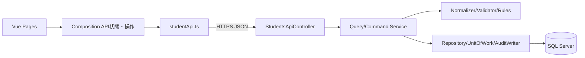

<!-- spec-meta: {"schema":"spec-md/1.0","documentId":"VUE_CSHARPAPI-COM-Vue_CSharpAPI","version":"8.3","path":"test-project1/spec/Vue_CSharpAPI/共通/方式別/01_共通実装仕様.md","sheets":[{"heading":"構造・責務","kind":"GRID","sheet":"01_構造・責務"},{"heading":"共通処理の層分担","kind":"GRID","sheet":"02_共通処理の層分担"},{"heading":"SQL・確定単位","kind":"GRID","sheet":"03_SQL・確定単位"},{"heading":"認証・状態・通信","kind":"GRID","sheet":"04_認証・状態・通信"},{"heading":"共通規約・日付実装","kind":"GRID","sheet":"05_共通規約・日付実装"}],"isolationProfile":"Vue_CSharpAPI"} -->
# Vue／C# API 共通実装仕様

| 項目 | 内容 |
| --- | --- |
| 版数・改訂日 | 8.3／2026-10-25 |
| 対象方式 | Vue／C# API |
| 適用 | 設計上の実装契約。製品コードの実装・コンパイルは未実施 |

開発入力：[学生検索詳細](../../詳細仕様書/01_学生検索画面.md)／[学生登録詳細](../../詳細仕様書/02_学生登録画面.md)／[共通実装](01_共通実装仕様.md)／[DB定義](../../DB定義/SQLServer/01_DB定義書.md)／[方式別開発規約](../../規約/Vue_CSharpAPI.md)／[共通開発規約](../../規約/開発規約.md)。

## 構造・責務

```text
frontend/src/pages/StudentSearchPage.vue, StudentEditPage.vue
frontend/src/components/StudentForm.vue, StudentGrid.vue, Pager.vue
frontend/src/components/CodeSelect.vue, ClassSelector.vue, MessagePanel.vue
frontend/src/components/DuplicateDialog.vue, DeleteDialog.vue
frontend/src/composables/useStudentSearch.ts, useStudentEditor.ts, useDirtyGuard.ts
frontend/src/api/studentApi.ts, contracts.ts, apiClient.ts
backend/Controllers/StudentsApiController.cs
backend/Contracts/StudentSearchRequest.cs, StudentSaveRequest.cs, ApiResult.cs
backend/Application/StudentQueryService.cs, StudentCommandService.cs, MasterMaintenanceService.cs
backend/Domain/StudentDraft.cs, Student.cs, SchoolClass.cs, CodeEntry.cs
backend/Infrastructure/StudentRepository.cs, UnitOfWork.cs, AuditWriter.cs
```



VueはSingle File ComponentとComposition API、TypeScript strict。Vueのリアクティブ値とAPI DTOを同一参照で共有しない。コンポーネントはpropsを直接変更せずupdateイベントを送る。`v-html`に学生値を渡さず通常のテキスト補間を使用。[S-05]

```typescript
export type EntityId = string; // 10進整数、Numberへ変換しない
export interface StudentSaveRequest {
  studentNo: string; studentName: string; studentNameKana: string;
  birthDateInput: { era: string; year: string; month: string; day: string }; genderCode: string; postalCode: string;
  prefectureCode: string; addressLine1: string; addressLine2: string | null;
  phoneNumber: string | null; emailAddress: string | null;
  admissionDate: string; enrollmentStatusCode: string;
  enrollmentEndDate: string | null; classId: EntityId | null;
  emergencyContactName: string | null; relationshipCode: string | null;
  emergencyPhoneNumber: string | null; remarks: string | null;
  schoolYear: number | null; gradeCode: string | null;
  expectedVersion: EntityId | null; duplicateToken: string | null;
  operationReason: string | null; returnContextId: string | null;
}
```

C#側の同名PascalCaseプロパティはraw入力を保持し、ID文字列→long、日付文字列→DateOnly、年→intを厳密検査。最大本文64KiB、未知プロパティと同名重複を拒否。数値やboolから文字列へ暗黙変換しない。

## 共通処理の層分担

| 共通契約 | フロント | API側の正本 |
| --- | --- | --- |
| 共通01～03 | user表示、失効案内 | CurrentUserAccessor、AuthorizationService、BusinessClock |
| 共通04～05 | 長さ・形式の入力補助 | StudentNormalizer、StudentValidator |
| 共通06～10 | 候補描画・人数参考・警告 | MasterLookupService、StudentRules、CapacityService、DuplicateService |
| 共通11 | トークンを一時保持して再送 | DuplicateConfirmationStore、全内容・候補・期限検査 |
| 共通12 | draftとapplied、画面遷移 | SearchContextStore、所有者・版・期限 |
| 共通13～14 | 結果を待つ。DB操作なし | UnitOfWork、AuditWriter |
| 共通15 | MessagePanel、項目エラー | ExceptionMapper、MessageCatalog |

フロントだけに必須・存在・定員・権限を実装しない。正規化の最終結果はAPI側を正本とし、フロント差異は共通テストベクトルで検出する。

## SQL・確定単位

共通の保存・検索手順は[SQL Server DB定義](../../DB定義/SQLServer/01_DB定義書.md)の補足説明を適用する。ここで定義するRepository/UnitOfWorkはその入出力・確定境界を実装する。名前だけを別DBへ置換したSQLは使用しない。

## 認証・状態・通信

基準は同一オリジンにSPAとAPIを配置、認証はSecure/HttpOnly Cookie。Cookie認証なのでJSON APIも明示的なCSRFトークン検証を行う。API bootstrapでCSRF要求トークンを返しメモリー保持、変更系と検索POSTにRequestVerificationTokenヘッダー。credentialsはsame-origin。CORSワイルドカードと資格情報の併用をしない。トークン・個人情報をlocalStorageへ保存しない。[S-14]

基準APIサーバー1台。SearchContextは256bit乱数ID、所有者・ログインセッション・画面タブ、実行済条件、ページ、ソート、Revision、30分期限。Context単位排他で更新し古いRevisionを拒否。DuplicateConfirmationは10分、全正規化業務値＋対象・版のハッシュと全候補ID/版ハッシュ。理由・補助条件は別検査。確認トークンの並行消費禁止、成功で消費、内容変更・結果不明で失効。複数台では共有状態ストア・保護鍵が必須。

認証UserIdと役割はAPIで取得し、JSONのRole・CreatedBy等を拒否。通信はHTTPS、全個人情報応答no-store、DB秘密はAPIだけ。ログは受付番号・処理名・SQLSTATE等の分類だけで要求本文・個人情報・トークンを除外する。

## 共通規約・日付実装

対象読者は実務経験５年程度のプログラマー。[検索詳細](../../詳細仕様書/01_学生検索画面.md)／[登録詳細](../../詳細仕様書/02_学生登録画面.md)／[開発規約](../../規約/開発規約.md)／[日付正本](../07_日付・和暦仕様.md)。

共通16の入力は元号識別値・年・月・日という原文字列4値と業務日。出力は正規化日付と和暦表示文字列、または項目エラー。共通17は項目種別と日付／年度にDATE-R01～06を適用する。変換で不正日を補正しない。OS全体の暦設定を変更しない。元号表の版を画面・保存側で一致させる。

| 役割 | 実装仕様 |
| --- | --- |
| 共通16物理名 | JapaneseBirthDateField.vue / JapaneseDateService（API側） |
| 内部日付型 | TypeScript ISO文字列／C# DateOnly |
| 入力と保存 | 和暦原入力4値から日付を生成。StudentDraft等のbirth_date相当は正規化日付。元号をDBへ重複保存しない |
| 通信境界 | Webの保存要求はbirthDateInputの4文字列を受け、保存側で厳密変換。既存取得応答のbirthDateはISO日付。入力と応答の型を混同しない |
| 表示 | 一覧・参照・重複確認のBirthDateWareki相当文字列は共通16で生成。その他の日付・日時は西暦 |
| 例外 | CHK-032～034、E-DATE-001～003。構文検査後、実在日、元号境界、逆変換、業務範囲、前後関係を順に検査 |
| 参考試験 | DATE-T01～20。ライブラリーの解析成功だけで元号境界を合格にしない |

### 保守入口・方式固有の適合条件

#### UI状態・保守・試験

`originalSnapshot`、`form`、`expectedVersion`、`dirty`、`isBusy`、`duplicateToken`、`lookupSeq`、`returnContextId`を分離。routerの離脱ガードで未保存破棄確認。v-modelが原スナップショットまで変更しないよう深い複製を用いる。リセットは原値、再読込は確認後GET。保存失敗・競合で版を自動更新しない。

管理者保守はC#コンソールから同じAPI側サービスを利用し、5分類70値・クラス規則・履歴原子性を実装。SPAにマスタ画面は増設しない。

共通T-01～28に加え、API直接呼出での権限、CSRF、IDが9007199254740991を超えても文字列保持、fetch応答逆転、ブラウザー戻る、watchループ、401・409・422・503ごとの表示、APIとフロントのスキーマ契約、永続ストレージに個人情報がないことを試験する。

### SQL Server接続・型・共通呼出契約

検索Repositoryは型付き条件、page/pageSize、Cancellation/要求IDを受け、上限超過/件数/一覧/検索日時を返す。SqlServerUnitOfWorkは検索をSNAPSHOT、保存をREAD COMMITTED＋Transaction所有のsp_getapplockで制御する。全DBコマンドは同じConnection/Transactionを受け、個別Commitを禁止する。保存戻り値はSuccess/ValidationError/ConfirmationRequired/Conflict/NotFound/Unknownに分ける。OUTPUT値はCOMMIT確認前にSuccessへしない。

.NETはMicrosoft.Data.SqlClientを参照。SqlDbType.BigInt/Int/SmallInt/Bit/Date/DateTimeOffset/VarChar/NVarChar/UniqueIdentifier/VarBinaryをDB定義と対応させる。長さを推測するAddWithValueを標準にせず型とSizeを明示する。日付パラメーターはDateOnly対応を採用ドライバーで試験し、未対応アダプターではDateTimeの年月日をSqlDbType.Dateへ渡し時差変換しない。GUIDと画面token文字列の表現を混同しない。

WHERE/LIKE/ページ/例外・ゲート戻り値はSQL Server DB定義を正本とし、LIKEは!/%/_/[のリテラル化を含む。接続暗号化、証明書検証、認証主体を最小権限で分離。UIの権限表示だけを更新認可として使わない。

### 派生分類と監査の共通実装

新規／通常更新は[共通データアクセス](../08_データアクセス仕様.md)の緊急４保存項目一式を適用する。続柄分類を常にRELATIONSHIPへ設定する処理は禁止し、続柄値未設定時は分類もNULLへバインドする。コード値を更新する際は分類も同時更新し、変更列監査へ含める。必須３分類は固定のまま。

マスタ監査は[共通モジュール](../03_共通モジュール設計.md)の状態遷移表に従い、停止中の名称変更はUPDATE、状態が実際に停止へ変わる時だけDISABLEとする。認証不成立はE-COM-001、認証済み利用者の認可拒否はE-COM-002を使用し、実装の誤った番号を仕様値として採用しない。


### 検索・編集の省スペースUIとAPI境界

StudentSearchPage.vueは4条件のdraftとappliedCriteriaを分離し、StudentGrid.vueは7列8論理項目と内部スクロールを担当する。criteriaはstudentNo/name/classId/statusCodesだけ。未知・廃止プロパティは空値でも422/E-SRC-002。search-compact-1をSearchContextに保持し、所有者・期限・contextRevisionの照合後、旧形式はW-SRC-002で未検索へ再初期化する。page/resumeは保持済み4条件を使う。検索候補は全年度で、編集用ClassSelector.vueの年度・学年watchは編集に限定する。

StudentEditPage.vue／StudentForm.vueは基本情報の横並びと下段3列をCSS Gridで配置し、12px以上・入力34px以上、1280×650と1366×650で通常入力から操作バーまで表示する。狭幅・拡大・エラー時は折返しと縦スクロール。DuplicateDialog.vue、DeleteDialog.vue、離脱ガードの確認は通常フォームから分離して1つずつ表示し、取消へ初期フォーカス、背景操作を抑止する。v-modelはraw値を保持し、APIだけが保存値・権限・厳密和暦変換を確定する。DB保存・ID文字列・64KiB・CSRF・Revisionを維持する。
