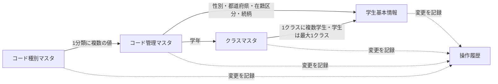

<!-- spec-meta: {"schema":"spec-md/1.0","documentId":"BAS-STU-03","version":"7.0","path":"test-project1/spec/基本設計書/03_テーブル仕様書.md","sheets":[{"heading":"概要","kind":"GRID","sheet":"01_概要"},{"heading":"項目一覧","kind":"LIST","sheet":"02_項目一覧","key":["論理DB項目ID"]},{"heading":"イベント仕様","kind":"GRID","sheet":"03_イベント仕様"},{"heading":"補足説明","kind":"GRID","sheet":"04_補足説明"}]} -->
# テーブル仕様書（論理設計）

| 項目 | 内容 |
| --- | --- |
| 文書番号 | TBL-STU-001 |
| システム名 | 学生管理システム |
| 版数・作成日 | 7.0／2026-10-11 |
| 対象読者 | 顧客（所在団体のIT部門） |
| 対応する詳細仕様 | [テーブル物理仕様](../詳細仕様書/00_実装方式一覧.md) |

## 概要

学生、クラス、業務コード、操作履歴を管理する。以下は業務上の項目名による設計であり、物理テーブル名・列名・データベース製品の型・索引・作成命令は詳細仕様書に定義する。元版の5テーブル・89項目を引き継ぐ。年齢・学年・クラス名称を学生へ重複保存しない。成績テーブルは設けない。

| 番号 | テーブル名 | 1件の単位 | 一意に識別する項目 | 項目数 |
| --- | --- | --- | --- | --- |
| 1 | 学生基本情報 | 学生1人 | 学生管理番号 | 35 |
| 2 | クラスマスタ | 年度内のクラス1件 | クラス管理番号 | 17 |
| 3 | コード種別マスタ | コード分類1件 | コード分類 | 11 |
| 4 | コード管理マスタ | 分類内のコード1件 | コード分類とコード値 | 14 |
| 5 | 操作履歴 | 確定した変更1件 | 操作履歴番号 | 12 |

### データ関連図

実線は保存情報の参照関係、点線は変更時の記録であり、削除連動を意味しない。学生のクラスは卒業・退学時に未所属を許容する。操作履歴は複数のテーブルを対象とする汎用記録であり、履歴の削除が学生へ連動することはない。

## 項目一覧

| 論理DB項目ID | 論理テーブル | 項目順 | 論理項目名 | 必須・初期値 | 形式・最大長 | 説明 |
| --- | --- | --- | --- | --- | --- | --- |
| TBL-01-001 | 学生基本情報 | 1 | 学生管理番号 | 自動 | 正の整数 | 学生を内部的に識別。不変、欠番可 |
| TBL-01-002 | 学生基本情報 | 2 | 学籍番号 | 必須 | 15文字 | 学校が付番。全学生で一意、削除後も再利用不可、変更不可。項目長設計基準に従う。 |
| TBL-01-003 | 学生基本情報 | 3 | 学生氏名 | 必須 | 8文字 | 原表記を保持。前後空白を除く。項目長設計基準に従う。 |
| TBL-01-004 | 学生基本情報 | 4 | 学生氏名カナ | 必須 | 18文字 | 全角カナへ整えた表記。項目長設計基準に従う。 |
| TBL-01-005 | 学生基本情報 | 5 | 氏名照合用情報 | 自動 | 160文字 | 氏名検索・候補比較用。氏名変更と同時に再作成。項目長設計基準に従う。 |
| TBL-01-006 | 学生基本情報 | 6 | 氏名カナ照合用情報 | 自動 | 18文字 | カナの空白差を除いて比較する情報。項目長設計基準に従う。 |
| TBL-01-007 | 学生基本情報 | 7 | 生年月日 | 必須 | 日付 | 内部は日付、画面は和暦。DATE-R01の下限・業務日・入学日を検査 |
| TBL-01-008 | 学生基本情報 | 8 | 性別のコード分類 | 自動固定 | 24文字 | 性別の値を他分類と誤認しないための分類情報。項目長設計基準に従う。 |
| TBL-01-009 | 学生基本情報 | 9 | 性別 | 必須・未回答 | コード値、1桁 | 未回答を許容 |
| TBL-01-010 | 学生基本情報 | 10 | 郵便番号 | 必須 | 数字7桁 | 区切りなし。先頭ゼロを保持 |
| TBL-01-011 | 学生基本情報 | 11 | 都道府県のコード分類 | 自動固定 | 24文字 | 都道府県の分類。項目長設計基準に従う。 |
| TBL-01-012 | 学生基本情報 | 12 | 都道府県 | 必須 | コード値、2桁 | 国内都道府県 |
| TBL-01-013 | 学生基本情報 | 13 | 住所1 | 必須 | 45文字 | 市区町村・町域・番地。項目長設計基準に従う。 |
| TBL-01-014 | 学生基本情報 | 14 | 住所2 | 任意・空 | 45文字 | 建物名・部屋番号。項目長設計基準に従う。 |
| TBL-01-015 | 学生基本情報 | 15 | 本人電話 | 条件付き | 16文字 | 国内または国番号付きの区切りなし表記 |
| TBL-01-016 | 学生基本情報 | 16 | 本人メール | 条件付き | 60文字 | 共通形式に従う。共有可。項目長設計基準に従う。 |
| TBL-01-017 | 学生基本情報 | 17 | 入学日 | 必須 | 日付 | 生年月日以上、本日以前 |
| TBL-01-018 | 学生基本情報 | 18 | 在籍区分のコード分類 | 自動固定 | 24文字 | 在籍区分の分類。項目長設計基準に従う。 |
| TBL-01-019 | 学生基本情報 | 19 | 在籍区分 | 必須・在学 | コード値、2桁 | 在学・休学・卒業・退学 |
| TBL-01-020 | 学生基本情報 | 20 | 卒業・退学日 | 条件付き | 日付 | 卒業・退学なら必須。在学・休学なら空 |
| TBL-01-021 | 学生基本情報 | 21 | 現在・最終所属クラス | 条件付き | クラス管理番号 | 在学・休学は必須。学生1人につき最大1件 |
| TBL-01-022 | 学生基本情報 | 22 | 緊急連絡先氏名 | 一式指定時必須 | 8文字 | 続柄・電話と組で入力。項目長設計基準に従う。 |
| TBL-01-023 | 学生基本情報 | 23 | 続柄のコード分類 | 自動固定 | 24文字 | 続柄の値が空でも分類情報を保持。項目長設計基準に従う。 |
| TBL-01-024 | 学生基本情報 | 24 | 緊急連絡先続柄 | 一式指定時必須 | コード値、2桁 | 父・母・その他等 |
| TBL-01-025 | 学生基本情報 | 25 | 緊急連絡先電話 | 一式指定時必須 | 16文字 | 本人電話と同形式 |
| TBL-01-026 | 学生基本情報 | 26 | 備考 | 任意・空 | 120文字 | 改行可。成績の管理対象ではない。項目長設計基準に従う。 |
| TBL-01-027 | 学生基本情報 | 27 | 削除の状態 | 自動・未削除 | 削除／未削除 | 在籍区分と別に管理 |
| TBL-01-028 | 学生基本情報 | 28 | 削除日時 | 削除時に自動 | 日時 | 未削除では空 |
| TBL-01-029 | 学生基本情報 | 29 | 削除者 | 削除時に自動 | 64文字 | 未削除では空 |
| TBL-01-030 | 学生基本情報 | 30 | 削除理由 | 削除時必須 | 60文字 | 空白だけは不可。未削除では空。項目長設計基準に従う。 |
| TBL-01-031 | 学生基本情報 | 31 | 作成日時 | 自動 | 日時 | 最初の保存日時。変更不可 |
| TBL-01-032 | 学生基本情報 | 32 | 作成者 | 自動 | 64文字 | 認証された登録者。変更不可 |
| TBL-01-033 | 学生基本情報 | 33 | 更新日時 | 自動 | 日時 | 実変更の保存時点 |
| TBL-01-034 | 学生基本情報 | 34 | 更新者 | 自動 | 64文字 | 認証された変更者 |
| TBL-01-035 | 学生基本情報 | 35 | 更新管理番号 | 自動 | 正の整数 | 新規1、実変更ごとに1加算、上限で停止 |
| TBL-02-001 | クラスマスタ | 1 | クラス管理番号 | 自動 | 正の整数 | 内部識別子、変更不可 |
| TBL-02-002 | クラスマスタ | 2 | 学校年度 | 必須 | 1900～9998 | 4月1日～翌年3月31日、登録後変更不可 |
| TBL-02-003 | クラスマスタ | 3 | 学年のコード分類 | 自動固定 | 24文字 | 学年の分類。項目長設計基準に従う。 |
| TBL-02-004 | クラスマスタ | 4 | 学年 | 必須・学年なし | コード値、2桁 | 参照学生がいる場合の意味変更を禁止 |
| TBL-02-005 | クラスマスタ | 5 | クラスコード | 必須 | 9文字 | 英数字・ハイフン、先頭英数字。年度内で一意、変更不可。項目長設計基準に従う。 |
| TBL-02-006 | クラスマスタ | 6 | クラス名 | 必須 | 18文字 | 顧客向けの名称。項目長設計基準に従う。 |
| TBL-02-007 | クラスマスタ | 7 | 利用開始日 | 必須・年度開始日 | 日付 | 学校年度内、終了日以下 |
| TBL-02-008 | クラスマスタ | 8 | 利用終了日 | 必須・年度終了日 | 日付 | 学校年度内。両端を含む |
| TBL-02-009 | クラスマスタ | 9 | 定員 | 任意・未設定 | 1～9999人 | 未設定は制限なし。0人定員は指定しない |
| TBL-02-010 | クラスマスタ | 10 | 表示順 | 必須・0 | 0以上の整数 | 候補表示の順番 |
| TBL-02-011 | クラスマスタ | 11 | 利用可否 | 必須・利用可 | 可／不可 | 停止しても既存参照は残す |
| TBL-02-012 | クラスマスタ | 12 | 備考 | 任意・空 | 120文字 | クラス説明。担任の人事管理は対象外。項目長設計基準に従う。 |
| TBL-02-013 | クラスマスタ | 13 | 作成日時 | 自動 | 日時 | 最初の保存日時。変更不可 |
| TBL-02-014 | クラスマスタ | 14 | 作成者 | 自動 | 64文字 | 認証された登録者。変更不可 |
| TBL-02-015 | クラスマスタ | 15 | 更新日時 | 自動 | 日時 | 実変更の保存時点 |
| TBL-02-016 | クラスマスタ | 16 | 更新者 | 自動 | 64文字 | 認証された変更者 |
| TBL-02-017 | クラスマスタ | 17 | 更新管理番号 | 自動 | 正の整数 | 新規1、実変更ごとに1加算、上限で停止 |
| TBL-03-001 | コード種別マスタ | 1 | コード分類 | 必須 | 24文字 | 分類の識別情報。登録後変更不可。項目長設計基準に従う。 |
| TBL-03-002 | コード種別マスタ | 2 | コード分類名 | 必須 | 12文字 | 性別・在籍区分等。項目長設計基準に従う。 |
| TBL-03-003 | コード種別マスタ | 3 | コード値の桁数 | 必須 | 1～10 | 分類内の値を固定桁で管理 |
| TBL-03-004 | コード種別マスタ | 4 | 値の追加可否 | 必須 | 可／不可 | 通常保守で新しい値を増やせるか |
| TBL-03-005 | コード種別マスタ | 5 | 分類の利用可否 | 必須・利用可 | 可／不可 | 本版の5分類は利用可を維持 |
| TBL-03-006 | コード種別マスタ | 6 | 備考 | 任意 | 120文字 | 分類の用途・保守上の注意。項目長設計基準に従う。 |
| TBL-03-007 | コード種別マスタ | 7 | 作成日時 | 自動 | 日時 | 最初の保存日時。変更不可 |
| TBL-03-008 | コード種別マスタ | 8 | 作成者 | 自動 | 64文字 | 認証された登録者。変更不可 |
| TBL-03-009 | コード種別マスタ | 9 | 更新日時 | 自動 | 日時 | 実変更の保存時点 |
| TBL-03-010 | コード種別マスタ | 10 | 更新者 | 自動 | 64文字 | 認証された変更者 |
| TBL-03-011 | コード種別マスタ | 11 | 更新管理番号 | 自動 | 正の整数 | 新規1、実変更ごとに1加算、上限で停止 |
| TBL-04-001 | コード管理マスタ | 1 | コード分類 | 必須 | 24文字 | コード種別マスタに存在する分類。項目長設計基準に従う。 |
| TBL-04-002 | コード管理マスタ | 2 | コード値 | 必須 | 数字1～10桁 | 分類で決めた固定桁。先頭ゼロを保持 |
| TBL-04-003 | コード管理マスタ | 3 | コード名称 | 必須 | 12文字 | 画面に表示する名称。項目長設計基準に従う。 |
| TBL-04-004 | コード管理マスタ | 4 | 表示順 | 必須・0 | 0以上の整数 | 同順位はコード値順 |
| TBL-04-005 | コード管理マスタ | 5 | 利用可否 | 必須・利用可 | 可／不可 | 利用不可は新規選択不可 |
| TBL-04-006 | コード管理マスタ | 6 | 有効開始日 | 必須・1900年1月1日 | 日付 | 両端を含む |
| TBL-04-007 | コード管理マスタ | 7 | 有効終了日 | 任意・空 | 日付 | 空は期限なし。開始日以上 |
| TBL-04-008 | コード管理マスタ | 8 | 保護対象 | 必須 | 対象／対象外 | 保護値の停止・期間短縮等を禁止 |
| TBL-04-009 | コード管理マスタ | 9 | 備考 | 任意・空 | 120文字 | 意味や使用上の注意。項目長設計基準に従う。 |
| TBL-04-010 | コード管理マスタ | 10 | 作成日時 | 自動 | 日時 | 最初の保存日時。変更不可 |
| TBL-04-011 | コード管理マスタ | 11 | 作成者 | 自動 | 64文字 | 認証された登録者。変更不可 |
| TBL-04-012 | コード管理マスタ | 12 | 更新日時 | 自動 | 日時 | 実変更の保存時点 |
| TBL-04-013 | コード管理マスタ | 13 | 更新者 | 自動 | 64文字 | 認証された変更者 |
| TBL-04-014 | コード管理マスタ | 14 | 更新管理番号 | 自動 | 正の整数 | 新規1、実変更ごとに1加算、上限で停止 |
| TBL-05-001 | 操作履歴 | 1 | 操作履歴番号 | 自動 | 正の整数 | 追記記録の識別子 |
| TBL-05-002 | 操作履歴 | 2 | 対象情報の種類 | 自動 | 21文字 | 学生、クラス、コード分類、コード値のいずれか。項目長設計基準に従う。 |
| TBL-05-003 | 操作履歴 | 3 | 対象の識別情報 | 自動 | 35文字 | 管理番号または分類と値。氏名等を含めない。項目長設計基準に従う。 |
| TBL-05-004 | 操作履歴 | 4 | 操作の種類 | 自動 | 11文字 | 新規・変更・論理削除・停止・再開。項目長設計基準に従う。 |
| TBL-05-005 | 操作履歴 | 5 | 変更前の更新管理番号 | 新規以外必須 | 正の整数 | 新規は空 |
| TBL-05-006 | 操作履歴 | 6 | 変更後の更新管理番号 | 自動 | 正の整数 | 新規は1、変更は以前の番号＋1 |
| TBL-05-007 | 操作履歴 | 7 | 変更項目一覧 | 自動 | 複数項目 | 変更した項目を記録。入力値自体は複写しない |
| TBL-05-008 | 操作履歴 | 8 | 実行者 | 自動 | 64文字 | 認証された利用者番号 |
| TBL-05-009 | 操作履歴 | 9 | 実行日時 | 自動 | 日時 | 対応する保存操作の日時 |
| TBL-05-010 | 操作履歴 | 10 | 受付番号 | 自動 | 一意な形式の番号 | 障害調査用。同一要求で関連付ける |
| TBL-05-011 | 操作履歴 | 11 | 操作・確認理由 | 条件付き | 60文字 | 削除・終了区分訂正・重複警告続行時は必須。項目長設計基準に従う。 |
| TBL-05-012 | 操作履歴 | 12 | 重複警告の確認有無 | 自動 | 有／無 | 別人確認を経た保存で有 |

## イベント仕様

| 操作 | 保存・検査規則 |
| --- | --- |
| 学生登録 | 学籍番号を全件で重複確認。参照先・連絡先・日付・定員・同一人物候補を検査。学生と履歴を一括保存 |
| 学生更新 | 対象存在、学籍番号不変、他者更新なしを確認。業務上の変更なしなら保存・履歴なし |
| 学生削除 | 削除状態・日時・者・理由・更新管理情報だけ変更し履歴を追記 |
| クラス保守 | 年度内一意、参照学生、現在人数、学年、期間を検証し履歴と保存 |
| コード保守 | 分類内一意、桁数、保護、利用期間、意味の不変を確認し履歴と保存 |
| 検索・画面表示 | 参照のみ。履歴は増やさない |

参照されているクラス・コードの実体を通常処理で削除しない。参照先が存在していても停止・期間外・満員等の業務条件は別に確認する。削除済みの学生からの参照も、マスタの意味を変えてよいかの判断に含める。

## 補足説明

物理消去と保管期間は別途運用承認が必要。サンプル学生・クラスは本番へ自動投入しない。初期投入はコード分類、コード値、学校が確認したクラスの順とする。学校名や実クラスは未指定である。

### 共通日付・項目追跡

[日付・年範囲](../共通/07_日付・和暦仕様.md)を正本とする。生年月日だけ和暦表示、他は西暦。元号は共通暦定義であり、既存5分類70コードへ追加しない。画面項目の表示・検索・保存の向きは各機能の項目IDから追跡する。

### 共通の管理項目

学生基本情報、クラスマスタ、コード種別マスタ、コード管理マスタに以下5項目を持つ。各表の項目数にはこの5項目を含む。

日時は同じ時点を一意に扱える形式で保存し、画面は日本時間で表示する。日付項目は時刻を持たない。管理項目を利用者の入力で上書きしない。

### 学生基本情報（個別30項目＋共通5項目）

学年は所属クラスから参照する。「学年なし」と「クラス未所属」は別概念。電話・メール・緊急電話のいずれか1つ以上を必要とする。緊急連絡先は氏名・続柄・電話の全部を空にするか、全部を入力する。

### クラスマスタ（個別12項目＋共通5項目）

同年度では学年が異なっても同じクラスコードは使用不可。同年度・同学年で同名クラスは警告するが、別コードなら保存可。学年の変更は削除済みを含む参照学生がいない場合だけ可能。利用停止は在学・休学の非削除学生が0人の場合だけ可能。定員を在籍人数未満へ減らさない。期間変更で現時点の所属学生が利用期間外になる場合は拒否する。

### コード管理マスタ（個別9項目＋共通5項目）

分類と値の組で一意。異なる分類の「01」は別の意味として共存する。名称は識別情報にしない。名称変更で学生のコード値を変更しない。コード値を別の意味へ再利用しない。

### 操作履歴（12項目）

操作履歴は確定した変更だけを記録し、追記のみとする。変更前後の個人情報を保持する履歴ではないため、過去の氏名・住所・所属を復元する機能を保証しない。
