<!-- spec-meta: {"schema":"spec-md/1.0","documentId":"DET-AS400_RPG-SCR-STU-001","version":"7.3","path":"test-project1/spec/詳細仕様書/AS400_RPG/01_学生検索画面.md","sheets":[{"heading":"概要","kind":"GRID","sheet":"01_概要"},{"heading":"項目一覧","kind":"LIST","sheet":"02_項目一覧","key":["項目ID"]},{"heading":"選択候補一覧","kind":"LIST","sheet":"03_選択候補一覧","key":["候補ID"]},{"heading":"内部項目一覧","kind":"LIST","sheet":"04_内部項目一覧","key":["内部項目ID"]},{"heading":"イベント仕様","kind":"GRID","sheet":"05_イベント仕様"},{"heading":"項目移送仕様","kind":"LIST","sheet":"06_項目移送仕様","key":["移送ID"]},{"heading":"補足説明","kind":"GRID","sheet":"07_補足説明"}]} -->
# 学生検索画面 詳細仕様書（AS400／RPG）

| 項目 | 内容 |
| --- | --- |
| システム名 | 学生管理システム |
| 機能ID | SCR-STU-001 |
| 版数・改訂日 | 7.3／2026-10-12 |
| 対象読者 | 実務経験５年程度のプログラマー |
| 状態 | 実装前の設計仕様。実装・コンパイル・実機試験は未実施 |
| 開発方式 | AS400／RPG |
| 対応基本設計 | [基本設計](../../基本設計書/01_学生検索画面.md) |

## 概要

### 概要説明

検索条件と一覧を管理する。業務DBは参照のみ。

| 責務 | 物理構成 |
| --- | --- |
| 画面・提示制御 | STUSRCH / STUSCHD |
| 業務処理・共通呼出 | StSaveStudent / StDeleteStudent |
| 共通実装仕様 | [方式別共通仕様・DB定義・開発規約](../../共通/方式別/AS400_RPG/01_共通実装仕様.md) |
| 原則 | DB列・変数・型は本書・共通仕様・DB定義・開発規約。業務要件を言語都合で弱めない |

### 画面設計

#### 画面レイアウト（描画可能な埋め込みHTML）

画面の配置・色・入力欄・一覧・操作を表現した**静的HTMLモック**。サンプル値は架空。実装環境の実機画面ではなく、ブラウザーで描画した設計見本である。

[単独HTMLプレビュー](assets/学生検索.html)／[レンダリング画像](assets/学生検索.png)。GitHubのMarkdown表示でCSSや入力要素が除去される場合にも配置を確認できるよう画像を併記する。下記HTMLが画面設計の構造であり、画像だけで代替しない。

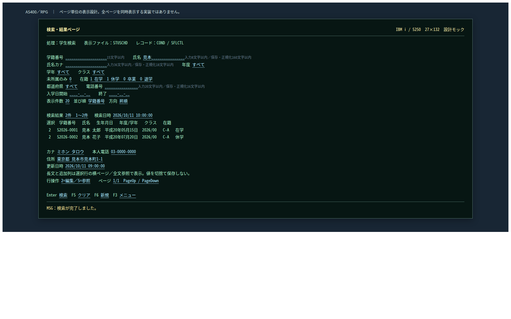

<!-- screen-html-start: SRC -->

AS400／RPG　｜　ページ単位の表示設計。全ページを同時表示する実装ではありません。

<strong>検索・結果ページ</strong>IBM i / 5250　27×132　設計モック
<pre>処理：学生検索　　表示ファイル：STUSCHD　　レコード：COND / SFLCTL

学籍番号 ____________________15文字以内    氏名 見本________________入力8文字以内／保存・正規化160文字以内
氏名カナ ____________________入力36文字以内／保存・正規化18文字以内    年度 すべて
学年 すべて    クラス すべて
未所属のみ 0    在籍 1 在学　1 休学　0 卒業　0 退学
都道府県 すべて    電話番号 ________________入力20文字以内／保存・正規化16文字以内
入学日開始 ____-__-__    終了 ____-__-__
表示件数 20  並び順 学籍番号  方向 昇順

検索結果 2件　1～2件   検索日時 2026/10/11 10:00:00
選択　学籍番号 　氏名 　生年月日 　年度/学年 　クラス 　在籍 
 2　 S2026-0001　見本 太郎　平成20年05月15日　2026/00　 C-A　 在学
 2　 S2026-0002　見本 花子　平成20年07月20日　2026/00　 C-A　 休学

カナ ミホン タロウ    本人電話 03-0000-0000
住所 東京都 見本市見本町1-1
更新日時 2026/10/11 09:00:00
長文と追加列は選択行の横ページ／全文参照で表示。値を切捨て保存しない。
行操作 2=編集／5=参照    ページ 1/1　PageUp / PageDown

Enter 検索  F5 クリア  F6 新規  F3 メニュー</pre>
MSG：検索が完了しました。

<!-- screen-html-end: SRC -->

#### 表示状態・モード別制御

[共通UI状態](../../共通/04_共通UI部品設計.md)に従う。初回は未検索。処理中は二重検索を抑止し、0件・上限超過・検索失敗を区別する。参照権限では新規登録を表示せず行操作を参照とする。検索画面では生年月日を編集しない。

### ファイル・DB入出力関係

#### 入出力一覧

方向は当該機能から見たもの。画面入力、DB読取り、DB書込みを区別する。

| IO-ID | 分類 | 対象 | 入出力 | 主な項目 | 保存単位・備考 |
| --- | --- | --- | --- | --- | --- |
| 01 | 画面 | 入力条件・操作 | 入力 | 当該機能の項目一覧 | 要求開始時の値を複製 |
| 02 | 永続DB | m_student | 入力（参照） | 学生基本情報・版 | 更新なし |
| 03 | 永続DB | m_class | 入力（参照） | 年度・学年・名称・期間・定員 | 学生機能からマスタを更新しない |
| 04 | 永続DB | m_code_category / m_code | 入力（参照） | 分類・値・名称・有効性 | 学生機能からマスタを更新しない |
| 05 | 一時情報 | ジョブ内DS・QTEMP | 入出力 | 確定検索条件・ページ・原入力・確認対象 | 業務表と別。所有者・期限を検査 |
| 06 | 外部ファイル | なし | なし | CSV・帳票・取込は本機能の対象外 | 仕様書MDを業務IOに数えない |
| 07 | 画面 | 一覧・メッセージ | 出力 | 個人情報は必要項目のみ | DB保存とは別の出力 |

#### データ操作関連図

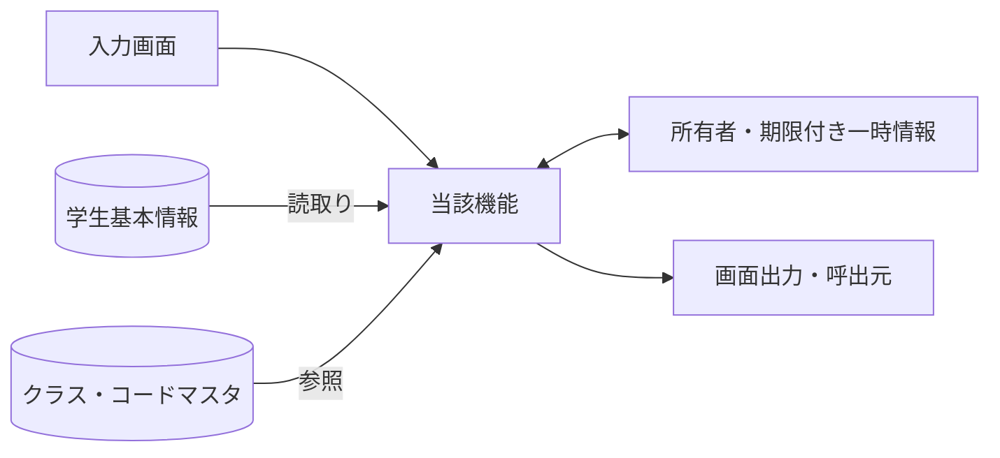

認証情報・業務日時は共通01～03から取得。マスタ保守の承認入力ファイルは画面機能のIOに含めず、方式別共通仕様に定義する。

### 実装契約の配置

共用クラス／プログラム構造は[方式別共通仕様](../../共通/方式別/AS400_RPG/01_共通実装仕様.md)、SQLの永続項目・制約は[DB定義](../../DB定義/Db2_for_i/01_DB定義書.md)、命名・配備は[開発規約](../../../docs/開発規約/AS400_RPG.md)へ分離する。本機能の具体的な画面・変数・DB割当・イベント順序は本書を正とし、共通契約を引数と結果で具体化する。

## 項目一覧

| 項目ID | グループ | 論理項目名 | 種類 | 入出力 | 入力最大長 | 保存・正規化最大長 | 長さ単位 | 必須区分 | 必須条件 | 初期値 | 未設定値 | 表示形式・許容範囲 | 関連論理DB項目 | 物理コントロール | 変数・プロパティ | 言語型 | 物理DB項目 | 候補ID | 正規化ID | チェックID | 関連イベント | DB連携説明 | Raw入力表現 | 対応DB型 | 対応DB_NULL可否 |
| --- | --- | --- | --- | --- | --- | --- | --- | --- | --- | --- | --- | --- | --- | --- | --- | --- | --- | --- | --- | --- | --- | --- | --- | --- | --- |
| SRC-001 | 検索条件 | 学籍番号 | 文字入力 | I（検索条件） | 15 | 15 | Unicodeスカラー値 | 任意 | 未指定は条件なし。CHK-003は番号形式だけ、重複・変更不可は非適用 | 空 | NULL相当 | 15文字以内 | 学生基本情報・学籍番号 | QSTUNO | criteria.studentNo | vargraphic(30)＋スカラー数検査 | m_student.student_no | － | N-06 | CHK-002,CHK-003 | EV-SRC-002 | 前方一致、N-06。保存なし | 画面文字列（空・不正を保持）／DDS文字領域＋NULL標識 | m_student.student_no:VARCHAR(15) CCSID1208 | m_student.student_no:不可 |
| SRC-002 | 検索条件 | 氏名 | 文字入力 | I（検索条件） | 8 | 160 | Unicodeスカラー値 | 任意 | 表示氏名ではなく照合キーに部分一致 | 空 | NULL相当 | 原入力8文字以内、正規化後160文字以内 | 学生基本情報・氏名照合用情報 | QNAME | criteria.nameKey | vargraphic(16)＋スカラー数検査 | m_student.name_key | － | N-03 | CHK-002 | EV-SRC-002 | N-03後の部分一致。氏名の原表記と区別 | 画面文字列（空・不正を保持）／DDS文字領域＋NULL標識 | m_student.name_key:VARGRAPHIC(320) CCSID1200 | m_student.name_key:不可 |
| SRC-003 | 検索条件 | 氏名カナ | 文字入力 | I（検索条件） | 36 | 18 | Unicodeスカラー値 | 任意 | カナ正規化後18以内、照合キーに部分一致 | 空 | NULL相当 | 原入力36文字以内、正規化後18文字以内 | 学生基本情報・氏名カナ照合用情報 | QKANA | criteria.kanaKey | vargraphic(72)＋スカラー数検査 | m_student.kana_key | － | N-04,N-05 | CHK-002,CHK-006 | EV-SRC-002 | N-05後の部分一致 | 画面文字列（空・不正を保持）／DDS文字領域＋NULL標識 | m_student.kana_key:VARGRAPHIC(36) CCSID1200 | m_student.kana_key:不可 |
| SRC-004 | 検索条件 | 年度 | 選択 | I（検索条件） | 4 | 4 | 数字またはASCII文字 | 任意 | 1900～9998かつクラス年度候補に存在 | すべて | NULL相当 | 4桁 | クラスマスタ・学校年度 | QYEAR | criteria.schoolYear | int(10)＋int(5) NULL標識 | m_class.school_year | 年度 | N-11 | CHK-010,CHK-014,CHK-034 | EV-SRC-002 | 完全一致。西暦1900～9998、DATE-R04 | 画面文字列（空・不正を保持）／DDS文字領域＋NULL標識 | m_class.school_year:SMALLINT | m_class.school_year:不可 |
| SRC-005 | 検索条件 | 学年 | 選択 | I（検索条件） | 2 | 2 | 数字またはASCII文字 | 任意 | 分類GRADEに存在。停止・期間外も検索可 | すべて | NULL相当 | 数字2桁。候補一覧の分類・値 | クラスマスタ・学年 | QGRADE | criteria.gradeCode | varchar(2)＋NULL標識 | m_class.grade_code | 学年 | N-07 | CHK-010,CHK-014 | EV-SRC-002 | 完全一致。学年なしと未所属は別 | 画面文字列（空・不正を保持）／DDS文字領域＋NULL標識 | m_class.grade_code:VARCHAR(2) CCSID1208 | m_class.grade_code:不可 |
| SRC-006 | 検索条件 | クラス | 選択 | I（検索条件） | 19 | 64bit正整数 | 数字またはASCII文字 | 任意 | 実在、指定された年度・学年と一致 | すべて | NULL相当 | 正の整数。型範囲は方式別DB定義 | 学生基本情報・現在・最終所属クラス | QCLASS | criteria.classId | int(20)＋int(5) NULL標識 | m_student.class_id | クラス | 非適用 | CHK-010,CHK-014 | EV-SRC-002 | 完全一致。年度・学年は選択クラス実値と照合 | 画面文字列（空・不正を保持）／DDS文字領域＋NULL標識 | m_student.class_id:BIGINT | m_student.class_id:可 |
| SRC-007 | 検索条件 | 未所属のみ | チェック | I（検索条件） | 1 | 1 | 真偽値 | 任意 | trueなら年度・学年・クラスなし | false | FALSE | 選択／未選択 | 学生基本情報・現在・最終所属クラス | QUNASS | criteria.unassignedOnly | ind | m_student.class_id | － | 非適用 | CHK-029 | EV-SRC-002 | 未設定だけ。年度・学年・クラスと排他 | 選択値の配列／チェック状態／DDS文字領域＋NULL標識 | m_student.class_id:BIGINT | m_student.class_id:可 |
| SRC-008 | 検索条件 | 在籍区分 | 複数選択 | I（検索条件） | 2×最大4件 | 2×最大4件 | 数字またはASCII文字 | 任意 | 空配列は全区分。重複値・未定義値は拒否 | 01,02 | 空配列 | 在学・休学・卒業・退学 | 学生基本情報・在籍区分 | QST01 / QST02 / QST03 / QST04 | criteria.statusSelected(1 To 4) | varchar(2) dim(4)＋件数 | m_student.enrollment_status_code | 在籍区分 | N-07 | CHK-010,CHK-024 | EV-SRC-002 | 複数値はいずれか一致、全解除は全区分 | 選択値の配列／チェック状態／DDS文字領域＋NULL標識 | m_student.enrollment_status_code:VARCHAR(2) CCSID1208 | m_student.enrollment_status_code:不可 |
| SRC-009 | 検索条件 | 都道府県 | 選択 | I（検索条件） | 2 | 2 | 数字またはASCII文字 | 任意 | 分類PREFECTUREに存在。停止も検索可 | すべて | NULL相当 | 数字2桁。候補一覧の分類・値 | 学生基本情報・都道府県 | QPREF | criteria.prefectureCode | varchar(2)＋NULL標識 | m_student.prefecture_code | 都道府県 | N-07 | CHK-010 | EV-SRC-002 | コード値で完全一致 | 画面文字列（空・不正を保持）／DDS文字領域＋NULL標識 | m_student.prefecture_code:VARCHAR(2) CCSID1208 | m_student.prefecture_code:不可 |
| SRC-010 | 検索条件 | 電話番号 | 文字入力 | I（検索条件） | 20 | 16 | Unicodeスカラー値 | 任意 | 本人電話または緊急電話に完全一致 | 空 | NULL相当 | 原入力20文字以内、正規化後16文字以内 | 学生基本情報・本人電話／緊急連絡先電話 | QPHONE | criteria.phoneNumber | vargraphic(40)＋スカラー数検査 | m_student.phone_number / emergency_phone_number | － | N-09 | CHK-002,CHK-017 | EV-SRC-002 | N-09後の完全一致、本人または緊急電話 | 画面文字列（空・不正を保持）／DDS文字領域＋NULL標識 | m_student.phone_number:VARCHAR(16) CCSID1208／m_student.emergency_phone_number:VARCHAR(16) CCSID1208 | m_student.phone_number:可；m_student.emergency_phone_number:可 |
| SRC-011 | 検索条件 | 入学日・開始 | 日付 | I（検索条件） | 10 | 日付 | 年4桁・ISO10文字 | 任意 | 1900-01-01～業務日。片側指定可 | 空 | NULL相当 | 西暦yyyy/MM/dd、入力yyyy-MM-dd、DATE-R02/03 | 学生基本情報・入学日 | QADMFROM | criteria.admissionFrom | date＋int(5) NULL標識 | m_student.admission_date | － | N-11 | CHK-007,CHK-033 | EV-SRC-002 | 開始日を含む。DATE-R03、片側指定可 | 画面文字列（空・不正を保持）／DDS文字領域＋NULL標識 | m_student.admission_date:DATE | m_student.admission_date:不可 |
| SRC-012 | 検索条件 | 入学日・終了 | 日付 | I（検索条件） | 10 | 日付 | 年4桁・ISO10文字 | 任意 | 1900-01-01～業務日、開始指定時は開始以上 | 空 | NULL相当 | 西暦yyyy/MM/dd、入力yyyy-MM-dd、DATE-R02/03 | 学生基本情報・入学日 | QADMTO | criteria.admissionTo | date＋int(5) NULL標識 | m_student.admission_date | － | N-11 | CHK-007,CHK-033 | EV-SRC-002 | 終了日を含む。DATE-R03、開始≦終了 | 画面文字列（空・不正を保持）／DDS文字領域＋NULL標識 | m_student.admission_date:DATE | m_student.admission_date:不可 |
| SRC-013 | 操作 | 検索 | 操作 | 操作 | 非適用 | 非適用 | 非適用 | 非適用 | 表示または操作項目 | 条件を検査して1ページ目を表示 | 非適用 | ― | DB保存なし | Enter | search | イベント／引数はイベント仕様 | － | － | 非適用 | 非適用 | EV-SRC-002 | 入力検査後、最初のページを取得 | 入力対象外 | 非適用（操作・計算または一覧DTO） | 非適用 |
| SRC-014 | 操作 | クリア | 操作 | 操作 | 非適用 | 非適用 | 非適用 | 非適用 | 表示または操作項目 | 初期条件・未検索へ戻す | 非適用 | ― | DB保存なし | F5 | clear | イベント／引数はイベント仕様 | － | － | 非適用 | 非適用 | EV-SRC-005 | 初期条件・未検索へ、保持条件を消去 | 入力対象外 | 非適用（操作・計算または一覧DTO） | 非適用 |
| SRC-015 | 操作 | 新規登録 | 操作 | 操作 | 非適用 | 非適用 | 非適用 | 非適用 | 表示または操作項目 | 担当者・管理者だけ表示 | 非適用 | ― | DB保存なし | F6 | new | イベント／引数はイベント仕様 | － | － | 非適用 | 非適用 | EV-SRC-005 | 権限を確認し学生登録へ遷移 | 入力対象外 | 非適用（操作・計算または一覧DTO） | 非適用 |
| SRC-016 | 操作 | メニューへ | 操作 | 操作 | 非適用 | 非適用 | 非適用 | 非適用 | 表示または操作項目 | 共通メニューへ戻る | 非適用 | ― | DB保存なし | F3 | menu | イベント／引数はイベント仕様 | － | － | 非適用 | 非適用 | EV-SRC-005 | 共通メニューへ | 入力対象外 | 非適用（操作・計算または一覧DTO） | 非適用 |
| SRC-017 | 結果・一覧 | 検索件数・表示範囲 | 表示 | O（表示） | 非適用 | 表示元の上限：件数0～10000・範囲0～10000 | 非適用 | 自動表示 | 入力対象外。取得結果または計算値を表示 | 未検索 | 表示欠損は－、マスタ欠落は不整合表示 | 件数0～10000・範囲0～10000 | 計算：全条件一致の学生件数 | RESULT_COUNT | totalCount / RangeFrom / RangeTo | 表示DTO／複合項目は内部項目一覧 | count of matching student_id | － | 非適用 | 非適用 | EV-SRC-002 | 未検索／0件／上限超過を区別 | 入力対象外 | 非適用（操作・計算または一覧DTO） | 非適用 |
| SRC-018 | 結果・一覧 | 検索日時 | 表示 | O（表示） | 非適用 | 表示元の上限：西暦日時19文字 | 非適用 | 自動表示 | 入力対象外。取得結果または計算値を表示 | 未検索 | 表示欠損は－、マスタ欠落は不整合表示 | 西暦日時19文字 | 計算：今回の検索実行日時 | SEARCH_AT | searchedAt | 表示DTO／複合項目は内部項目一覧 | RequestContext.ExecutedAt | － | 非適用 | 非適用 | EV-SRC-002 | 西暦日時、日本時間。DB保存なし | 入力対象外 | 非適用（操作・計算または一覧DTO） | 非適用 |
| SRC-019 | 結果・一覧 | 表示件数 | 選択 | I（表示指定） | 3 | 保存なし | 数字またはASCII文字 | 必須 | 20・50・100のみ | 20 | 不可 | 表示規則による | DB保存なし：取得範囲 | QSIZE | pageSize | int(10)＋int(5) NULL標識 | pageSize | 表示件数 | 非適用 | CHK-024 | EV-SRC-004 | 20／50／100、既定20 | 画面文字列（空・不正を保持）／DDS文字領域＋NULL標識 | 非適用（操作・計算または一覧DTO） | 非適用 |
| SRC-020 | 結果・一覧 | 学籍番号 | 表示 | O（表示） | 非適用 | 表示元の上限：15 | 非適用 | 自動表示 | 入力対象外。取得結果または計算値を表示 | 未検索 | 表示欠損は－、マスタ欠落は不整合表示 | 15 | 学生基本情報・学籍番号 | SFL.StudentNo | studentNo | 表示DTO／複合項目は内部項目一覧 | m_student.student_no | － | 非適用 | 非適用 | EV-SRC-002,EV-SRC-004,EV-SRC-006 | 保存済み文字列、文字順 | 入力対象外 | m_student.student_no:VARCHAR(15) CCSID1208 | m_student.student_no:不可 |
| SRC-021 | 結果・一覧 | 氏名 | 表示 | O（表示） | 非適用 | 表示元の上限：8 | 非適用 | 自動表示 | 入力対象外。取得結果または計算値を表示 | 未検索 | 表示欠損は－、マスタ欠落は不整合表示 | 8 | 学生基本情報・学生氏名 | SFL.StudentName | studentName | 表示DTO／複合項目は内部項目一覧 | m_student.student_name | － | 非適用 | 非適用 | EV-SRC-002,EV-SRC-004,EV-SRC-006 | 登録表記のまま文字列表示 | 入力対象外 | m_student.student_name:VARGRAPHIC(16) CCSID1200 | m_student.student_name:不可 |
| SRC-022 | 結果・一覧 | 氏名カナ | 表示 | O（表示） | 非適用 | 表示元の上限：18 | 非適用 | 自動表示 | 入力対象外。取得結果または計算値を表示 | 未検索 | 表示欠損は－、マスタ欠落は不整合表示 | 18 | 学生基本情報・学生氏名カナ | SFL.StudentNameKana | studentNameKana | 表示DTO／複合項目は内部項目一覧 | m_student.student_name_kana | － | 非適用 | 非適用 | EV-SRC-002,EV-SRC-004,EV-SRC-006 | 保存済みカナ表記 | 入力対象外 | m_student.student_name_kana:VARGRAPHIC(36) CCSID1200 | m_student.student_name_kana:不可 |
| SRC-023 | 結果・一覧 | 生年月日 | 表示 | O（表示） | 非適用 | 表示元の上限：共通和暦書式 | 非適用 | 自動表示 | 入力対象外。取得結果または計算値を表示 | 未検索 | 表示欠損は－、マスタ欠落は不整合表示 | 共通和暦書式 | 学生基本情報・生年月日 | SFL.BirthDateWareki | birthDateWareki | 表示DTO／複合項目は内部項目一覧 | m_student.birth_date | － | 非適用 | 非適用 | EV-SRC-002,EV-SRC-004,EV-SRC-006 | 和暦表示。共通16で日付から変換 | 入力対象外 | m_student.birth_date:DATE | m_student.birth_date:不可 |
| SRC-024 | 結果・一覧 | 年度・学年 | 表示 | O（表示） | 非適用 | 表示元の上限：年度4桁＋学年名称12 | 非適用 | 自動表示 | 入力対象外。取得結果または計算値を表示 | 未検索 | 表示欠損は－、マスタ欠落は不整合表示 | 年度4桁＋学年名称12 | クラスマスタ・学校年度／学年→コード管理マスタ（学年）・コード名称 | SFL.SchoolYear / GradeName | schoolYear / GradeName | 表示DTO／複合項目は内部項目一覧 | m_class.school_year / grade_code → m_code.code_name | － | 非適用 | 非適用 | EV-SRC-002,EV-SRC-004,EV-SRC-006 | 年度は西暦、学年は名称。未所属は－ | 入力対象外 | m_class.school_year:SMALLINT／m_code.code_name:VARGRAPHIC(24) CCSID1200 | m_class.school_year:不可；m_code.code_name:不可 |
| SRC-025 | 結果・一覧 | クラス | 表示 | O（表示） | 非適用 | 表示元の上限：コード9＋名称18＋注記 | 非適用 | 自動表示 | 入力対象外。取得結果または計算値を表示 | 未検索 | 表示欠損は－、マスタ欠落は不整合表示 | コード9＋名称18＋注記 | 学生基本情報・現在・最終所属クラス→クラスマスタ・クラスコード／クラス名 | SFL.ClassCode / ClassName | classCode / ClassName | 表示DTO／複合項目は内部項目一覧 | m_student.class_id → m_class.class_code / class_name | － | 非適用 | 非適用 | EV-SRC-002,EV-SRC-004,EV-SRC-006 | 未所属／停止／期間外を区別 | 入力対象外 | m_class.class_code:VARCHAR(9) CCSID1208／m_class.class_name:VARGRAPHIC(36) CCSID1200 | m_class.class_code:不可；m_class.class_name:不可 |
| SRC-026 | 結果・一覧 | 在籍区分 | 表示 | O（表示） | 非適用 | 表示元の上限：名称12 | 非適用 | 自動表示 | 入力対象外。取得結果または計算値を表示 | 未検索 | 表示欠損は－、マスタ欠落は不整合表示 | 名称12 | 学生基本情報・在籍区分→コード管理マスタ（在籍区分）・コード名称 | SFL.EnrollmentName | enrollmentName | 表示DTO／複合項目は内部項目一覧 | m_student.enrollment_status_code → m_code.code_name | － | 非適用 | 非適用 | EV-SRC-002,EV-SRC-004,EV-SRC-006 | 種別と値で結合、名称未取得でも学生行を落とさない | 入力対象外 | m_code.code_name:VARGRAPHIC(24) CCSID1200 | m_code.code_name:不可 |
| SRC-027 | 結果・一覧 | 住所 | 表示 | O（表示） | 非適用 | 表示元の上限：都道府県名称12＋住所1の45 | 非適用 | 自動表示 | 入力対象外。取得結果または計算値を表示 | 未検索 | 表示欠損は－、マスタ欠落は不整合表示 | 都道府県名称12＋住所1の45 | 学生基本情報・都道府県→コード管理マスタ（都道府県）・コード名称＋学生基本情報・住所1 | SFL.AddressDisplay | addressDisplay | 表示DTO／複合項目は内部項目一覧 | m_code.code_name + m_student.address_line1 | － | 非適用 | 非適用 | EV-SRC-002,EV-SRC-004,EV-SRC-006 | 都道府県名と住所1を連結。住所2は表示しない | 入力対象外 | m_code.code_name:VARGRAPHIC(24) CCSID1200／m_student.address_line1:VARGRAPHIC(90) CCSID1200 | m_code.code_name:不可；m_student.address_line1:不可 |
| SRC-028 | 結果・一覧 | 本人電話 | 表示 | O（表示） | 非適用 | 表示元の上限：16 | 非適用 | 自動表示 | 入力対象外。取得結果または計算値を表示 | 未検索 | 表示欠損は－、マスタ欠落は不整合表示 | 16 | 学生基本情報・本人電話 | SFL.PhoneNumber | phoneNumber | 表示DTO／複合項目は内部項目一覧 | m_student.phone_number | － | 非適用 | 非適用 | EV-SRC-002,EV-SRC-004,EV-SRC-006 | 未設定は－。緊急電話を一覧へ出さない | 入力対象外 | m_student.phone_number:VARCHAR(16) CCSID1208 | m_student.phone_number:可 |
| SRC-029 | 結果・一覧 | 更新日時 | 表示 | O（表示） | 非適用 | 表示元の上限：西暦日時19文字 | 非適用 | 自動表示 | 入力対象外。取得結果または計算値を表示 | 未検索 | 表示欠損は－、マスタ欠落は不整合表示 | 西暦日時19文字 | 学生基本情報・更新日時 | SFL.UpdatedAt | updatedAt | 表示DTO／複合項目は内部項目一覧 | m_student.updated_at | － | 非適用 | 非適用 | EV-SRC-002,EV-SRC-004,EV-SRC-006 | 西暦日時、日本時間 | 入力対象外 | m_student.updated_at:TIMESTAMP(6) | m_student.updated_at:不可 |
| SRC-030 | 結果・一覧 | 編集／参照 | 操作 | 操作 | 非適用 | 非適用 | 非適用 | 非適用 | 表示または操作項目 | 未検索 | 非適用 | 表示規則による | 学生基本情報・学生管理番号 | SFL.OPT | openSelectedStudent | イベント／引数はイベント仕様 | m_student.student_id | － | 非適用 | 非適用 | EV-SRC-005 | 行番号ではなく対象IDで遷移、遷移先で再取得 | 入力対象外 | 非適用（操作・計算または一覧DTO） | 非適用 |
| SRC-031 | 結果・一覧 | ページ操作 | 操作 | 操作 | 非適用 | 非適用 | 非適用 | 非適用 | 表示または操作項目 | 未検索 | 非適用 | 表示規則による | DB保存なし：取得範囲 | PageUp / PageDown / FIRST / LAST | page | イベント／引数はイベント仕様 | page / pageSize | － | 非適用 | 非適用 | EV-SRC-004 | 先頭・前・次・最後。有効範囲へ再補正 | 入力対象外 | 非適用（操作・計算または一覧DTO） | 非適用 |
| SRC-032 | 結果操作 | 並び順項目 | 選択 | I（表示指定） | 13 | 保存なし | Unicodeスカラー値 | 必須 | studentNo・name・admissionDate・updatedAtのみ | studentNo | 不可 | 固定候補 | 検索：学籍番号／氏名照合用情報／入学日／更新日時 | QSORT | sortKey | vargraphic(20)＋スカラー数検査 | sortKey | 並び順 | 非適用 | CHK-024 | EV-SRC-004 | 許可4項目。最後に学生ID昇順を加える | 画面文字列（空・不正を保持）／DDS文字領域＋NULL標識 | 非適用（操作・計算または一覧DTO） | 非適用 |
| SRC-033 | 結果操作 | 並び順方向 | 選択 | I（表示指定） | 4 | 保存なし | Unicodeスカラー値 | 必須 | asc・descのみ | asc | 不可 | 固定候補 | DB保存なし：取得順 | QDIR | sortDirection | vargraphic(20)＋スカラー数検査 | sortDirection | 昇降順 | 非適用 | CHK-024 | EV-SRC-004 | 昇順／降順。初期は昇順 | 画面文字列（空・不正を保持）／DDS文字領域＋NULL標識 | 非適用（操作・計算または一覧DTO） | 非適用 |

## 選択候補一覧

| 候補ID | 参照元・分類 | 選択値 | 表示値 | 抽出条件 | 表示順 | 初期値・連動 |
| --- | --- | --- | --- | --- | --- | --- |
| 年度 | クラスマスタ・学校年度 | school_year | 年度 | 停止・過去年度を含め範囲1900～9998。新規登録は当年度を選択補助へ | 年度降順 | 検索すべて／登録当年度、クラス0件を区別 |
| 学年 | コード管理マスタ（学年） | GRADE / grade_code | コード名称 | 検索は停止を含む。新規選択は有効値、既存値は別枠保持 | 表示順→コード値 | すべて。学年なし00は未所属と別 |
| クラス | クラスマスタ・コード管理マスタ（学年） | class_id | 年度・学年・クラスコード・クラス名 | 検索は停止を含む。登録は共通モジュール07の新規所属／最終所属／既存保持の区別 | 年度降順→学年表示順→クラス表示順→コード→ID | 検索すべて／新規未選択。上位変更で不適合なら解除 |
| 在籍区分 | コード管理マスタ（在籍区分） | ENROLLMENT_STATUS / code_value | コード名称 | 検索は分類内の値。登録の新規選択は有効値。01～04は保護 | 表示順→コード値 | 検索01・02／新規登録01、全解除検索は全区分 |
| 都道府県 | コード管理マスタ（都道府県） | PREFECTURE / code_value | コード名称 | 検索は停止を含む。登録新規選択は有効、既存同値は保持 | 表示順→コード値 | 検索すべて／登録未選択 |
| 表示件数 | 共通UI固定定義 | 20 / 50 / 100 | 20件／50件／100件 | 固定3候補。業務コードではない | 20→50→100 | 20、変更で1ページへ |
| 並び順 | 共通UI固定定義 | studentNo / name / admissionDate / updatedAt | 学籍番号／氏名／入学日／更新日時 | 固定4候補。自由文字でDB列を指定しない | 左記順 | 学籍番号 |
| 昇降順 | 共通UI固定定義 | asc / desc | 昇順／降順 | 固定2候補 | 昇順→降順 | 昇順 |

## 内部項目一覧

| 内部項目ID | 親項目ID | 論理名 | 変数・コントロール | 型 | 最大長・範囲 | 必須条件 | 未設定 | 設定元 | 用途・制約 |
| --- | --- | --- | --- | --- | --- | --- | --- | --- | --- |
| SRC-INT-001 | SRC-017 | 件数 | TotalCount | 非負整数 | 5 | 検索成功時 | 未検索／上限超過は未設定 | OP-COUNT / page | 0件の範囲は0～0。表示件数と混同しない |
| SRC-INT-002 | SRC-017 | 開始位置 | RangeFrom | 非負整数 | 5 | 検索成功時 | 未検索／上限超過は未設定 | OP-COUNT / page | 0件の範囲は0～0。表示件数と混同しない |
| SRC-INT-003 | SRC-017 | 終了位置 | RangeTo | 非負整数 | 5 | 検索成功時 | 未検索／上限超過は未設定 | OP-COUNT / page | 0件の範囲は0～0。表示件数と混同しない |
| SRC-INT-004 | SRC-024 | 年度 | StudentListItem.SchoolYear | 任意整数 | 4 | 表示 | 未所属は－ | m_class.school_year | 1900～9998、西暦 |
| SRC-INT-005 | SRC-024 | 学年名称 | StudentListItem.GradeName | varchar/vargraphic | 12 | 表示 | 未所属は－ | m_code GRADE.code_name | 保存値でなく名称 |
| SRC-INT-006 | SRC-025 | クラスコード | StudentListItem.ClassCode | varchar/vargraphic | 9 | 表示 | 未所属表示 | m_class | 名称欠落で学生行を消さない |
| SRC-INT-007 | SRC-025 | クラス名称 | StudentListItem.ClassName | varchar/vargraphic | 18 | 表示 | 未所属表示 | m_class | 名称欠落で学生行を消さない |
| SRC-INT-008 | SRC-023 | 内部生年月日 | StudentListItem.BirthDate | date＋int(5) NULL標識 | 日付／ISO10 | 取得時必須 | 欠損はデータ不整合 | m_student.birth_date | 共通16で和暦へ変換。時差を適用しない |
| SRC-INT-009 | SRC-030 | 対象学生ID | StudentId | int(20)（正64bit） | 19 | 更新削除・既存読込時 | 新規はNULL | DB採番値／行モデル／ルート | 行番号ではない。権限・存在を再確認 |
| SRC-INT-010 | SRC-031 | 検索状態キー | ContextId | varchar/vargraphic | 36 | 復帰または一覧操作時 | 初回だけ未指定 | 共通12のUUID文字表記または同一形式のインスタンスキー | 利用者・セッション・画面ごと、30分 |
| SRC-INT-011 | SRC-013 | 処理中 | IsBusy | 真偽 | 1 | 自動 | false | 処理開始終了 | UI再入防止のみ。DB排他は共通13 |
| SRC-INT-012 | SRC-013 | 応答世代 | RequestSequence | 非負整数 | 数値 | 非同期要求時 | 0初期 | 画面内要求連番 | 旧応答を無視。桁あふれ時は採番継続しない |

## イベント仕様

### EV-SRC-001 初期表示

#### 処理概要

認証済み利用者がメニューから起動。学生一覧は取得しない。

#### 処理手順

1. 共通01・02で参照権限を確認し、共通03で業務日時を確定する。
2. OP-CODE・OP-CLASSで候補取得。在学・休学、20件、学籍番号昇順、未検索を設定する。必須マスタ不足なら検索を不可とする。
3. 共通12の画面別状態を作成する。復帰識別がある場合はEV-SRC-006へ進む。

##### 実装詳細

入口：`STUSRCH初期・STUAUTH`。機能内の入力・結果型は項目一覧、共通実装は[方式別共通仕様](../../共通/方式別/AS400_RPG/01_共通実装仕様.md)を使用する。 `Draft`相当の未実行値と`AppliedCriteria`相当の確定条件を分離。呼出引数を複製し、結果を返した要求が最新であることを確認して画面へ移送する。

#### 処理フロー

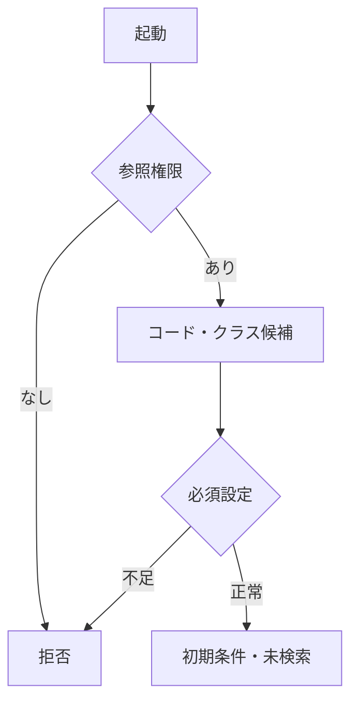

#### SQL・テーブル関連（ER図）

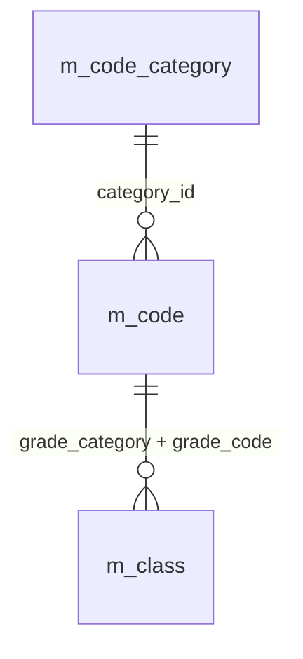

名称参照は未所属・停止値を残す外部結合相当。コードは用途ごとの別名で**分類と値**を結合する。図は読取りの関連であり、履歴への書込みや削除連動を意味しない。単独の存在確認・採番・書込みの表関連は下記操作IDで特定する。

#### DB操作の詳細

`OP-CODE` → `OP-CLASS`。下記「DB操作定義」の同名操作を実行する。

#### 結果・例外時の扱い

入力不備は項目エラーと原入力を保持。検索要求の失敗は一覧消去、0件はI-SRC-001、上限超過はW-SRC-001。権限不備・他者の保持情報は拒否する。候補連動だけでは既存一覧を再検索しない。 各イベントで実行していない処理の結果状態は発生対象外。

### EV-SRC-002 検索実行

#### 処理概要

入力した検索条件で、非削除学生を検索する。

#### 処理手順

1. 入力を複製し共通04・05・17で正規化、桁、日付範囲、選択値、未所属条件を検査する。項目エラーは入力保持・一覧消去、DB検索なし。
2. OP-EXISTSでコード分類・クラス・年度・学年の存在と整合を検査する。検索では停止・期間外の既存値を許容する。
3. OP-COUNT・OP-PAGEへ同じ確定条件を渡す。10001件で上限、0件は該当なし、それ以外は最初のページを表示する。件数と一覧の読取りを揃える。
4. 正常時に実行済み条件を共通12へ保持。生年月日は共通16で和暦表示。他の日付・日時は西暦。

##### 実装詳細

入口：`COND Enter`。機能内の入力・結果型は項目一覧、共通実装は[方式別共通仕様](../../共通/方式別/AS400_RPG/01_共通実装仕様.md)を使用する。 `Draft`相当の未実行値と`AppliedCriteria`相当の確定条件を分離。呼出引数を複製し、結果を返した要求が最新であることを確認して画面へ移送する。

#### 処理フロー

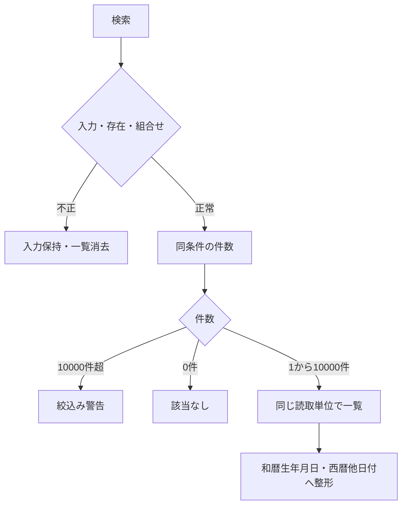

#### SQL・テーブル関連（ER図）

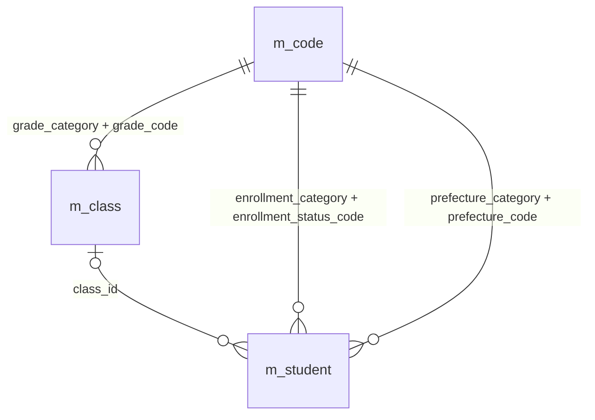

名称参照は未所属・停止値を残す外部結合相当。コードは用途ごとの別名で**分類と値**を結合する。図は読取りの関連であり、履歴への書込みや削除連動を意味しない。単独の存在確認・採番・書込みの表関連は下記操作IDで特定する。

#### DB操作の詳細

`OP-EXISTS` → `OP-COUNT` → `OP-PAGE`。下記「DB操作定義」の同名操作を実行する。

#### 結果・例外時の扱い

入力不備は項目エラーと原入力を保持。検索要求の失敗は一覧消去、0件はI-SRC-001、上限超過はW-SRC-001。権限不備・他者の保持情報は拒否する。候補連動だけでは既存一覧を再検索しない。 各イベントで実行していない処理の結果状態は発生対象外。

### EV-SRC-003 条件連動

#### 処理概要

年度・学年・クラス・未所属の変更。学生検索はまだ実行しない。

#### 処理手順

1. 未所属ONなら年度・学年・クラスを解除し非活性、OFFでも元の条件を勝手に戻さない。
2. OP-CLASSへ選択済み年度・学年を渡し候補を再取得。不適合クラスは解除しW-STU-107。クラス先行選択なら実際の年度・学年を反映する。
3. 候補要求の応答順を照合して古い応答は破棄。変更未反映を表示し実行済み条件は維持する。

##### 実装詳細

入口：`F4候補／条件変更`。機能内の入力・結果型は項目一覧、共通実装は[方式別共通仕様](../../共通/方式別/AS400_RPG/01_共通実装仕様.md)を使用する。 `Draft`相当の未実行値と`AppliedCriteria`相当の確定条件を分離。呼出引数を複製し、結果を返した要求が最新であることを確認して画面へ移送する。

#### 処理フロー

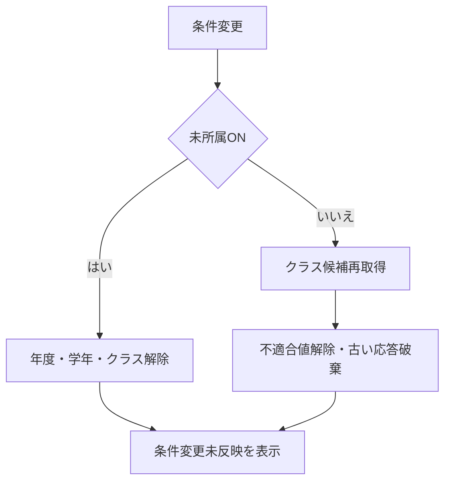

#### SQL・テーブル関連（ER図）

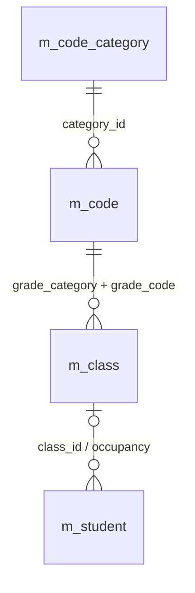

名称参照は未所属・停止値を残す外部結合相当。コードは用途ごとの別名で**分類と値**を結合する。図は読取りの関連であり、履歴への書込みや削除連動を意味しない。単独の存在確認・採番・書込みの表関連は下記操作IDで特定する。

#### DB操作の詳細

`OP-CLASS`。下記「DB操作定義」の同名操作を実行する。

#### 結果・例外時の扱い

入力不備は項目エラーと原入力を保持。検索要求の失敗は一覧消去、0件はI-SRC-001、上限超過はW-SRC-001。権限不備・他者の保持情報は拒否する。候補連動だけでは既存一覧を再検索しない。 各イベントで実行していない処理の結果状態は発生対象外。

### EV-SRC-004 並び替え・ページ移動

#### 処理概要

実行済み条件の結果を別の順序・ページで取得する。

#### 処理手順

1. 共通12から保持条件を取得。未検索は不可、期限切れはW-SRC-002。入力途中の条件を混ぜない。
2. 並び順4項目・方向2種・件数20/50/100・正のページ番号を検査する。並び順・件数変更時は1ページへ戻す。
3. OP-COUNT・OP-PAGEを再実行。件数減少時は最終有効ページへ補正。0件は一覧なし・ページ操作不可。

##### 実装詳細

入口：`PageUp/Down・F7/F10`。機能内の入力・結果型は項目一覧、共通実装は[方式別共通仕様](../../共通/方式別/AS400_RPG/01_共通実装仕様.md)を使用する。 `Draft`相当の未実行値と`AppliedCriteria`相当の確定条件を分離。呼出引数を複製し、結果を返した要求が最新であることを確認して画面へ移送する。

#### 処理フロー

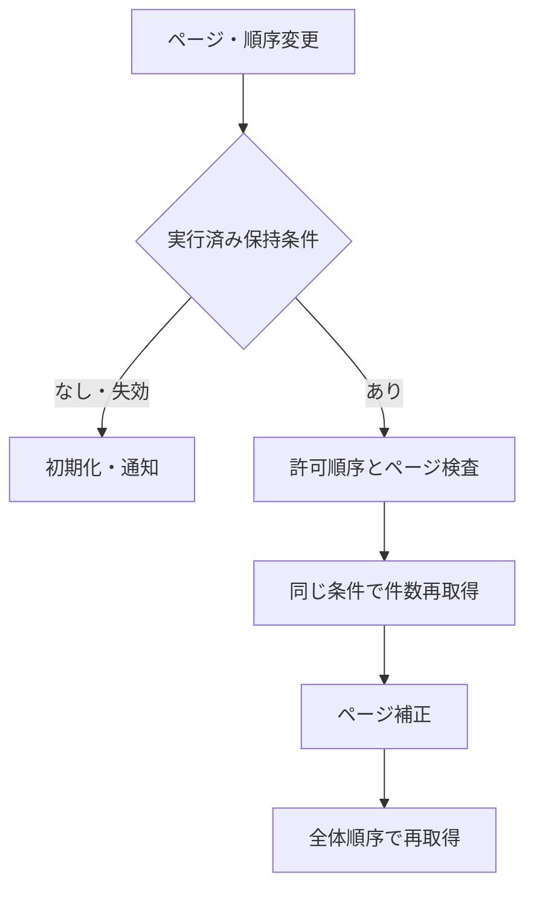

#### SQL・テーブル関連（ER図）

名称参照は未所属・停止値を残す外部結合相当。コードは用途ごとの別名で**分類と値**を結合する。図は読取りの関連であり、履歴への書込みや削除連動を意味しない。単独の存在確認・採番・書込みの表関連は下記操作IDで特定する。

#### DB操作の詳細

`OP-COUNT` → `OP-PAGE`。下記「DB操作定義」の同名操作を実行する。

#### 結果・例外時の扱い

入力不備は項目エラーと原入力を保持。検索要求の失敗は一覧消去、0件はI-SRC-001、上限超過はW-SRC-001。権限不備・他者の保持情報は拒否する。候補連動だけでは既存一覧を再検索しない。 各イベントで実行していない処理の結果状態は発生対象外。

### EV-SRC-005 新規・編集・参照・クリア

#### 処理概要

行操作または機能ボタンを受け付ける。

#### 処理手順

1. 新規は作成権限を確認し学生登録へ。検索条件を登録値へ流用しない。
2. 編集・参照は選択行の学生管理番号で登録機能を起動する。行番号・表示名を識別子にしない。読込みは登録側の責務。
3. クリアは初期条件・未検索へ戻し共通12も初期化。メニューへ戻る処理はDB更新なし。

##### 実装詳細

入口：`READC 2/5・F6・F5`。機能内の入力・結果型は項目一覧、共通実装は[方式別共通仕様](../../共通/方式別/AS400_RPG/01_共通実装仕様.md)を使用する。 `Draft`相当の未実行値と`AppliedCriteria`相当の確定条件を分離。呼出引数を複製し、結果を返した要求が最新であることを確認して画面へ移送する。

#### 処理フロー

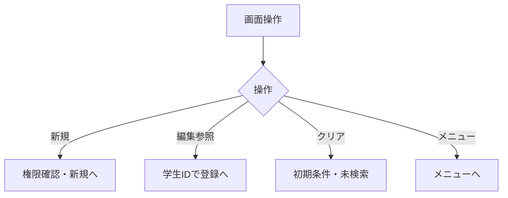

#### SQL・テーブル関連（ER図）

DB参照なし。ER図は対象外。

#### DB操作の詳細

このイベントで業務DBを読み書きしない。遷移先の読込みと混同しない。

#### 結果・例外時の扱い

入力不備は項目エラーと原入力を保持。検索要求の失敗は一覧消去、0件はI-SRC-001、上限超過はW-SRC-001。権限不備・他者の保持情報は拒否する。候補連動だけでは既存一覧を再検索しない。 各イベントで実行していない処理の結果状態は発生対象外。

### EV-SRC-006 学生登録からの復帰

#### 処理概要

保存・削除・取消・戻るから検索状態を復元する。

#### 処理手順

1. 共通12で所有者・認証・画面・期限を確認。他者状態は拒否、期限切れは初期化する。
2. 未検索から起動していた場合は未検索へ。検索済みなら元条件でOP-COUNT・OP-PAGEを再実行し最新DBを表示する。
3. 確定済み成功通知だけを表示。保存した学生が条件外でも検索条件を変更しない。

##### 実装詳細

入口：`STUEDITから復帰`。機能内の入力・結果型は項目一覧、共通実装は[方式別共通仕様](../../共通/方式別/AS400_RPG/01_共通実装仕様.md)を使用する。 `Draft`相当の未実行値と`AppliedCriteria`相当の確定条件を分離。呼出引数を複製し、結果を返した要求が最新であることを確認して画面へ移送する。

#### 処理フロー

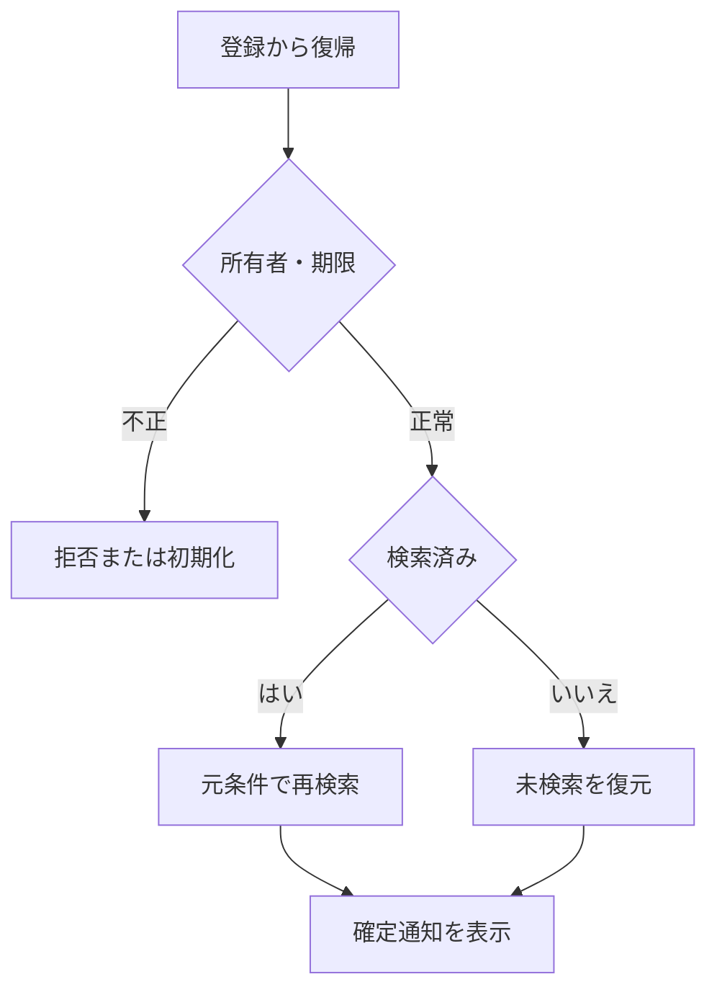

#### SQL・テーブル関連（ER図）

名称参照は未所属・停止値を残す外部結合相当。コードは用途ごとの別名で**分類と値**を結合する。図は読取りの関連であり、履歴への書込みや削除連動を意味しない。単独の存在確認・採番・書込みの表関連は下記操作IDで特定する。

#### DB操作の詳細

`OP-COUNT` → `OP-PAGE`。下記「DB操作定義」の同名操作を実行する。

#### 結果・例外時の扱い

入力不備は項目エラーと原入力を保持。検索要求の失敗は一覧消去、0件はI-SRC-001、上限超過はW-SRC-001。権限不備・他者の保持情報は拒否する。候補連動だけでは既存一覧を再検索しない。 各イベントで実行していない処理の結果状態は発生対象外。

### DB操作定義

操作の業務契約は[共通データアクセス](../../共通/08_データアクセス仕様.md)が正本。本機能における具体的な対象・引数・確定単位は以下。

#### OP-CODE

| 項目 | 内容 |
| --- | --- |
| 対象テーブル | m_code_category / m_code |
| 操作 | 参照 |
| 実行条件・引数 | 分類、用途（検索／新規選択／既存表示）、既存値、業務日 |
| 取得・設定項目／対象条件 | 分類・値・名称・表示順・利用可否・期間。分類＋値で取得 |
| 件数・順序 | 候補0件を検出。既定値を先頭値へ代替しない |
| 確定・取消 | 参照のみ |

#### OP-CLASS

| 項目 | 内容 |
| --- | --- |
| 対象テーブル | m_class / m_code / m_student |
| 操作 | 参照 |
| 実行条件・引数 | 用途、年度、学年、在籍区分、在籍期間、既存所属、業務日、人数参照要否 |
| 取得・設定項目／対象条件 | 年度・学年・クラスID・コード・名称・期間・定員。人数集計は登録側で要求した場合のみ。検索の候補取得では学生を集計しない |
| 件数・順序 | 年度降順、学年表示順、クラス表示順、クラスコード、ID |
| 確定・取消 | 参照のみ、人数は予約ではない |

#### OP-EXISTS

| 項目 | 内容 |
| --- | --- |
| 対象テーブル | m_student / m_class / m_code_category / m_code |
| 操作 | 参照 |
| 実行条件・引数 | 用途（検索／保存）、分類付きコード・クラスID・選択補助。保存だけ対象ID・完全な学籍番号・期待版 |
| 取得・設定項目／対象条件 | 検索は指定コード・クラスの存在と年度学年の整合のみ。学籍番号前方一致に重複・完全一致存在検査をしない。保存は全行学籍番号一意、分類付き存在、変更有無、有効性を再検査 |
| 件数・順序 | 未存在／重複／組合せ／停止を区別。未指定の検索条件は検査対象外 |
| 確定・取消 | 検索は参照のみ、保存は保護した最新値で確認 |

#### OP-COUNT

| 項目 | 内容 |
| --- | --- |
| 対象テーブル | m_student s LEFT JOIN m_class c |
| 操作 | 参照 |
| 実行条件・引数 | 正規化後の実行済み検索条件 |
| 取得・設定項目／対象条件 | 非削除必須、指定項目AND、状態OR・電話OR。全条件一致IDだけ最大10001件 |
| 件数・順序 | 10001件は上限、10000件以下は実件数。0件は該当なし |
| 確定・取消 | OP-PAGEと同じ読取り整合性 |

#### OP-PAGE

| 項目 | 内容 |
| --- | --- |
| 対象テーブル | m_student s / m_class c / m_code g, es, p |
| 操作 | 参照 |
| 実行条件・引数 | OP-COUNTと同じ条件、ページ、件数、許可並び順 |
| 取得・設定項目／対象条件 | 一覧11項目＋学生ID。住所2・メール・緊急連絡先・備考を返さない |
| 件数・順序 | 全一致集合をソート後ページ化。同順位学生ID昇順 |
| 確定・取消 | 参照のみ、旧結果を最新として残さない |

### ネイティブイベント・通信の対応

#### 検索・パネルイベント

初期はSTUAUTH、候補、01/02、20件、未検索。Enterは条件正規化→CHK検査→DB検索。入力不備はメッセージと項目を指示し条件パネル維持。未所属と所属条件の同時指定は拒否。F4候補はコード値と名称を表示、年度・学年変更でクラスが不適合なら解除。

検索結果の1ページ20/50/100件をプログラムの`resultRows`へ読み、SFLに展開する。SFLPAG(10)、SFLSIZ(101)を基準とする。SFL内の10行送りは既取得結果の表示移動、取得ページの末端を越える操作だけDBを再検索。ソート・件数変更は1ページへ戻し、現在の条件未実行ならappliedCriteriaだけを使用する。

READCで変更された選択行を読み、hidden studentIdで編集／参照を開く。閲覧者の2=編集要求は参照へ案内し、保存プロシージャーも権限を拒否。編集終了後は元の検索コンテキストで再検索。QTEMPまたはジョブ内DSの条件は利用者・ジョブ・画面識別単位、30分で失効。ジョブを跨いで自動復元する要件はない。

## 項目移送仕様

| 移送ID | 項目ID | 関連イベント | 画面側 | 処理変数 | DB側・出力値 | 方向 | 変換ID | 未設定 | 移送条件・説明 | 異常時 |
| --- | --- | --- | --- | --- | --- | --- | --- | --- | --- | --- |
| MAP-SRC-001 | SRC-001 | EV-SRC-002 | QSTUNO | criteria.studentNo | m_student.student_no | I（検索条件） | N-06 | NULL相当 | 前方一致、N-06。保存なし | 入力不正は原入力保持・DB処理なし |
| MAP-SRC-002 | SRC-002 | EV-SRC-002 | QNAME | criteria.nameKey | m_student.name_key | I（検索条件） | N-03 | NULL相当 | N-03後の部分一致。氏名の原表記と区別 | 入力不正は原入力保持・DB処理なし |
| MAP-SRC-003 | SRC-003 | EV-SRC-002 | QKANA | criteria.kanaKey | m_student.kana_key | I（検索条件） | N-04,N-05 | NULL相当 | N-05後の部分一致 | 入力不正は原入力保持・DB処理なし |
| MAP-SRC-004 | SRC-004 | EV-SRC-002 | QYEAR | criteria.schoolYear | m_class.school_year | I（検索条件） | N-11 | NULL相当 | 完全一致。西暦1900～9998、DATE-R04 | 入力不正は原入力保持・DB処理なし |
| MAP-SRC-005 | SRC-005 | EV-SRC-002 | QGRADE | criteria.gradeCode | m_class.grade_code | I（検索条件） | N-07 | NULL相当 | 完全一致。学年なしと未所属は別 | 入力不正は原入力保持・DB処理なし |
| MAP-SRC-006 | SRC-006 | EV-SRC-002 | QCLASS | criteria.classId | m_student.class_id | I（検索条件） | 非適用 | NULL相当 | 完全一致。年度・学年は選択クラス実値と照合 | 入力不正は原入力保持・DB処理なし |
| MAP-SRC-007 | SRC-007 | EV-SRC-002 | QUNASS | criteria.unassignedOnly | m_student.class_id | I（検索条件） | 非適用 | FALSE | 未設定だけ。年度・学年・クラスと排他 | 入力不正は原入力保持・DB処理なし |
| MAP-SRC-008 | SRC-008 | EV-SRC-002 | QST01 / QST02 / QST03 / QST04 | criteria.statusSelected(1 To 4) | m_student.enrollment_status_code | I（検索条件） | N-07 | 空配列 | 複数値はいずれか一致、全解除は全区分 | 入力不正は原入力保持・DB処理なし |
| MAP-SRC-009 | SRC-009 | EV-SRC-002 | QPREF | criteria.prefectureCode | m_student.prefecture_code | I（検索条件） | N-07 | NULL相当 | コード値で完全一致 | 入力不正は原入力保持・DB処理なし |
| MAP-SRC-010 | SRC-010 | EV-SRC-002 | QPHONE | criteria.phoneNumber | m_student.phone_number / emergency_phone_number | I（検索条件） | N-09 | NULL相当 | N-09後の完全一致、本人または緊急電話 | 入力不正は原入力保持・DB処理なし |
| MAP-SRC-011 | SRC-011 | EV-SRC-002 | QADMFROM | criteria.admissionFrom | m_student.admission_date | I（検索条件） | N-11 | NULL相当 | 開始日を含む。DATE-R03、片側指定可 | 入力不正は原入力保持・DB処理なし |
| MAP-SRC-012 | SRC-012 | EV-SRC-002 | QADMTO | criteria.admissionTo | m_student.admission_date | I（検索条件） | N-11 | NULL相当 | 終了日を含む。DATE-R03、開始≦終了 | 入力不正は原入力保持・DB処理なし |
| MAP-SRC-017 | SRC-017 | EV-SRC-002 | RESULT_COUNT | totalCount / RangeFrom / RangeTo | count of matching student_id | O（表示） | 非適用 | 表示欠損は－、マスタ欠落は不整合表示 | 未検索／0件／上限超過を区別 | 取得不整合は明示・行を無言で落とさない |
| MAP-SRC-018 | SRC-018 | EV-SRC-002 | SEARCH_AT | searchedAt | RequestContext.ExecutedAt | O（表示） | 非適用 | 表示欠損は－、マスタ欠落は不整合表示 | 西暦日時、日本時間。DB保存なし | 取得不整合は明示・行を無言で落とさない |
| MAP-SRC-019 | SRC-019 | EV-SRC-004 | QSIZE | pageSize | pageSize | I（表示指定） | 非適用 | 不可 | 20／50／100、既定20 | 入力不正は原入力保持・DB処理なし |
| MAP-SRC-020 | SRC-020 | EV-SRC-002,EV-SRC-004,EV-SRC-006 | SFL.StudentNo | studentNo | m_student.student_no | O（表示） | 非適用 | 表示欠損は－、マスタ欠落は不整合表示 | 保存済み文字列、文字順 | 取得不整合は明示・行を無言で落とさない |
| MAP-SRC-021 | SRC-021 | EV-SRC-002,EV-SRC-004,EV-SRC-006 | SFL.StudentName | studentName | m_student.student_name | O（表示） | 非適用 | 表示欠損は－、マスタ欠落は不整合表示 | 登録表記のまま文字列表示 | 取得不整合は明示・行を無言で落とさない |
| MAP-SRC-022 | SRC-022 | EV-SRC-002,EV-SRC-004,EV-SRC-006 | SFL.StudentNameKana | studentNameKana | m_student.student_name_kana | O（表示） | 非適用 | 表示欠損は－、マスタ欠落は不整合表示 | 保存済みカナ表記 | 取得不整合は明示・行を無言で落とさない |
| MAP-SRC-023 | SRC-023 | EV-SRC-002,EV-SRC-004,EV-SRC-006 | SFL.BirthDateWareki | birthDateWareki | m_student.birth_date | O（表示） | 非適用 | 表示欠損は－、マスタ欠落は不整合表示 | 和暦表示。共通16で日付から変換 | 取得不整合は明示・行を無言で落とさない |
| MAP-SRC-024 | SRC-024 | EV-SRC-002,EV-SRC-004,EV-SRC-006 | SFL.SchoolYear / GradeName | schoolYear / GradeName | m_class.school_year / grade_code → m_code.code_name | O（表示） | 非適用 | 表示欠損は－、マスタ欠落は不整合表示 | 年度は西暦、学年は名称。未所属は－ | 取得不整合は明示・行を無言で落とさない |
| MAP-SRC-025 | SRC-025 | EV-SRC-002,EV-SRC-004,EV-SRC-006 | SFL.ClassCode / ClassName | classCode / ClassName | m_student.class_id → m_class.class_code / class_name | O（表示） | 非適用 | 表示欠損は－、マスタ欠落は不整合表示 | 未所属／停止／期間外を区別 | 取得不整合は明示・行を無言で落とさない |
| MAP-SRC-026 | SRC-026 | EV-SRC-002,EV-SRC-004,EV-SRC-006 | SFL.EnrollmentName | enrollmentName | m_student.enrollment_status_code → m_code.code_name | O（表示） | 非適用 | 表示欠損は－、マスタ欠落は不整合表示 | 種別と値で結合、名称未取得でも学生行を落とさない | 取得不整合は明示・行を無言で落とさない |
| MAP-SRC-027 | SRC-027 | EV-SRC-002,EV-SRC-004,EV-SRC-006 | SFL.AddressDisplay | addressDisplay | m_code.code_name + m_student.address_line1 | O（表示） | 非適用 | 表示欠損は－、マスタ欠落は不整合表示 | 都道府県名と住所1を連結。住所2は表示しない | 取得不整合は明示・行を無言で落とさない |
| MAP-SRC-028 | SRC-028 | EV-SRC-002,EV-SRC-004,EV-SRC-006 | SFL.PhoneNumber | phoneNumber | m_student.phone_number | O（表示） | 非適用 | 表示欠損は－、マスタ欠落は不整合表示 | 未設定は－。緊急電話を一覧へ出さない | 取得不整合は明示・行を無言で落とさない |
| MAP-SRC-029 | SRC-029 | EV-SRC-002,EV-SRC-004,EV-SRC-006 | SFL.UpdatedAt | updatedAt | m_student.updated_at | O（表示） | 非適用 | 表示欠損は－、マスタ欠落は不整合表示 | 西暦日時、日本時間 | 取得不整合は明示・行を無言で落とさない |
| MAP-SRC-032 | SRC-032 | EV-SRC-004 | QSORT | sortKey | sortKey | I（表示指定） | 非適用 | 不可 | 許可4項目。最後に学生ID昇順を加える | 入力不正は原入力保持・DB処理なし |
| MAP-SRC-033 | SRC-033 | EV-SRC-004 | QDIR | sortDirection | sortDirection | I（表示指定） | 非適用 | 不可 | 昇順／降順。初期は昇順 | 入力不正は原入力保持・DB処理なし |

## 補足説明

### 制約・正本

本書は1機能を対象とし、複数クラス・API・パネルはその内部実装である。マスタ保守、共通UI、物理テーブル、ビルド・配備は[方式別共通仕様](../../共通/方式別/AS400_RPG/01_共通実装仕様.md)を参照する。

### 試験観点

[共通T-01～28](../../共通/06_要件対応・設計判断.md)と[DATE-T01～20](../../共通/07_日付・和暦仕様.md)の該当項目を実装工程で実施する。入力→処理値→DB→再表示を往復確認し、Unicode最大長、日付境界、停止候補、最終席競合、旧版、履歴失敗、保存結果不明を含める。

[レビュー結果](../../../docs/仕様書レビュー結果.md)。文書検査と実装試験合格を区別する。

### 実装上の移送・制御補足

#### 物理バインド・変数定義

##### 条件・RPG変数

| DDS名 | プログラム内の型付き値 | DB対象 |
| --- | --- | --- |
| QSTUNO | criteria.studentNo | STUDAPP.M_STUDENT.STUDENT_NO、前方一致 |
| QNAME/QKANA | criteria.nameKey/kanaKey | NAME_KEY/KANA_KEY部分一致 |
| QYEAR/QGRADE | criteria.schoolYear/gradeCode | M_CLASS.SCHOOL_YEAR/GRADE_CODE |
| QCLASS | criteria.classIdとNULL標識 | M_STUDENT.CLASS_ID |
| QUNASS | criteria.unassignedOnly | CLASS_ID IS NULL |
| QST01～04 | criteria.statusSelected(1～4) | ENROLLMENT_STATUS_CODE、全0は条件なし |
| QPREF | criteria.prefectureCode | PREFECTURE_CODE |
| QPHONE | criteria.phoneNumber | 本人／緊急電話の完全一致 |
| QADMFROM/QADMTO | criteria.admissionFrom/ToとNULL標識 | ADMISSION_DATE両端含む |
| QSIZE/QSORT/QDIR | pageSize/sortKey/sortDirection | 20/50/100・許可4項目・昇降順 |

日付画面値は10桁文字、空は未指定、実在検査後にdateへ変換。生年月日など必須日付でも最初は空とする。

##### 型と制御情報

| 対象 | 規約 |
| --- | --- |
| 日付型 | date、SQL NULLは別標識 |
| ID・版 | 方式別ID型を使用し近似数へ変換しない。新規は対象・期待版なし、更新削除は正のID・期待版必須 |
| 隠し状態 | 原スナップショット、編集値、期待版、戻りContext、確認Token、要求連番、Busyを分離。利用者権限は入力にしない |
| 生年月日 | 一覧の日付値→共通16→和暦表示（入力なし） |
| 一覧出力 | 一覧取得DTOはOP-PAGEの11表示項目＋学生ID。birth_dateは和暦表示へ、updated_atは西暦日本時間へ変換 |
| 未設定 | 任意文字の空は共通04でNULL相当。変換失敗をNULLや0にしない |

### 開発入力と責務

本機能を実装する直接入力は、本書、[方式別共通仕様](../../共通/方式別/AS400_RPG/01_共通実装仕様.md)、[DB定義](../../DB定義/Db2_for_i/01_DB定義書.md)、[方式別開発規約](../../../docs/開発規約/AS400_RPG.md)、[共通開発規約](../../../docs/開発規約.md)である。基本設計は背景理解・承認確認に用いる。項目の必須・長さ・初期値は本書に再掲し、[共通項目制約](../../共通/09_項目制約定義.md)と一致させる。

raw入力は表示用に保持し、正規化成功後の値だけを型付き命令に移す。型変換エラーをNULLと扱わない。生年月日は和暦4入力、変換後のみbirth_dateとして保存する。氏名・カナの照合値は保存側が再生成する。操作イベントごとの引数・結果分岐は本書イベント仕様に従い、共通呼出しの成功を業務保存の成功と混同しない。

本書の構成要素IDは親項目の細分化であり、新たな業務要件を追加するものではない。内部名が前版で未指定だった表示用変数は本版の実装設計名。ソースが実在するという主張ではない。

### 長さと物理領域の解釈

項目一覧の「言語型」は検証途中のモデルを含む。DateOnly?等の未設定状態を許容しても、保存時の必須検査を省略しない。Raw入力と正規化値を別領域へ保持する。対応DB型・NULL可否は採用DB定義と同じ値を再掲している。

Unicode入力はスカラー値で業務長を判定し、UTF-16のMaxLength／HTML maxlengthが同じ数字だから正しいとは判断しない。画面部品の物理入力上限は必要に応じ2Nコード単位以上を確保し、共通検査でNスカラー値を厳守する。描画モックのdata-business-maxlengthが業務上限であり、HTMLの物理ガード値は業務上限を拡張する指定ではない。

### 画面キーの対応

Enter＝検索、F4＝候補、F5＝クリア、F6＝新規、F3＝メニュー、PageUp/PageDown＝前後ページ、F7/F10＝先頭／最後。検索と最終ページに同じキーを割り当てない。
