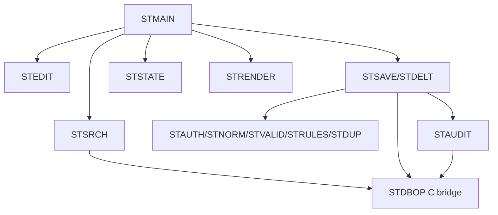

<!-- spec-meta: {"schema":"spec-md/1.0","documentId":"COBOL-COM-COBOL","version":"8.2","path":"test-project1/srcs/COBOL/spec/共通/方式別/01_共通実装仕様.md","sheets":[{"heading":"PROGRAM-ID・COPY・呼出関係","kind":"GRID","sheet":"01_PROGRAM-ID・COPY・呼出関係"},{"heading":"SQL・エラー処理","kind":"GRID","sheet":"02_SQL・エラー処理"},{"heading":"CGI・Unicode・状態","kind":"GRID","sheet":"03_CGI・Unicode・状態"},{"heading":"共通規約・日付実装","kind":"GRID","sheet":"04_共通規約・日付実装"}],"isolationProfile":"COBOL"} -->
# COBOL 共通実装仕様

| 項目 | 内容 |
| --- | --- |
| 版数・改訂日 | 8.2／2026-10-25 |
| 対象方式 | COBOL |
| 適用 | 設計上の実装契約。製品コードの実装・コンパイルは未実施 |

開発入力：[学生検索詳細](../../詳細仕様書/01_学生検索画面.md)／[学生登録詳細](../../詳細仕様書/02_学生登録画面.md)／[共通実装](01_共通実装仕様.md)／[DB定義](../../DB定義/SQLServer/01_DB定義書.md)／[方式別開発規約](../../規約/COBOL.md)／[共通開発規約](../../規約/開発規約.md)。

## PROGRAM-ID・COPY・呼出関係

```text
cobol/STMAIN.cob    CGI受付・振分け
cobol/STSRCH.cob    検索・ページ
cobol/STEDIT.cob    新規／既存表示
cobol/STSAVE.cob    登録更新の確定単位
cobol/STDELT.cob    論理削除
cobol/STNORM.cob    正規化呼出
cobol/STVALID.cob   入力チェック
cobol/STRULES.cob   存在・状態・期間・定員
cobol/STDUP.cob     同一人物候補・確認
cobol/STAUDIT.cob   操作履歴
cobol/STSTATE.cob   要求間の検索・確認状態
cobol/STAUTH.cob    共通認証アダプター
cobol/STRENDER.cob  UTF-8 HTML表示
cobol/STMAINT.cob   管理者CLI
copy/ST-REQUEST.cpy, ST-STUDENT.cpy, ST-SEARCH.cpy, ST-RESULT.cpy
copy/ST-DB-REQUEST.cpy, ST-DB-RESULT.cpy
bridge/student_bridge.c  ODBC・Unicode・暗号・HTTP入力の境界処理
```

共通01～03＝STAUTH/STCLOCK、04～05＝STNORM/STVALID、06～10＝STMLOOK/STRULES/STDUP、11～12＝STSTATE、13＝STSAVE＋STDBOP、14＝STAUDIT、15＝STMSG/STRENDER。STCLOCK・STMLOOK・STMSGも呼出可能プログラムとして同じcobol配下に実装する。



GnuCOBOLにEXEC SQLのプリコンパイル機能が標準であるとは仮定しない。DB操作は明示したCブリッジのODBCパラメーターAPIを使う。C側に学生業務を全移植せず、接続・型境界・固定SQL実行・Unicode処理だけを置く。

## SQL・エラー処理

共通の保存・検索手順は[SQL Server DB定義](../../DB定義/SQLServer/01_DB定義書.md)の補足説明を適用する。ここで定義するRepository/UnitOfWorkはその入出力・確定境界を実装する。名前だけを別DBへ置換したSQLは使用しない。

COBOLのcommand_idはST-COUNT/ST-LIST/ST-LOAD/ST-UQ/ST-DUP/ST-CAP/ST-INSERT/ST-UPDATE/ST-DELETE/LOG-INSERTを維持。ST-DB-REQUEST/RESULT COPYの引数は下記ODBC境界に対応する。

## CGI・Unicode・状態

CGI入力はCONTENT_LENGTHを厳密確認し最大65536byte。標準入力を長さ分だけ読み、不足・超過・不正%エンコード・不正UTF-8・NUL・重複単一項目を拒否。HTMLヘッダー送信は検証結果が決まってから。Content-Type:text/html;charset=UTF-8、Cache-Control:no-store。学生値は&、<、>、引用符を文脈に応じエスケープする。

STNORMはCブリッジのUnicode正規化関数を呼ぶ。NFKC、Unicode scalarの単純大文字対応、空白除去、カナ対応、コードポイント数検査を行い、COBOLのFUNCTION UPPER-CASEやバイト置換だけで日本語を正規化しない。ライブラリー版を固定して共通ベクトルと照合する。

補助`t_runtime_state`を設ける：state_id varchar(64) PK（256bit乱数64桁hex）、owner_id nvarchar(128)、login_session_id varchar(64)、state_kind varchar(16)、encrypted_payload varbinary(max)、expires_at datetimeoffset(7)、revision bigint、consumed bit。検索30分・確認10分・成功Flash一回。業務5表ではない。payloadは認証済み暗号化、鍵はWebサーバー秘密管理、所有者と目的を照合、状態の更新・消費は条件付きで原子的に行う。期限切れを定期削除する。

共通認証済みWebサーバーだけがCGIのREMOTE_USERを設定する。利用者が送る同名ヘッダーを信頼せず、CGI実行環境を外部から直接操作させない。認証セッションCookieはSecure/HttpOnly、POSTはセッションに紐付くCSRFトークンを検証。画面のRoleを認証情報にしない。DB資格情報と暗号鍵はソースへ保存しない。

## 共通規約・日付実装

対象読者は実務経験５年程度のプログラマー。[検索詳細](../../詳細仕様書/01_学生検索画面.md)／[登録詳細](../../詳細仕様書/02_学生登録画面.md)／[開発規約](../../規約/開発規約.md)／[日付正本](../07_日付・和暦仕様.md)。

共通16の入力は元号識別値・年・月・日という原文字列4値と業務日。出力は正規化日付と和暦表示文字列、または項目エラー。共通17は項目種別と日付／年度にDATE-R01～06を適用する。変換で不正日を補正しない。OS全体の暦設定を変更しない。元号表の版を画面・保存側で一致させる。

| 役割 | 実装仕様 |
| --- | --- |
| 共通16物理名 | STDATE / ST-DATE-INPUT COPY |
| 内部日付型 | PIC X(10)、SQL NULLは別標識 |
| 入力と保存 | 和暦原入力4値から日付を生成。StudentDraft等のbirth_date相当は正規化日付。元号をDBへ重複保存しない |
| 通信境界 | Webの保存要求はbirthDateInputの4文字列を受け、保存側で厳密変換。既存取得応答のbirthDateはISO日付。入力と応答の型を混同しない |
| 表示 | 一覧・参照・重複確認のBirthDateWareki相当文字列は共通16で生成。その他の日付・日時は西暦 |
| 例外 | CHK-032～034、E-DATE-001～003。構文検査後、実在日、元号境界、逆変換、業務範囲、前後関係を順に検査 |
| 参考試験 | DATE-T01～20。ライブラリーの解析成功だけで元号境界を合格にしない |

### 保守入口・方式固有の適合条件

#### 処理単位

クラスを前提にしない。`STMAIN`がCGI要求を受けて`STSRCH`（検索）、`STEDIT`（登録表示）、`STSAVE`（保存）、`STDELT`（削除）、`STMAINT`（管理者CLI）へ振り分ける。データ構造はCOPY句で共通化する。画面HTMLは`STRENDER`がUTF-8で出力する。

### 保守・試験

`student-maint`はCGI公開外の管理者CLI。STMAINT→同じ検証・保存・監査プログラム。初期5分類70値、差分時上書き禁止、クラス年度内一意、参照時学年不変、定員・期間・保護コード規則を維持する。

共通T-01～28、UTF-8の1～4バイト文字、PIC領域境界、URLデコード不正・重複項目・CONTENT_LENGTH超過、CGI再起動後の状態復帰、C ABIの長さ・NULL・ポインター、DB失敗時のSQLSTATE、全候補を20件だけで判定していないことを試験する。

### SQL Server接続・型・共通呼出契約

検索Repositoryは型付き条件、page/pageSize、Cancellation/要求IDを受け、上限超過/件数/一覧/検索日時を返す。STSAVE/STDBOPのトランザクション管理は検索をSNAPSHOT、保存をREAD COMMITTED＋Transaction所有のsp_getapplockで制御する。全DBコマンドは同じConnection/Transactionを受け、個別Commitを禁止する。保存戻り値はSuccess/ValidationError/ConfirmationRequired/Conflict/NotFound/Unknownに分ける。OUTPUT値はCOMMIT確認前にSuccessへしない。

COBOLの型は下記ODBC境界に従う。.NETのSqlParameter/DateOnlyクラスはこの方式の依存関係に追加しない。

WHERE/LIKE/ページ/例外・ゲート戻り値はSQL Server DB定義を正本とし、LIKEは!/%/_/[のリテラル化を含む。接続暗号化、証明書検証、認証主体を最小権限で分離。UIの権限表示だけを更新認可として使わない。

### COBOLのODBC境界

GnuCOBOLはSQL Server用の組込みEXEC SQLプリコンパイラを前提としない。student_bridge.cがMicrosoft ODBC Driver 18 for SQL Server＋unixODBCを使用する設計案とする。環境・ABI・依存版はビルド工程で固定する。SQLAllocHandle→SQLSetEnvAttr→SQLDriverConnectW→SQLPrepareW→SQLBindParameter→SQLExecute→SQLFetch/SQLGetData、SQLGetDiagRecWでSQLSTATEとネイティブ番号を別々に返す。ハンドルの所有権・解放、SQL_SUCCESS_WITH_INFOの切捨て診断を明記し、01004を成功と扱わない。

COBOL UTF-8 PIC X(4×raw上限)＋実バイト長＋NULL標識をCブリッジへ渡す。CはUnicodeを検証してUTF-16へ変換し、SQLWCHARの実サイズ/ABIを確認する。SQL_C_WCHAR/SQL_WVARCHARのColumnSize（宣言長）とBufferLength（バイト長）とStrLen_or_IndPtr（実バイト長またはSQL_NULL_DATA）を区別する。SQL_C_SBIGINT/SQL_BIGINT、SQL_C_BIT/SQL_BIT、SQL_C_TYPE_DATE/SQL_TYPE_DATEも明示する。STCLOCKの日付はDB側の信頼時刻を基準とする。

SQL_ATTR_AUTOCOMMIT=OFFの同一HDBCで分離レベルとゲートを設定し、SQLEndTran(SQL_COMMIT/SQL_ROLLBACK)で終了する。文字列配列は個別パラメーターへ展開、採番はOUTPUT INSERTEDを読みCOMMIT成功後だけ返す。C側に学生業務の分岐を移さずSTVALID/STRULES/STDUP/STAUDITを維持する。t_runtime_stateは本DB定義の型へ合わせ、トークンは64桁hexとする。

参考：Microsoft ODBC https://learn.microsoft.com/en-us/sql/connect/odbc/microsoft-odbc-driver-for-sql-server ／SQLBindParameter https://learn.microsoft.com/en-us/sql/odbc/reference/syntax/sqlbindparameter-function 。2026-10-11参照。C ABIとODBC実機接続は未試験。

### 派生分類と監査の共通実装

新規／通常更新は[共通データアクセス](../08_データアクセス仕様.md)の緊急４保存項目一式を適用する。続柄分類を常にRELATIONSHIPへ設定する処理は禁止し、続柄値未設定時は分類もNULLへバインドする。コード値を更新する際は分類も同時更新し、変更列監査へ含める。必須３分類は固定のまま。

マスタ監査は[共通モジュール](../03_共通モジュール設計.md)の状態遷移表に従い、停止中の名称変更はUPDATE、状態が実際に停止へ変わる時だけDISABLEとする。認証不成立はE-COM-001、認証済み利用者の認可拒否はE-COM-002を使用し、実装の誤った番号を仕様値として採用しない。


### CGI検索・編集の省スペース配置

STRENDERは通常検索の4条件と7列8論理項目をHTMLで出力する。SEARCHの業務条件名はstudentNo/name/classId/statusCodeだけ。未知名・廃止名は空値でも400/E-SRC-002、反復可能はstatusCodeだけ。STSRCHはST-SEARCH COPYへ検証済み4条件を渡し、ST-COUNT/ST-LISTを同一SNAPSHOTで実行する。Q-STUDENT-NOはPIC X(60)、Q-NAMEはPIC X(32)＋実バイト長、正規化氏名は640byte以上、Q-CLASS-IDは正64bit＋NULL標識、Q-STATUSはPIC X(2) OCCURS 4＋件数。検索で年度・学年・未所属連動を行わず、編集OPTIONSの所属補助は維持する。

STSTATEの暗号化payloadへ形式版search-compact-1を記録する。所有者・期限・期待Revisionを条件付き更新で照合し、旧形式はW-SRC-002で初期条件・未検索へ再初期化する。プロセス終了を跨ぐ状態をWORKING-STORAGEへ置かない。POST再描画でも未実行入力と実行済み条件を分け、ページでは保持済み4条件だけを使う。

STEDIT/STRENDERは基本情報を横並び、下段を3列のHTML/CSSへ整理する。通常100%で1280×650と1366×650の本文領域を目標とし、12px以上・34px以上の入力操作、入力後の操作バーを確保する。確認はactionとサーバー状態による専用再描画とし、通常画面の下へ常時追加しない。JavaScriptなしでも重複・削除・変更破棄を1状態ずつ表示し、取消既定と原入力復帰を守る。編集の全REG・UTF-8容量・実長・NULL標識・65536byte・CSRF・保存確定境界は維持する。

### 原入力保持・確認操作の整合補正

入力版の郵便番号raw領域と共有POST許可列挙に不整合があったため、今回の入力保持・確認配置の関連範囲で補正する。E-POSTALのraw10スカラーはPIC X(40)＋実バイト長、正規化ST-POSTAL-CODEはASCII7桁、DB varchar(7)を維持する。ST-REQUEST COPYとSTRENDERの再表示へ同じraw40byteを渡し、28byteへ暗黙縮小しない。

STMAINの共有POST許可集合はSEARCH/PAGE/CLEAR/OPTIONS/CREATE/UPDATE/DELETE/CONFIRM/RESET/RELOAD/BACK/CANCEL。許可名と状態可否を別に検査する。RESET/RELOAD/BACKの変更破棄待ちはSTSTATEへraw入力・pendingActionを保存し、CONFIRMでサーバー保持の対象操作だけを続行、CANCELで確認を失効して原入力へ戻す。重複・削除のCONFIRMはサーバー保持種別から各イベントへ振り分け、削除理由や同一人物の確認を破棄承認で代替しない。所有者・期限・期待revisionとCSRFを毎回照合する。WORKING-STORAGEだけで要求を跨ぐ確認待ちを保持しない。
