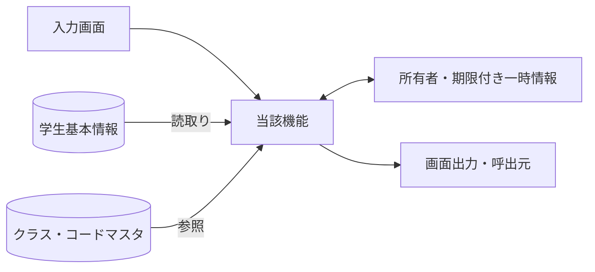
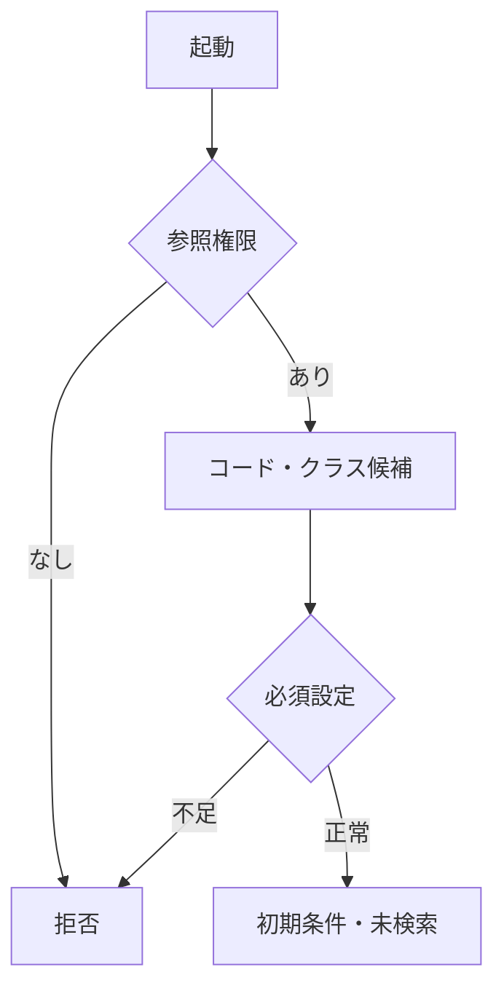
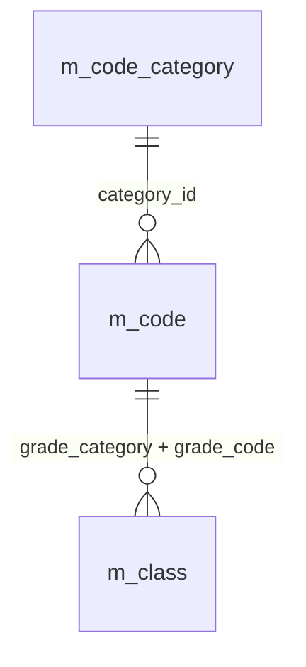
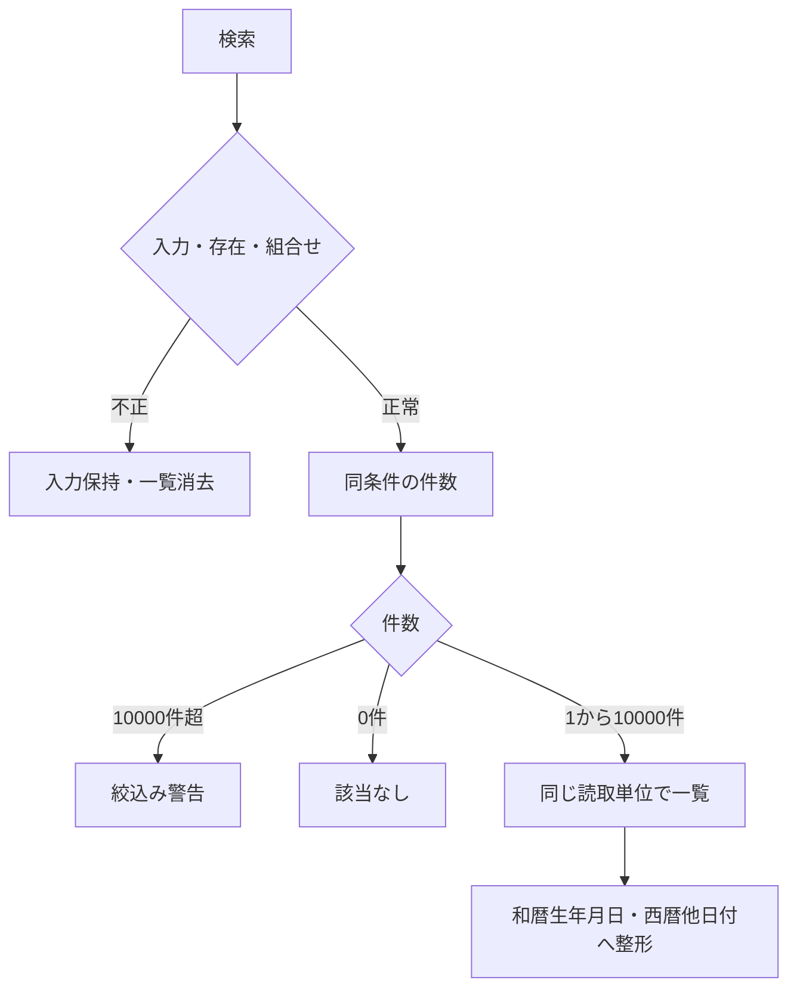
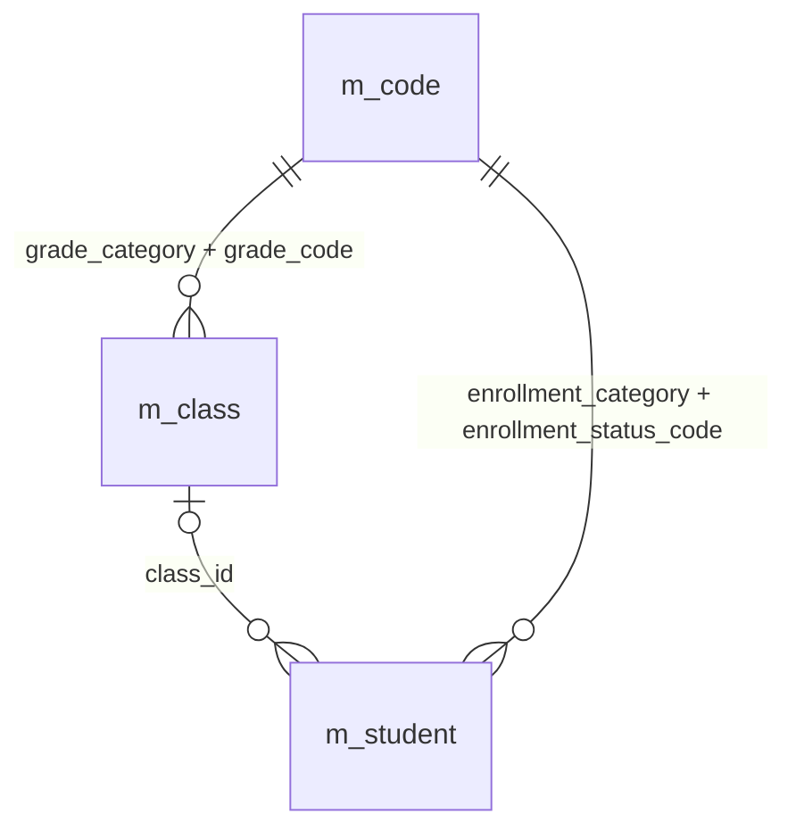
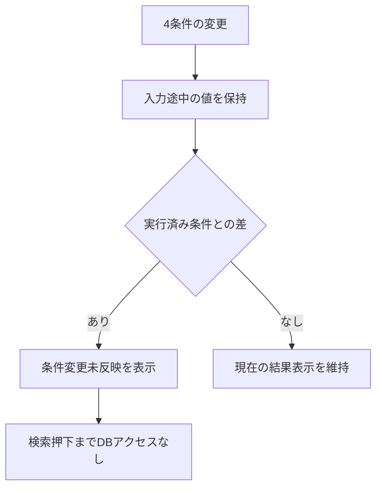
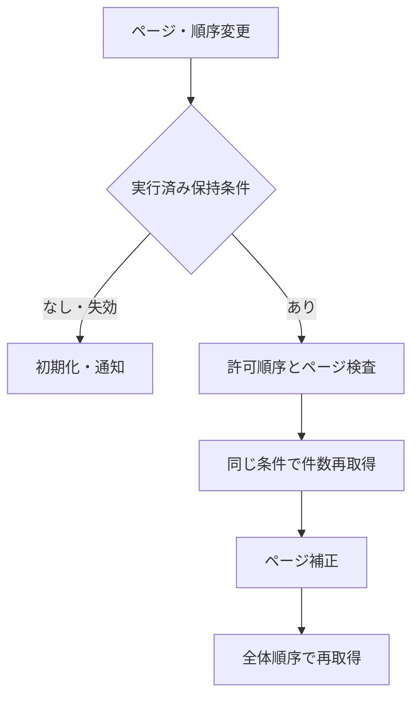
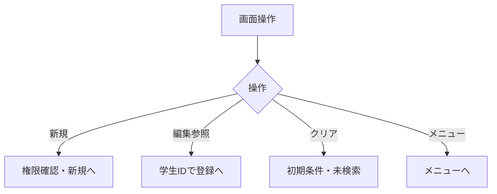
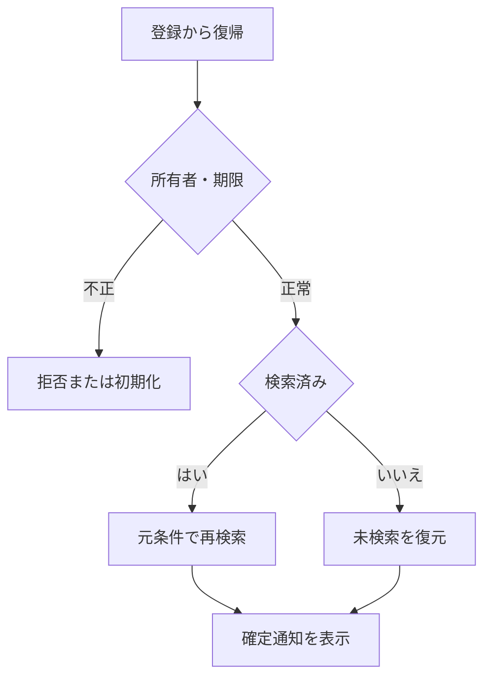

<!-- spec-meta: {"schema":"spec-md/1.0","documentId":"CSHARP_ASPNET-DET-CSharp_ASPNET-SCR-STU-001","version":"8.3","path":"test-project1/srcs/CSharp_ASPNET/spec/詳細仕様書/01_学生検索画面.md","sheets":[{"heading":"概要","kind":"GRID","sheet":"01_概要"},{"heading":"項目一覧","kind":"LIST","sheet":"02_項目一覧","key":["項目ID"]},{"heading":"選択候補一覧","kind":"LIST","sheet":"03_選択候補一覧","key":["候補ID"]},{"heading":"内部項目一覧","kind":"LIST","sheet":"04_内部項目一覧","key":["内部項目ID"]},{"heading":"イベント仕様","kind":"GRID","sheet":"05_イベント仕様"},{"heading":"項目移送仕様","kind":"LIST","sheet":"06_項目移送仕様","key":["移送ID"]},{"heading":"補足説明","kind":"GRID","sheet":"07_補足説明"}],"isolationProfile":"CSharp_ASPNET"} -->
# 学生検索画面 詳細仕様書（C#／ASP.NET）

| 項目 | 内容 |
| --- | --- |
| システム名 | 学生管理システム |
| 機能ID | SCR-STU-001 |
| 版数・改訂日 | 8.3／2026-10-25 |
| 対象読者 | 実務経験５年程度のプログラマー |
| 状態 | 実装前の設計仕様。実装・コンパイル・実機試験は未実施 |
| 開発方式 | C#／ASP.NET |
| 対応基本設計 | [基本設計](../基本設計書/01_学生検索画面.md) |

## 概要

### 概要説明

小規模な学生管理の検索条件と一覧を管理する。条件は学籍番号・氏名・クラス・在籍区分の4項目だけとする。学籍番号前方一致、氏名の照合キー部分一致、クラスID完全一致、在籍区分内ORをANDで結合し、未指定条件は適用しない。業務DBは参照のみ。

| 責務 | 物理構成 |
| --- | --- |
| 画面・提示制御 | StudentsController / Search.cshtml |
| 業務処理・共通呼出 | StudentQueryService |
| 共通実装仕様 | [方式別共通仕様・DB定義・開発規約](../共通/方式別/01_共通実装仕様.md) |
| 原則 | DB列・変数・型は本書・共通仕様・DB定義・開発規約。業務要件を言語都合で弱めない |

### 画面設計

#### 画面レイアウト（描画可能な埋め込みHTML）

画面の配置は下記の埋め込みHTMLを正本とし、基本設計にも同じ断片を掲載する。値は架空の設計例であり、製品実機の画面ではない。PNGや別配置の簡略図、単独HTMLプレビューは併置しない。CSSとフォーム要素を保持するHTML表示で確認し、ビューアーが要素を除去した表示を正規の配置とみなさない。描画確認用の抽出HTML・画像は方式内.tmp/だけで扱い、今回の検査記録と入出力manifestは方式内build/spec-generation/の固定先へ更新する。

<!-- screen-html-start: SRC -->

  
仕様モック：すべて架空の表示例です。検索・画面遷移は動作しません。

  

    <header class="titlebar"><strong>学生管理システム</strong>利用者：見本担当者　｜　管理者</header>
    <main class="main">
      

        <h2>学生検索</h2>
        

          <button data-binding="New" data-control="New" data-field-id="SRC-015" type="button">新規登録</button>
          <button data-binding="Menu" data-control="Menu" data-field-id="SRC-016" type="button">メニューへ</button>
        

      

      <section class="criteria" aria-labelledby="src-criteria-heading">
        <h3 id="src-criteria-heading">検索条件</h3>
        

          

            <label class="field-label" for="src-student-no">学籍番号</label>
            <input id="src-student-no" class="input" name="Criteria.StudentNo" type="text" maxlength="30" data-business-maxlength="15" data-normalized-maxlength="15" value="" aria-describedby="src-student-no-hint">
            前方一致・15文字まで
          

          

            <label class="field-label" for="src-name">氏名</label>
            <input id="src-name" class="input" name="Criteria.Name" type="text" maxlength="16" data-business-maxlength="8" data-normalized-maxlength="160" value="見本" aria-describedby="src-name-hint">
            部分一致・8文字まで
          

          

            <label class="field-label" for="src-class">クラス</label>
            <select id="src-class" class="class-select" name="Criteria.ClassId" aria-describedby="src-class-hint">
              <option value="" selected>すべて</option>
              <option value="101">2026年度／第1学年／C-A／Aクラス</option>
              <option value="102">2026年度／第1学年／C-B／Bクラス</option>
              <option value="201">2025年度／第1学年／C-A／Aクラス（停止）</option>
            </select>
            年度・学年・コード・名称で選択（停止も含む）
          

          <fieldset class="field status-field" data-binding="criteria.StatusCodes" data-control="Criteria.StatusCodes" data-field-id="SRC-008" aria-describedby="src-status-hint">
            <legend class="field-label">在籍区分</legend>
            

              <label><input name="Criteria.StatusCodes" type="checkbox" value="01" checked>在学</label>
              <label><input name="Criteria.StatusCodes" type="checkbox" value="02" checked>休学</label>
              <label><input name="Criteria.StatusCodes" type="checkbox" value="03">卒業</label>
              <label><input name="Criteria.StatusCodes" type="checkbox" value="04">退学</label>
            

            すべて解除すると全区分を検索
          </fieldset>
          

            <button class="primary" data-binding="Search" data-control="Search" data-field-id="SRC-013" type="button">検索</button>
            <button data-binding="Clear" data-control="Clear" data-field-id="SRC-014" type="button">クリア</button>
          

        

      </section>
      

        <strong class="result-count" data-binding="TotalCount / RangeFrom / RangeTo" data-control="TotalCount / RangeFrom / RangeTo" data-field-id="SRC-017">検索結果 24件　1–20件を表示</strong>
        

          <label data-binding="PageSize" data-control="PageSize" data-field-id="SRC-019" for="src-page-size">表示件数 <select id="src-page-size" name="PageSize"><option value="20" selected>20件</option><option value="50">50件</option><option value="100">100件</option></select></label>
          <label data-binding="SortKey" data-control="SortKey" data-field-id="SRC-032" for="src-sort-key">並び順 <select id="src-sort-key" name="SortKey"><option value="studentNo" selected>学籍番号</option><option value="name">氏名</option><option value="admissionDate">入学日</option><option value="updatedAt">更新日時</option></select></label>
          <label data-binding="SortDirection" data-control="SortDirection" data-field-id="SRC-033" for="src-sort-direction">昇降順 <select id="src-sort-direction" name="SortDirection"><option value="asc" selected>昇順</option><option value="desc">降順</option></select></label>
        

      

      

        <table class="grid" aria-label="学生検索結果一覧">
          <colgroup><col style="width:13%"><col style="width:19%"><col style="width:17%"><col style="width:12%"><col style="width:21%"><col style="width:9%"><col style="width:9%"></colgroup>
          <thead>
            <tr>
              <th scope="col" data-binding="StudentNo" data-control="StudentNo" data-field-id="SRC-020">学籍番号</th>
              <th scope="col">氏名カナ</th>
              <th scope="col" data-binding="BirthDateWareki" data-control="BirthDateWareki" data-field-id="SRC-023">生年月日（和暦）</th>
              <th scope="col" data-binding="SchoolYear / GradeName" data-control="SchoolYear / GradeName" data-field-id="SRC-024">年度／学年</th>
              <th scope="col" data-binding="ClassCode / ClassName" data-control="ClassCode / ClassName" data-field-id="SRC-025">クラス</th>
              <th scope="col" data-binding="EnrollmentName" data-control="EnrollmentName" data-field-id="SRC-026">在籍区分</th>
              <th scope="col" data-binding="OpenSelectedStudent" data-control="OpenSelectedStudent" data-field-id="SRC-030">操作</th>
            </tr>
          </thead>
          <tbody>
            <tr><td>S2026-0001</td><td>見本 太郎ミホン タロウ</td><td>平成20年05月15日</td><td>2026年度第1学年</td><td>C-AAクラス</td><td>在学</td><td><button class="row-action" type="button" aria-label="見本 太郎の登録内容を編集">編集</button></td></tr>
            <tr><td>S2026-0002</td><td>見本 花子ミホン ハナコ</td><td>平成20年07月20日</td><td>2026年度第1学年</td><td>C-AAクラス</td><td>休学</td><td><button class="row-action" type="button" aria-label="見本 花子の登録内容を編集">編集</button></td></tr>
            <tr><td>S2026-0003</td><td>見本 一郎ミホン イチロウ</td><td>平成20年04月02日</td><td>2026年度第1学年</td><td>C-BBクラス</td><td>在学</td><td><button class="row-action" type="button" aria-label="見本 一郎の登録内容を編集">編集</button></td></tr>
            <tr><td>S2026-0004</td><td>見本 美咲ミホン ミサキ</td><td>平成20年06月18日</td><td>2026年度第1学年</td><td>C-BBクラス</td><td>在学</td><td><button class="row-action" type="button" aria-label="見本 美咲の登録内容を編集">編集</button></td></tr>
            <tr><td>S2026-0005</td><td>見本 翔ミホン ショウ</td><td>平成20年08月03日</td><td>2026年度第1学年</td><td>C-AAクラス</td><td>在学</td><td><button class="row-action" type="button" aria-label="見本 翔の登録内容を編集">編集</button></td></tr>
            <tr><td>S2026-0006</td><td>見本 結衣ミホン ユイ</td><td>平成20年09月12日</td><td>2026年度第1学年</td><td>C-AAクラス</td><td>在学</td><td><button class="row-action" type="button" aria-label="見本 結衣の登録内容を編集">編集</button></td></tr>
            <tr><td>S2026-0007</td><td>見本 陽菜ミホン ヒナ</td><td>平成20年10月24日</td><td>2026年度第1学年</td><td>C-BBクラス</td><td>休学</td><td><button class="row-action" type="button" aria-label="見本 陽菜の登録内容を編集">編集</button></td></tr>
            <tr><td>S2026-0008</td><td>見本 大輝ミホン ダイキ</td><td>平成20年11月01日</td><td>2026年度第1学年</td><td>C-BBクラス</td><td>在学</td><td><button class="row-action" type="button" aria-label="見本 大輝の登録内容を編集">編集</button></td></tr>
            <tr><td>S2026-0009</td><td>見本 葵ミホン アオイ</td><td>平成20年12月09日</td><td>2026年度第1学年</td><td>C-AAクラス</td><td>在学</td><td><button class="row-action" type="button" aria-label="見本 葵の登録内容を編集">編集</button></td></tr>
            <tr><td>S2026-0010</td><td>見本 蓮ミホン レン</td><td>平成21年01月11日</td><td>2026年度第1学年</td><td>C-AAクラス</td><td>在学</td><td><button class="row-action" type="button" aria-label="見本 蓮の登録内容を編集">編集</button></td></tr>
            <tr><td>S2026-0011</td><td>見本 陽翔ミホン ハルト</td><td>平成21年02月16日</td><td>2026年度第1学年</td><td>C-BBクラス</td><td>在学</td><td><button class="row-action" type="button" aria-label="見本 陽翔の登録内容を編集">編集</button></td></tr>
            <tr><td>S2026-0012</td><td>見本 紬ミホン ツムギ</td><td>平成21年03月21日</td><td>2026年度第1学年</td><td>C-BBクラス</td><td>在学</td><td><button class="row-action" type="button" aria-label="見本 紬の登録内容を編集">編集</button></td></tr>
            <tr><td>S2026-0013</td><td>見本 湊ミホン ミナト</td><td>平成20年04月14日</td><td>2026年度第1学年</td><td>C-AAクラス</td><td>休学</td><td><button class="row-action" type="button" aria-label="見本 湊の登録内容を編集">編集</button></td></tr>
            <tr><td>S2026-0014</td><td>見本 凛ミホン リン</td><td>平成20年05月07日</td><td>2026年度第1学年</td><td>C-AAクラス</td><td>在学</td><td><button class="row-action" type="button" aria-label="見本 凛の登録内容を編集">編集</button></td></tr>
            <tr><td>S2026-0015</td><td>見本 樹ミホン イツキ</td><td>平成20年06月28日</td><td>2026年度第1学年</td><td>C-BBクラス</td><td>在学</td><td><button class="row-action" type="button" aria-label="見本 樹の登録内容を編集">編集</button></td></tr>
            <tr><td>S2026-0016</td><td>見本 澪ミホン ミオ</td><td>平成20年07月06日</td><td>2026年度第1学年</td><td>C-BBクラス</td><td>在学</td><td><button class="row-action" type="button" aria-label="見本 澪の登録内容を編集">編集</button></td></tr>
            <tr><td>S2026-0017</td><td>見本 蒼ミホン アオ</td><td>平成20年08月22日</td><td>2026年度第1学年</td><td>C-AAクラス</td><td>在学</td><td><button class="row-action" type="button" aria-label="見本 蒼の登録内容を編集">編集</button></td></tr>
            <tr><td>S2026-0018</td><td>見本 杏ミホン アン</td><td>平成20年09月19日</td><td>2026年度第1学年</td><td>C-AAクラス</td><td>在学</td><td><button class="row-action" type="button" aria-label="見本 杏の登録内容を編集">編集</button></td></tr>
            <tr><td>S2026-0019</td><td>見本 悠真ミホン ユウマ</td><td>平成20年10月05日</td><td>2026年度第1学年</td><td>C-BBクラス</td><td>休学</td><td><button class="row-action" type="button" aria-label="見本 悠真の登録内容を編集">編集</button></td></tr>
            <tr><td>S2026-0020</td><td>見本 心春ミホン コハル</td><td>平成20年11月26日</td><td>2026年度第1学年</td><td>C-BBクラス</td><td>在学</td><td><button class="row-action" type="button" aria-label="見本 心春の登録内容を編集">編集</button></td></tr>
          </tbody>
        </table>
      

      

        <nav class="pager" aria-label="検索結果のページ" data-binding="Page" data-control="Page" data-field-id="SRC-031"><button type="button" disabled>先頭</button><button type="button" disabled>前へ</button><strong>1 / 2</strong><button type="button">次へ</button><button type="button">最後</button></nav>
        
検索日時：2026/10/23 10:00:00（日本時間）

      

      
検索が完了しました。実行条件：氏名「見本」、在学・休学。

    </main>
  

<!-- screen-html-end: SRC -->

#### 標準領域と配置規則

確認対象はブラウザー本文1366×650 CSS px・100%。1280×650でも確認する。条件は2段以内、検索・クリアは条件入力と同じ行の右端、新規・メニューは画面見出し右に並べ、一覧は7列とする。氏名SRC-021とカナSRC-022は1セル内の上下にまとめる。住所SRC-027・本人電話SRC-028・更新日時SRC-029は検索一覧から除き、既存の学生登録画面で編集／参照する。物理名・仕様ID・正規化上限の説明は利用者画面へ表示せず、項目表とHTMLのdata属性へ保持する。

条件・操作・結果見出し・ページ操作・検索日時までを外側の縦横スクロールなしで表示する。20／50／100件という取得単位は維持し、一覧領域だけを縦スクロールする。一覧の全行を同時表示する保証ではない。見出しを一覧の上端に固定し、一覧はキーボードからフォーカスしてスクロールできるようにする。長文は折返し、行高を増やして全文へ到達できるようにする。文字を縮小して詰め込まない。

幅1024 CSS px以下や200%拡大など標準外の領域では、条件・操作を折返し、ページ全体の縦スクロールを許容する。メッセージや項目エラーの増加時も内容を切り捨てず縦に伸長する。表示状態は下記のとおりであり、標準画像は検索済み20件の例とする。

#### 表示状態・モード別制御

[共通UI状態](../共通/04_共通UI部品設計.md)に従う。初回は未検索。処理中は二重検索を抑止し、0件・上限超過・検索失敗を区別する。参照権限では新規登録を表示せず行操作を参照とする。検索画面では生年月日を編集しない。

### ファイル・DB入出力関係

#### 入出力一覧

方向は当該機能から見たもの。画面入力、DB読取り、DB書込みを区別する。

| IO-ID | 分類 | 対象 | 入出力 | 主な項目 | 保存単位・備考 |
| --- | --- | --- | --- | --- | --- |
| 01 | 画面 | 入力条件・操作 | 入力 | 当該機能の項目一覧 | 要求開始時の値を複製 |
| 02 | 永続DB | m_student | 入力（参照） | 学生基本情報・版 | 更新なし |
| 03 | 永続DB | m_class | 入力（参照） | 年度・学年・名称・期間・定員 | 学生機能からマスタを更新しない |
| 04 | 永続DB | m_code_category / m_code | 入力（参照） | 分類・値・名称・有効性 | 学生機能からマスタを更新しない |
| 05 | 一時情報 | 認証者・セッション・タブ別SearchContext | 入出力 | 確定検索条件・ページ・原入力・確認対象 | 業務表と別。所有者・期限を検査 |
| 06 | 外部ファイル | なし | なし | CSV・帳票・取込は本機能の対象外 | 仕様書MDを業務IOに数えない |
| 07 | 画面 | 一覧・メッセージ | 出力 | 個人情報は必要項目のみ | DB保存とは別の出力 |

#### データ操作関連図

認証情報・業務日時は共通01～03から取得。マスタ保守の承認入力ファイルは画面機能のIOに含めず、方式別共通仕様に定義する。

### 実装契約の配置

共用クラス／プログラム構造は[方式別共通仕様](../共通/方式別/01_共通実装仕様.md)、SQLの永続項目・制約は[DB定義](../DB定義/SQLServer/01_DB定義書.md)、命名・配備は[開発規約](../規約/CSharp_ASPNET.md)へ分離する。本機能の具体的な画面・変数・DB割当・イベント順序は本書を正とし、共通契約を引数と結果で具体化する。

## 項目一覧

| 項目ID | グループ | 論理項目名 | 種類 | 入出力 | 入力最大長 | 保存・正規化最大長 | 長さ単位 | 必須区分 | 必須条件 | 初期値 | 未設定値 | 表示形式・許容範囲 | 関連論理DB項目 | 物理コントロール | 変数・プロパティ | 言語型 | 物理DB項目 | 候補ID | 正規化ID | チェックID | 関連イベント | DB連携説明 | Raw入力表現 | 対応DB型 | 対応DB_NULL可否 |
| --- | --- | --- | --- | --- | --- | --- | --- | --- | --- | --- | --- | --- | --- | --- | --- | --- | --- | --- | --- | --- | --- | --- | --- | --- | --- |
| SRC-001 | 検索条件 | 学籍番号 | 文字入力 | I（検索条件） | 15 | 15 | Unicodeスカラー値 | 任意 | 未指定は条件なし。CHK-003は番号形式だけ、重複・変更不可は非適用 | 空 | NULL相当 | 15文字以内 | 学生基本情報・学籍番号 | Criteria.StudentNo | criteria.StudentNoPrefix | string | m_student.student_no | － | N-06 | CHK-002,CHK-003 | EV-SRC-002 | 前方一致、N-06。保存なし | 画面文字列（空・不正を保持） | m_student.student_no:varchar(15) | m_student.student_no:不可 |
| SRC-002 | 検索条件 | 氏名 | 文字入力 | I（検索条件） | 8 | 160 | Unicodeスカラー値 | 任意 | 表示氏名ではなく照合キーに部分一致 | 空 | NULL相当 | 原入力8文字以内、正規化後160文字以内 | 学生基本情報・氏名照合用情報 | Criteria.Name | criteria.NameKey | string | m_student.name_key | － | N-03 | CHK-002 | EV-SRC-002 | N-03後の部分一致。氏名の原表記と区別 | 画面文字列（空・不正を保持） | m_student.name_key:nvarchar(320) | m_student.name_key:不可 |
| SRC-006 | 検索条件 | クラス | 選択 | I（検索条件） | 19 | 64bit正整数 | 数字またはASCII文字 | 任意 | 実在するクラス。停止・期間外も検索可 | すべて | NULL相当 | 正の整数。型範囲は方式別DB定義 | 学生基本情報・現在・最終所属クラス | Criteria.ClassId | criteria.ClassId | long? | m_student.class_id | クラス | 非適用 | CHK-010 | EV-SRC-002 | 所属IDの完全一致。年度・学年は候補の識別表示だけ | 画面文字列（空・不正を保持） | m_student.class_id:bigint | m_student.class_id:可 |
| SRC-008 | 検索条件 | 在籍区分 | 複数選択 | I（検索条件） | 2×最大4件 | 2×最大4件 | 数字またはASCII文字 | 任意 | 空配列は全区分。重複値・未定義値は拒否 | 01,02 | 空配列 | 在学・休学・卒業・退学 | 学生基本情報・在籍区分 | Criteria.StatusCodes | criteria.StatusCodes | IReadOnlyList&lt;string&gt; | m_student.enrollment_status_code | 在籍区分 | N-07 | CHK-010,CHK-024 | EV-SRC-002 | 複数値はいずれか一致、全解除は全区分 | 選択値の配列／チェック状態 | m_student.enrollment_status_code:varchar(2) | m_student.enrollment_status_code:不可 |
| SRC-013 | 操作 | 検索 | 操作 | 操作 | 非適用 | 非適用 | 非適用 | 非適用 | 表示または操作項目 | 条件を検査して1ページ目を表示 | 非適用 | ― | DB保存なし | Search | Search | イベント／引数はイベント仕様 | － | － | 非適用 | 非適用 | EV-SRC-002 | 入力検査後、最初のページを取得 | 入力対象外 | 非適用（操作・計算または一覧DTO） | 非適用 |
| SRC-014 | 操作 | クリア | 操作 | 操作 | 非適用 | 非適用 | 非適用 | 非適用 | 表示または操作項目 | 初期条件・未検索へ戻す | 非適用 | ― | DB保存なし | Clear | Clear | イベント／引数はイベント仕様 | － | － | 非適用 | 非適用 | EV-SRC-005 | 初期条件・未検索へ、保持条件を消去 | 入力対象外 | 非適用（操作・計算または一覧DTO） | 非適用 |
| SRC-015 | 操作 | 新規登録 | 操作 | 操作 | 非適用 | 非適用 | 非適用 | 非適用 | 表示または操作項目 | 担当者・管理者だけ表示 | 非適用 | ― | DB保存なし | New | New | イベント／引数はイベント仕様 | － | － | 非適用 | 非適用 | EV-SRC-005 | 権限を確認し学生登録へ遷移 | 入力対象外 | 非適用（操作・計算または一覧DTO） | 非適用 |
| SRC-016 | 操作 | メニューへ | 操作 | 操作 | 非適用 | 非適用 | 非適用 | 非適用 | 表示または操作項目 | 共通メニューへ戻る | 非適用 | ― | DB保存なし | Menu | Menu | イベント／引数はイベント仕様 | － | － | 非適用 | 非適用 | EV-SRC-005 | 共通メニューへ | 入力対象外 | 非適用（操作・計算または一覧DTO） | 非適用 |
| SRC-017 | 結果・一覧 | 検索件数・表示範囲 | 表示 | O（表示） | 非適用 | 表示元の上限：件数0～10000・範囲0～10000 | 非適用 | 自動表示 | 入力対象外。取得結果または計算値を表示 | 未検索 | 表示欠損は－、マスタ欠落は不整合表示 | 件数0～10000・範囲0～10000 | 計算：全条件一致の学生件数 | TotalCount / RangeFrom / RangeTo | TotalCount / RangeFrom / RangeTo | 表示DTO／複合項目は内部項目一覧 | count of matching student_id | － | 非適用 | 非適用 | EV-SRC-002 | 未検索／0件／上限超過を区別 | 入力対象外 | 非適用（操作・計算または一覧DTO） | 非適用 |
| SRC-018 | 結果・一覧 | 検索日時 | 表示 | O（表示） | 非適用 | 表示元の上限：西暦日時19文字 | 非適用 | 自動表示 | 入力対象外。取得結果または計算値を表示 | 未検索 | 表示欠損は－、マスタ欠落は不整合表示 | 西暦日時19文字 | 計算：今回の検索実行日時 | SearchedAt | SearchedAt | 表示DTO／複合項目は内部項目一覧 | RequestContext.ExecutedAt | － | 非適用 | 非適用 | EV-SRC-002 | 西暦日時、日本時間。DB保存なし | 入力対象外 | 非適用（操作・計算または一覧DTO） | 非適用 |
| SRC-019 | 結果・一覧 | 表示件数 | 選択 | I（表示指定） | 3 | 保存なし | 数字またはASCII文字 | 必須 | 20・50・100のみ | 20 | 不可 | 表示規則による | DB保存なし：取得範囲 | PageSize | PageSize | int? | pageSize | 表示件数 | 非適用 | CHK-024 | EV-SRC-004 | 20／50／100、既定20 | 画面文字列（空・不正を保持） | 非適用（操作・計算または一覧DTO） | 非適用 |
| SRC-020 | 結果・一覧 | 学籍番号 | 表示 | O（表示） | 非適用 | 表示元の上限：15 | 非適用 | 自動表示 | 入力対象外。取得結果または計算値を表示 | 未検索 | 表示欠損は－、マスタ欠落は不整合表示 | 15 | 学生基本情報・学籍番号 | StudentNo | StudentNo | 表示DTO／複合項目は内部項目一覧 | m_student.student_no | － | 非適用 | 非適用 | EV-SRC-002,EV-SRC-004,EV-SRC-006 | 保存済み文字列、文字順 | 入力対象外 | m_student.student_no:varchar(15) | m_student.student_no:不可 |
| SRC-021 | 結果・一覧 | 氏名 | 表示 | O（表示） | 非適用 | 表示元の上限：8 | 非適用 | 自動表示 | 入力対象外。取得結果または計算値を表示 | 未検索 | 表示欠損は－、マスタ欠落は不整合表示 | 8 | 学生基本情報・学生氏名 | StudentName | StudentName | 表示DTO／複合項目は内部項目一覧 | m_student.student_name | － | 非適用 | 非適用 | EV-SRC-002,EV-SRC-004,EV-SRC-006 | 登録表記のまま文字列表示 | 入力対象外 | m_student.student_name:nvarchar(16) | m_student.student_name:不可 |
| SRC-022 | 結果・一覧 | 氏名カナ | 表示 | O（表示） | 非適用 | 表示元の上限：18 | 非適用 | 自動表示 | 入力対象外。取得結果または計算値を表示 | 未検索 | 表示欠損は－、マスタ欠落は不整合表示 | 18 | 学生基本情報・学生氏名カナ | StudentNameKana | StudentNameKana | 表示DTO／複合項目は内部項目一覧 | m_student.student_name_kana | － | 非適用 | 非適用 | EV-SRC-002,EV-SRC-004,EV-SRC-006 | 保存済みカナ表記 | 入力対象外 | m_student.student_name_kana:nvarchar(36) | m_student.student_name_kana:不可 |
| SRC-023 | 結果・一覧 | 生年月日 | 表示 | O（表示） | 非適用 | 表示元の上限：共通和暦書式 | 非適用 | 自動表示 | 入力対象外。取得結果または計算値を表示 | 未検索 | 表示欠損は－、マスタ欠落は不整合表示 | 共通和暦書式 | 学生基本情報・生年月日 | BirthDateWareki | BirthDateWareki | 表示DTO／複合項目は内部項目一覧 | m_student.birth_date | － | 非適用 | 非適用 | EV-SRC-002,EV-SRC-004,EV-SRC-006 | 和暦表示。共通16で日付から変換 | 入力対象外 | m_student.birth_date:date | m_student.birth_date:不可 |
| SRC-024 | 結果・一覧 | 年度・学年 | 表示 | O（表示） | 非適用 | 表示元の上限：年度4桁＋学年名称12 | 非適用 | 自動表示 | 入力対象外。取得結果または計算値を表示 | 未検索 | 表示欠損は－、マスタ欠落は不整合表示 | 年度4桁＋学年名称12 | クラスマスタ・学校年度／学年→コード管理マスタ（学年）・コード名称 | SchoolYear / GradeName | SchoolYear / GradeName | 表示DTO／複合項目は内部項目一覧 | m_class.school_year / grade_code → m_code.code_name | － | 非適用 | 非適用 | EV-SRC-002,EV-SRC-004,EV-SRC-006 | 年度は西暦、学年は名称。未所属は－ | 入力対象外 | m_class.school_year:smallint／m_code.code_name:nvarchar(24) | m_class.school_year:不可；m_code.code_name:不可 |
| SRC-025 | 結果・一覧 | クラス | 表示 | O（表示） | 非適用 | 表示元の上限：コード9＋名称18＋注記 | 非適用 | 自動表示 | 入力対象外。取得結果または計算値を表示 | 未検索 | 表示欠損は－、マスタ欠落は不整合表示 | コード9＋名称18＋注記 | 学生基本情報・現在・最終所属クラス→クラスマスタ・クラスコード／クラス名 | ClassCode / ClassName | ClassCode / ClassName | 表示DTO／複合項目は内部項目一覧 | m_student.class_id → m_class.class_code / class_name | － | 非適用 | 非適用 | EV-SRC-002,EV-SRC-004,EV-SRC-006 | 未所属／停止／期間外を区別 | 入力対象外 | m_class.class_code:varchar(9)／m_class.class_name:nvarchar(36) | m_class.class_code:不可；m_class.class_name:不可 |
| SRC-026 | 結果・一覧 | 在籍区分 | 表示 | O（表示） | 非適用 | 表示元の上限：名称12 | 非適用 | 自動表示 | 入力対象外。取得結果または計算値を表示 | 未検索 | 表示欠損は－、マスタ欠落は不整合表示 | 名称12 | 学生基本情報・在籍区分→コード管理マスタ（在籍区分）・コード名称 | EnrollmentName | EnrollmentName | 表示DTO／複合項目は内部項目一覧 | m_student.enrollment_status_code → m_code.code_name | － | 非適用 | 非適用 | EV-SRC-002,EV-SRC-004,EV-SRC-006 | 種別と値で結合、名称未取得でも学生行を落とさない | 入力対象外 | m_code.code_name:nvarchar(24) | m_code.code_name:不可 |
| SRC-030 | 結果・一覧 | 編集／参照 | 操作 | 操作 | 非適用 | 非適用 | 非適用 | 非適用 | 表示または操作項目 | 未検索 | 非適用 | 表示規則による | 学生基本情報・学生管理番号 | OpenSelectedStudent | OpenSelectedStudent | イベント／引数はイベント仕様 | m_student.student_id | － | 非適用 | 非適用 | EV-SRC-005 | 行番号ではなく対象IDで遷移、遷移先で再取得 | 入力対象外 | 非適用（操作・計算または一覧DTO） | 非適用 |
| SRC-031 | 結果・一覧 | ページ操作 | 操作 | 操作 | 非適用 | 非適用 | 非適用 | 非適用 | 表示または操作項目 | 未検索 | 非適用 | 表示規則による | DB保存なし：取得範囲 | Page | Page | イベント／引数はイベント仕様 | page / pageSize | － | 非適用 | 非適用 | EV-SRC-004 | 先頭・前・次・最後。有効範囲へ再補正 | 入力対象外 | 非適用（操作・計算または一覧DTO） | 非適用 |
| SRC-032 | 結果操作 | 並び順項目 | 選択 | I（表示指定） | 13 | 保存なし | Unicodeスカラー値 | 必須 | studentNo・name・admissionDate・updatedAtのみ | studentNo | 不可 | 固定候補 | 検索：学籍番号／氏名照合用情報／入学日／更新日時 | SortKey | SortKey | string | sortKey | 並び順 | 非適用 | CHK-024 | EV-SRC-004 | 許可4項目。最後に学生ID昇順を加える | 画面文字列（空・不正を保持） | 非適用（操作・計算または一覧DTO） | 非適用 |
| SRC-033 | 結果操作 | 並び順方向 | 選択 | I（表示指定） | 4 | 保存なし | Unicodeスカラー値 | 必須 | asc・descのみ | asc | 不可 | 固定候補 | DB保存なし：取得順 | SortDirection | SortDirection | string | sortDirection | 昇降順 | 非適用 | CHK-024 | EV-SRC-004 | 昇順／降順。初期は昇順 | 画面文字列（空・不正を保持） | 非適用（操作・計算または一覧DTO） | 非適用 |

## 選択候補一覧

| 候補ID | 参照元・分類 | 選択値 | 表示値 | 抽出条件 | 表示順 | 初期値・連動 |
| --- | --- | --- | --- | --- | --- | --- |
| クラス | クラスマスタ・コード管理マスタ（学年） | class_id | 年度・学年・クラスコード・クラス名 | 全年度、停止・期間外を含む検索用候補。上位条件で絞らない | 年度降順→学年表示順→クラス表示順→コード→ID | すべて。クラス0件でも在籍区分・個人条件で検索可 |
| 在籍区分 | コード管理マスタ（在籍区分） | ENROLLMENT_STATUS / code_value | コード名称 | 検索は分類内の値。登録の新規選択は有効値。01～04は保護 | 表示順→コード値 | 検索01・02／新規登録01、全解除検索は全区分 |
| 表示件数 | 共通UI固定定義 | 20 / 50 / 100 | 20件／50件／100件 | 固定3候補。業務コードではない | 20→50→100 | 20、変更で1ページへ |
| 並び順 | 共通UI固定定義 | studentNo / name / admissionDate / updatedAt | 学籍番号／氏名／入学日／更新日時 | 固定4候補。自由文字でDB列を指定しない | 左記順 | 学籍番号 |
| 昇降順 | 共通UI固定定義 | asc / desc | 昇順／降順 | 固定2候補 | 昇順→降順 | 昇順 |

## 内部項目一覧

| 内部項目ID | 親項目ID | 論理名 | 変数・コントロール | 型 | 最大長・範囲 | 必須条件 | 未設定 | 設定元 | 用途・制約 |
| --- | --- | --- | --- | --- | --- | --- | --- | --- | --- |
| SRC-INT-001 | SRC-017 | 件数 | TotalCount | 非負整数 | 5 | 検索成功時 | 未検索／上限超過は未設定 | OP-COUNT / page | 0件の範囲は0～0。表示件数と混同しない |
| SRC-INT-002 | SRC-017 | 開始位置 | RangeFrom | 非負整数 | 5 | 検索成功時 | 未検索／上限超過は未設定 | OP-COUNT / page | 0件の範囲は0～0。表示件数と混同しない |
| SRC-INT-003 | SRC-017 | 終了位置 | RangeTo | 非負整数 | 5 | 検索成功時 | 未検索／上限超過は未設定 | OP-COUNT / page | 0件の範囲は0～0。表示件数と混同しない |
| SRC-INT-004 | SRC-024 | 年度 | StudentListItem.SchoolYear | 任意整数 | 4 | 表示 | 未所属は－ | m_class.school_year | 1900～9998、西暦 |
| SRC-INT-005 | SRC-024 | 学年名称 | StudentListItem.GradeName | string | 12 | 表示 | 未所属は－ | m_code GRADE.code_name | 保存値でなく名称 |
| SRC-INT-006 | SRC-025 | クラスコード | StudentListItem.ClassCode | string | 9 | 表示 | 未所属表示 | m_class | 名称欠落で学生行を消さない |
| SRC-INT-007 | SRC-025 | クラス名称 | StudentListItem.ClassName | string | 18 | 表示 | 未所属表示 | m_class | 名称欠落で学生行を消さない |
| SRC-INT-008 | SRC-023 | 内部生年月日 | StudentListItem.BirthDate | DateOnly? | 日付／ISO10 | 取得時必須 | 欠損はデータ不整合 | m_student.birth_date | 共通16で和暦へ変換。時差を適用しない |
| SRC-INT-009 | SRC-030 | 対象学生ID | StudentId | long（正64bit） | 19 | 更新削除・既存読込時 | 新規はNULL | DB採番値／行モデル／ルート | 行番号ではない。権限・存在を再確認 |
| SRC-INT-010 | SRC-031 | 検索状態キー | ContextId | string | 64 | 復帰または一覧操作時 | 初回だけ未指定 | 共通12の256bit乱数を64桁hexへ符号化した不透明キー | 利用者・セッション・画面ごと、30分 |
| SRC-INT-011 | SRC-013 | CSRF情報 | CsrfToken | 認証基盤のopaque文字列 | 基盤定義・QA-AUTH | 状態変更・規約で指定するPOST | 必須条件時不可 | 共通認証基盤 | 二重送信や認可の代替ではない。実値長は基盤決定事項 |
| SRC-INT-012 | SRC-013 | 処理中 | IsBusy | 真偽 | 1 | 自動 | false | 処理開始終了 | UI再入防止のみ。DB排他は共通13 |
| SRC-INT-013 | SRC-013 | 応答世代 | RequestSequence | 非負整数 | 数値 | 非同期要求時 | 0初期 | 画面内要求連番 | 旧応答を無視。桁あふれ時は採番継続しない |

## イベント仕様

### EV-SRC-001 初期表示

#### 処理概要

認証済み利用者がメニューから起動。学生一覧は取得しない。

#### 処理手順

1. 共通01・02で参照権限を確認し、共通03で業務日時を確定する。
2. OP-CODE・OP-CLASSで候補取得。在学・休学、20件、学籍番号昇順、未検索を設定する。必須マスタ不足なら検索を不可とする。
3. 共通12の画面別状態を作成する。復帰識別がある場合はEV-SRC-006へ進む。

##### 実装詳細

入口：`GET /students`。機能内の入力・結果型は項目一覧、共通実装は[方式別共通仕様](../共通/方式別/01_共通実装仕様.md)を使用する。 `Draft`相当の未実行値と`AppliedCriteria`相当の確定条件を分離。呼出引数を複製し、結果を返した要求が最新であることを確認して画面へ移送する。

#### 処理フロー

#### SQL・テーブル関連（ER図）

名称参照は未所属・停止値を残す外部結合相当。コードは用途ごとの別名で**分類と値**を結合する。図は読取りの関連であり、履歴への書込みや削除連動を意味しない。単独の存在確認・採番・書込みの表関連は下記操作IDで特定する。

#### DB操作の詳細

`OP-CODE` → `OP-CLASS`。下記「DB操作定義」の同名操作を実行する。

#### 結果・例外時の扱い

入力不備は項目エラーと原入力を保持。検索要求の失敗は一覧消去、0件はI-SRC-001、上限超過はW-SRC-001。権限不備・他者の保持情報は拒否する。候補連動だけでは既存一覧を再検索しない。 各イベントで実行していない処理の結果状態は発生対象外。

### EV-SRC-002 検索実行

#### 処理概要

入力した検索条件で、非削除学生を検索する。

#### 処理手順

1. 入力を複製し共通04・05で学籍番号・氏名の正規化と桁、クラスID、在籍区分を検査する。項目エラーは入力保持・一覧消去、DB検索なし。廃止した条件を含む要求はHTTP422 E-SRC-002で拒否する。
2. OP-EXISTSで指定クラスと在籍区分の分類付き存在を検査する。検索では停止・期間外の値を許容する。年度・学年の独立条件は受け取らない。
3. OP-COUNT・OP-PAGEへ同じ確定条件を渡す。10001件で上限、0件は該当なし、それ以外は最初のページを表示する。件数と一覧の読取りを揃える。
4. 正常時に実行済み条件を共通12へ保持。生年月日は共通16で和暦表示。他の日付・日時は西暦。

##### 実装詳細

入口：`POST /students/search`。機能内の入力・結果型は項目一覧、共通実装は[方式別共通仕様](../共通/方式別/01_共通実装仕様.md)を使用する。 `Draft`相当の未実行値と`AppliedCriteria`相当の確定条件を分離。呼出引数を複製し、結果を返した要求が最新であることを確認して画面へ移送する。

#### 処理フロー

#### SQL・テーブル関連（ER図）

名称参照は未所属・停止値を残す外部結合相当。コードは用途ごとの別名で**分類と値**を結合する。図は読取りの関連であり、履歴への書込みや削除連動を意味しない。単独の存在確認・採番・書込みの表関連は下記操作IDで特定する。

#### DB操作の詳細

`OP-EXISTS` → `OP-COUNT` → `OP-PAGE`。下記「DB操作定義」の同名操作を実行する。

#### 結果・例外時の扱い

入力不備は項目エラーと原入力を保持。検索要求の失敗は一覧消去、0件はI-SRC-001、上限超過はW-SRC-001。権限不備・他者の保持情報は拒否する。候補連動だけでは既存一覧を再検索しない。 各イベントで実行していない処理の結果状態は発生対象外。

### EV-SRC-003 条件変更

#### 処理概要

4つの条件の変更を保持し、結果に未反映であることを示す。学生検索はまだ実行しない。

#### 処理手順

1. 入力途中の条件と最後に検索した条件を分けて保持する。クラス変更による他条件の自動設定・解除はない。
2. 検索済み条件との差があれば「条件変更は未反映」と表示する。未検索の場合は検索案内を継続する。
3. 一覧・ページ操作は最後の実行済み条件を使う。検索押下までDB検索・候補通信を実行しない。

##### 実装詳細

画面上のchange/inputでDraft相当の値を更新する。AppliedCriteria・ContextId・Revisionと表示中一覧は変更しない。クラス選択だけで別フィールドを補完しない。JavaScriptが無効でも検索フォームとページフォームを分け、ページ要求はサーバーのAppliedCriteriaだけを使用する。

#### 処理フロー

#### SQL・テーブル関連（ER図）

DB参照なし。入力途中の表示だけを変更するためER図は対象外。

#### DB操作の詳細

DB操作なし。候補は初期表示時に取得したものを使い、検索実行時に存在を再確認する。

#### 結果・例外時の扱い

入力不備は項目エラーと原入力を保持。検索要求の失敗は一覧消去、0件はI-SRC-001、上限超過はW-SRC-001。権限不備・他者の保持情報は拒否する。候補連動だけでは既存一覧を再検索しない。 各イベントで実行していない処理の結果状態は発生対象外。

### EV-SRC-004 並び替え・ページ移動

#### 処理概要

実行済み条件の結果を別の順序・ページで取得する。

#### 処理手順

1. 共通12から保持条件を取得。未検索は不可、期限切れはW-SRC-002。入力途中の条件を混ぜない。
2. 並び順4項目・方向2種・件数20/50/100・正のページ番号を検査する。並び順・件数変更時は1ページへ戻す。
3. OP-COUNT・OP-PAGEを再実行。件数減少時は最終有効ページへ補正。0件は一覧なし・ページ操作不可。

##### 実装詳細

入口：`POST /students/page`。機能内の入力・結果型は項目一覧、共通実装は[方式別共通仕様](../共通/方式別/01_共通実装仕様.md)を使用する。 `Draft`相当の未実行値と`AppliedCriteria`相当の確定条件を分離。呼出引数を複製し、結果を返した要求が最新であることを確認して画面へ移送する。

#### 処理フロー

#### SQL・テーブル関連（ER図）

名称参照は未所属・停止値を残す外部結合相当。コードは用途ごとの別名で**分類と値**を結合する。図は読取りの関連であり、履歴への書込みや削除連動を意味しない。単独の存在確認・採番・書込みの表関連は下記操作IDで特定する。

#### DB操作の詳細

`OP-COUNT` → `OP-PAGE`。下記「DB操作定義」の同名操作を実行する。

#### 結果・例外時の扱い

入力不備は項目エラーと原入力を保持。検索要求の失敗は一覧消去、0件はI-SRC-001、上限超過はW-SRC-001。権限不備・他者の保持情報は拒否する。候補連動だけでは既存一覧を再検索しない。 各イベントで実行していない処理の結果状態は発生対象外。

### EV-SRC-005 新規・編集・参照・クリア

#### 処理概要

行操作または機能ボタンを受け付ける。

#### 処理手順

1. 新規は作成権限を確認し学生登録へ。検索条件を登録値へ流用しない。
2. 編集・参照は選択行の学生管理番号で登録機能を起動する。行番号・表示名を識別子にしない。読込みは登録側の責務。
3. クリアは初期条件・未検索へ戻し共通12も初期化。メニューへ戻る処理はDB更新なし。

##### 実装詳細

入口：`GET /students/new・/{id}、POST /students/clear`。機能内の入力・結果型は項目一覧、共通実装は[方式別共通仕様](../共通/方式別/01_共通実装仕様.md)を使用する。 `Draft`相当の未実行値と`AppliedCriteria`相当の確定条件を分離。呼出引数を複製し、結果を返した要求が最新であることを確認して画面へ移送する。

#### 処理フロー

#### SQL・テーブル関連（ER図）

DB参照なし。ER図は対象外。

#### DB操作の詳細

このイベントで業務DBを読み書きしない。遷移先の読込みと混同しない。

#### 結果・例外時の扱い

入力不備は項目エラーと原入力を保持。検索要求の失敗は一覧消去、0件はI-SRC-001、上限超過はW-SRC-001。権限不備・他者の保持情報は拒否する。候補連動だけでは既存一覧を再検索しない。 各イベントで実行していない処理の結果状態は発生対象外。

### EV-SRC-006 学生登録からの復帰

#### 処理概要

保存・削除・取消・戻るから検索状態を復元する。

#### 処理手順

1. 共通12で所有者・認証・画面・期限を確認。他者状態は拒否、期限切れは初期化する。
2. 未検索から起動していた場合は未検索へ。検索済みなら元条件でOP-COUNT・OP-PAGEを再実行し最新DBを表示する。
3. 確定済み成功通知だけを表示。保存した学生が条件外でも検索条件を変更しない。

##### 実装詳細

入口：`元ContextIdによる復帰`。機能内の入力・結果型は項目一覧、共通実装は[方式別共通仕様](../共通/方式別/01_共通実装仕様.md)を使用する。 `Draft`相当の未実行値と`AppliedCriteria`相当の確定条件を分離。呼出引数を複製し、結果を返した要求が最新であることを確認して画面へ移送する。

#### 処理フロー

#### SQL・テーブル関連（ER図）

名称参照は未所属・停止値を残す外部結合相当。コードは用途ごとの別名で**分類と値**を結合する。図は読取りの関連であり、履歴への書込みや削除連動を意味しない。単独の存在確認・採番・書込みの表関連は下記操作IDで特定する。

#### DB操作の詳細

`OP-COUNT` → `OP-PAGE`。下記「DB操作定義」の同名操作を実行する。

#### 結果・例外時の扱い

入力不備は項目エラーと原入力を保持。検索要求の失敗は一覧消去、0件はI-SRC-001、上限超過はW-SRC-001。権限不備・他者の保持情報は拒否する。候補連動だけでは既存一覧を再検索しない。 各イベントで実行していない処理の結果状態は発生対象外。

### DB操作定義

操作の業務契約は[共通データアクセス](../共通/08_データアクセス仕様.md)が正本。本機能における具体的な対象・引数・確定単位は以下。

#### OP-CODE

| 項目 | 内容 |
| --- | --- |
| 対象テーブル | m_code_category / m_code |
| 操作 | 参照 |
| 実行条件・引数 | 分類、用途（検索／新規選択／既存表示）、既存値、業務日 |
| 取得・設定項目／対象条件 | 分類・値・名称・表示順・利用可否・期間。分類＋値で取得 |
| 件数・順序 | 候補0件を検出。既定値を先頭値へ代替しない |
| 確定・取消 | 参照のみ |

#### OP-CLASS

| 項目 | 内容 |
| --- | --- |
| 対象テーブル | m_class / m_code（GRADE分類） |
| 操作 | 参照 |
| 実行条件・引数 | 用途＝検索、業務日。年度・学年その他の上位条件は未指定、人数参照false |
| 取得・設定項目／対象条件 | 全年度のclass_id, school_year, grade_code, class_code, class_name, 利用可否・期間と学年名称。停止・期間外も含め候補に注記。学生人数は集計しない |
| 件数・順序 | 年度降順、学年表示順、クラス表示順、クラスコード、ID |
| 確定・取消 | 参照のみ、人数は予約ではない |

#### OP-EXISTS

| 項目 | 内容 |
| --- | --- |
| 対象テーブル | m_student / m_class / m_code_category / m_code |
| 操作 | 参照 |
| 実行条件・引数 | 用途（検索／保存）、分類付きコード・クラスID・選択補助。保存だけ対象ID・完全な学籍番号・期待版 |
| 取得・設定項目／対象条件 | 検索は在籍区分コードと指定クラスの存在のみ。年度・学年の条件照合はなし。学籍番号前方一致に重複・完全一致存在検査をしない。保存は従来の一意・存在・有効性検査を維持 |
| 件数・順序 | 未存在／重複／組合せ／停止を区別。未指定の検索条件は検査対象外 |
| 確定・取消 | 検索は参照のみ、保存は保護した最新値で確認 |

#### OP-COUNT

| 項目 | 内容 |
| --- | --- |
| 対象テーブル | m_student s |
| 操作 | 参照 |
| 実行条件・引数 | 正規化後の実行済み検索条件 |
| 取得・設定項目／対象条件 | 非削除必須。学籍番号・氏名・クラス・在籍区分をAND、在籍区分内はOR。未指定は条件なし。全条件一致IDだけ最大10001件 |
| 件数・順序 | 10001件は上限、10000件以下は実件数。0件は該当なし |
| 確定・取消 | OP-PAGEと同じ読取り整合性 |

#### OP-PAGE

| 項目 | 内容 |
| --- | --- |
| 対象テーブル | m_student s / m_class c / m_code g, es |
| 操作 | 参照 |
| 実行条件・引数 | OP-COUNTと同じ条件、ページ、件数、許可並び順 |
| 取得・設定項目／対象条件 | StudentNo, StudentName, StudentNameKana, BirthDate, SchoolYear, GradeName, ClassCode, ClassName, EnrollmentName, StudentIdを取得。7表示項目＋操作用IDを7列に配置。住所・電話・更新日時・メール・緊急連絡先・備考を返さない |
| 件数・順序 | 全一致集合をソート後ページ化。同順位学生ID昇順 |
| 確定・取消 | 参照のみ、旧結果を最新として残さない |

### ネイティブイベント・通信の対応

#### ルートと検索イベント

| メソッド・パス | 処理・応答 |
| --- | --- |
| GET /students | Read権限。候補と初期01・02・20件、未検索HTMLを表示 |
| POST /students/search | ContextId・Revision必須。CSRF、入力、マスタ存在、条件整合→同一読取Txで件数・一覧→HTML200。入力不備422 |
| POST /students/page | ContextId・Revision・ページ指定だけ。サーバーの実行済条件で再取得 |
| POST /students/clear | ContextId・Revision必須。Contextを初期化、未検索画面 |
| GET /students/new | Create権限、新規画面 |
| GET /students/{id} | Read権限、最新の非削除対象、Update権限に応じ編集／参照 |

初回GETは学生検索なし。検索条件はSearchContextに保存し、pageとsortは最後に成功した条件だけで実行。ソート・件数変更はpage=1。0件はページ1/1、移動不可。上限超過は200で警告と一覧空、古い結果を残さない。検索失敗・不正入力は条件を保持し一覧消去。

クラス候補は初期表示時に全年度・停止を含め取得する。条件変更に伴う候補通信やPOST /students/optionsは使用しない。JavaScript補助がない場合も検索・ページ操作はPOST再描画で操作可能とし、サーバーは実行済み条件の概要を常に表示する。検索条件フォームとページ操作フォームを分け、未実行の入力をページ操作に混入させない。

廃止したPOST /students/optionsは404を返す。登録画面の年度・学年連動や候補取得は別の責務として継続する。

## 項目移送仕様

| 移送ID | 項目ID | 関連イベント | 画面側 | 処理変数 | DB側・出力値 | 方向 | 変換ID | 未設定 | 移送条件・説明 | 異常時 |
| --- | --- | --- | --- | --- | --- | --- | --- | --- | --- | --- |
| MAP-SRC-001 | SRC-001 | EV-SRC-002 | Criteria.StudentNo | criteria.StudentNoPrefix | m_student.student_no | I（検索条件） | N-06 | NULL相当 | 前方一致、N-06。保存なし | 入力不正は原入力保持・DB処理なし |
| MAP-SRC-002 | SRC-002 | EV-SRC-002 | Criteria.Name | criteria.NameKey | m_student.name_key | I（検索条件） | N-03 | NULL相当 | N-03後の部分一致。氏名の原表記と区別 | 入力不正は原入力保持・DB処理なし |
| MAP-SRC-006 | SRC-006 | EV-SRC-002 | Criteria.ClassId | criteria.ClassId | m_student.class_id | I（検索条件） | 非適用 | NULL相当 | 所属IDの完全一致。年度・学年は候補の識別表示だけ | 入力不正は原入力保持・DB処理なし |
| MAP-SRC-008 | SRC-008 | EV-SRC-002 | Criteria.StatusCodes | criteria.StatusCodes | m_student.enrollment_status_code | I（検索条件） | N-07 | 空配列 | 複数値はいずれか一致、全解除は全区分 | 入力不正は原入力保持・DB処理なし |
| MAP-SRC-017 | SRC-017 | EV-SRC-002 | TotalCount / RangeFrom / RangeTo | TotalCount / RangeFrom / RangeTo | count of matching student_id | O（表示） | 非適用 | 表示欠損は－、マスタ欠落は不整合表示 | 未検索／0件／上限超過を区別 | 取得不整合は明示・行を無言で落とさない |
| MAP-SRC-018 | SRC-018 | EV-SRC-002 | SearchedAt | SearchedAt | RequestContext.ExecutedAt | O（表示） | 非適用 | 表示欠損は－、マスタ欠落は不整合表示 | 西暦日時、日本時間。DB保存なし | 取得不整合は明示・行を無言で落とさない |
| MAP-SRC-019 | SRC-019 | EV-SRC-004 | PageSize | PageSize | pageSize | I（表示指定） | 非適用 | 不可 | 20／50／100、既定20 | 入力不正は原入力保持・DB処理なし |
| MAP-SRC-020 | SRC-020 | EV-SRC-002,EV-SRC-004,EV-SRC-006 | StudentNo | StudentNo | m_student.student_no | O（表示） | 非適用 | 表示欠損は－、マスタ欠落は不整合表示 | 保存済み文字列、文字順 | 取得不整合は明示・行を無言で落とさない |
| MAP-SRC-021 | SRC-021 | EV-SRC-002,EV-SRC-004,EV-SRC-006 | StudentName | StudentName | m_student.student_name | O（表示） | 非適用 | 表示欠損は－、マスタ欠落は不整合表示 | 登録表記のまま文字列表示 | 取得不整合は明示・行を無言で落とさない |
| MAP-SRC-022 | SRC-022 | EV-SRC-002,EV-SRC-004,EV-SRC-006 | StudentNameKana | StudentNameKana | m_student.student_name_kana | O（表示） | 非適用 | 表示欠損は－、マスタ欠落は不整合表示 | 保存済みカナ表記 | 取得不整合は明示・行を無言で落とさない |
| MAP-SRC-023 | SRC-023 | EV-SRC-002,EV-SRC-004,EV-SRC-006 | BirthDateWareki | BirthDateWareki | m_student.birth_date | O（表示） | 非適用 | 表示欠損は－、マスタ欠落は不整合表示 | 和暦表示。共通16で日付から変換 | 取得不整合は明示・行を無言で落とさない |
| MAP-SRC-024 | SRC-024 | EV-SRC-002,EV-SRC-004,EV-SRC-006 | SchoolYear / GradeName | SchoolYear / GradeName | m_class.school_year / grade_code → m_code.code_name | O（表示） | 非適用 | 表示欠損は－、マスタ欠落は不整合表示 | 年度は西暦、学年は名称。未所属は－ | 取得不整合は明示・行を無言で落とさない |
| MAP-SRC-025 | SRC-025 | EV-SRC-002,EV-SRC-004,EV-SRC-006 | ClassCode / ClassName | ClassCode / ClassName | m_student.class_id → m_class.class_code / class_name | O（表示） | 非適用 | 表示欠損は－、マスタ欠落は不整合表示 | 未所属／停止／期間外を区別 | 取得不整合は明示・行を無言で落とさない |
| MAP-SRC-026 | SRC-026 | EV-SRC-002,EV-SRC-004,EV-SRC-006 | EnrollmentName | EnrollmentName | m_student.enrollment_status_code → m_code.code_name | O（表示） | 非適用 | 表示欠損は－、マスタ欠落は不整合表示 | 種別と値で結合、名称未取得でも学生行を落とさない | 取得不整合は明示・行を無言で落とさない |
| MAP-SRC-032 | SRC-032 | EV-SRC-004 | SortKey | SortKey | sortKey | I（表示指定） | 非適用 | 不可 | 許可4項目。最後に学生ID昇順を加える | 入力不正は原入力保持・DB処理なし |
| MAP-SRC-033 | SRC-033 | EV-SRC-004 | SortDirection | SortDirection | sortDirection | I（表示指定） | 非適用 | 不可 | 昇順／降順。初期は昇順 | 入力不正は原入力保持・DB処理なし |

## 補足説明

### 制約・正本

本書は1機能を対象とし、複数クラス・API・パネルはその内部実装である。マスタ保守、共通UI、物理テーブル、ビルド・配備は[方式別共通仕様](../共通/方式別/01_共通実装仕様.md)を参照する。

### 試験観点

[共通T-01～28](../共通/06_要件対応・設計判断.md)と[DATE-T01～20](../共通/07_日付・和暦仕様.md)の該当項目を実装工程で実施する。入力→処理値→DB→再表示を往復確認し、Unicode最大長、日付境界、停止候補、最終席競合、旧版、履歴失敗、保存結果不明を含める。

レビュー結果。文書検査と実装試験合格を区別する。

### 実装上の移送・制御補足

#### 物理バインド・変数定義

##### 入力・バインド

| HTML名／C#入力名 | 正規化後のプロパティ | DB条件 |
| --- | --- | --- |
| Criteria.StudentNo | StudentNoPrefix | student_no前方一致 |
| Criteria.Name | NameKey | name_key部分一致 |
| Criteria.ClassId | ClassId long? | m_student.class_id |
| Criteria.StatusCodes | string[] | enrollment_status_code、空配列は全区分 |
| PageSize/SortKey/SortDirection | int/string/string | 20/50/100、許可ソート4項目、asc/desc |

任意のraw入力はstring?で受け、厳密検査後に型付けする。Checkboxが全OFFで省略される場合はStatusCodes=空配列とする。Criteriaの許可入力は上記4フィールドのみで、不明・廃止フィールドを含む検索要求をHTTP422 E-SRC-002で拒否する。空・未指定を旧条件で補完しない。

##### 型と制御情報

| 対象 | 規約 |
| --- | --- |
| 日付型 | DateOnly / DateOnly? |
| ID・版 | 方式別ID型を使用し近似数へ変換しない。新規は対象・期待版なし、更新削除は正のID・期待版必須 |
| 隠し状態 | 原スナップショット、編集値、期待版、戻りContext、確認Token、要求連番、Busyを分離。利用者権限は入力にしない |
| 生年月日 | 一覧の日付値→共通16→和暦表示（入力なし） |
| 一覧出力 | 一覧取得DTOはOP-PAGEの取得項目だけ。BirthDateは共通16で和暦表示へ変換。氏名とカナを1セル内に配置し、住所・電話・更新日時をDTOへ含めない |
| 未設定 | 任意文字の空は共通04でNULL相当。変換失敗をNULLや0にしない |

### 開発入力と責務

本機能を実装する直接入力は、本書、[方式別共通仕様](../共通/方式別/01_共通実装仕様.md)、[DB定義](../DB定義/SQLServer/01_DB定義書.md)、[方式別開発規約](../規約/CSharp_ASPNET.md)、[共通開発規約](../規約/開発規約.md)である。基本設計は背景理解・承認確認に用いる。項目の必須・長さ・初期値は本書に再掲し、[共通項目制約](../共通/09_項目制約定義.md)と一致させる。

raw入力は表示用に保持し、正規化成功後の値だけを型付き検索条件に移す。型変換エラーをNULLと扱わない。本画面の生年月日は一覧表示のみ。氏名・カナの保存時照合値生成は登録側の責務とする。操作イベントごとの引数・結果分岐は本書イベント仕様に従う。

本書の構成要素IDは親項目の細分化であり、新たな業務要件を追加するものではない。内部名が前版で未指定だった表示用変数は本版の実装設計名。ソースが実在するという主張ではない。

### 長さと物理領域の解釈

項目一覧の「言語型」は検証途中のモデルを含む。DateOnly?等の未設定状態を許容しても、保存時の必須検査を省略しない。Raw入力と正規化値を別領域へ保持する。対応DB型・NULL可否は採用DB定義と同じ値を再掲している。

Unicode入力はスカラー値で業務長を判定し、UTF-16のMaxLength／HTML maxlengthが同じ数字だから正しいとは判断しない。画面部品の物理入力上限は必要に応じ2Nコード単位以上を確保し、共通検査でNスカラー値を厳守する。描画モックのdata-business-maxlengthが業務上限であり、HTMLの物理ガード値は業務上限を拡張する指定ではない。

### SQL Serverとの接続

Microsoft.Data.SqlClientの型付きパラメーターを使用する。[DB定義](../DB定義/SQLServer/01_DB定義書.md)と[方式別共通](../共通/方式別/01_共通実装仕様.md)のSNAPSHOT検索、書込ゲート・負戻り値、OUTPUT後の確定確認を適用。表示用の和暦値ではなく内部dateを保存・比較する。文字数は業務スカラー値で検査し、nvarchar容量は別に確保する。

### 検索状態の版照合

既に発行された検索状態を利用する検索・ページ・クリア・復帰は、状態IDと最後に受領したRevisionを渡す。新規初期表示だけは状態未発行として状態ID・Revisionをサーバーが発行する。所有者・認証状態・タブ・有効期限を確認後、同一状態の排他区間で期待Revisionを照合する。省略時にサーバーの最新Revisionで補完しない。旧Revisionは拒否し、検索状態・実行済み条件・一覧を上書きしない。

Revisionは既存の検索状態契約の版番号であり、学生のExpectedVersionとは別。成功して状態を変えた場合だけRevisionを進め、応答へ返す。拒否時は入力を保持し、再取得による再確認を案内する。単に古い要求を自動再送しない。並行する同じRevisionの２要求が両方とも状態更新に成功してはならない。

API／HTTPパラメーターの省略補完ではなく、既存の状態Revision照合を全該当経路へ明示した。状態版の取得・拒否応答は方式別共通仕様へ合わせる。

### 8.1版の移行と検証範囲

廃止IDと理由は[基本設計の改訂範囲](../基本設計書/01_学生検索画面.md)に記録した。存続IDを再採番せず、廃止IDも再利用しない。8.1の型付き検索条件はStudentNoPrefix・NameKey・ClassId・StatusCodesだけとする。旧条件を隠し項目や詳細条件として残さない。

SearchContextのschemaVersionを8.1とする。版未設定・8.0・未知版の状態による検索・ページ・クリア・復帰はHTTP409 E-SRC-002で拒否して再検索を案内し、Revisionと保持状態を上書きしない。再初期表示で旧状態を失効し、新ContextId・Revision・schemaVersionを発行する。schemaVersionは状態形式、Revisionは同一状態の更新版であり別物とする。

本改訂は仕様と静的モックの改善。構造・HTML同期・画面描画の確認は今回のハッシュとともに報告し、アプリ実装・通信・認証・SQL実行・正式採点の成功を意味しない。

