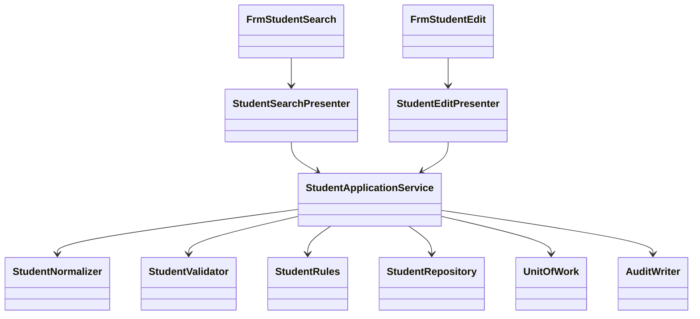

<!-- spec-meta: {"schema":"spec-md/1.0","documentId":"VB.NET_WINFORMS-COM-VB.NET_WinForms","version":"8.3","path":"test-project1/srcs/VB.NET_WinForms/spec/共通/方式別/01_共通実装仕様.md","sheets":[{"heading":"構造・命名・型","kind":"GRID","sheet":"01_構造・命名・型"},{"heading":"SQL・保存単位","kind":"GRID","sheet":"02_SQL・保存単位"},{"heading":"共通モジュールの実装","kind":"GRID","sheet":"03_共通モジュールの実装"},{"heading":"共通規約・日付実装","kind":"GRID","sheet":"04_共通規約・日付実装"},{"heading":"画面最適化の方式適合","kind":"GRID","sheet":"05_画面最適化の方式適合"}],"isolationProfile":"VB.NET_WinForms"} -->
# VB.NET／WinForms 共通実装仕様

| 項目 | 内容 |
| --- | --- |
| 版数・改訂日 | 8.3／2026-10-25 |
| 対象方式 | VB.NET／WinForms |
| 適用 | 設計上の実装契約。製品コードの実装・コンパイルは未実施 |

開発入力：[学生検索詳細](../../詳細仕様書/01_学生検索画面.md)／[学生登録詳細](../../詳細仕様書/02_学生登録画面.md)／[共通実装](01_共通実装仕様.md)／[DB定義](../../DB定義/SQLServer/01_DB定義書.md)／[方式別開発規約](../../規約/VB.NET_WinForms.md)／[共通開発規約](../../規約/開発規約.md)。

## 構造・命名・型

```text
StudentManagement.WinForms/Forms/FrmStudentSearch.vb, FrmStudentEdit.vb
StudentManagement.WinForms/Controls/NullableDateControl.vb, CodeComboControl.vb
StudentManagement.WinForms/Presenters/StudentSearchPresenter.vb, StudentEditPresenter.vb
StudentManagement.Application/StudentApplicationService.vb, MasterMaintenanceService.vb
StudentManagement.Application/StudentNormalizer.vb, StudentValidator.vb, StudentRules.vb
StudentManagement.Domain/Student.vb, StudentDraft.vb, SchoolClass.vb, CodeEntry.vb
StudentManagement.Infrastructure/StudentRepository.vb, MasterRepository.vb, UnitOfWork.vb
StudentManagement.Infrastructure/ConfirmationStore.vb, AuditWriter.vb, CurrentUserAdapter.vb
StudentManagement.Maintenance/Program.vb
```

`Option Strict On / Option Explicit On / Option Infer On`。型・プロパティPascalCase、ローカルcamelCase、privateフィールド先頭_。FormはPresenterへ操作を委譲、PresenterはFormインターフェイスを使い、業務サービスはWindows.Formsに依存しない。



| 意味 | VB.NET型 | NULL・注意 |
| --- | --- | --- |
| ID・版 | Long／Nullable(Of Long) | Integerへ狭めない。上限前に採番・版加算停止 |
| 人数・一覧内スクロール位置 | Integer | 非負。定員はInteger?、スクロール位置は0始まり |
| 日付 | DateOnly／DateOnly? | UIのDateTimeから年月日だけ取得 |
| 時点 | DateTimeOffset | UTC保持、表示時日本時間 |
| 任意文字 | String、Nothing | String.EmptyとDB NULLを正規化で統一 |
| 真偽 | Boolean | DBNullをFalseに黙って変換しない |
| DBパラメーターNULL | DBNull.Value | AddWithValueで型を推測せずSqlDbTypeを指定 |

## SQL・保存単位

共通の保存・検索手順は[SQL Server DB定義](../../DB定義/SQLServer/01_DB定義書.md)の補足説明を適用する。ここで定義するRepository/UnitOfWorkはその入出力・確定境界を実装する。名前だけを別DBへ置換したSQLは使用しない。

## 共通モジュールの実装

共通01～03＝CurrentUserAdapter/AuthorizationService/BusinessClock、04～05＝StudentNormalizer/StudentValidator、06～10＝MasterRepository/StudentRules/ClassCapacityService/DuplicateService、11＝ConfirmationStore、12＝SearchContext、13＝UnitOfWork、14＝AuditWriter、15＝MessageCatalog/DisplayFormatter。

```vb
Public Interface IStudentApplicationService
    Function SearchAsync(criteria As StudentSearchCriteria, sortKey As StudentSortKey,
                         sortDirection As SortDirection, ct As CancellationToken) As Task(Of SearchResult)
    Function SaveAsync(command As StudentSaveCommand,
                       ct As CancellationToken) As Task(Of SaveResult)
    Function DeleteAsync(command As StudentDeleteCommand,
                         ct As CancellationToken) As Task(Of SaveResult)
End Interface
```

StudentSaveCommandはStudentId As Long?、ExpectedVersion As Long?、Draft As StudentDraft、SelectionHints、Confirmation、OperationReason。StudentDraftの全プロパティは物理列対応表の編集可能業務21列（入力19＋生成キー2）。Entityの管理列をUIに双方向バインドしない。

照合キーはString.Normalize(FormKC)、ToUpperInvariant、Runeベースの空白・文字数処理、カナ対応変換。Nothing/空文字を正規化しDBNullへ変換。文字長はString.Lengthだけで判定しない。Microsoft.Data.SqlClient例外はSqlException.Number 2601/2627とDB入口の固定エラーコードで番号重複、547で参照不整合、1205/1222/3960で競合・再確認へ変換。SQL本文を表示しない。

## 共通規約・日付実装

対象読者は実務経験５年程度のプログラマー。[検索詳細](../../詳細仕様書/01_学生検索画面.md)／[登録詳細](../../詳細仕様書/02_学生登録画面.md)／[開発規約](../../規約/開発規約.md)／[日付正本](../07_日付・和暦仕様.md)。

共通16の入力は元号識別値・年・月・日という原文字列4値と業務日。出力は正規化日付と和暦表示文字列、または項目エラー。共通17は項目種別と日付／年度にDATE-R01～06を適用する。変換で不正日を補正しない。OS全体の暦設定を変更しない。元号表の版を画面・保存側で一致させる。

| 役割 | 実装仕様 |
| --- | --- |
| 共通16物理名 | JapaneseBirthDateControl / JapaneseDateService |
| 内部日付型 | DateOnly / DateOnly? |
| 入力と保存 | 和暦原入力4値から日付を生成。StudentDraft等のbirth_date相当は正規化日付。元号をDBへ重複保存しない |
| 呼出境界 | 本方式はネイティブ画面。和暦原入力4値を業務処理へ渡し厳密変換する。取得時は内部日付を和暦表示に変換。Web JSON契約は本方式に適用しない |
| 表示 | 一覧・参照・重複確認のBirthDateWareki相当文字列は共通16で生成。その他の日付・日時は西暦 |
| 例外 | CHK-032～034、E-DATE-001～003。構文検査後、実在日、元号境界、逆変換、業務範囲、前後関係を順に検査 |
| 参考試験 | DATE-T01～20。ライブラリーの解析成功だけで元号境界を合格にしない |

### 保守入口・方式固有の適合条件

#### マスタ保守・例外・試験

`StudentMaintenance.exe`の管理者用VBコンソールから`MasterMaintenanceService`を呼ぶ。入力は承認済みJSONファイルを読み、型付き値に変換する。5分類70値を初期投入、同値再実行は変更なし、差分は黙って上書きしない。クラス年度＋コード一意、同年度・同学年同名は警告、参照学生がいる学年変更・人数未満の定員縮小・在学休学のいる利用停止は拒否。学生保存と同じ同時保存制御・監査を使う。

`ErrorProvider`と全体メッセージに同じエラーを対応付ける。UIイベント以外のAsync Subは禁止し、非同期例外をAwait元で処理。破棄済Formへ結果を反映しない。保存結果不明では再保存前に検索確認を案内。

共通T-01～28に加え、フォーム2枚で条件が混ざらない、DateTimePicker未チェック、IME入力確定前の変換抑止、DPI150/200%、長文、読み取り専用行、フォーム終了中の非同期完了、2プロセス最終席競合を試験する。

### SQL Server接続・型・共通呼出契約

検索Repositoryは型付き4条件、許可SortKey/SortDirection、Cancellation/要求IDを受け、上限超過/全件数/全一致一覧/検索日時を返す。SqlServerUnitOfWorkは検索をSNAPSHOT、保存をREAD COMMITTED＋Transaction所有のsp_getapplockで制御する。全DBコマンドは同じConnection/Transactionを受け、個別Commitを禁止する。保存戻り値はSuccess/ValidationError/ConfirmationRequired/Conflict/NotFound/Unknownに分ける。OUTPUT値はCOMMIT確認前にSuccessへしない。

.NETはMicrosoft.Data.SqlClientを参照。SqlDbType.BigInt/Int/SmallInt/Bit/Date/DateTimeOffset/VarChar/NVarChar/UniqueIdentifier/VarBinaryをDB定義と対応させる。長さを推測するAddWithValueを標準にせず型とSizeを明示する。日付パラメーターはDateOnly対応を採用ドライバーで試験し、未対応アダプターではDateTimeの年月日をSqlDbType.Dateへ渡し時差変換しない。GUIDと画面token文字列の表現を混同しない。

WHERE/LIKE/全一致一括取得/例外・ゲート戻り値はSQL Server DB定義を正本とし、LIKEは!/%/_/[のリテラル化を含む。接続暗号化、証明書検証、認証主体を最小権限で分離。UIの権限表示だけを更新認可として使わない。

### 派生分類と監査の共通実装

新規／通常更新は[共通データアクセス](../08_データアクセス仕様.md)の緊急４保存項目一式を適用する。続柄分類を常にRELATIONSHIPへ設定する処理は禁止し、続柄値未設定時は分類もNULLへバインドする。コード値を更新する際は分類も同時更新し、変更列監査へ含める。必須３分類は固定のまま。

マスタ監査は[共通モジュール](../03_共通モジュール設計.md)の状態遷移表に従い、停止中の名称変更はUPDATE、状態が実際に停止へ変わる時だけDISABLEとする。認証不成立はE-COM-001、認証済み利用者の認可拒否はE-COM-002を使用し、実装の誤った番号を仕様値として採用しない。

## 画面最適化の方式適合

FrmStudentSearch/StudentSearchPresenterのStudentSearchCriteriaはStudentNoPrefix As String、NameKey As String、ClassId As Long?、StatusCodes As IReadOnlyList(Of String)の4値。FrmStudentEditは従来GroupBoxによる上段基本・中央住所連絡／在籍・下段緊急と長文の配置とし、ErrorProviderを維持。フォーム終了後の非同期応答は破棄する。

小規模の学生管理という利用者指定を設計前提とし、件数・頻度の実測値とは扱わない。対象発見には学籍番号の前方一致（SRC-001）、氏名照合キーの部分一致（SRC-002）、クラスIDの完全一致（SRC-006）、在籍区分の複数OR（SRC-008）を使用する。4条件間はAND、未指定の条件は追加しない。初期在籍は在学・休学、全解除で全区分。論理削除済みは常に除外する。

SRC-003/004/005/007/009/010/011/012は廃止しIDを再利用しない。氏名カナ、年度・学年、未所属専用、都道府県、電話、入学期間による詳細絞込みは設けない。年度・学年はクラス候補と結果の識別情報へ集約する。候補は全年度・停止・期間外を含み、年度／学年／クラスコード／名称で区別する。候補なしは「すべて」を残し、停止値を理由に検索を拒否しない。

一覧は学籍番号、氏名＋カナ、生年月日（和暦）、年度＋学年、クラス、在籍区分、操作の7列・8論理項目（SRC-020/021/022/023/024/025/026/030）。SRC-027/028/029は一覧DTOから廃止し、住所・本人電話・更新情報は既存の学生編集／参照画面で確認する。検索の更新日時ソートは維持するが、更新日時を一覧DTOへ返す理由にしない。一覧は1万件以下の全一致を一括取得してDataGridView内でスクロールする。表示件数選択とページ移動は設けない。許可4ソートと方向、非削除・認可・所有者・期限・Revision契約は維持する。

検索形式版は `student-search-scroll-2` とする。フォーム別SearchContextはDraftのraw4条件とAppliedCriteriaの検証済み4条件、SortKey・SortDirection、SelectedStudentId、FirstDisplayedScrollingRowIndex、状態ID・Revision・所有者・認証セッション・フォームインスタンス・30分期限を保持する。Revisionと形式版は別に検査する。旧compact-1・形式版欠落・未知版は検索状態全体を未検索・初期4条件・学籍番号昇順・選択なし・スクロール先頭へ再初期化し、旧形式のため初期化した旨を通知する。現行形式の要求に廃止／未知の条件名、page・pageSize・offset等の旧表示指定キーがあれば、空・NULLでもCHK-024／E-COM-003で拒否し、黙って無視しない。型付きSearchAsyncへこれらを引数として渡さない。状態ID・期待Revision・所有者・インスタンス・期限の照合を維持し、旧Revisionで状態・一覧を上書きしない。ネイティブの型付き呼出しと状態ストアの境界へ適用し、新しいHTTPエンドポイントは追加しない。

通常編集は従来のWinFormsフォームとして、上段を「基本情報」、中央左を「住所・本人連絡先」、中央右を「在籍・所属」、下段を「緊急連絡先・備考・理由」のGroupBoxへ配置する。幅の長い住所・メール・備考を左側へまとめ、短い日付・年度・区分を右側へまとめる。各グループ内はラベル左端、入力左端、同じ種類の入力高さ、32pxの行送りを揃える。短い番号・日付・氏名・電話をグループ全幅まで引き延ばさない。REG-001～034と和暦4入力、raw／保存上限、条件付き必須、保存19入力／更新18入力＋生成照合値2は維持する。

設計基準はClientSize=1180×610、96DPI、Segoe UI 9pt（日本語フォールバックはYu Gothic UI）、SystemColors.Control背景・WindowText文字の標準部品である。静的HTMLでは標準外枠・タイトル26pxを加えた1182×638pxの設計見本とし、1366×650および1280×650 CSS px・100%で確認する。TextBoxは単行23～24px、ComboBoxは24px、Buttonは27pxを基準とする。9ptの可読文字に必要な内側高さを確保した従来デスクトップ設計であり、34px固定のWeb風入力欄やカードの等分割、色帯・角丸・影は採用しない。

通常のフォーム本体は1画面に収め、確認は所有者付きShowDialogの別Formへ排他表示する。既定・Escapeの取消で元操作へ戻し、通常フォームに確認例を縦積みしない。HTMLのdata-state=duplicate/delete/discardは別確認Formの静的状態を表す。エラー一覧は高さに応じて内容を押し下げ、AutoScrollで全項目と操作へ到達可能にする。待機中のDBロック保持、権限、保存制約は変更しない。

表示幅は保存制限ではない。単行TextBoxはAutoScroll相当のカーソル移動・Home/End・選択で全文へ到達し、備考と理由はMultiline=True、ScrollBars=Vertical、AcceptsReturn=Trueとする。MaxLengthはrawのUTF-16領域を確保し、業務長はUnicodeスカラー値で別検査する。長文の省略表示だけで元値を切り捨てない。画面サイズ低下・DPI拡大時は最小部品幅を維持してフォームのAutoScrollを使い、HTMLのブレークポイントでカードを組み替える設計にはしない。実装・ネイティブ実機・DPI試験は未実施。

### 座標・幅とDPI適合

座標は各Formのクライアント左上を(0,0)とした96DPIのpxで、(左,上,幅,高さ)を記す。標準余白は外周8px・GroupBox内12px、入力行は32px送り、同一行のラベルと入力の基線を揃える。フォーム外枠・タイトルはOSが描画し、HTMLのタイトルは位置確認用である。

| 対象 | 基準矩形・幅 | 算定・整列理由 |
| --- | --- | --- |
| 両Form | ClientSize 1180×610、AutoScaleDimensions=96×96、AutoScaleMode=Dpi | フォント9pt、単行TextBox23～24・ComboBox24・Button27px。上限はスカラー値で検査し、幅は別に決定 |
| 編集基本GroupBox | (8,34,1164,104) | 行y=54/92。学籍番号入力x=104、氏名x=320、カナx=540、生年月日x=104、性別x=540 |
| 学籍番号／氏名／カナ | 幅144／128／260px | 15半角×約7px＋内側余地、8全角×約12px＋余地、18全角×約12px＋余地。氏名と緊急氏名は同幅。rawカナ36文字は横スクロールで全文へ到達 |
| 生年月日 | 元号68、年40、月32、日32px | 元号の名称と選択矢印、年raw4桁、月日raw各2桁に合わせた小欄。4値を別領域保持 |
| 住所・本人連絡GroupBox | (8,146,756,194) | 入力左端x=104、住所1・住所2・メール右端x=744。行y=166/198/230/262/294 |
| 郵便／都道府県／電話 | 幅104／128／176px | 郵便raw10・保存7、都道府県名称と矢印、電話raw20・保存16を個別に想定。同種の緊急電話も176px |
| 住所1・住所2／メール | 各640px | 45全角×約12px＝540px／60半角×約7px＝420pxと内側余地を確保し、左端・右端を揃える |
| 在籍・所属GroupBox | (772,146,400,194) | 主要ラベルx=784・入力x=888。日付116、年度96、学年116、在籍96、クラス264px。クラスは名称表示とDropDownWidthを別設定 |
| 緊急・備考・理由GroupBox | (8,348,1164,164) | 緊急3項目はy=368、備考と理由はy=400で上端を揃える。備考640×64、理由264×64px、理由入力左端x=888を在籍入力に揃える |
| 更新情報／編集操作 | 更新(20,520,1132,20)、Button行y=548、高さ27 | 更新・取消・再読込・戻るの左順を固定し、削除Buttonは(1056,548,96,27)へ離す。右端x=1152は在籍／理由欄と揃える |
| 検索条件 | GroupBox(8,36,1164,100)、入力行y=56、区分行y=96 | 番号入力x=104、氏名x=320、クラスx=540。検索／クリア／新規／メニューのButton右端x=1152 |
| 検索結果・操作 | 件数等y=144、一覧(8,178,1164,390)、検索日時y=582 | DataGridViewの右端とGroupBox右端を揃える。行編集ButtonはDataGridViewButtonColumn |

FormはAutoScroll=True、AutoScrollMinSizeを通常内容1180×610相当に設定する。上段のGroupBoxはAnchor=Top/Left/Right、中央左と右はTableLayoutPanelのAbsolute列756px/8px/400pxで配置し、住所側だけ余剰幅へ伸長する。固定幅の短いTextBox/ComboBoxはAnchor=Top/Left、住所・メール・備考は左右Anchor、右側GroupBoxと削除ButtonはTop/Right、DataGridViewはTop/Bottom/Left/Rightとする。拡大時は一覧と長文欄だけへ余剰を配り、学籍番号・日付・電話は必要幅を保つ。縮小時は最小列幅を下回らず、フォームの縦横スクロールで各コントロールへ到達する。コントロールを別カードに折り返さない。

DPI変更時はWinFormsの自動スケールで矩形・フォント・行高・余白を同じ比率で拡大し、手動倍率の重複適用をしない。DPIごとのDropDownWidth・ErrorProvider余地・DataGridView行高を再計算し、切れや重なりを実機で確認すること。TabIndexは基本→住所連絡→在籍所属→緊急→備考→理由→主要操作、エラーはErrorProviderと全体一覧を同期する。個人情報をToolTip以外の通常ログへ追加しない。ここでのDPI挙動は設計指定であり、ネイティブ実機試験は未実施。

SearchResultはStatus（Success/ValidationError/LimitExceeded/Failed）・TotalCount As Integer?・Items As IReadOnlyList(Of StudentListItem)・SearchedAt As DateTimeOffset?を持つ。SuccessのItems.CountはTotalCountと一致し、0件は空リスト。LimitExceededではItemsを空、TotalCountは未設定、上限警告を返す。結果とSearchContextにページ番号・取得件数・取得開始位置を設けない。全一覧はフォーム存続中だけ保持し、状態ストアには選択IDと表示位置を保持する。
