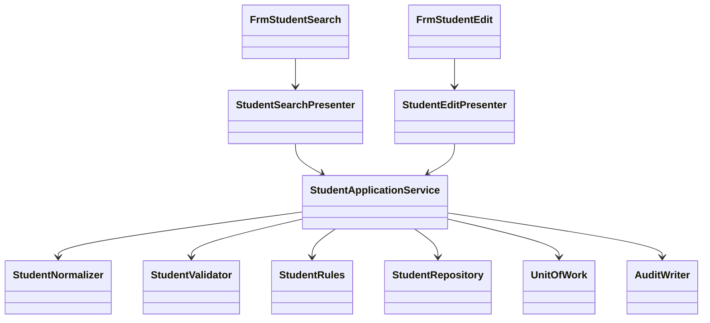

<!-- spec-meta: {"schema":"spec-md/1.0","documentId":"VB.NET_WINFORMS-COM-VB.NET_WinForms","version":"8.1","path":"test-project1/srcs/VB.NET_WinForms/spec/共通/方式別/VB.NET_WinForms/01_共通実装仕様.md","sheets":[{"heading":"構造・命名・型","kind":"GRID","sheet":"01_構造・命名・型"},{"heading":"SQL・保存単位","kind":"GRID","sheet":"02_SQL・保存単位"},{"heading":"共通モジュールの実装","kind":"GRID","sheet":"03_共通モジュールの実装"},{"heading":"共通規約・日付実装","kind":"GRID","sheet":"04_共通規約・日付実装"},{"heading":"画面最適化の方式適合","kind":"GRID","sheet":"05_画面最適化の方式適合"}],"isolationProfile":"VB.NET_WinForms"} -->
# VB.NET／WinForms 共通実装仕様

| 項目 | 内容 |
| --- | --- |
| 版数・改訂日 | 8.1／2026-10-23 |
| 対象方式 | VB.NET／WinForms |
| 適用 | 設計上の実装契約。製品コードの実装・コンパイルは未実施 |

開発入力：[学生検索詳細](../../../詳細仕様書/VB.NET_WinForms/01_学生検索画面.md)／[学生登録詳細](../../../詳細仕様書/VB.NET_WinForms/02_学生登録画面.md)／[共通実装](01_共通実装仕様.md)／[DB定義](../../../DB定義/SQLServer/01_DB定義書.md)／[方式別開発規約](../../../規約/VB.NET_WinForms.md)／[共通開発規約](../../../規約/開発規約.md)。

## 構造・命名・型

```text
StudentManagement.WinForms/Forms/FrmStudentSearch.vb, FrmStudentEdit.vb
StudentManagement.WinForms/Controls/NullableDateControl.vb, CodeComboControl.vb
StudentManagement.WinForms/Presenters/StudentSearchPresenter.vb, StudentEditPresenter.vb
StudentManagement.Application/StudentApplicationService.vb, MasterMaintenanceService.vb
StudentManagement.Application/StudentNormalizer.vb, StudentValidator.vb, StudentRules.vb
StudentManagement.Domain/Student.vb, StudentDraft.vb, SchoolClass.vb, CodeEntry.vb
StudentManagement.Infrastructure/StudentRepository.vb, MasterRepository.vb, UnitOfWork.vb
StudentManagement.Infrastructure/ConfirmationStore.vb, AuditWriter.vb, CurrentUserAdapter.vb
StudentManagement.Maintenance/Program.vb
```

`Option Strict On / Option Explicit On / Option Infer On`。型・プロパティPascalCase、ローカルcamelCase、privateフィールド先頭_。FormはPresenterへ操作を委譲、PresenterはFormインターフェイスを使い、業務サービスはWindows.Formsに依存しない。



| 意味 | VB.NET型 | NULL・注意 |
| --- | --- | --- |
| ID・版 | Long／Nullable(Of Long) | Integerへ狭めない。上限前に採番・版加算停止 |
| 人数・並び順・ページ | Integer | 非負。定員はInteger? |
| 日付 | DateOnly／DateOnly? | UIのDateTimeから年月日だけ取得 |
| 時点 | DateTimeOffset | UTC保持、表示時日本時間 |
| 任意文字 | String、Nothing | String.EmptyとDB NULLを正規化で統一 |
| 真偽 | Boolean | DBNullをFalseに黙って変換しない |
| DBパラメーターNULL | DBNull.Value | AddWithValueで型を推測せずSqlDbTypeを指定 |

## SQL・保存単位

共通の保存・検索手順は[SQL Server DB定義](../../../DB定義/SQLServer/01_DB定義書.md)の補足説明を適用する。ここで定義するRepository/UnitOfWorkはその入出力・確定境界を実装する。名前だけを別DBへ置換したSQLは使用しない。

## 共通モジュールの実装

共通01～03＝CurrentUserAdapter/AuthorizationService/BusinessClock、04～05＝StudentNormalizer/StudentValidator、06～10＝MasterRepository/StudentRules/ClassCapacityService/DuplicateService、11＝ConfirmationStore、12＝SearchContext、13＝UnitOfWork、14＝AuditWriter、15＝MessageCatalog/DisplayFormatter。

```vb
Public Interface IStudentApplicationService
    Function SearchAsync(criteria As StudentSearchCriteria, page As Integer,
                         pageSize As Integer, ct As CancellationToken) As Task(Of SearchResult)
    Function SaveAsync(command As StudentSaveCommand,
                       ct As CancellationToken) As Task(Of SaveResult)
    Function DeleteAsync(command As StudentDeleteCommand,
                         ct As CancellationToken) As Task(Of SaveResult)
End Interface
```

StudentSaveCommandはStudentId As Long?、ExpectedVersion As Long?、Draft As StudentDraft、SelectionHints、Confirmation、OperationReason。StudentDraftの全プロパティは物理列対応表の編集可能業務21列（入力19＋生成キー2）。Entityの管理列をUIに双方向バインドしない。

照合キーはString.Normalize(FormKC)、ToUpperInvariant、Runeベースの空白・文字数処理、カナ対応変換。Nothing/空文字を正規化しDBNullへ変換。文字長はString.Lengthだけで判定しない。Microsoft.Data.SqlClient例外はSqlException.Number 2601/2627とDB入口の固定エラーコードで番号重複、547で参照不整合、1205/1222/3960で競合・再確認へ変換。SQL本文を表示しない。

## 共通規約・日付実装

対象読者は実務経験５年程度のプログラマー。[検索詳細](../../../詳細仕様書/VB.NET_WinForms/01_学生検索画面.md)／[登録詳細](../../../詳細仕様書/VB.NET_WinForms/02_学生登録画面.md)／[開発規約](../../../規約/開発規約.md)／[日付正本](../../07_日付・和暦仕様.md)。

共通16の入力は元号識別値・年・月・日という原文字列4値と業務日。出力は正規化日付と和暦表示文字列、または項目エラー。共通17は項目種別と日付／年度にDATE-R01～06を適用する。変換で不正日を補正しない。OS全体の暦設定を変更しない。元号表の版を画面・保存側で一致させる。

| 役割 | 実装仕様 |
| --- | --- |
| 共通16物理名 | JapaneseBirthDateControl / JapaneseDateService |
| 内部日付型 | DateOnly / DateOnly? |
| 入力と保存 | 和暦原入力4値から日付を生成。StudentDraft等のbirth_date相当は正規化日付。元号をDBへ重複保存しない |
| 呼出境界 | 本方式はネイティブ画面。和暦原入力4値を業務処理へ渡し厳密変換する。取得時は内部日付を和暦表示に変換。Web JSON契約は本方式に適用しない |
| 表示 | 一覧・参照・重複確認のBirthDateWareki相当文字列は共通16で生成。その他の日付・日時は西暦 |
| 例外 | CHK-032～034、E-DATE-001～003。構文検査後、実在日、元号境界、逆変換、業務範囲、前後関係を順に検査 |
| 参考試験 | DATE-T01～20。ライブラリーの解析成功だけで元号境界を合格にしない |

### 保守入口・方式固有の適合条件

#### マスタ保守・例外・試験

`StudentMaintenance.exe`の管理者用VBコンソールから`MasterMaintenanceService`を呼ぶ。入力は承認済みJSONファイルを読み、型付き値に変換する。5分類70値を初期投入、同値再実行は変更なし、差分は黙って上書きしない。クラス年度＋コード一意、同年度・同学年同名は警告、参照学生がいる学年変更・人数未満の定員縮小・在学休学のいる利用停止は拒否。学生保存と同じ同時保存制御・監査を使う。

`ErrorProvider`と全体メッセージに同じエラーを対応付ける。UIイベント以外のAsync Subは禁止し、非同期例外をAwait元で処理。破棄済Formへ結果を反映しない。保存結果不明では再保存前に検索確認を案内。

共通T-01～28に加え、フォーム2枚で条件が混ざらない、DateTimePicker未チェック、IME入力確定前の変換抑止、DPI150/200%、長文、読み取り専用行、フォーム終了中の非同期完了、2プロセス最終席競合を試験する。

### SQL Server接続・型・共通呼出契約

検索Repositoryは型付き条件、page/pageSize、Cancellation/要求IDを受け、上限超過/件数/一覧/検索日時を返す。SqlServerUnitOfWorkは検索をSNAPSHOT、保存をREAD COMMITTED＋Transaction所有のsp_getapplockで制御する。全DBコマンドは同じConnection/Transactionを受け、個別Commitを禁止する。保存戻り値はSuccess/ValidationError/ConfirmationRequired/Conflict/NotFound/Unknownに分ける。OUTPUT値はCOMMIT確認前にSuccessへしない。

.NETはMicrosoft.Data.SqlClientを参照。SqlDbType.BigInt/Int/SmallInt/Bit/Date/DateTimeOffset/VarChar/NVarChar/UniqueIdentifier/VarBinaryをDB定義と対応させる。長さを推測するAddWithValueを標準にせず型とSizeを明示する。日付パラメーターはDateOnly対応を採用ドライバーで試験し、未対応アダプターではDateTimeの年月日をSqlDbType.Dateへ渡し時差変換しない。GUIDと画面token文字列の表現を混同しない。

WHERE/LIKE/ページ/例外・ゲート戻り値はSQL Server DB定義を正本とし、LIKEは!/%/_/[のリテラル化を含む。接続暗号化、証明書検証、認証主体を最小権限で分離。UIの権限表示だけを更新認可として使わない。

### 派生分類と監査の共通実装

新規／通常更新は[共通データアクセス](../../08_データアクセス仕様.md)の緊急４保存項目一式を適用する。続柄分類を常にRELATIONSHIPへ設定する処理は禁止し、続柄値未設定時は分類もNULLへバインドする。コード値を更新する際は分類も同時更新し、変更列監査へ含める。必須３分類は固定のまま。

マスタ監査は[共通モジュール](../../03_共通モジュール設計.md)の状態遷移表に従い、停止中の名称変更はUPDATE、状態が実際に停止へ変わる時だけDISABLEとする。認証不成立はE-COM-001、認証済み利用者の認可拒否はE-COM-002を使用し、実装の誤った番号を仕様値として採用しない。

## 画面最適化の方式適合

FrmStudentSearch/StudentSearchPresenterのStudentSearchCriteriaはStudentNoPrefix As String、NameKey As String、ClassId As Long?、StatusCodes As IReadOnlyList(Of String)の4値。FrmStudentEditはTableLayoutPanelで基本を上段、下段3列へ配置し、ErrorProviderを維持。フォーム終了後の非同期応答は破棄する。

小規模の学生管理という利用者指定を設計前提とし、件数・頻度の実測値とは扱わない。対象発見には学籍番号の前方一致（SRC-001）、氏名照合キーの部分一致（SRC-002）、クラスIDの完全一致（SRC-006）、在籍区分の複数OR（SRC-008）を使用する。4条件間はAND、未指定の条件は追加しない。初期在籍は在学・休学、全解除で全区分。論理削除済みは常に除外する。

SRC-003/004/005/007/009/010/011/012は廃止しIDを再利用しない。氏名カナ、年度・学年、未所属専用、都道府県、電話、入学期間による詳細絞込みは設けない。年度・学年はクラス候補と結果の識別情報へ集約する。候補は全年度・停止・期間外を含み、年度／学年／クラスコード／名称で区別する。候補なしは「すべて」を残し、停止値を理由に検索を拒否しない。

一覧は学籍番号、氏名＋カナ、生年月日（和暦）、年度＋学年、クラス、在籍区分、操作の7列・8論理項目（SRC-020/021/022/023/024/025/026/030）。SRC-027/028/029は一覧DTOから廃止し、住所・本人電話・更新情報は既存の学生編集／参照画面で確認する。検索の更新日時ソートは維持するが、更新日時を一覧DTOへ返す理由にしない。20/50/100件・既定20、許可4ソートと方向、1万件上限、非削除・認可・所有者・期限・Revision契約は維持する。

検索形式版は `student-search-compact-1` とする。既存のフォーム／Window別SearchContextの読出し時に形式版を照合する。旧版・形式版欠落は8条件だけ捨てて自動復元せず、検索状態全体を未検索・初期4条件・20件・学籍番号昇順へ再初期化し、旧形式のため初期化した旨を通知する。現行形式へ廃止／未知条件が渡された場合はCHK-024／E-COM-003で拒否し、黙って無視しない。形式版はRevisionと別に検査し、状態ID・期待Revision・所有者・画面インスタンス・30分期限の照合を省略しない。新しいHTTPエンドポイントは追加せず、ネイティブの型付き呼出しと状態ストアの境界へ適用する。

通常編集は基本情報6項目を上段の3列×2行へ置き、下段を「住所・本人連絡先」「在籍・所属」「緊急連絡先・備考・理由」の3列にする。更新情報と操作バーは通常フローの末尾に置き、入力・エラー・説明へ重ねない。REG-001～034と全保存項目、和暦4入力、原入力／保存文字数、条件付き必須、保存19入力／更新18入力＋生成照合値2は維持する。

通常表示の設計確認サイズは1366×650および1280×650 CSS px・100%。入力高さ34px、文字12px以上を基本とする。長い1行入力は標準部品内でカーソル移動して全文を編集でき、備考・理由は複数行で全文へ到達できる。狭幅、200%相当、項目エラー展開時は縦スクロールを許可する。通常編集に確認例を縦積みせず、重複・削除・未保存破棄は排他的な別ダイアログとする。単独HTMLのdata-stateをduplicate/delete/discardに切替えた別図で確認する。取消を既定とし、確認待ちにDBロックを保持しない。
